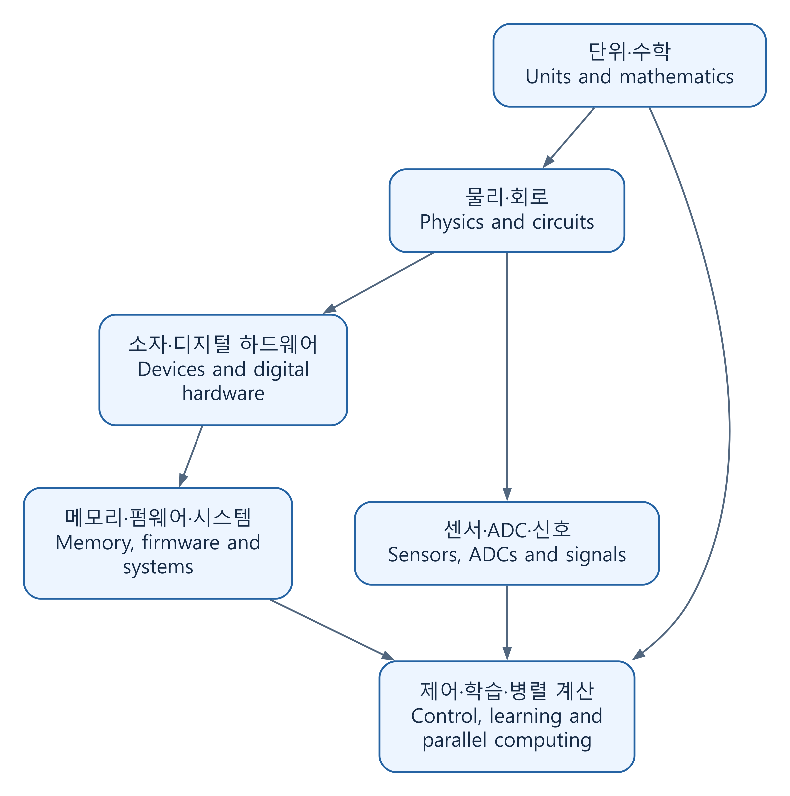

# 기초에서 구현과 검증까지

[전체 분야](../CATALOG.md) · [용어의 뜻과 뉘앙스](TERMS_AND_INTUITION.md) · [실행 예제](../examples/foundations/README.md) · [출처·검토 범위](FOUNDATIONS_REVIEW.md) · [English](#english)

공학의 개념을 정의에서 끝내지 않고 수식, 프로그램, 확인할 수 있는 결과로 연결했다. 먼저 익숙한 현상으로 감을 잡고, 변수의 뜻과 단위, 가정을 정한 뒤 식을 유도한다. 각 글에는 실행할 모델과 별도로 비교할 기준이 있다. 설명은 한국어 먼저, 같은 내용의 영어를 뒤에 두었으며 코드 주석은 한국어로 적었다.

## 어떻게 이어지는가

[SVG](../assets/diagrams/foundations.svg) · [도식 원본 / Diagram source](../assets/diagrams/foundations.mmd)

직접 구성한 연결도다. 위아래는 기술의 우열이 아니라 모델 사이의 관계를 뜻한다. 소프트웨어에서 출발해 하드웨어로 내려가도 되고, 측정하려는 현상에서 필요한 수학으로 돌아가도 된다.

## 1. 수학과 물리

| 글 | 풀어 가는 질문 |
| --- | --- |
| [단위·차원·불확도](../topics/06-math-to-code/notes/units-dimensional-analysis-uncertainty.md) | 숫자의 단위가 맞는가? 측정값을 계산에 넣으면 불확도는 어떻게 전파되는가? |
| [선형대수·최소제곱](../topics/06-math-to-code/notes/linear-algebra-least-squares.md) | 여러 측정점에서 규칙을 어떻게 찾고 QR로 계산하는가? |
| [확률·추정](../topics/06-math-to-code/notes/probability-estimation.md) | 표본 평균과 분산은 무엇을 말하며 신뢰구간의 조건은 무엇인가? |
| [미분방정식·수치해법](../topics/06-math-to-code/notes/differential-equations-numerics.md) | 변화율을 반복 계산으로 바꿀 때 정확도와 안정성을 어떻게 확인하는가? |
| [역학·에너지·진동](../topics/56-physics-foundations/notes/mechanics-energy-oscillation.md) | 힘의 법칙에서 진동 모델과 에너지 검사를 어떻게 얻는가? |
| [열전도·확산](../topics/56-physics-foundations/notes/heat-diffusion.md) | 에너지 수지에서 열방정식을 만들고 격자 계산을 어떻게 검증하는가? |

## 2. 회로·반도체·하드웨어

| 글 | 풀어 가는 질문 |
| --- | --- |
| [RC/RLC 회로](../topics/09-circuits-electronics/notes/rc-rlc-response.md) | 전하·에너지 보존에서 시정수, 감쇠, 주파수 응답을 어떻게 얻는가? |
| [MOS 전하와 스위칭](../topics/10-semiconductors/notes/mos-electrostatics-switching.md) | gate가 전류를 바꾸는 이유는 무엇이며 square-law 모델은 어디까지 맞는가? |
| [FSM·동기식 FIFO](../topics/13-verilog-systemverilog/notes/synchronous-fifo-invariants.md) | 같은 에지의 읽기·쓰기·리셋과 데이터 순서를 어떻게 명세하는가? |
| [지역성·cache·AMAT](../topics/33-memory-storage/notes/locality-cache-amat.md) | 빠른 메모리를 작게 두는 이유와 평균 접근 시간의 조건은 무엇인가? |
| [전송선·반사](../topics/29-electromagnetics-rf/notes/transmission-lines-reflections.md) | 배선을 하나의 점으로 보지 못하는 때와 반사가 생기는 이유는 무엇인가? |
| [계측·probe 부하·불확도](../topics/37-sensors-instrumentation/notes/measurement-loading-uncertainty.md) | 측정기가 회로를 바꾸는 효과와 측정값의 신뢰 범위를 어떻게 다루는가? |

## 3. 수 표현에서 펌웨어·시스템까지

| 글 | 풀어 가는 질문 |
| --- | --- |
| [정수·부동소수점·고정소수점](../topics/04-c-cpp-python/notes/numbers-and-quantization.md) | 같은 비트가 왜 다른 수가 되며 overflow·반올림·포화는 어떻게 정하는가? |
| [컴파일·링크·reset에서 main까지](../topics/39-compilers-languages/notes/reset-to-main-and-toolchain.md) | 소스가 실행 코드가 되고 초기 RAM 상태가 준비되는 과정은 무엇인가? |
| [MMIO·인터럽트·DMA](../topics/17-firmware-rtos/notes/mmio-interrupt-dma.md) | 레지스터·cache·RAM·장치 사이의 순서와 버퍼 소유권은 어떻게 관리하는가? |
| [UART framing·CRC](../topics/20-interfaces-communications/notes/framing-uart-crc.md) | byte 흐름에서 경계를 찾고 오류를 검출하는 규약은 무엇인가? |
| [프로세스·가상 메모리·동시성](../topics/07-cs-foundations/notes/processes-memory-concurrency.md) | 주소 공간과 접근 권한은 무엇이며 공유값의 갱신은 왜 사라지는가? |
| [보안과 신뢰성의 경계](../topics/38-security-cryptography/notes/security-and-reliability-boundaries.md) | CRC·ECC·MAC은 각각 무엇을 확인하고 무엇을 보장하지 않는가? |

## 4. 신호·제어·AI·성능

| 글 | 풀어 가는 질문 |
| --- | --- |
| [샘플링·aliasing](../topics/21-signals-control/notes/sampling-aliasing.md) | 서로 다른 연속 신호가 같은 표본이 되는 이유는 무엇인가? |
| [ADC 양자화](../topics/32-mixed-signal-data-converters/notes/adc-quantization.md) | 분해능과 정확도는 어떻게 다르며 양자화 SNR 식은 어디서 나오는가? |
| [피드백·이산 모델](../topics/21-signals-control/notes/feedback-discrete-model.md) | 표본화와 입력 유지 아래에서 제어 이득과 안정성을 어떻게 연결하는가? |
| [미분·역전파·학습](../topics/23-ai-machine-learning/notes/gradients-and-learning.md) | 손실의 미분을 유도하고 중심 차분으로 확인한 뒤 어떻게 갱신하는가? |
| [Attention 수식과 구현](../topics/44-language-speech-multimodal/notes/attention-from-equations.md) | Q/K/V·softmax·마스크가 어떤 계산을 만들며 무엇을 검사할 수 있는가? |
| [Roofline·병렬화 한계](../topics/25-cuda-performance/notes/roofline-and-parallel-limits.md) | 연산과 데이터 이동의 상한을 구분하고 병렬화 효과를 어떻게 추정하는가? |

## 여러 글을 연결해서 읽기

센서 교정은 단위·불확도 → 최소제곱 → 계측 → ADC로 이어진다. 하드웨어 연산은 수 표현 → MOS → FIFO → 메모리로, 센서 데이터 처리는 샘플링 → DMA → framing → 제어로 연결된다. AI의 경우 최소제곱·미분 → 학습 → attention을 보고, 실행 비용은 cache·Roofline으로 돌아가 살펴볼 수 있다.

각 글은 식이 성립하는 조건과 확인한 범위를 함께 적는다. 계산이 해석해와 맞는다는 사실과 그 모델이 실제 장치를 충분히 설명한다는 사실은 다르다. 출처는 글 안의 해당 설명과 끝의 참고 자료에서 찾을 수 있고, 전체 계산은 [76개 자동 검사](../examples/foundations/README.md)로 다시 실행할 수 있다.

## English

These 24 articles connect definitions to equations, executable models and checkable results. Each begins with an accessible physical or computational intuition, defines symbols and assumptions, derives the model, and checks it against an independent reference. Korean explanations come first, followed by equivalent English; code comments are in Korean. The [terminology guide](TERMS_AND_INTUITION.md#english) explains names whose everyday associations can obscure their technical meaning. The original diagram above shows relationships between models, not a ranking of technologies. Readers may move from software down to hardware or from a physical question back to its mathematical tools.

### 1. Mathematics and physics

| Article | Central question |
| --- | --- |
| [Units, dimensions and uncertainty](../topics/06-math-to-code/notes/units-dimensional-analysis-uncertainty.md#english) | Are units consistent, and how does measurement uncertainty propagate? |
| [Linear algebra and least squares](../topics/06-math-to-code/notes/linear-algebra-least-squares.md#english) | How can a rule be fitted to measurements and calculated through QR? |
| [Probability and estimation](../topics/06-math-to-code/notes/probability-estimation.md#english) | What do sample mean, variance and confidence intervals mean under their assumptions? |
| [Differential equations and numerics](../topics/06-math-to-code/notes/differential-equations-numerics.md#english) | How are rates turned into updates, and how are accuracy and stability checked? |
| [Mechanics, energy and oscillation](../topics/56-physics-foundations/notes/mechanics-energy-oscillation.md#english) | How do force laws produce oscillator models and energy checks? |
| [Heat conduction and diffusion](../topics/56-physics-foundations/notes/heat-diffusion.md#english) | How does energy balance produce a heat equation and a verifiable grid calculation? |

### 2. Circuits, semiconductors and hardware

| Article | Central question |
| --- | --- |
| [RC/RLC response](../topics/09-circuits-electronics/notes/rc-rlc-response.md#english) | How do charge and energy laws yield time constants, damping and frequency response? |
| [MOS electrostatics and switching](../topics/10-semiconductors/notes/mos-electrostatics-switching.md#english) | Why does the gate control current, and where does square-law modeling apply? |
| [FSM and synchronous FIFO](../topics/13-verilog-systemverilog/notes/synchronous-fifo-invariants.md#english) | How are simultaneous operations, reset and data order specified? |
| [Locality, cache and AMAT](../topics/33-memory-storage/notes/locality-cache-amat.md#english) | Why use small fast memories, and what assumptions support average access time? |
| [Transmission lines and reflections](../topics/29-electromagnetics-rf/notes/transmission-lines-reflections.md#english) | When does interconnect propagation matter, and why do reflections occur? |
| [Measurement, probes and uncertainty](../topics/37-sensors-instrumentation/notes/measurement-loading-uncertainty.md#english) | How does an instrument load the circuit, and how are measurement uncertainties handled? |

### 3. Representation, firmware and systems

| Article | Central question |
| --- | --- |
| [Integer, floating point and fixed point](../topics/04-c-cpp-python/notes/numbers-and-quantization.md#english) | How do formats interpret bits and specify overflow, rounding and saturation? |
| [Compilation, linking and reset to main](../topics/39-compilers-languages/notes/reset-to-main-and-toolchain.md#english) | How does source become executable code, and how is initial RAM prepared? |
| [MMIO, interrupts and DMA](../topics/17-firmware-rtos/notes/mmio-interrupt-dma.md#english) | How are ordering, caches and buffer ownership managed across CPU and device? |
| [UART framing and CRC](../topics/20-interfaces-communications/notes/framing-uart-crc.md#english) | How does a byte stream acquire boundaries and error detection? |
| [Processes, virtual memory and concurrency](../topics/07-cs-foundations/notes/processes-memory-concurrency.md#english) | What do address spaces and protection mean, and why can shared updates disappear? |
| [Security and reliability boundaries](../topics/38-security-cryptography/notes/security-and-reliability-boundaries.md#english) | What do CRC, ECC and MAC check, and where do their guarantees stop? |

### 4. Signals, control, AI and performance

| Article | Central question |
| --- | --- |
| [Sampling and aliasing](../topics/21-signals-control/notes/sampling-aliasing.md#english) | Why can different continuous signals produce identical samples? |
| [ADC quantization](../topics/32-mixed-signal-data-converters/notes/adc-quantization.md#english) | How does resolution differ from accuracy, and how is the ideal SNR derived? |
| [Feedback and discrete models](../topics/21-signals-control/notes/feedback-discrete-model.md#english) | How do sampled measurement and held input connect controller gain to stability? |
| [Gradients and learning](../topics/23-ai-machine-learning/notes/gradients-and-learning.md#english) | How are loss derivatives derived, checked with centered differences and used for updates? |
| [Attention from equations](../topics/44-language-speech-multimodal/notes/attention-from-equations.md#english) | What do Q/K/V, softmax and masking compute, and which properties can be checked? |
| [Roofline and parallel limits](../topics/25-cuda-performance/notes/roofline-and-parallel-limits.md#english) | How do compute/traffic bounds and serial fractions limit performance? |

### Connecting the articles

Sensor calibration connects units and uncertainty to least squares, measurement and ADCs. Hardware arithmetic connects representations, MOS devices, FIFOs and memory. Sensor processing connects sampling, DMA, framing and control. Learning builds on least squares and differentiation, then leads to attention; cache and Roofline explain execution cost.

Every article states its assumptions and checked scope. Agreement with an analytical solution verifies a computation; it does not by itself validate the model for a physical device. Relevant sources are linked beside the explanation and in each article's reference section. [The 76 automated checks](../examples/foundations/README.md#english) make the calculations reproducible.
