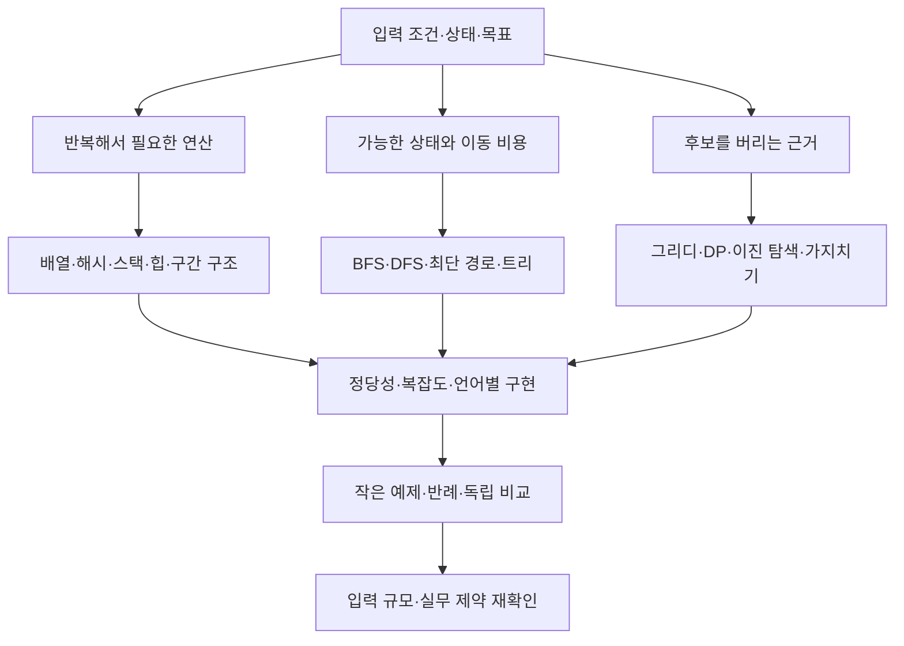

# 알고리즘 유형별 학습과 프로그래머스 풀이

[프로그래머스 전체](<../README.md>) · [유형별 연습문제](<연습문제_problem-index.md>) · [출처와 참고 자료](<출처_sources.md>)

같은 계산 구조가 다른 이야기와 입력 형태로 반복됩니다. 이 자료는 구현·자료구조·탐색·그리디·DP·그래프·문자열·수학·고급 최적화를 연결해, 조건에서 풀이를 고르고 정당성을 설명하는 방법을 다룹니다. 각 본문에서 원리와 중요성, 알아보는 단서, 풀이 절차, 직접 구성한 예제, 시간·공간 비용, 반례, 언어별 주의점, 실제 모형과 복습 질문을 읽을 수 있습니다.

## 시작하는 방법

처음에는 [문제 모델링과 복잡도](<01-문제모델링과복잡도_modeling-complexity.md>)로 상태와 비용을 정하고, [풀이 선택과 학습 경로](<42-문제해결순서와실무모델링_problem-solving-practice.md>)를 따라 필요한 유형으로 이동합니다. C·C++·Python은 [구현 비교](<40-C와CPP와Python구현비교_language-implementation.md>)로 자료형과 컨테이너의 차이를 확인합니다.

유형은 대표 보관 풀이의 핵심과 보조 기법을 함께 표시합니다. BFS와 DFS, 그리디와 DP, 최단 경로와 MST, 부분합과 구간 자료구조처럼 비슷해 보이는 도구의 적용 조건을 비교합니다. 세부 알고리즘의 이름만 외우기보다 왜 다른 후보를 버려도 되는지, 미래에 필요한 정보가 상태에 남아 있는지 확인합니다.

## 풀이를 연결하는 관점

하나의 문제는 여러 갈래의 도구를 함께 사용할 수 있습니다. 다음 그림은 서로 배타적인 분류표가 아니라, 모델에서 자료구조·탐색·정당성·검증으로 이어지는 읽기 순서입니다.

## 기초 표현과 자료구조

| 본문 | 다루는 내용 | 보관 풀이 연결 |
| --- | --- | --- |
| [1. 문제 모델링과 복잡도](<01-문제모델링과복잡도_modeling-complexity.md>) | 상태·전이·비용 모형과 정당성, 상각 분석 | 공통 학습 |
| [2. 구현과 시뮬레이션](<02-구현과시뮬레이션_implementation-simulation.md>) | 시간·명령·상태 변화, 동시 갱신과 이벤트 처리 | [문제 목록 (91)](<분류별문제_problems-by-type/simulation.md>) |
| [3. 배열과 연결 리스트](<03-배열과연결리스트_arrays-linked-lists.md>) | 인덱스·메모리 배치·삽입과 삭제·2차원 배열 | [문제 목록 (122)](<분류별문제_problems-by-type/arrays.md>) |
| [4. 문자열과 파싱](<04-문자열과파싱_strings-parsing.md>) | 토큰·문자 처리·상태 기계·표현과 값의 구별 | [문제 목록 (161)](<분류별문제_problems-by-type/strings.md>) |
| [5. 정렬과 비교 함수](<05-정렬과비교함수_sorting-comparators.md>) | 정렬 키·안정성·비교 관계와 정렬 후 구조 | [문제 목록 (67)](<분류별문제_problems-by-type/sorting.md>) |
| [6. 해시와 빈도 집계](<06-해시와빈도집계_hashing-counting.md>) | 집합·사전·중복·개수·충돌과 평균 비용 | [문제 목록 (63)](<분류별문제_problems-by-type/hashing.md>) |
| [7. 스택·큐·덱](<07-스택큐덱_stack-queue-deque.md>) | 처리 순서와 단조 스택·단조 덱 | [문제 목록 (23)](<분류별문제_problems-by-type/stack-queue.md>) |
| [8. 힙과 우선순위 큐](<08-힙과우선순위큐_heap-priority-queue.md>) | 동적 극값·일정·상위 K개·지연 삭제 | [문제 목록 (13)](<분류별문제_problems-by-type/heap.md>) |
| [9. 누적합과 차분](<09-누적합과차분_prefix-difference.md>) | 구간 합·2차원 합·구간 갱신과 경계 | [문제 목록 (13)](<분류별문제_problems-by-type/prefix-sum.md>) |
| [10. 투포인터와 슬라이딩 윈도](<10-투포인터와슬라이딩윈도_two-pointers-window.md>) | 후보를 버리는 단조성·가변 길이·음수 반례 | [문제 목록 (8)](<분류별문제_problems-by-type/two-pointers.md>) |

## 탐색과 풀이 설계

| 본문 | 다루는 내용 | 보관 풀이 연결 |
| --- | --- | --- |
| [11. 이진 탐색과 매개변수 탐색](<11-이진탐색과매개변수탐색_binary-parametric-search.md>) | 경계 불변식·판정 함수·정답 공간의 단조성 | [문제 목록 (11)](<분류별문제_problems-by-type/binary-search.md>) |
| [12. 완전 탐색과 중간에서 만나기](<12-완전탐색과중간에서만나기_exhaustive-meet-in-middle.md>) | 조합·순열·부분집합·양쪽 절반의 결과 결합 | [문제 목록 (42)](<분류별문제_problems-by-type/bruteforce.md>) |
| [13. 백트래킹과 가지치기](<13-백트래킹과가지치기_backtracking-pruning.md>) | 선택·탐색·복구와 안전한 후보 제거 | [문제 목록 (8)](<분류별문제_problems-by-type/backtracking.md>) |
| [14. 분할 정복과 재귀](<14-분할정복과재귀_divide-conquer-recursion.md>) | 부분 문제·결합·재귀식·종료 조건 | [문제 목록 (9)](<분류별문제_problems-by-type/divide-conquer.md>) |
| [15. 그리디와 교환 논증](<15-그리디와교환논증_greedy-exchange.md>) | 안전한 국소 선택·정렬 기준·교환 반례 | [문제 목록 (49)](<분류별문제_problems-by-type/greedy.md>) |
| [16. DP의 상태와 전이](<16-동적계획법의상태와전이_dynamic-programming.md>) | 메모이제이션·계산 순서·초기값·상태 압축 | [문제 목록 (49)](<분류별문제_problems-by-type/dp.md>) |
| [17. 배낭·수열·구간·확률 DP](<17-배낭수열구간확률DP_dp-variants.md>) | 배낭·LIS·LCS·구간·자릿수·기댓값 | [문제 목록 (8)](<분류별문제_problems-by-type/dp-variants.md>) |
| [18. 비트마스크와 비트 집합](<18-비트마스크와비트집합_bitmask-bitset.md>) | 부분집합 상태·집합 연산·비트 병렬 처리 | [문제 목록 (21)](<분류별문제_problems-by-type/bitmask.md>) |

## 그래프와 트리

| 본문 | 다루는 내용 | 보관 풀이 연결 |
| --- | --- | --- |
| [19. 그래프 모델링과 BFS](<19-그래프모델링과BFS_graph-bfs.md>) | 최단 행동 수·다중 시작점·확장 상태·경로 복원 | [문제 목록 (16)](<분류별문제_problems-by-type/bfs.md>) |
| [20. DFS와 연결 요소](<20-DFS와연결요소_graph-dfs.md>) | 진입·퇴장·사이클·이분 그래프·오일러 경로 | [문제 목록 (13)](<분류별문제_problems-by-type/dfs.md>) |
| [21. 최단 경로와 확장 상태](<21-최단경로와확장상태_shortest-path.md>) | 0-1 BFS·Dijkstra·Bellman–Ford·Floyd·Johnson | [문제 목록 (7)](<분류별문제_problems-by-type/shortest-path.md>) |
| [22. 최소 신장 트리와 DSU](<22-최소신장트리와서로소집합_mst-dsu.md>) | Kruskal·Prim·절단 성질·경로 압축 | [문제 목록 (6)](<분류별문제_problems-by-type/mst-dsu.md>) |
| [23. 위상 정렬과 DAG](<23-위상정렬과DAG_topological-dag.md>) | 선행 조건·사이클·DAG DP·임계 경로 | [문제 목록 (1)](<분류별문제_problems-by-type/topological.md>) |
| [24. SCC·단절점·단절선·2-SAT](<24-강한연결요소단절점2SAT_scc-lowlink-2sat.md>) | 서로 도달 가능성·lowlink·함의 그래프 | [문제 목록 (1)](<분류별문제_problems-by-type/scc.md>) |
| [25. 트리·LCA·트리 DP](<25-트리순회LCA트리DP_trees-lca-dp.md>) | Euler 평탄화·rerooting·지름·HLD·센트로이드 | [문제 목록 (19)](<분류별문제_problems-by-type/tree.md>) |

## 구간·문자열·수학과 심화

| 본문 | 다루는 내용 | 보관 풀이 연결 |
| --- | --- | --- |
| [26. 구간 질의와 지연 전파](<26-구간질의와지연전파_range-queries.md>) | Fenwick·세그먼트 트리·희소 테이블·균형 트리 | [문제 목록 (6)](<분류별문제_problems-by-type/range-query.md>) |
| [27. 오프라인 질의와 스위프](<27-오프라인질의와스위프_offline-sweep.md>) | 좌표 압축·Mo·rollback·영속 구조·CDQ | [문제 목록 (6)](<분류별문제_problems-by-type/offline-sweep.md>) |
| [28. 트라이와 문자열 매칭](<28-트라이와문자열매칭_trie-kmp-aho.md>) | 트라이·KMP·Z·Aho–Corasick의 서로 다른 목적 | 본문 예제 |
| [29. 접미사·해시·팰린드롬](<29-접미사해시팰린드롬_suffix-hash-palindrome.md>) | 접미사 배열·LCP·자동자·Manacher·충돌 | [문제 목록 (1)](<분류별문제_problems-by-type/advanced-string.md>) |
| [30. 정수론과 모듈러 연산](<30-정수론과모듈러연산_number-theory.md>) | 소수·체·GCD·역원·중국인의 나머지 정리 | [문제 목록 (24)](<분류별문제_problems-by-type/number-theory.md>) |
| [31. 조합론과 생성 함수](<31-조합론과생성함수_combinatorics-generating-functions.md>) | 순열·조합·포함 배제·합성곱·FFT·NTT | [문제 목록 (25)](<분류별문제_problems-by-type/combinatorics.md>) |
| [32. 행렬 거듭제곱과 선형 점화](<32-행렬거듭제곱과선형점화_matrix-recurrence.md>) | 선형 전이·빠른 거듭제곱·경로 수 | [문제 목록 (2)](<분류별문제_problems-by-type/matrix.md>) |
| [33. 계산기하와 좌표 변환](<33-계산기하와좌표변환_computational-geometry.md>) | 외적·교차·볼록 껍질·면적·거리 변환 | [문제 목록 (33)](<분류별문제_problems-by-type/geometry.md>) |
| [34. 이분 매칭과 네트워크 유량](<34-이분매칭과네트워크유량_matching-flow.md>) | 증대 경로·최소 컷·최소 비용·가중 할당 | [문제 목록 (3)](<분류별문제_problems-by-type/matching-flow.md>) |
| [35. 게임 이론과 승패 상태](<35-게임이론과승패상태_game-theory.md>) | 승패 DP·Nim·Grundy·minimax의 조건 | [문제 목록 (2)](<분류별문제_problems-by-type/game.md>) |
| [36. 무작위화와 근사 최적화](<36-무작위화와근사최적화_randomized-approximation.md>) | 확률 보장·기대 비용·근사 비율·휴리스틱 | [문제 목록 (2)](<분류별문제_problems-by-type/randomized.md>) |
| [37. DP 최적화와 볼록 껍질 트릭](<37-DP최적화와볼록껍질트릭_dp-optimization.md>) | 전이 단조성·Monge·분할 정복·Knuth·CHT | 본문 예제 |
| [38. 함수 그래프와 반복 점프](<38-함수그래프와반복점프_functional-graph-lifting.md>) | 사이클·진입점·이진 리프팅·누적 정보 | [문제 목록 (2)](<분류별문제_problems-by-type/functional-graph.md>) |
| [39. 불변량과 구성적 풀이](<39-수학적규칙과구성적풀이_invariants-constructive.md>) | 필요충분조건·홀짝·주기·잠재 함수 | [문제 목록 (17)](<분류별문제_problems-by-type/invariants.md>) |

## 구현·검증·실무와 추가 탐색

| 본문 | 다루는 내용 | 보관 풀이 연결 |
| --- | --- | --- |
| [40. C·C++·Python 구현 비교](<40-C와CPP와Python구현비교_language-implementation.md>) | 자료형·메모리·컨테이너·중간 계산·복사 | 공통 학습 |
| [41. 반례·검증·성능 측정](<41-반례와테스트와성능측정_testing-debugging.md>) | 독립 기준 풀이·경계·차등 검사·측정 범위 | 공통 학습 |
| [42. 학습 경로와 실무 모델링](<42-문제해결순서와실무모델링_problem-solving-practice.md>) | 유형 선택·복습·모델의 조건과 현업 제약 | 공통 학습 |
| [43. 휴리스틱 탐색과 상태 공간](<43-휴리스틱탐색과상태공간_heuristic-state-search.md>) | A*·허용성·일관성·IDA*·branch and bound·빔 탐색 | [문제 목록 (1)](<분류별문제_problems-by-type/heuristic-search.md>) |
| [44. 기초 수학과 진법](<44-기초수학과진법_basic-math.md>) | 사칙연산·몫과 나머지·올림·자리값·비율 | [문제 목록 (75)](<분류별문제_problems-by-type/basic-math.md>) |

## 보관 자료와 분류 범위

2026-10-26 저장소 기준으로 중복을 합친 581문제를 연결합니다. 언어별 보관은 C 통과 421문제, C++ 통과 581문제, Python 통과 565문제·비교용 10문제·실패 5회 후 중단 1문제입니다. 이 숫자는 보관 목록의 합집합과 상태이며 현재 사이트의 신규 문제까지 조사한 결과는 아닙니다.

새 학습 예제는 기존 사이트 채점 결과와 구별합니다. 기존 풀이 파일과 채점 기록은 그대로 두고 링크로 연결합니다. [분류 기준](<분류기준_classification.md>)과 [대조 기록](<확인기록_validation.md>)에서 문제·언어·근거의 범위를 확인할 수 있습니다.
