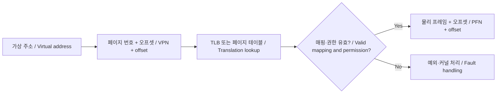

# 같은 주소, 다른 메모리: 프로세스·가상 메모리·동시성

[상위 주제](../README.md) · [주소 변환 모델](../../../examples/foundations/systems/systems_models.py) · [검증 코드](../../../examples/foundations/systems/test_systems_models.py)

## 한국어

### 주소는 사물함 번호와 비슷하다

두 학교에 모두 101번 사물함이 있어도 같은 사물함은 아니다. 프로세스가 사용하는 가상 주소도 어느 주소 공간에서 해석하느냐에 따라 다른 물리 메모리로 이어질 수 있다. 가상 메모리는 단순히 “RAM이 부족하면 SSD를 쓰는 기능”만을 뜻하지 않는다. 주소 변환, 접근 권한, 격리와 공유를 구성하는 수단이며, 저장장치로의 paging은 가능한 정책 중 하나다.

프로세스는 실행 중인 프로그램을 자원과 보호 경계로 관리하는 단위다. 같은 프로세스 안의 스레드는 보통 주소 공간을 공유하지만 각 실행 흐름의 레지스터 상태와 스택은 따로 관리한다. 커널은 시스템 호출을 통해 파일이나 장치 같은 보호된 자원에 대한 요청을 처리한다. 세부 구조는 OS에 따라 다르다. [MIT xv6 book, Chapters 1–3](https://pdos.csail.mit.edu/6.1810/2023/xv6/book-riscv-rev3.pdf)

### 페이지 단위로 주소를 나누기

페이지 크기를 $P=2^p$ byte라 하면 가상 주소 $v$는

$$v=\mathrm{VPN}\,P+o,\quad0\le o<P$$

로 나뉜다. 페이지 테이블이 VPN을 물리 프레임 번호 PFN에 대응시키면

$$a=\mathrm{PFN}\,P+o$$

가 물리 주소다. 예를 들어 $P=4096$, 가상 페이지 1이 물리 프레임 9에 대응하면 가상 주소 4097은 물리 주소 $9\times4096+1=36865$가 된다. 다른 프로세스는 같은 가상 페이지 1을 프레임 20에 대응시킬 수 있다.

이는 단순화한 평면 모델이다. 실제 RISC-V Sv39는 계층적 페이지 테이블을 사용하고 더 큰 페이지도 지원한다. 4 KiB를 모든 CPU의 유일한 페이지 크기로 외우면 안 된다. 페이지 테이블 엔트리에는 주소 외에도 유효 여부와 읽기·쓰기·실행 등 권한이 들어간다. [MIT xv6, Chapter 3](https://pdos.csail.mit.edu/6.1810/2023/xv6/book-riscv-rev3.pdf)

직접 작성한 개념도다. TLB는 주소 변환 결과를 저장하는 캐시다. 페이지 테이블을 바꾸면 오래된 TLB 항목이 남지 않도록 아키텍처가 요구하는 동기화도 필요하다. TLB hit와 data cache hit는 서로 다른 사건이다.

### 격리와 공유는 서로 양립한다

두 프로세스의 같은 가상 주소가 다른 프레임을 가리키면 격리된 데이터를 둘 수 있다. 반대로 다른 가상 주소라도 같은 프레임을 가리키면 공유 메모리가 된다. 권한은 별도로 검사해야 한다. 이 글의 `translate()`는 읽기·쓰기만 모델링하고 실행 권한, 사용자·커널 모드, 다단계 walk, TLB와 page fault 복구 정책은 생략한다. 매핑되지 않은 주소와 쓰기 금지 주소를 서로 다른 예외로 표현한다.

### 한 줄짜리 증가 연산도 동시에 안전하지 않다

`counter++`를 개념적으로 읽기, 1 더하기, 쓰기로 나누어 보자. A와 B가 모두 0을 읽고 각각 1을 쓰면 두 번 증가했는데도 결과가 1이다. 실행 순서가 섞여도 지켜야 할 규칙을 불변조건으로 정하면 문제가 드러난다. 여기서는 “성공한 증가 두 번 뒤 결과는 2”가 규칙이다.

이 순서 예시는 잃어버린 갱신을 이해하기 위한 추상 모델이다. 실제 C/C++에서 비원자적 공유 변수에 대해 동기화 없는 충돌 접근이 data race를 이루면 undefined behavior가 될 수 있다. 결과가 1 또는 2 중 하나라고 언어가 보장하는 것은 아니다. C11 초안의 메모리 모델에서 순서와 data race의 정의를 확인할 수 있다. [WG14 N1570 §5.1.2.4](https://www.open-std.org/jtc1/sc22/wg14/www/docs/n1570.pdf)

뮤텍스로 임계 구역을 보호하거나 적합한 atomic read-modify-write를 사용하면 이 증가 연산을 직렬화할 수 있다. 다른 데이터를 준비한 뒤 ready flag로 알리는 상황에서는 flag만 원자적이라는 이유로 충분하지 않다. release/acquire 같은 적절한 순서 규칙과 데이터 접근 규약을 함께 정한다. CPU·컴파일러의 재배치, 커널 API와 사용자 C++ atomic의 규칙도 구분한다. [Linux memory barriers](https://docs.kernel.org/core-api/wrappers/memory-barriers.html)

### 구현과 검증

주소 변환 모델은 딕셔너리 조회를 사용한다. 이 Python 예제의 평균 조회는 $O(1)$이며 실제 MMU의 캐시·계층 접근 시간을 나타내지 않는다. 페이지 1과 2를 같은 프레임에 연결해 alias를 확인하고, 별도 테이블의 같은 VPN이 다른 프레임으로 가는지도 검사한다. 페이지 첫 바이트와 마지막 바이트, 미매핑과 쓰기 금지 경계를 포함한다.

동시성 테스트는 두 실행 흐름의 읽기·쓰기 순서를 모두 열거한다. 각 흐름의 읽기가 쓰기보다 앞선다는 조건 아래, 가능한 결과에 1과 2가 모두 있음을 확인한다. 실제 OS 스레드의 우연한 스케줄링에 기대지 않는 작은 model checking이다. 실제 프로그램에서는 ThreadSanitizer 같은 동적 분석, 잠금 규약 검토와 stress test가 추가 자료가 된다. 단일 실행의 성공은 모든 가능한 순서의 안전성을 증명하지 않는다. [예제 실행 안내](../../../examples/foundations/systems/README.md)

## English

### An address resembles a locker number

Locker 101 in one school is not locker 101 in another. Likewise, a virtual address can refer to different physical memory depending on its address space. Virtual memory is more than using storage when RAM runs short: it provides translation, permissions, isolation, and sharing. Paging to storage is one possible policy.

A process manages a running program through resource and protection boundaries. Threads within a process usually share its address space while retaining distinct execution state and stacks. System calls let the kernel handle requests involving protected resources such as files and devices. Details vary by OS. [MIT xv6, Chapters 1–3](https://pdos.csail.mit.edu/6.1810/2023/xv6/book-riscv-rev3.pdf)

### Split the address into a page and an offset

For page size $P=2^p$ bytes,

$$v=\mathrm{VPN}\,P+o,\quad0\le o<P.$$

If the page table maps VPN to physical frame number PFN, the physical address is

$$a=\mathrm{PFN}\,P+o.$$

For $P=4096$, virtual page 1 mapped to physical frame 9 translates address 4097 into $9\times4096+1=36865$. Another process can map the same virtual page to frame 20.

This is a flat teaching model. Actual RISC-V Sv39 uses hierarchical page tables and supports larger pages too. Do not assume 4 KiB is the only page size on all CPUs. Page-table entries contain validity and permissions such as read, write, and execute in addition to an address. [MIT xv6, Chapter 3](https://pdos.csail.mit.edu/6.1810/2023/xv6/book-riscv-rev3.pdf)

The original diagram above shows translation lookup, permission checking, and fault handling. A TLB caches translations. Page-table changes require architecture-appropriate synchronization to avoid stale translations. A TLB hit is distinct from a data-cache hit.

### Isolation and sharing coexist

Mapping the same virtual address in different processes to different frames separates their data. Mapping distinct virtual addresses to the same frame enables shared memory. Permissions remain a separate check. `translate()` models only read and write permissions; it omits execution permissions, privilege modes, multilevel walks, the TLB, and page-fault recovery policies. Unmapped and write-protected addresses raise different exceptions.

### A one-line increment is not automatically safe

Conceptually split `counter++` into read, add one, and write. If A and B both read 0 and then write 1, two increments leave 1. An invariant makes the failure visible: after two successful increments, the counter should equal 2.

This interleaving is an abstract explanation of a lost update. In actual C/C++, conflicting unsynchronized accesses to a non-atomic shared object can form a data race with undefined behavior. The language does not guarantee that only 1 or 2 can result. [WG14 N1570 §5.1.2.4](https://www.open-std.org/jtc1/sc22/wg14/www/docs/n1570.pdf)

A mutex-protected critical section or a suitable atomic read-modify-write can serialize the increment. Publishing other data through a ready flag needs an appropriate ordering rule and access contract, not merely an atomic flag. Release/acquire is one such building block. Distinguish CPU and compiler reordering, kernel APIs, and user-language atomic semantics. [Linux memory barriers](https://docs.kernel.org/core-api/wrappers/memory-barriers.html)

### Implementation and verification

The Python translation model uses a dictionary, giving average $O(1)$ lookup in this example; it does not predict hardware MMU timing. Tests map pages 1 and 2 to one frame to check aliasing, then map the same VPN differently in a second table. They include first and last byte offsets, unmapped addresses, and write protection.

The concurrency test enumerates all read/write interleavings for two execution flows, preserving read-before-write within each. It confirms both 1 and 2 are possible in the abstract model. This is small model checking rather than a test relying on lucky OS thread scheduling. A real program can also use dynamic analysis such as ThreadSanitizer, lock-contract review, and stress tests. One successful execution does not prove safety for all schedules. [Execution guide](../../../examples/foundations/systems/README.md)

## 출처와 교차 확인 / Sources and cross-check

- MIT xv6: 프로세스와 RISC-V 페이지 테이블 / processes and RISC-V page tables.
- WG14 N1570 §5.1.2.4: C data race와 메모리 모델 / C data races and memory model.
- Linux memory barriers: 실행 순서의 플랫폼·API별 조건 / ordering constraints tied to platform and API.
- 주소 산술·권한과 추상 interleaving을 별도 테스트로 확인했다. / Address arithmetic, permissions, and abstract interleavings have separate tests.
