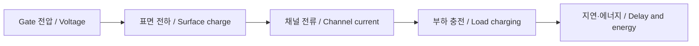

# MOSFET: 전기장으로 전류를 조절하는 원리와 모델의 한계

[반도체](../README.md) · [구현과 검증](../../../examples/foundations/circuits_hardware/README.md)

## 한국어

### 1. 전류가 거의 흐르지 않는 단자로 전류를 조절한다

MOSFET의 gate는 절연막을 사이에 두고 반도체 표면의 전하를 조절한다. 문을 열고 닫는 스위치를 떠올릴 수 있지만, 실제로는 gate 전압이 전하 밀도와 전위 분포를 바꾸는 소자다. 이상적인 gate에는 정상상태 직류가 흐르지 않더라도 전압을 바꿀 때는 정전용량을 충전하는 전류가 필요하다.

여기서는 p형 body의 enhancement NMOS, `VDS≥0`, body와 source가 같은 전위인 경우를 다룬다. 단위면적 산화막 정전용량은 평판 근사에서 `Cox=εox/tox`이며 단위는 F/m²다. gate 전압을 올리면 표면의 정공이 밀려나는 공핍을 거쳐 전자가 모인 반전 채널이 형성된다. threshold VT는 단순 모델의 기준 전압이지, 그 아래에서 실제 전류가 정확히 0이 되는 물리적 문턱은 아니다. [MIT 6.012 Lecture 8](https://web.mit.edu/6.012/www/SP07-L8.pdf)

| 기호 | 의미 | 단위 |
|---|---|---|
| VGS, VDS, VT | gate–source, drain–source, threshold 전압 | V |
| W, L | 채널 폭과 길이 | m |
| μn | 전자 이동도 | m²/(V·s) |
| Qn(x) | 위치 x의 반전층 면전하 밀도 | C/m² |
| β=μnCox W/L | 모델 계수 | A/V² |

### 2. square law를 유도하는 데 필요한 가정

긴 채널, 강한 반전, drift 지배, 일정한 이동도·threshold, 완만한 채널 전위 변화, 준정적 상태를 가정한다. body 효과·채널 길이 변조·속도 포화·접촉 저항·누설은 생략한다. 이 가정의 의미와 단채널에서의 한계는 [Berkeley EECS 240 Lecture 3](https://rfic.eecs.berkeley.edu/courses/ee240sp06/pdf/lect3.pdf)의 pp. 4–8, 26–29와 대조했다.

source를 0 V로 잡고 채널 전위를 V(x), overdrive를 `Vov=VGS-VT`라 하면 charge-sheet 근사는 `Qn(x)=-Cox[Vov-V(x)]`다. 전류의 양의 방향을 drain에서 source로 정하면

$$I_D=\mu_n W C_{ox}[V_{ov}-V(x)]\frac{dV}{dx}.$$

`V(0)=0`, `V(L)=VDS`로 적분하면

$$I_DL=\mu_nWC_{ox}\int_0^{V_{DS}}(V_{ov}-V)\,dV,$$

$$I_D=\beta\left(V_{ov}V_{DS}-\frac{V_{DS}^2}{2}\right),\quad 0\le V_{DS}<V_{ov}.$$

VDS가 Vov에 도달하면 drain 쪽 반전 전하가 이 근사에서 0이 된다. 이를 pinch-off라 하며, 전류가 끊어진다는 뜻은 아니다. 경계식을 대입한 이상적인 포화 전류는 `ID=βVov²/2`다. [MIT Lecture 9](https://web.mit.edu/6.012/www/SP07-L9.pdf)는 pinch-off와 body 효과, 채널 길이 변조를 따로 다룬다.

| 조건 | 단순 모델 | 해석 |
|---|---|---|
| Vov≤0 | ID=0 | cutoff 근사; 실제 누설을 예측하지 않음 |
| 0≤VDS<Vov | β(VovVDS−VDS²/2) | triode 영역 |
| VDS≥Vov>0 | βVov²/2 | 채널 길이 변조를 생략한 포화 영역 |

triode를 언제나 선형이라고 부르기보다는 `VDS≪Vov`일 때 `ID≈βVovVDS`, `Ron≈1/(βVov)`라고 제한해야 한다. MOSFET의 포화는 BJT를 스위치로 사용할 때 말하는 포화와 같은 뜻도 아니다.

### 3. 소자에서 디지털 에너지로 연결하기

직접 작성한 인과 관계도다. CMOS inverter의 NMOS는 출력 전하를 내보내고 PMOS는 채운다. 부하를 일정한 CL, 켜진 소자를 일정한 Ron으로 치환한 1차 근사에서는 50% 지연이 `ln(2)RonCL`다. 실제 소자 전류는 출력 전압에 따라 변하므로 이 값을 정확한 셀 지연으로 사용하지 않는다.

0→VDD 충전 한 번에 이상적인 전원은 `CL VDD²`를 공급한다. 이 중 `CL VDD²/2`가 C에 저장되고 나머지는 충전 경로에서 소모된다. 이어지는 방전에서는 저장 에너지도 소모된다. α를 한 클록당 평균 0→1 전이 횟수로 정의하면 `Pdynamic=αCLVDD²f`다. α를 모든 방향의 전이율로 정의하면 계수가 달라질 수 있다. 단락 전류와 누설 전력은 이 식에 포함되지 않는다.

### 4. 구현과 확인 범위

`nmos_current`는 위의 세 영역만 구현하며 입력 전압은 V, β는 A/V²로 받는다. 실제 공정의 PDK 모델이 아니다. 테스트에서는 triode 식을 채널 전하의 별도 수치 적분과 비교하고, VDS=0, cutoff, 영역 경계 연속성, VDS에 대한 단조성, β를 두 배로 한 경우를 확인한다. 샘플 한 점의 계산은 O(1), N점 sweep은 O(N)이다.

이 검증은 코드가 정해진 식을 따르는지 확인한다. 실제 소자에 맞는지 보려면 측정 온도·W/L·body 바이어스를 기록한 ID–VGS·ID–VDS 곡선, 계측기의 compliance, 파라미터 추출법과 오차가 필요하다. 특히 단채널 소자나 문턱 근처에서 square law로 맞지 않는 데이터를 억지로 설명하지 않는다.

## English

### 1. Controlling current through an electric field

A MOSFET gate controls semiconductor surface charge across an insulating layer. A switch is a useful starting picture, but the mechanism is an electric-field change in charge density and potential. An ideal gate can carry no steady DC current while still requiring transient current to charge capacitances.

The model here is an enhancement NMOS on a p-type body, with `VDS≥0` and body tied to source. Under a parallel-plate approximation, oxide capacitance per unit area is `Cox=εox/tox` in F/m². Increasing gate bias depletes holes and then forms an electron inversion channel. VT is a model reference, not a physical boundary below which real current is exactly zero. [MIT Lecture 8](https://web.mit.edu/6.012/www/SP07-L8.pdf)

VGS, VDS and VT are voltages in V; W and L are channel dimensions in m; electron mobility μn is in m²/(V·s); inversion-sheet charge Qn is in C/m²; and `β=μnCoxW/L` is in A/V².

### 2. Deriving a deliberately limited current model

Assume a long channel, strong inversion, drift-dominated current, constant mobility and threshold, a gradual channel-potential variation, and quasi-static operation. Body effect, channel-length modulation, velocity saturation, contact resistance and leakage are excluded. [Berkeley EECS 240 Lecture 3](https://rfic.eecs.berkeley.edu/courses/ee240sp06/pdf/lect3.pdf), pp. 4–8 and 26–29, cross-checks these assumptions and the limitations near threshold and in short channels.

Reference the channel potential V(x) to the source and define `Vov=VGS-VT`. The charge-sheet approximation is `Qn(x)=-Cox[Vov-V(x)]`. With positive drain current flowing from drain to source,

$$I_D=\mu_n W C_{ox}[V_{ov}-V(x)]\frac{dV}{dx}.$$

Integrating between `V(0)=0` and `V(L)=VDS` gives `IDL=μnWCox∫₀^VDS(Vov-V)dV`. Therefore,

$$I_D=\beta(V_{ov}V_{DS}-V_{DS}^2/2),\quad 0\le V_{DS}<V_{ov}.$$

At VDS=Vov, the approximate inversion charge vanishes at the drain end: pinch-off. Current does not stop there. Substituting this boundary into the expression gives the ideal saturation current `ID=βVov²/2`. [MIT Lecture 9](https://web.mit.edu/6.012/www/SP07-L9.pdf) separately explains pinch-off, body bias and channel-length modulation.

The implemented regions are cutoff (`Vov≤0`, ID=0), triode (`0≤VDS<Vov`), and ideal saturation (`VDS≥Vov>0`). Zero cutoff current is an approximation, not a leakage prediction. The triode equation is approximately linear only when `VDS≪Vov`; then `Ron≈1/(βVov)`. MOSFET saturation also differs from BJT switching saturation.

### 3. From channel current to switching energy

The original diagram links gate voltage, surface charge, channel current, load charging, and delay or energy. In a CMOS inverter the NMOS discharges the output and the PMOS charges it. Replacing the load by constant CL and the conducting path by constant Ron gives the first-order 50% delay `ln(2)RonCL`. Since actual transistor current changes with output voltage, this is not an exact cell-delay model.

Charging a capacitor from 0 to VDD through a resistive path draws `CLVDD²` from an ideal supply. Half becomes stored energy and half is dissipated during charging. The stored half is dissipated in the subsequent discharge. If α explicitly denotes the average number of 0→1 transitions per clock, `Pdynamic=αCLVDD²f`. Defining activity using both transition directions changes the coefficient convention. This equation excludes short-circuit current and leakage.

### 4. Implementation and verification

`nmos_current` implements only the three stated regions, with voltages in V and β in A/V². It is not a foundry PDK model. Tests compare the triode expression with a separate numerical channel-charge integral, then check zero VDS, cutoff, continuity at the region boundary, monotonic current versus VDS, and scaling with β. One sample costs O(1); an N-point sweep costs O(N).

Those checks establish agreement with the selected equations. Physical validation requires ID–VGS and ID–VDS data with temperature, geometry, body bias, instrument compliance, extraction method and uncertainty recorded. A mismatch near threshold or in a short-channel device is a reason to revise the model, rather than force the data into a square-law interpretation.

## 출처와 대조한 내용 | Sources and cross-checks

- MIT 6.012 Lectures 8–9: 채널 전하 적분·영역 조건·pinch-off / channel-charge integration, region conditions and pinch-off.
- Berkeley EECS 240 Lecture 3: 강한 반전·이동도 가정과 단채널·약한 반전 한계 / strong-inversion and mobility assumptions, short-channel and weak-inversion limits. MIT의 유도에 필요한 조건을 이 문서로 대조했다 / used to cross-check the scope of the MIT derivation.
- 도식과 수치 테스트는 직접 구성했다 / diagram and numerical tests constructed for this article. 출처 확인 / sources checked: 2026-10-19.
