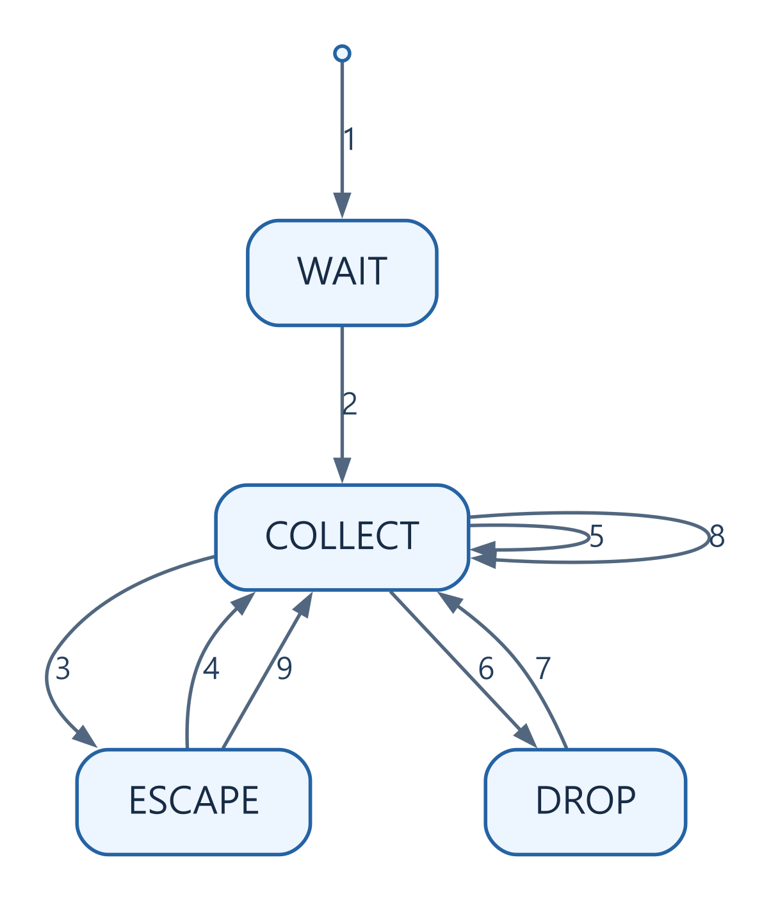

# 바이트가 메시지가 되려면: UART, 프레이밍과 CRC

[상위 주제](../README.md) · [프레임 구현](../../../examples/foundations/systems/systems_models.py) · [검증 코드](../../../examples/foundations/systems/test_systems_models.py)

## 한국어

### UART가 보내는 바이트와 프로그램의 메시지는 다르다

UART로 `온도=25`라는 데이터를 보냈다고 해도 수신 함수가 이를 한 번에 돌려준다는 보장은 없다. 일부 바이트씩 나뉘거나 여러 메시지가 함께 도착할 수 있다. UART는 비트의 시작과 끝을 정하고, 애플리케이션 프레임은 메시지의 시작과 끝을 정한다. 전기적 신호와 상위 데이터의 경계를 나눠 생각해야 한다.

8N1은 시작 비트 1개, 데이터 8비트, parity 없음, 정지 비트 1개다. 비트 시간을 $1/B$초라 하면 한 바이트의 전송 시간은 $10/B$초다. 쉬는 구간이 없다는 가정에서 $115200$ bit/s의 UART는 최대 $11520$ data byte/s를 전송한다. 메시지 헤더와 CRC, escape 바이트를 빼면 실제 데이터 처리율은 더 낮아진다. baud와 bit/s가 일반적으로 같은 뜻인 것은 아니지만, 여기서는 한 심벌에 한 비트를 보내는 UART를 다룬다. [TI UART configuration](https://software-dl.ti.com/C2000/docs/C2000_driverlib_api_guide/f28p65x/build/html/modules/uart.html)

### 경계 표시가 데이터 안에도 나오면?

이 예제는 `0x7E`를 경계로 사용한다. 데이터나 CRC 안의 `0x7E`와 `0x7D`는 `0x7D` 뒤에 원래 바이트 XOR `0x20`을 보내는 방식으로 바꾼다. 수신기는 escape 상태를 기억해 원래 바이트를 복원한다. 한 바이트씩 들어와도 이 상태를 유지하므로 분할 수신을 처리할 수 있다. 이 방식은 RFC1662의 octet stuffing과 FCS 계산을 참고한 작은 애플리케이션 프레임이며, 주소·제어·프로토콜 필드나 ACCM 협상 등을 갖춘 완전한 PPP 구현은 아니다. [RFC1662 §4·Appendix C](https://www.rfc-editor.org/rfc/rfc1662.html)

[SVG](../../../assets/diagrams/framing-uart-crc.svg) · [도식 원본 / Diagram source](../../../assets/diagrams/framing-uart-crc.mmd)

| 번호 / No. | 출발 / From | 도착 / To | 조건·동작 / Condition and action |
| --- | --- | --- | --- |
| 1 | 시작 / Start | WAIT | 초기화 / Initialize |
| 2 | WAIT | COLLECT | 0x7E |
| 3 | COLLECT | ESCAPE | 0x7D |
| 4 | ESCAPE | COLLECT | XOR 0x20 후 저장 / Decode and append |
| 5 | COLLECT | COLLECT | 일반 바이트 저장 / Append byte |
| 6 | COLLECT | DROP | 길이 상한 초과 / Capacity exceeded |
| 7 | DROP | COLLECT | 0x7E |
| 8 | COLLECT | COLLECT | 0x7E에서 검사·초기화 / Validate and restart |
| 9 | ESCAPE | COLLECT | 0x7E에서 폐기·초기화 / Abort and restart |

직접 작성한 상태도다. `DROP` 상태는 경계가 나올 때까지 모든 내용을 버린다. 입력이 잘못되어도 저장 공간을 끝없이 늘리지 않는다. 경계 직전이 escape이면 미완성 프레임으로 버린다. 전송 중단 후의 timeout은 이 바이트 모델 밖에서 시간 기준을 정해 추가할 수 있다.

### CRC를 다항식으로 보기

CRC는 비트열을 $GF(2)$ 위의 다항식으로 보고, 정한 생성 다항식으로 나눈 나머지를 이용한다. 계수는 0 또는 1이고 덧셈·뺄셈은 XOR다. 여기서는

$$G(x)=x^{16}+x^{12}+x^5+1$$

을 사용한다. 다항식만 같다고 CRC가 같은 것은 아니다. 입력 비트 순서, 초기값, 최종 XOR와 전송 순서까지 맞아야 한다.

| 항목 | 이 예제의 CRC-16/X-25, CRC-16/IBM-SDLC 설정 |
| --- | --- |
| width / poly | 16 / `0x1021` (최상위 항 제외) |
| init / xorout | `0xFFFF` / `0xFFFF` |
| refin / refout | true / true |
| reflected 루프 상수 | `0x8408` |
| FCS 전송 순서 | 낮은 바이트 먼저 |
| `123456789`의 결과 | `0x906E` |
| payload+FCS의 raw residue | 최종 XOR 전 `0xF0B8` |

구현의 오른쪽 시프트는 다항식 나눗셈을 비트 순서에 맞춰 수행한다. 매 바이트에 8번 반복하므로 길이 $N$에서 $O(N)$ 시간, CRC 상태는 $O(1)$ 공간이다. 처리율이 부족하면 같은 규칙으로 만든 lookup table이나 하드웨어 CRC를 사용할 수 있지만, 장치의 reflection과 초기·최종 처리 설정까지 비교해야 한다.

### 검출과 보안의 경계

CRC는 잡음이나 전송 오류의 검출 수단이다. 공격자는 데이터를 바꾸고 CRC도 다시 계산할 수 있으므로 인증 수단이 아니다. 검출되지 않는 오류도 존재한다. 예를 들어 코드 다항식에 $G(x)$의 배수인 오류를 XOR하면 나머지가 변하지 않는다. 따라서 “CRC가 맞으니 내용이 반드시 정확하다”는 결론은 성립하지 않는다. [보안과 신뢰성의 경계](../../38-security-cryptography/notes/security-and-reliability-boundaries.md)

### 구현과 검증

프레임의 최대 payload를 $M$으로 제한하면 수신 내부 버퍼는 CRC를 포함해 $M+2$ 바이트다. 최악의 escape 확장까지 포함한 송신 크기는 $2(M+2)+2$ 바이트 이하이며, 8N1 전송 시간은 그 바이트 수에 $10/B$를 곱한 값이다. `FrameParser.feed()`는 결과를 순차적으로 내보내는 generator여서 반환 프레임을 내부에 누적하지 않는다. 호출자가 결과를 무제한 모으면 그 공간은 별도로 늘어난다.

테스트는 `123456789` 벡터와 RFC1662 residue를 확인한다. CRC를 정방향 `binascii.crc_hqx()`와 비트 반전으로 독립 계산해 비교하고, 모든 256종 바이트, 빈 메시지, 다양한 chunk 크기를 검사한다. 80개 단일 비트 오류, 10,000바이트 초과 프레임의 저장 상한, 다음 정상 경계에서 복구, escape 중단도 확인한다. 테스트는 특정 UART의 baud 오차·배선·FIFO overrun을 측정하지 않는다. [실행 안내](../../../examples/foundations/systems/README.md)

## English

### A byte stream is not a message stream

Sending `temperature=25` over UART does not guarantee one receive call returns the entire message. Data may arrive in fragments or several messages together. UART defines bit-level character boundaries; application framing defines message boundaries. Separate electrical signaling from higher-level data structure.

8N1 uses one start bit, eight data bits, no parity, and one stop bit. At $B$ bit/s, each character takes $10/B$ seconds. With no idle gaps, $115200$ bit/s allows at most $11520$ data bytes/s before application overhead. Headers, CRC, and escaping reduce useful throughput. Baud is not universally synonymous with bit/s; this UART model sends one bit per symbol. [TI UART configuration](https://software-dl.ti.com/C2000/docs/C2000_driverlib_api_guide/f28p65x/build/html/modules/uart.html)

### What if a boundary byte appears inside the data?

The example uses `0x7E` as a delimiter. A payload or CRC byte equal to `0x7E` or `0x7D` is encoded as `0x7D` followed by the original byte XOR `0x20`. A receiver retains escape state across chunks and reconstructs the byte. This compact application format follows RFC1662 octet stuffing and FCS computation; it is not complete PPP with its address, control, protocol fields, and ACCM negotiation. [RFC1662 §4, Appendix C](https://www.rfc-editor.org/rfc/rfc1662.html)

The original state diagram above includes waiting, collecting, escaping, and dropping. Capacity overflow discards data until the next delimiter instead of growing memory without limit. An escape immediately followed by a delimiter aborts the incomplete frame. A wall-clock timeout for interrupted transmission is outside this byte-only model.

### CRC as polynomial arithmetic

A CRC treats bits as coefficients of a polynomial over $GF(2)$ and uses a remainder under a chosen generator. Coefficients are 0 or 1; addition and subtraction are XOR. Here

$$G(x)=x^{16}+x^{12}+x^5+1.$$

The polynomial alone does not identify a CRC variant. Input bit order, initial value, final XOR, and transmission order must agree too.

| Parameter | CRC-16/X-25, also CRC-16/IBM-SDLC, used here |
| --- | --- |
| Width / polynomial | 16 / `0x1021`, omitting the leading term |
| Initial value / final XOR | `0xFFFF` / `0xFFFF` |
| Input / output reflection | true / true |
| Reflected loop constant | `0x8408` |
| FCS wire order | Low byte first |
| Check for `123456789` | `0x906E` |
| Raw payload+FCS residue | `0xF0B8` before final XOR |

The right-shift implementation performs polynomial reduction in the reflected bit order. Eight iterations per byte give $O(N)$ time for $N$ bytes and $O(1)$ CRC state. A lookup table or hardware unit can improve throughput, but reflection, initialization, and finalization must still match.

### Detection is different from authentication

A CRC detects communication errors; an adversary can modify a message and recompute its CRC. Undetected error patterns also exist: XORing an error polynomial divisible by $G(x)$ preserves the remainder. A matching CRC therefore does not prove the content is correct or authentic. [Security and reliability boundaries](../../38-security-cryptography/notes/security-and-reliability-boundaries.md)

### Implementation and verification

For a maximum payload $M$, the parser's internal decoded buffer is bounded by $M+2$ bytes including CRC. Worst-case encoded size is at most $2(M+2)+2$ bytes. Multiply the actual wire length by $10/B$ for ideal 8N1 time. `FrameParser.feed()` yields frames incrementally instead of accumulating output internally; a caller collecting unlimited results creates its own unbounded storage.

Tests check the `123456789` value and RFC1662 residue, and independently compare CRC results using forward `binascii.crc_hqx()` plus bit reflection. They cover all 256 byte values, empty payloads, chunk boundaries, 80 single-bit errors, a 10,000-byte oversized input, recovery at the next delimiter, and aborted escapes. They do not measure UART baud tolerance, wiring quality, or FIFO overrun. [Execution guide](../../../examples/foundations/systems/README.md)

## 출처와 교차 확인 / Sources and cross-check

- TI UART API: 데이터 폭·parity·정지 비트 구성 / data width, parity, and stop-bit configuration.
- RFC1662 §4·Appendix C: escape 방식·생성 다항식·FCS 잔여값 / escaping, generator, and FCS residue.
- 식의 처리율·최대 길이는 프레임 정의에서 직접 계산했으며 CRC는 별도 구현과 비교했다. / Throughput and maximum size follow from the defined format; CRC is compared against an independent implementation.
