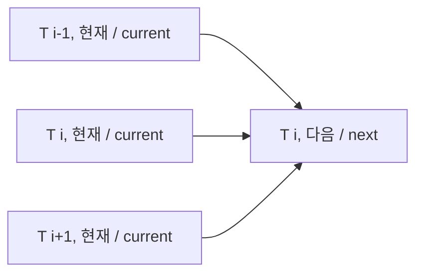

# 열전도와 확산 | Heat conduction and diffusion

[물리 기초](../README.md) · [실행 코드와 검사](../../../examples/foundations/math_physics/README.md)

## 한국어

### 온도가 높은 곳에서 낮은 곳으로

금속 막대의 가운데를 데우면 주변도 서서히 따뜻해진다. 물체 전체가 한 번에 같은 온도가 되는 것이 아니라 위치마다 온도가 달라진다. 열전도 모델은 이 분포 $T(x,t)$가 시간에 따라 어떻게 변하는지 계산한다. 칩과 방열판도 열을 다루지만, 여기서는 계산의 기본을 분명히 보기 위해 균질한 1차원 막대를 사용한다.

Fourier 법칙에서 열유속 $q''$는 단위 면적당 전력이다.

$$q''=-k\frac{\partial T}{\partial x},\qquad
[q'']=\mathrm{W/m^2},\quad [k]=\mathrm{W/(m\,K)}.$$

음의 부호는 온도가 내려가는 방향으로 열이 이동함을 뜻한다. 이 구성 관계는 [MIT 열전도 강의 §16.2](https://web.mit.edu/16.unified/www/SPRING/propulsion/notes/node116.html)와 [RWTH Aachen 열방정식 §11.1](https://mbd.pages.rwth-aachen.de/courses/cmm/content/script/chapters/heatequation.html)을 대조했다. 열전도율 $k$와 열확산계수 $\alpha$는 다른 물리량이다.

### 작은 구간의 에너지 수지

길이 $\Delta x$, 단면적 $A$인 구간에서 축적되는 열에너지의 변화율은 들어오는 전력에서 나가는 전력을 뺀 값이다. 밀도 $\rho$와 비열 $c$가 일정하고, 내부 발열·물질 이동·상변화가 없으면

$$\rho cA\Delta x\frac{\partial T}{\partial t}
=Aq''(x)-Aq''(x+\Delta x).$$

$\Delta x\to0$으로 보내고 Fourier 법칙을 넣으면

$$\rho c\frac{\partial T}{\partial t}=k\frac{\partial^2T}{\partial x^2},\qquad
\frac{\partial T}{\partial t}=\alpha\frac{\partial^2T}{\partial x^2},\quad \alpha=\frac{k}{\rho c}.$$

$\rho$의 단위는 kg/m³, $c$는 J/(kg K), $\alpha$는 m²/s다. 막대 옆면은 단열로 보고 양 끝 온도는 시간에 따라 변하지 않는 Dirichlet 경계로 둔다. 초기 분포 $T(x,0)$도 필요하다. 유도에 사용한 조건은 [RWTH Aachen §11.3](https://mbd.pages.rwth-aachen.de/courses/cmm/content/script/chapters/heatequation.html)과 일치한다. 움직이는 유체, 변하는 물성, 접촉 열저항은 이 식의 추가 검토 대상이다.

### 격자로 바꾸기

길이 $L$을 $M$개 구간으로 나누면 $\Delta x=L/M$, 격자점은 $M+1$개다. 시간 간격은 $\Delta t$다. 시간에는 전진 차분, 공간에는 중앙 차분을 넣으면

$$T_i^{n+1}=T_i^n+r(T_{i-1}^n-2T_i^n+T_{i+1}^n),\qquad
r=\frac{\alpha\Delta t}{\Delta x^2}.$$

FTCS라는 이름은 forward time, centred space에서 왔다. 충분히 매끄러운 해에서 시간 1차·공간 2차 정확도다. $0\le r\le1/2$이면 새 값은 이웃 두 점과 자신의 비음수 가중평균이다. 따라서 고정 경계와 초기값 범위를 벗어나는 새 극값을 만들지 않는다. Fourier 모드 $e^{\mathrm ji\theta}$를 대입해도 증폭계수 $G=1-4r\sin^2(\theta/2)$가 나와 $|G|\le1$인 동일 조건을 얻는다. 이 조건은 이 글의 1차원·균일 격자·상수 계수 FTCS에 대한 것이다. [Cambridge 수치해석 안정성 자료](https://www.damtp.cam.ac.uk/user/hf323/M21-II-NA/demos/pde_stability/pde_stability.html)와 [TU Delft diffusion equation](https://mude.citg.tudelft.nl/book/2025/numerical_methods_for_PDEs/diffusion_equation.html)에서 교차 확인했다.



도식은 한 격자점의 갱신 의존 관계다. / The original diagram shows one stencil update.

### 구현과 비용

```python
from math import sin, pi
from models import heat_ftcs

cells = 20
initial = [sin(pi*i/cells) for i in range(cells+1)]
# 같은 시간의 이웃값만 사용하는 두 버퍼 구현이다.
result = heat_ftcs(initial, diffusivity=1.0, length=1.0, duration=0.05, steps=200)
print(result[cells//2])
```

여기서 온도는 기준 온도에 대한 편차이며 양 끝은 0이다. $\alpha=1\ \mathrm{m^2/s}$는 해석해 비교를 간단히 하는 예제 계수다. 특정 금속의 물성이라고 해석하지 않는다. 구현은 새 배열을 매 단계 할당하지 않고 두 버퍼를 바꾼다. 전체 이력을 보관하지 않으므로 $N$단계·$M+1$점에서 시간 $O(NM)$, 추가 메모리 $O(M)$이다. 공간 간격을 절반으로 줄이면 같은 $r$을 유지할 때 시간 간격은 1/4로 줄여야 한다. 1차원에서 같은 기간을 계산하는 일은 대략 8배 늘어난다.

### 해석해와 경계조건으로 검증하기

$T(0,t)=T(L,t)=0$, $T(x,0)=\sin(\pi x/L)$이면

$$T(x,t)=e^{-\alpha(\pi/L)^2t}\sin(\pi x/L)$$

가 정확한 해다. 미분해 원래 PDE와 초기·경계조건에 대입하면 직접 확인할 수 있다. 검사는 이 해와의 최대 절대오차, 격자를 절반으로 줄이고 $\Delta t\propto\Delta x^2$로 맞췄을 때 약 4배의 오차 감소, 일정·선형 정상 분포, 양 끝 유지, 최대값 원리, 불안정 간격 거부를 확인한다.

양 끝 온도를 고정하면 외부와 열을 주고받으므로 막대의 총 열에너지가 일정해야 한다는 검사는 맞지 않는다. 단열 경계로 바꾸려면 경계 이산화와 에너지 검사를 함께 바꿔야 한다. 실제 방열 설계에서는 대류·복사·다층 재료·접촉 상태를 추가하고 실측과 비교해야 한다. 수치해 수렴만으로 실제 칩 온도의 정확도가 확인되는 것은 아니다.

## English

### From heat flow to an energy balance

Heating the centre of a metal rod changes the temperature distribution gradually. The field $T(x,t)$ records temperature at each position and time. Chips and heat sinks involve the same subject, but a homogeneous one-dimensional rod makes the basic model explicit.

Fourier's law is $q''=-k\partial T/\partial x$. Heat flux $q''$ has units W/m² and conductivity $k$ has units W/(m K). The negative sign indicates flow down the temperature gradient. This constitutive law is cross-checked against [MIT conduction notes §16.2](https://web.mit.edu/16.unified/www/SPRING/propulsion/notes/node116.html) and [RWTH Aachen §11.1](https://mbd.pages.rwth-aachen.de/courses/cmm/content/script/chapters/heatequation.html). Conductivity and diffusivity are distinct quantities.

For a segment of area $A$ and length $\Delta x$, accumulation equals incoming minus outgoing power: $\rho cA\Delta x\,\partial T/\partial t=Aq''(x)-Aq''(x+\Delta x)$. With constant density and heat capacity, no internal source, material motion, or phase change, taking $\Delta x\to0$ yields $\rho c\partial T/\partial t=k\partial^2T/\partial x^2$. Thus $\partial T/\partial t=\alpha\partial^2T/\partial x^2$, where $\alpha=k/(\rho c)$ in m²/s. Density is in kg/m³ and heat capacity in J/(kg K).

The lateral surface is insulated, endpoint temperatures are fixed Dirichlet conditions, and an initial distribution must be specified. These assumptions match [RWTH Aachen §11.3](https://mbd.pages.rwth-aachen.de/courses/cmm/content/script/chapters/heatequation.html). Moving fluids, variable properties, and contact resistance need additional modelling.

### Discretization and stability

Divide length $L$ into $M$ intervals with $M+1$ grid points and $\Delta x=L/M$. Forward time and centred space differences give $T_i^{n+1}=T_i^n+r(T_{i-1}^n-2T_i^n+T_{i+1}^n)$, $r=\alpha\Delta t/\Delta x^2$. FTCS has first-order time and second-order space accuracy for smooth solutions. For $0\le r\le1/2$, each new interior value is a nonnegative weighted average, preserving the initial/boundary range. Substituting a Fourier mode gives $G=1-4r\sin^2(\theta/2)$ and the same $|G|\le1$ condition. This bound applies to the stated one-dimensional uniform-grid constant-coefficient scheme. See [Cambridge stability notes](https://www.damtp.cam.ac.uk/user/hf323/M21-II-NA/demos/pde_stability/pde_stability.html) and [TU Delft's diffusion chapter](https://mude.citg.tudelft.nl/book/2025/numerical_methods_for_PDEs/diffusion_equation.html). The original diagram above shows the three current-time values used by one next-time update.

### Implementation and verification

The Python example uses deviations from a reference temperature, zero endpoint deviations, and $\alpha=1\ \mathrm{m^2/s}$ as a convenient verification parameter, not as a claimed metal property. The implementation exchanges two buffers and stores no full history, requiring $O(NM)$ work and $O(M)$ additional storage. Halving the spatial step requires quartering the time step at fixed $r$, increasing one-dimensional work over the same duration by roughly a factor of eight.

For zero endpoint values and initial $\sin(\pi x/L)$, the analytical solution is $T(x,t)=e^{-\alpha(\pi/L)^2t}\sin(\pi x/L)$. Differentiation verifies the PDE, initial state, and boundaries directly. Tests compare maximum absolute error and verify approximately fourfold error reduction when space is halved while $\Delta t\propto\Delta x^2$. They also check constant and linear steady states, fixed endpoints, the maximum principle, and rejection of unstable steps.

Fixed endpoint temperatures allow energy exchange with the environment, so requiring constant total rod energy would be incorrect. Insulated endpoints require a corresponding change in both discretization and energy tests. Physical thermal design additionally needs convection, radiation, material layers, contact effects, and measured validation. Grid convergence alone does not establish accuracy for a real chip.

## 출처 / Sources

- MIT §16.2 and RWTH Aachen §§11.1–11.3: Fourier 법칙·에너지 수지·열확산계수 / Fourier law, energy balance, and diffusivity.
- Cambridge and TU Delft: FTCS 차분식·안정 조건 / FTCS stencil and stability bound.

도식과 해석해 비교용 수치 예는 직접 구성했다. / Diagrams and numerical examples for analytical comparison were constructed for this article.
