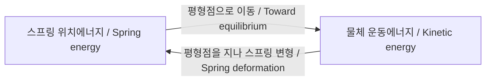

# 역학, 에너지, 진동 | Mechanics, energy, and oscillation

[물리 기초](../README.md) · [실행 코드와 검사](../../../examples/foundations/math_physics/README.md)

## 한국어

### 원래 자리로 돌아가려는 힘

스프링에 연결한 물체를 옆으로 당겼다 놓으면 가운데를 지나 반대쪽으로 움직인다. 가운데에서 힘이 0이어도 속도까지 0인 것은 아니기 때문이다. 이 차이를 이해하면 센서의 떨림, 로봇 구조물의 진동, 제어계의 응답을 더 잘 읽을 수 있다. 여기서는 마찰 없는 수평면의 질량과 선형 스프링을 생각한다. 스프링 자체의 질량은 무시하고 변위가 Hooke 법칙의 범위 안에 있다고 가정한다.

| 기호 | 뜻 | 단위 |
|---|---|---|
| $x$ | 평형점에서의 변위 | m |
| $v=dx/dt$ | 속도 | m/s |
| $m$ | 질량 | kg |
| $k$ | 스프링 강성 | N/m |
| $\omega=\sqrt{k/m}$ | 고유 각진동수 | rad/s |

힘은 $F=-kx$다. 음의 부호는 오른쪽으로 당기면 왼쪽으로 되돌리려 한다는 뜻이다. Newton의 운동법칙과 결합하면

$$m\ddot x=-kx,\qquad \ddot x+\omega^2x=0.$$

이 선형 모델과 적용 조건은 [MIT 8.01 Chapter 23](https://ocw.mit.edu/courses/8-01sc-classical-mechanics-fall-2016/mit8_01scs22_chapter23.pdf)와 [Rice University OpenStax, §15.1](https://openstax.org/books/university-physics-volume-1/pages/15-1-simple-harmonic-motion)을 대조했다.



도식은 위 모델의 에너지 교환을 나타낸다. / The original diagram represents energy exchange in this model.

### 초기 상태에서 해석해 얻기

$x(0)=x_0$, $v(0)=v_0$이면 일반해 $A\cos(\omega t)+B\sin(\omega t)$에 초기조건을 넣어

$$x(t)=x_0\cos(\omega t)+\frac{v_0}{\omega}\sin(\omega t),$$
$$v(t)=-\omega x_0\sin(\omega t)+v_0\cos(\omega t)$$

를 얻는다. 주기는 $P=2\pi/\omega$다. 주파수 $f=1/P$는 Hz이고, 각진동수와는 $\omega=2\pi f$로 다르다. 이상적인 선형 모델에서 주기는 진폭과 무관하지만, 큰 변형의 비선형 스프링까지 그렇다는 뜻은 아니다.

### 운동과 에너지를 함께 검사하기

힘이 한 일을 적분하면 스프링 위치에너지는 $U(x)=kx^2/2$다. 운동에너지 $K=mv^2/2$와 더하면

$$E=\frac12mv^2+\frac12kx^2,\qquad
\frac{dE}{dt}=v(m\dot v+kx)=0.$$

위치에너지의 기준은 평형점으로 잡았다. 물체와 스프링을 합친 계에서는 운동에너지와 위치에너지가 바뀌어도 합은 일정하다. 마찰이 없다 해도 물체만 떼어 놓고 그 운동에너지가 일정하다고 할 수는 없다. 계의 경계가 중요하다. 에너지 관점은 [OpenStax §15.2](https://openstax.org/books/university-physics-volume-1/pages/15-2-energy-in-simple-harmonic-motion) 및 MIT Chapter 23 §23.3과 일치한다.

### 수치 구현: velocity Verlet

가속도 $a(x)=-\omega^2x$가 위치에만 의존할 때 다음의 대칭 갱신을 쓸 수 있다.

$$v_{n+1/2}=v_n+\frac h2a(x_n),\quad
x_{n+1}=x_n+hv_{n+1/2},\quad
v_{n+1}=v_{n+1/2}+\frac h2a(x_{n+1}).$$

이는 위치의 Taylor 전개 $x(t+h)=x+hv+h^2a/2+O(h^3)$와 양 끝 가속도를 평균한 속도 갱신을 결합한다. 매끄러운 궤적의 고정 시간에서 전역 2차 정확도를 갖는다. 이 선형 진동자에 적용하면 위치는

$$x_{n+1}-2x_n+x_{n-1}=-h^2\omega^2x_n$$

을 따른다. $x_n=z^n$을 넣어 얻은 특성근은 $0<h\omega<2$에서 단위원 위에 있다. 경계 $h\omega=2$는 제외한다. 코드는 이 조건을 확인한다. 조건을 만족해도 위상 오차는 쌓이며, 실제 에너지가 매 단계 정확히 보존되는 방법은 아니다. 같은 조건에서 무감쇠 선형 진동자의 에너지 오차는 작은 간격일 때 제한된 범위에서 진동한다.

```python
from models import oscillator_verlet

# 모든 궤적을 저장하지 않고 한 상태씩 받아 최대 에너지 오차만 남긴다.
largest_error = 0.0
for t, x, v in oscillator_verlet(1.0, 4.0, 0.3, 0.0, 100.0, 10000):
    energy = 0.5*v*v + 2.0*x*x
    largest_error = max(largest_error, abs(energy-0.18))
print(largest_error)
```

$m=1\ \mathrm{kg}$, $k=4\ \mathrm{N/m}$, $x_0=0.3\ \mathrm m$, $v_0=0$의 초기 에너지는 0.18 J다. 예는 100 s를 10,000단계로 계산한다. 생성기로 내보내므로 시간 $O(N)$, 상태 저장 $O(1)$이다. 검사는 해석해와의 위치 오차, 간격 절반에서 약 4배 오차 감소, 장시간 에너지 상대오차 $1.1\times10^{-4}$ 미만, 평형점 유지, 불안정 간격 거부를 확인한다. 이 허용치는 명시한 수치 사례의 기준이다.

실제 진동에서는 감쇠 $c\dot x$와 외력 $F(t)$를 추가해 $m\ddot x+c\dot x+kx=F(t)$로 확장할 수 있다. 그러면 $dE/dt=Fv-cv^2$여서 무조건 에너지 일정이라는 검사는 틀린다. 실제 장치에 적용하려면 질량·강성·감쇠를 식별하고, 측정된 주기와 진폭 감쇠를 비교한다. 여기의 계산 검사는 그 실측 과정을 대신하지 않는다.

## English

### Restoring force and motion

A mass released from a stretched spring crosses equilibrium because zero force at the centre does not imply zero velocity. This distinction helps explain structural vibration, sensor motion, and control responses. The model assumes a frictionless horizontal surface, negligible spring mass, and displacements within the linear Hooke-law range. Displacement $x$ is in m, velocity $v$ in m/s, mass $m$ in kg, and stiffness $k$ in N/m.

The restoring force $F=-kx$ opposes displacement. Newton's law gives $m\ddot x=-kx$, or $\ddot x+\omega^2x=0$, with $\omega=\sqrt{k/m}$ in rad/s. These assumptions and the oscillator model are cross-checked against [MIT 8.01 Chapter 23](https://ocw.mit.edu/courses/8-01sc-classical-mechanics-fall-2016/mit8_01scs22_chapter23.pdf) and [Rice University OpenStax §15.1](https://openstax.org/books/university-physics-volume-1/pages/15-1-simple-harmonic-motion). The original diagram above shows exchange between spring potential energy and kinetic energy.

### Analytical solution and energy

Using $x(0)=x_0$ and $v(0)=v_0$ in a sine–cosine solution gives $x(t)=x_0\cos(\omega t)+(v_0/\omega)\sin(\omega t)$ and $v(t)=-\omega x_0\sin(\omega t)+v_0\cos(\omega t)$. The period is $P=2\pi/\omega$, frequency $f=1/P$ in Hz, and $\omega=2\pi f$. Amplitude independence belongs to the ideal linear model and does not extend automatically to nonlinear springs.

Integrating spring force gives $U=kx^2/2$, taking zero potential at equilibrium. Together with $K=mv^2/2$, total mechanical energy is $E=mv^2/2+kx^2/2$. Its derivative is $dE/dt=v(m\dot v+kx)=0$. Energy transfers between the mass and spring while their total remains constant. The kinetic energy of the mass alone is not constant; the chosen system boundary matters. See [OpenStax §15.2](https://openstax.org/books/university-physics-volume-1/pages/15-2-energy-in-simple-harmonic-motion) and MIT Chapter 23 §23.3.

### Numerical model and verification

For position-dependent acceleration $a(x)=-\omega^2x$, velocity Verlet uses $v_{n+1/2}=v_n+ha(x_n)/2$, $x_{n+1}=x_n+hv_{n+1/2}$, and $v_{n+1}=v_{n+1/2}+ha(x_{n+1})/2$. It combines a second-order position expansion with averaging the endpoint accelerations for velocity, giving second-order global accuracy for smooth trajectories over fixed time.

For this linear oscillator, $x_{n+1}-2x_n+x_{n-1}=-h^2\omega^2x_n$. Substituting $x_n=z^n$ shows unit-magnitude characteristic roots for $0<h\omega<2$. The code excludes the boundary at 2. Stability does not remove accumulated phase error, and ordinary mechanical energy is not exactly conserved at every step. At sufficiently small stable steps, its error oscillates within a bounded range for this undamped linear model.

The example uses $m=1\ \mathrm{kg}$, $k=4\ \mathrm{N/m}$, $x_0=0.3\ \mathrm m$, $v_0=0$, giving initial energy 0.18 J. It simulates 100 s in 10,000 steps, retaining only the maximum energy error. A generator needs $O(N)$ time and $O(1)$ state storage. Tests compare position with the analytical solution, verify approximately fourfold error reduction after halving the step, require relative energy error below $1.1\times10^{-4}$ in the stated long-duration case, preserve equilibrium, and reject an unstable step. That tolerance belongs to this numerical case.

Adding damping and external force gives $m\ddot x+c\dot x+kx=F(t)$ and $dE/dt=Fv-cv^2$. Constant-energy tests are then inappropriate. Physical application requires identification of mass, stiffness, and damping, followed by comparison with measured period and amplitude decay. The computational checks here do not replace those measurements.

## 출처 / Sources

- MIT 8.01 Chapter 23 §§23.2–23.3, 23.5–23.6: 진동방정식·에너지·감쇠와 외력 / oscillator equations, energy, damping, and forcing.
- Rice University OpenStax §§15.1–15.2: 주기·각진동수·계의 에너지 / period, angular frequency, and system energy.

Verlet 갱신의 적용, 안정 조건의 대수 전개와 수치 예는 위 모델에서 직접 구성했다. / The Verlet application, algebraic stability calculation, and numerical examples were constructed from the stated model.
