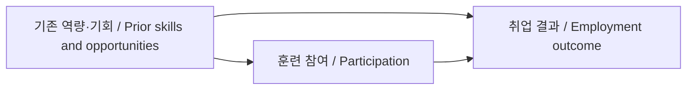

# 사회를 자료로 읽기: 제도, 규범과 인과관계

[사회와 제도](../README.md) · [논증과 가치 판단](../../58-philosophy-critical-thinking/notes/knowledge-arguments-values.md)

## 한국어

### 규칙은 종이에만 있지 않다

도서관에서 책을 빌리는 일에는 대출 규정, 담당자의 역할, 이용자의 기대와 실제 행동이 함께 작용한다. 제도는 법 조문 하나나 건물 하나로만 설명하기 어렵다. 학문마다 용법에 차이가 있지만, 지속되는 규칙·역할·관행과 이를 뒷받침하는 관계를 살피면 제도가 어떻게 작동하는지 이해하는 데 도움이 된다. 제도를 조직 자체와 가깝게 보는 설명도, 규칙과 균형에 무게를 두는 설명도 있다. [Stanford SEP, Social Institutions §§1–2](https://plato.stanford.edu/entries/social-institutions/)

사회규범은 사람들이 무엇을 하거나 해야 한다고 기대하는지와 관련된다. 많은 사람이 같은 행동을 한다고 해서 그 행동을 요구하는 규범이 있다는 결론이 자동으로 나오지는 않는다. 모두 비가 와서 우산을 쓰는 일과, 다른 사람의 비난을 예상해 줄을 지키는 일은 다를 수 있다. 규범에 대한 이론마다 기대·제재·동기를 설명하는 방식도 다르다. [SEP, Social Norms §§1–2](https://plato.stanford.edu/entries/social-norms/)

제도를 평가할 때는 쓰인 규정, 실제 집행, 이용자가 겪는 결과를 나누어 본다. 규정상 이용 가능해도 시간·비용·접근성 때문에 이용하기 어려울 수 있다. 반대로 이용률만 낮다는 이유로 불필요한 제도라고 결론 내리려면, 필요의 크기와 이용 장벽을 구분해야 한다.

### 관련되어 있다는 것과 바꾸었다는 것은 다르다

직업훈련 참가자의 취업률이 비참가자보다 높다고 하자. 이것은 비교에서 관찰된 관련성이다. 참가자가 원래 다른 경력이나 동기를 가졌다면 훈련이 그 차이를 전부 만들었다고 말할 수 없다. 다음은 실제 사업의 효과가 아니라 인과관계를 설명하기 위한 개념 모형이다.

직접 작성한 가설 도식이다. 화살표는 자료로 입증된 사실이 아니라 검토할 인과 가정을 나타낸다. 기존 역량이 참여와 결과 모두에 영향을 주면, 두 집단을 그대로 비교할 때 선택 차이가 섞인다.

개인 $i$의 훈련 참여 결과를 $Y_i(1)$, 비참여 결과를 $Y_i(0)$라고 쓴다. 한 사람에게 같은 시점의 두 상태를 모두 관찰할 수 없다는 점이 평가의 어려움이다. 평균 효과는 $E[Y(1)-Y(0)]$로 정의할 수 있지만, 그 정의만으로 관측 자료에서 값을 계산할 수 있는 것은 아니다. [World Bank, Impact Evaluation in Practice, 2nd ed., Chapter 3](https://documents1.worldbank.org/curated/en/698441474029568469/pdf/Impact-evaluation-in-practice.pdf)

### 관찰된 차이에 무엇이 섞이는지 유도하기

$D=1$을 참여, $D=0$을 비참여로 놓고 실제 결과가 선택한 상태의 잠재결과와 같다고 가정하자. 이 두 상태 모형은 훈련 내용을 분명히 정하고 다른 사람의 참여가 주는 영향을 별도로 다루지 않은 단순화다. 다음 식은 $E[Y(0)\mid D=1]$을 더하고 빼서 얻는다.

$$\begin{aligned}
E[Y\mid D=1]-E[Y\mid D=0]
&=E[Y(1)-Y(0)\mid D=1]\\
&\quad+E[Y(0)\mid D=1]-E[Y(0)\mid D=0].
\end{aligned}$$

첫 항은 참가자에게서의 평균 효과이고, 뒤 두 항의 차이는 훈련이 없었더라도 생겼을 집단 차이다. 예를 들어 취업률 차이가 15%p라 해도 그 수치만으로 첫 항이 15%p라고 정할 수 없다. 15%p는 설명용 숫자이며 조사 결과가 아니다. 효과의 정의와 비교 집단을 분명히 해야 한다.

무작위 배정은 배정 전 특성과 잠재결과의 체계적 차이를 평균적으로 줄이는 방법이다. 실제 표본에서 모든 특성이 정확히 같아지는 것은 아니다. 배정 불이행이 있으면 배정의 효과와 실제 참여의 효과도 구분하고, 누락·탈락·집단 간 파급을 살핀다. 모든 제도에 무작위 평가가 가능하거나 적절한 것도 아니다. [MIT J-PAL, Introduction to randomized evaluations](https://www.povertyactionlab.org/resource/introduction-randomized-evaluations), [World Bank, Chapters 5·9](https://documents1.worldbank.org/curated/en/698441474029568469/pdf/Impact-evaluation-in-practice.pdf)

관찰 연구에서도 자연실험, 차이의 차이, 회귀불연속 등 적합한 설계를 사용할 수 있다. 각각 비교 가능성, 추세, 경계 주변의 행동 같은 가정을 검토해야 하며, 방법 이름이 인과성을 보장하지 않는다. 통계적 통제에 관측 변수를 많이 넣는 것만으로 숨은 차이가 모두 사라지는 것도 아니다. [World Bank, Chapters 4–8](https://www.worldbank.org/en/programs/sief-trust-fund/publication/impact-evaluation-in-practice)

### 통계와 제도의 평가를 연결하기

| 자료에서 확인할 것 | 해석에 필요한 이유 |
| --- | --- |
| 분모·모집단·기간 | 누구의 어떤 변화인지 정함 |
| 측정 정의와 수집 방식 | 같은 이름의 변수가 같은 뜻인지 확인 |
| 누락·탈락·가중치 | 자료에 남은 사람이 전체를 대표하는지 살핌 |
| 비교 집단과 시행 전 추세 | 효과와 기존 차이를 구분하는 근거 |
| 불확실성과 하위 집단 | 평균 뒤의 차이와 추정의 흔들림을 드러냄 |

비율이 20%에서 25%로 바뀌면 5%p 증가이자 상대적으로 25% 증가다. 둘은 같은 변화의 다른 표현이며 숫자 크기만 비교하면 오해하기 쉽다. 집단별 평균이 같아도 구성 비중이 달라 전체 평균이 달라질 수 있으므로 집계 수준도 확인한다.

마지막으로 효과와 정당성은 다른 질문이다. 평균 효과가 양수여도 일부 집단이 부담을 더 지거나 참여 기회가 제한될 수 있다. 효율, 권리, 공정성과 지속가능성의 어떤 기준으로 평가했는지 밝히고, 자료로 확인한 사실과 가치 판단을 구분한다. 제도의 복잡성을 이유로 검증을 포기하기보다, 어떤 조건에서 누구에게 어떤 결과가 나타났는지 더 정확하게 설명하는 것이 이 분석의 목적이다.

## English

### Rules exist in practice as well as on paper

Borrowing a library book involves written rules, staff roles, users' expectations, and actual behavior. An institution cannot always be reduced to one rule or one building. Disciplines use the term differently: some accounts emphasize organizations, while others emphasize durable rules, practices, and equilibria. Examining these relationships helps explain how an institution works. [SEP, Social Institutions §§1–2](https://plato.stanford.edu/entries/social-institutions/)

Social norms concern expectations about what people do or should do. Widespread behavior alone does not prove a norm requiring it. Using umbrellas because it rains differs from respecting a queue because disapproval is expected. Theories differ in their treatment of expectations, sanctions, and motivation. [SEP, Social Norms §§1–2](https://plato.stanford.edu/entries/social-norms/)

Separate written provisions, actual implementation, and users' outcomes. A service can be formally available yet difficult to access because of time, cost, or accessibility barriers. Low uptake alone does not establish low need without distinguishing need from barriers.

### Association is different from causing change

Higher employment among training participants is an observed association. Existing experience or motivation could account for some of the difference. The original diagram is a conceptual hypothesis, not an evaluation of a real program: prior skills and opportunities may affect both participation and employment, confounding a direct comparison.

Let $Y_i(1)$ be person $i$'s outcome with training and $Y_i(0)$ without it. Both states cannot be observed for the same person at the same time. Defining an average effect as $E[Y(1)-Y(0)]$ does not itself identify it from observed data. [World Bank, Impact Evaluation in Practice, Chapter 3](https://documents1.worldbank.org/curated/en/698441474029568469/pdf/Impact-evaluation-in-practice.pdf)

### Decompose an observed difference

With $D=1$ for participation and $D=0$ otherwise, assume the observed outcome equals the potential outcome under the received state. This two-state simplification requires a well-defined training intervention and does not separately model effects of other people's participation. Adding and subtracting $E[Y(0)\mid D=1]$ gives

$$\begin{aligned}
E[Y\mid D=1]-E[Y\mid D=0]
&=E[Y(1)-Y(0)\mid D=1]\\
&\quad+E[Y(0)\mid D=1]-E[Y(0)\mid D=0].
\end{aligned}$$

The first term is the average effect for participants. The remaining difference is what would have separated the groups without training. A 15-percentage-point observed gap therefore does not identify a 15-point effect. That number is illustrative, not a survey finding. State the estimand and comparison group.

Random assignment removes systematic preassignment differences in expectation, rather than making every realized sample characteristic identical. Noncompliance distinguishes assignment effects from actual participation effects. Missing outcomes, attrition, and spillovers also matter, and random evaluation is not feasible or suitable for every institution. [MIT J-PAL introduction](https://www.povertyactionlab.org/resource/introduction-randomized-evaluations), [World Bank, Chapters 5 and 9](https://documents1.worldbank.org/curated/en/698441474029568469/pdf/Impact-evaluation-in-practice.pdf)

Observational work can use designs such as natural experiments, difference-in-differences, and regression discontinuity when their assumptions fit. Examine comparability, trends, and behavior around thresholds; naming a method does not establish causality. Adding many observed controls does not automatically remove unobserved differences. [World Bank, Chapters 4–8](https://www.worldbank.org/en/programs/sief-trust-fund/publication/impact-evaluation-in-practice)

### Connect evidence to institutional evaluation

Record the denominator, population, period, measurement definition, collection method, missingness, attrition, and weights. Examine the comparison group and preimplementation trends, and report uncertainty and subgroup differences alongside an average.

A rate rising from 20% to 25% increases by five percentage points, or 25% relative to its original value. Comparing only the numerical sizes can mislead. Changes in group weights can change an aggregate average even if subgroup averages remain unchanged.

Effectiveness and justification are distinct questions. A positive average effect can coexist with concentrated burdens or restricted access. Identify whether an evaluation prioritizes efficiency, rights, fairness, or sustainability, separating supported factual claims from value judgments. Complexity is a reason to specify who experienced which outcomes under what conditions, rather than to abandon examination.

## 출처와 대조 / Sources and cross-check

- Stanford SEP, *Social Institutions*·*Social Norms*: 제도·조직·규범의 용법과 이론적 차이 / terminology and competing accounts.
- Gertler 외, World Bank, *Impact Evaluation in Practice*, 2nd ed., 2016, Chapters 3–9: 반사실·비교 집단·평가 설계·불이행 / counterfactuals, comparison groups, evaluation design, and noncompliance.
- MIT J-PAL: 무작위 배정의 의미, 파급과 적용 한계 / assignment, spillovers, and limitations.

효과의 정의와 실제 식별 조건을 World Bank와 J-PAL의 설명으로 대조했다. 도식·수치 예와 식의 재배열은 개념 설명용이다. / Effect definitions and identification conditions were cross-checked between World Bank and J-PAL. The diagram, numerical examples, and algebraic decomposition are explanatory. 확인 / checked: 2026-10-19.
