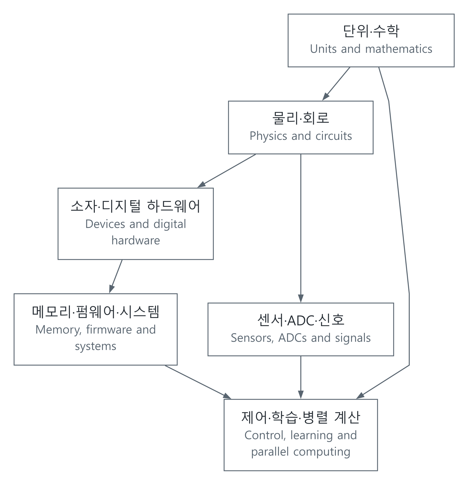

# 기초에서 구현과 검증까지

[전체 분야](../분야별목차_CATALOG.md) · [용어의 뜻과 뉘앙스](용어와직관_TERMS_AND_INTUITION.md) · [실행 예제](../예제_examples/공학기초_foundations/README.md) · [출처·검토 범위](검증기록_VERIFICATION.md) · [English](#english)

공학의 개념을 정의에서 끝내지 않고 수식, 프로그램, 확인할 수 있는 결과로 연결했습니다. 먼저 익숙한 현상으로 감을 잡고, 변수의 뜻과 단위, 가정을 정한 뒤 식을 유도합니다. 각 글에는 실행할 모델과 별도로 비교할 기준이 있습니다. 설명은 한국어 먼저, 같은 내용의 영어를 뒤에 두었으며 코드 주석은 한국어로 적었습니다.

## 개념의 연결

첫 시간 응답 계산으로 [RC 충전](RC충전_RC_RESPONSE.md)을 읽으실 수 있습니다. 전류와 전압 관계에서 출발해 시정수, 99%에 도달하는 시간, Euler 한 걸음의 오차를 계산합니다.

[SVG](../자료_assets/도식_diagrams/foundations.svg) · [그림 원본 / Diagram source](../자료_assets/도식_diagrams/foundations.mmd)

직접 구성한 연결도입니다. 위아래는 기술의 우열이 아니라 모델 사이의 관계를 뜻합니다. 소프트웨어에서 출발해 하드웨어로 내려가도 되고, 측정하려는 현상에서 필요한 수학으로 돌아가도 됩니다.

## 1. 수학과 물리

| 글 | 풀어 가는 질문 |
| --- | --- |
| [단위·차원·불확도](../분야_topics/06-수식과코드_math-to-code/해설_notes/단위차원측정불확도_units-dimensional-analysis-uncertainty.md) | 숫자의 단위가 맞습니까? 측정값을 계산에 넣으면 불확도는 어떻게 전파됩니까? |
| [선형대수·최소제곱](../분야_topics/06-수식과코드_math-to-code/해설_notes/선형대수와최소제곱_linear-algebra-least-squares.md) | 여러 측정점에서 규칙을 어떻게 찾고 QR로 계산합니까? |
| [확률·추정](../분야_topics/06-수식과코드_math-to-code/해설_notes/확률평균추정의불확실성_probability-estimation.md) | 표본 평균과 분산은 무엇을 말하며 신뢰구간의 조건은 무엇입니까? |
| [미분방정식·수치해법](../분야_topics/06-수식과코드_math-to-code/해설_notes/미분방정식에서수치해로_differential-equations-numerics.md) | 변화율을 반복 계산으로 바꿀 때 정확도와 안정성을 어떻게 확인합니까? |
| [역학·에너지·진동](../분야_topics/56-물리기초_physics-foundations/해설_notes/역학에너지진동_mechanics-energy-oscillation.md) | 힘의 법칙에서 진동 모델과 에너지 검사를 어떻게 얻습니까? |
| [열전도·확산](../분야_topics/56-물리기초_physics-foundations/해설_notes/열전도와확산_heat-diffusion.md) | 에너지 수지에서 열방정식을 만들고 격자 계산을 어떻게 검증합니까? |

## 2. 회로·반도체·하드웨어

| 글 | 풀어 가는 질문 |
| --- | --- |
| [RC/RLC 회로](../분야_topics/09-회로전자공학_circuits-electronics/해설_notes/rc-rlc-response.md) | 전하·에너지 보존에서 시정수, 감쇠, 주파수 응답을 어떻게 얻습니까? |
| [MOS 전하와 스위칭](../분야_topics/10-반도체소자_semiconductors/해설_notes/mos-electrostatics-switching.md) | gate가 전류를 바꾸는 이유는 무엇이며 square-law 모델은 어디까지 맞습니까? |
| [FSM·동기식 FIFO](../분야_topics/13-RTL설계_verilog-systemverilog/해설_notes/FSM과FIFO_synchronous-fifo-invariants.md) | 같은 에지의 읽기·쓰기·리셋과 데이터 순서를 어떻게 명세합니까? |
| [지역성·cache·AMAT](../분야_topics/33-메모리저장장치_memory-storage/해설_notes/메모리지역성과캐시_locality-cache-amat.md) | 빠른 메모리를 작게 두는 이유와 평균 접근 시간의 조건은 무엇입니까? |
| [전송선·반사](../분야_topics/29-전자기학-RF_electromagnetics-rf/해설_notes/전송선과반사_transmission-lines-reflections.md) | 배선을 하나의 점으로 보지 못하는 때와 반사가 생기는 이유는 무엇입니까? |
| [계측·probe 부하·불확도](../분야_topics/37-센서계측_sensors-instrumentation/해설_notes/계측_measurement-loading-uncertainty.md) | 측정기가 회로를 바꾸는 효과와 측정값의 신뢰 범위를 어떻게 다룹니까? |

## 3. 수 표현에서 펌웨어·시스템까지

| 글 | 풀어 가는 질문 |
| --- | --- |
| [정수·부동소수점·고정소수점](../분야_topics/04-c-cpp-python/해설_notes/비트에서수까지_numbers-and-quantization.md) | 같은 비트가 왜 다른 수가 되며 overflow·반올림·포화는 어떻게 정합니까? |
| [컴파일·링크·reset에서 main까지](../분야_topics/39-컴파일러언어런타임_compilers-languages/해설_notes/C코드가실행되기까지_reset-to-main-and-toolchain.md) | 소스가 실행 코드가 되고 초기 RAM 상태가 준비되는 과정은 무엇입니까? |
| [MMIO·인터럽트·DMA](../분야_topics/17-펌웨어-RTOS_firmware-rtos/해설_notes/CPU와장치가같은데이터를다룰때_mmio-interrupt-dma.md) | 레지스터·cache·RAM·장치 사이의 순서와 버퍼 소유권은 어떻게 관리합니까? |
| [UART framing·CRC](../분야_topics/20-인터페이스통신_interfaces-communications/해설_notes/바이트가메시지가되려면_framing-uart-crc.md) | byte 흐름에서 경계를 찾고 오류를 검출하는 규약은 무엇입니까? |
| [프로세스·가상 메모리·동시성](../분야_topics/07-컴퓨터공학기초_cs-foundations/해설_notes/같은주소다른메모리_processes-memory-concurrency.md) | 주소 공간과 접근 권한은 무엇이며 공유값의 갱신은 왜 사라집니까? |
| [보안과 신뢰성의 경계](../분야_topics/38-보안암호하드웨어신뢰_security-cryptography/해설_notes/오류를찾는것과공격을막는것_security-and-reliability-boundaries.md) | CRC·ECC·MAC은 각각 무엇을 확인하고 무엇을 보장하지 않습니까? |

## 4. 신호·제어·AI·성능

| 글 | 풀어 가는 질문 |
| --- | --- |
| [샘플링·aliasing](../분야_topics/21-신호처리제어_signals-control/해설_notes/샘플링과aliasing_sampling-aliasing.md) | 서로 다른 연속 신호가 같은 표본이 되는 이유는 무엇입니까? |
| [ADC 양자화](../분야_topics/32-혼성신호-ADC-DAC_mixed-signal-data-converters/해설_notes/ADC양자화_adc-quantization.md) | 분해능과 정확도는 어떻게 다르며 양자화 SNR 식은 어디서 나옵니까? |
| [피드백·이산 모델](../분야_topics/21-신호처리제어_signals-control/해설_notes/피드백제어_feedback-discrete-model.md) | 표본화와 입력 유지 아래에서 제어 이득과 안정성을 어떻게 연결합니까? |
| [미분·역전파·학습](../분야_topics/23-AI머신러닝_ai-machine-learning/해설_notes/미분에서학습까지_gradients-and-learning.md) | 손실의 미분을 유도하고 중심 차분으로 확인한 뒤 어떻게 갱신합니까? |
| [Attention 수식과 구현](../분야_topics/44-언어음성멀티모달AI_language-speech-multimodal/해설_notes/attention-from-equations.md) | Q/K/V·softmax·마스크가 어떤 계산을 만들며 무엇을 검사할 수 있습니까? |
| [Roofline·병렬화 한계](../분야_topics/25-CUDA성능최적화_cuda-performance/해설_notes/계산이느린가데이터를기다리는가_roofline-and-parallel-limits.md) | 연산과 데이터 이동의 상한을 구분하고 병렬화 효과를 어떻게 추정합니까? |

## 여러 글을 연결해서 읽기

센서 교정은 단위·불확도 → 최소제곱 → 계측 → ADC로 이어집니다. 하드웨어 연산은 수 표현 → MOS → FIFO → 메모리로, 센서 데이터 처리는 샘플링 → DMA → framing → 제어로 연결됩니다. AI의 경우 최소제곱·미분 → 학습 → attention을 보고, 실행 비용은 cache·Roofline으로 돌아가 살펴볼 수 있습니다.

각 글은 식이 성립하는 조건과 확인한 범위를 함께 적습니다. 계산이 해석해와 맞는다는 사실과 그 모델이 실제 장치를 충분히 설명한다는 사실은 다릅니다. 출처는 글 안의 해당 설명과 끝의 참고 자료에서 찾을 수 있고, 전체 계산은 [76개 자동 검사](../예제_examples/공학기초_foundations/README.md)로 다시 실행할 수 있습니다.

## English

These 24 articles connect definitions to equations, executable models and checkable results. Each begins with an accessible physical or computational intuition, defines symbols and assumptions, derives the model, and checks it against an independent reference. Korean explanations come first, followed by equivalent English; code comments are in Korean. The [terminology guide](용어와직관_TERMS_AND_INTUITION.md#english) explains names whose everyday associations can obscure their technical meaning. The original diagram above shows relationships between models, not a ranking of technologies. Readers may move from software down to hardware or from a physical question back to its mathematical tools.

### 1. Mathematics and physics

| Article | Central question |
| --- | --- |
| [Units, dimensions and uncertainty](../분야_topics/06-수식과코드_math-to-code/해설_notes/단위차원측정불확도_units-dimensional-analysis-uncertainty.md#english) | Are units consistent, and how does measurement uncertainty propagate? |
| [Linear algebra and least squares](../분야_topics/06-수식과코드_math-to-code/해설_notes/선형대수와최소제곱_linear-algebra-least-squares.md#english) | How can a rule be fitted to measurements and calculated through QR? |
| [Probability and estimation](../분야_topics/06-수식과코드_math-to-code/해설_notes/확률평균추정의불확실성_probability-estimation.md#english) | What do sample mean, variance and confidence intervals mean under their assumptions? |
| [Differential equations and numerics](../분야_topics/06-수식과코드_math-to-code/해설_notes/미분방정식에서수치해로_differential-equations-numerics.md#english) | How are rates turned into updates, and how are accuracy and stability checked? |
| [Mechanics, energy and oscillation](../분야_topics/56-물리기초_physics-foundations/해설_notes/역학에너지진동_mechanics-energy-oscillation.md#english) | How do force laws produce oscillator models and energy checks? |
| [Heat conduction and diffusion](../분야_topics/56-물리기초_physics-foundations/해설_notes/열전도와확산_heat-diffusion.md#english) | How does energy balance produce a heat equation and a verifiable grid calculation? |

### 2. Circuits, semiconductors and hardware

| Article | Central question |
| --- | --- |
| [RC/RLC response](../분야_topics/09-회로전자공학_circuits-electronics/해설_notes/rc-rlc-response.md#english) | How do charge and energy laws yield time constants, damping and frequency response? |
| [MOS electrostatics and switching](../분야_topics/10-반도체소자_semiconductors/해설_notes/mos-electrostatics-switching.md#english) | Why does the gate control current, and where does square-law modeling apply? |
| [FSM and synchronous FIFO](../분야_topics/13-RTL설계_verilog-systemverilog/해설_notes/FSM과FIFO_synchronous-fifo-invariants.md#english) | How are simultaneous operations, reset and data order specified? |
| [Locality, cache and AMAT](../분야_topics/33-메모리저장장치_memory-storage/해설_notes/메모리지역성과캐시_locality-cache-amat.md#english) | Why use small fast memories, and what assumptions support average access time? |
| [Transmission lines and reflections](../분야_topics/29-전자기학-RF_electromagnetics-rf/해설_notes/전송선과반사_transmission-lines-reflections.md#english) | When does interconnect propagation matter, and why do reflections occur? |
| [Measurement, probes and uncertainty](../분야_topics/37-센서계측_sensors-instrumentation/해설_notes/계측_measurement-loading-uncertainty.md#english) | How does an instrument load the circuit, and how are measurement uncertainties handled? |

### 3. Representation, firmware and systems

| Article | Central question |
| --- | --- |
| [Integer, floating point and fixed point](../분야_topics/04-c-cpp-python/해설_notes/비트에서수까지_numbers-and-quantization.md#english) | How do formats interpret bits and specify overflow, rounding and saturation? |
| [Compilation, linking and reset to main](../분야_topics/39-컴파일러언어런타임_compilers-languages/해설_notes/C코드가실행되기까지_reset-to-main-and-toolchain.md#english) | How does source become executable code, and how is initial RAM prepared? |
| [MMIO, interrupts and DMA](../분야_topics/17-펌웨어-RTOS_firmware-rtos/해설_notes/CPU와장치가같은데이터를다룰때_mmio-interrupt-dma.md#english) | How are ordering, caches and buffer ownership managed across CPU and device? |
| [UART framing and CRC](../분야_topics/20-인터페이스통신_interfaces-communications/해설_notes/바이트가메시지가되려면_framing-uart-crc.md#english) | How does a byte stream acquire boundaries and error detection? |
| [Processes, virtual memory and concurrency](../분야_topics/07-컴퓨터공학기초_cs-foundations/해설_notes/같은주소다른메모리_processes-memory-concurrency.md#english) | What do address spaces and protection mean, and why can shared updates disappear? |
| [Security and reliability boundaries](../분야_topics/38-보안암호하드웨어신뢰_security-cryptography/해설_notes/오류를찾는것과공격을막는것_security-and-reliability-boundaries.md#english) | What do CRC, ECC and MAC check, and where do their guarantees stop? |

### 4. Signals, control, AI and performance

| Article | Central question |
| --- | --- |
| [Sampling and aliasing](../분야_topics/21-신호처리제어_signals-control/해설_notes/샘플링과aliasing_sampling-aliasing.md#english) | Why can different continuous signals produce identical samples? |
| [ADC quantization](../분야_topics/32-혼성신호-ADC-DAC_mixed-signal-data-converters/해설_notes/ADC양자화_adc-quantization.md#english) | How does resolution differ from accuracy, and how is the ideal SNR derived? |
| [Feedback and discrete models](../분야_topics/21-신호처리제어_signals-control/해설_notes/피드백제어_feedback-discrete-model.md#english) | How do sampled measurement and held input connect controller gain to stability? |
| [Gradients and learning](../분야_topics/23-AI머신러닝_ai-machine-learning/해설_notes/미분에서학습까지_gradients-and-learning.md#english) | How are loss derivatives derived, checked with centered differences and used for updates? |
| [Attention from equations](../분야_topics/44-언어음성멀티모달AI_language-speech-multimodal/해설_notes/attention-from-equations.md#english) | What do Q/K/V, softmax and masking compute, and which properties can be checked? |
| [Roofline and parallel limits](../분야_topics/25-CUDA성능최적화_cuda-performance/해설_notes/계산이느린가데이터를기다리는가_roofline-and-parallel-limits.md#english) | How do compute/traffic bounds and serial fractions limit performance? |

### Connecting the articles

Sensor calibration connects units and uncertainty to least squares, measurement and ADCs. Hardware arithmetic connects representations, MOS devices, FIFOs and memory. Sensor processing connects sampling, DMA, framing and control. Learning builds on least squares and differentiation, then leads to attention; cache and Roofline explain execution cost.

Every article states its assumptions and checked scope. Agreement with an analytical solution verifies a computation; it does not by itself validate the model for a physical device. Relevant sources are linked beside the explanation and in each article's reference section. [The 76 automated checks](../예제_examples/공학기초_foundations/README.md#english) make the calculations reproducible.
