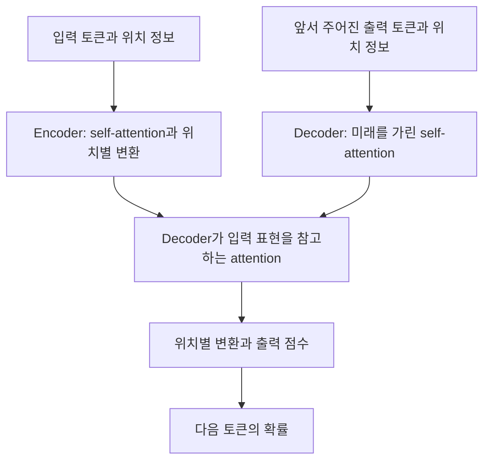

# Transformer의 attention 계산 | A worked attention calculation

대상은 Vaswani 등의 [Attention Is All You Need](https://arxiv.org/abs/1706.03762)입니다. 최초 제출은 2017년이며, 여기서는 [v7의 §3.2](https://arxiv.org/html/1706.03762v7#S3.SS2)를 기준으로 attention을 계산합니다. 논문의 번역 성능을 재현하는 실험과 아래의 수치 예제는 범위가 다릅니다.

논문은 NeurIPS 2017에 발표되었습니다. arXiv v7의 2023년 표시는 수정본의 날짜이며 연구의 최초 발표 연도를 바꾸는 표시는 아닙니다. 아래에서는 논문 구조의 핵심을 짚고, 직접 정한 두 토큰으로 한 연산을 끝까지 계산합니다.

## 제목의 attention을 읽는 방법

Attention에는 ‘주의를 기울인다’는 느낌이 있습니다. 이 문맥에서는 현재 위치가 다른 위치의 내용을 어떤 비율로 참고할지 정하는 계산입니다. 제목을 문자 그대로 받아들여 모델의 모든 연산이 attention이라고 생각하지는 않습니다. 논문의 구조에는 위치 정보, feed-forward 계산, 잔차 연결과 normalization도 있습니다.

[이전 attention 연구](딥러닝_deep-learning/번역의어텐션_bahdanau-attention.md)가 순환 모델의 번역에 참고할 위치를 고르는 장치를 연결했다면, 이 논문에서는 self-attention을 중심으로 위치 사이를 연결합니다. ‘Self’는 Q·K·V의 근원이 같은 입력열이라는 뜻으로 읽으시면 됩니다. 각 벡터가 서로 완전히 같다는 뜻은 아닙니다.

## 문장 전체에서의 계산 흐름

Encoder는 입력을 참고 가능한 표현으로 바꾸고, decoder는 이미 주어진 출력과 encoder 표현을 이용합니다. 원문의 연결과 수식은 §3.1–3.5에서 확인하실 수 있습니다. 위 그림은 흐름을 읽기 위해 직접 그린 요약이며 잔차·정규화 경로는 생략했습니다.

Feed-forward는 위치마다 같은 변환을 적용하되 그 변환 안에 비선형 함수를 넣는 계산입니다. Residual connection은 변환 결과에 원래 입력을 더하는 지름길입니다. Layer normalization은 한 위치의 특징값들을 묶어 평균·분산을 계산하는 방식으로 여기서는 잔차를 더한 뒤 적용됩니다. ‘정규화’가 무엇을 바꾸는지는 [용어와 숫자 예](논문을읽는용어_PAPER_TERMS.md)와 [LayerNorm 해설](딥러닝_deep-learning/층정규화_layer-normalization.md)에서 이어집니다.

## 논문에서 가져올 핵심

Transformer는 encoder–decoder 구조에서 attention과 위치별 feed-forward 계산을 사용합니다. Scaled dot-product attention은 query와 key의 내적을 $\sqrt{d_k}$로 나누고 softmax를 적용한 뒤, 그 비율로 value를 합칩니다. decoder의 미래 위치에는 마스크를 적용합니다. 이 설명의 근거는 원 논문 §3.1–3.2이며, 여기서는 해당 연산 하나를 분석합니다.

$$
\operatorname{Attention}(Q,K,V)=\operatorname{softmax}(QK^T/\sqrt{d_k})V
$$

| 기호 | 역할 | 이 예제의 크기 |
| --- | --- | --- |
| Q | 현재 위치가 찾는 정보를 표현합니다. | 한 행, 두 성분 |
| K | 각 위치를 비교할 기준입니다. | 두 행, 두 성분 |
| V | 비율에 따라 섞을 실제 내용입니다. | 두 행, 두 성분 |
| softmax | 점수를 합이 1인 양의 비율로 바꿉니다. | 두 위치의 혼합 비율 |

## 두 토큰을 손으로 계산하기

직접 정한 입력은 `q=[1,0]`, `k1=[1,0]`, `k2=[0,1]`, `v1=[10,0]`, `v2=[0,20]`입니다. 내적은 `[1,0]`이며 $d_k=2$이므로 점수는 `[1/√2,0]`입니다.

첫 비율은 $p_1=e^{1/\sqrt2}/(e^{1/\sqrt2}+1)$이고 두 번째는 $1-p_1$입니다. 따라서 출력은 $p_1[10,0]+(1-p_1)[0,20]$입니다. 점수가 더 큰 첫 위치만 선택하는 것이 아니라 두 value를 서로 다른 비율로 섞습니다.

| 계산 | Python 3.12.14에서 실행한 값 |
| --- | --- |
| attention 비율 | `[0.6697615493, 0.3302384507]` |
| 가중합 출력 | `[6.6976154933, 6.6047690135]` |
| 첫 위치에서 미래 위치를 가린 비율 | `[1.0]` |
| 미래 위치를 가린 출력 | `[10.0, 0.0]` |

마스크가 있을 때에는 두 번째 key를 아무리 크게 바꾸어도 첫 위치의 출력이 바뀌지 않아야 합니다. 이 성질을 검사하면 단순히 표의 숫자를 맞추는 것보다 미래 정보 누출을 직접 확인할 수 있습니다.

## 계산이 알려 주는 것

내적 점수와 attention 비율, 출력 벡터는 서로 다른 값입니다. 비율이 0.67이라고 해서 정답 확률이 67%라는 뜻은 아닙니다. 이 비율은 현재 행에서 value를 섞는 데 쓰입니다. 최종 출력 확률은 뒤의 여러 계산을 거쳐 정해집니다.

여기서는 입력 행렬을 직접 정했으므로 Q·K·V의 학습, multi-head 연결, feed-forward, residual, layer normalization, 위치 표현을 구현하지 않았습니다. 이 작은 계산이 맞는다는 사실은 번역 품질이나 학습 성공을 보여 주지 않습니다. 다음 단계는 [attention 수식 해설](../전자컴퓨터공학_ece/44-언어음성멀티모달AI_language-speech-multimodal/해설_notes/어텐션의수식과가중합_attention-from-equations.md)과 [역전파·캐시 검증](../전자컴퓨터공학_ece/44-언어음성멀티모달AI_language-speech-multimodal/해설_notes/어텐션역전파와캐시_attention-gradients.md)입니다.

## 병렬 계산의 이점과 길이의 비용

주어진 문장 전체의 학습 계산과 다음 토큰을 생성하는 과정은 다릅니다. 학습에서는 이미 주어진 토큰 사이의 계산을 병렬화할 수 있어도, 자기회귀 생성에서는 다음 입력에 쓸 토큰을 앞 단계에서 먼저 정해야 합니다. 마스크를 쓴다는 사실이 모든 출력 토큰을 한 번에 생성한다는 뜻은 아닙니다.

길이가 n인 입력에서 모든 위치 쌍을 비교하면 점수 칸은 n²개입니다. 직접 정한 길이 1,000에서는 1,000,000칸, 2,000에서는 4,000,000칸입니다. 길이를 두 배로 늘렸을 때 위치 쌍은 네 배가 됩니다. 이는 단일 head의 점수 칸 수이며 실제 peak memory나 총 실행시간의 실측값은 아닙니다. head 수, 정밀도, 저장하지 않고 계산하는 구현도 실제 비용에 영향을 줍니다.

논문의 번역 결과는 원문 §6의 데이터·모델 크기·비교 조건과 함께 읽어야 합니다. 후속 [BERT](딥러닝_deep-learning/양쪽문맥의가린토큰예측_bert.md)와 [GPT-3](언어와멀티모달_language-multimodal/문맥의예시로수행하는언어과제_gpt3.md)는 Transformer 계열의 구조를 서로 다른 학습 목표와 평가 방식으로 사용합니다. 한 연산의 수식이 이어진다고 이 모델들의 학습 방식과 용도가 모두 같아지는 것은 아닙니다.

## 자기 점검

1. 참고 비율이 0.8, 0.2이고 값이 10, 30이면 가중합은 얼마입니까?
2. 미래 위치의 점수를 0으로 바꾸면 softmax 뒤 비율도 반드시 0입니까?
3. 입력 길이가 세 배가 되면 위치 쌍의 수는 몇 배입니까?

답과 이유

1. `0.8×10+0.2×30=14`입니다.
2. 아닙니다. `exp(0)=1`이므로 유한한 다른 점수와 함께 정규화하면 양의 비율이 남습니다. 금지 위치는 비율에서 제외되도록 마스크해야 합니다.
3. 아홉 배입니다. 이는 n²의 비교 칸 수 관계이며 실행시간 아홉 배를 보장하는 측정은 아닙니다.

## 재실행

저장소 루트에서 `python 논문해설_papers/attention_calculation.py`를 실행합니다. 외부 패키지는 필요하지 않습니다. [실행 코드](attention_calculation.py)는 합 1, 비음수, 닫힌 형태와의 일치, 첫 위치 마스크, 미래 key 변경에 대한 불변성을 검사합니다. [원시 결과](attention_result.json)에는 반올림 전 값이 있습니다. 실행 확인일은 2026-10-19입니다.

## English

The worked example isolates scaled dot-product attention from Vaswani et al., §3.2. With two orthogonal keys and a two-component query, the weights are approximately 0.66976 and 0.33024. Their weighted value sum is `[6.69762, 6.60477]`. A causal mask leaves only the first value and makes the result invariant to future-key changes. The script checks these properties; it neither trains a Transformer nor reproduces translation scores.
