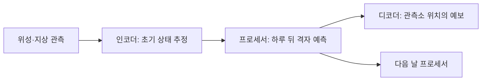

# 관측에서 예보까지 이어지는 Aardvark / Aardvark Weather from observations to forecasts

날씨를 예측하려면 앞으로의 변화만 계산하면 될까요? 현재 대기의 상태부터 알아내야 합니다. 위성은 구름과 복사 신호를, 관측소는 특정 위치의 온도와 바람을 측정합니다. 서로 다른 자료를 지금의 대기 상태로 연결하는 단계도 예보의 일부입니다. 이 논문은 그 단계부터 지역 예보까지 학습하는 구조를 다룹니다.

## 원문과 읽은 범위

Anna Allen, Stratis Markou, Will Tebbutt, James Requeima, Wessel P. Bruinsma, Tom R. Andersson, Michael Herzog, Nicholas D. Lane, Matthew Chantry, J. Scott Hosking, Richard E. Turner의 「End-to-end data-driven weather prediction」입니다. Cambridge·Toronto·Microsoft Research·British Antarctic Survey·ECMWF·Alan Turing Institute가 참여했습니다. Nature 641, 1172–1179, 온라인 2025년 3월 20일, 권호 5월 29일입니다. [출판 원문과 DOI](https://www.nature.com/articles/s41586-025-08897-0)

2026년 10월 20일의 출판 PDF에서 본문·Methods·확장 자료 표 1–2를 읽었습니다. 별도 Supplementary Information의 전체 실험은 이 해설의 확인 범위에 포함하지 않았습니다. 출판사의 2025년 6월 17일 변경 기록은 잘못 올라갔던 보충자료와 그 안의 참고문헌을 교체했다고 설명합니다. 2024년 사전논문을 별개의 연구로 세지 않습니다.

## 초기 상태와 미래 상태는 다른 문제입니다

자료동화는 관측과 모형의 정보를 결합해 대기의 현재 상태 등을 추정하는 과정입니다. 재분석은 과거 관측과 수치 모형을 일관된 체계로 다시 처리한 자료입니다. 실제 지구를 빈틈없이 직접 측정한 정답표는 아닙니다. [칼만 필터](../우주와관측_space-observation/예측과관측의불확실성결합_kalman-1960.md)는 추정과 관측의 불확실성을 함께 다루는 기초 사례입니다.

다음 그림은 논문의 세 모듈을 학습용으로 다시 구성한 것입니다.

논문은 ERA5로 사전학습하고 관측 자료로 조정합니다. 실행 시에는 새로운 ERA5 대기장을 입력하지 않습니다. ‘수치 모형을 전혀 이용하지 않았습니다’와 ‘실행할 때 수치 예보의 초기장이 필요 없습니다’는 따라서 다릅니다. 입력 자료에도 교정·위치 부여와 격자화가 적용됩니다.

이 구분은 다른 학습 시스템에도 중요합니다. 교사가 만든 정답으로 배운 학생이 시험장에서 교사에게 답을 묻지 않는다고 해서, 학습 과정에 교사의 지식이 없었던 것은 아닙니다. 이 비유는 학습 자료의 의존 관계를 설명하며 학생과 신경망의 학습 기제가 같다는 주장은 아닙니다.

## 무엇과 어떤 조건에서 비교했나요?

원문 그림 2·5와 Methods의 비교 범위는 다음과 같습니다.

| 항목 | 연구의 설정 | 읽을 때 구분할 것 |
|---|---|---|
| 시간 분할 | 2018년 이전 학습, 2018년 시험, 2019년 검증입니다. | 최신 연도의 실제 운영 실적은 아닙니다. |
| 전 지구 격자 | 1.50°이며 HRES·GFS도 비교용으로 같은 격자에 옮깁니다. | 원래 해상도의 모든 현상을 비교한 것은 아닙니다. |
| 관측소 | 기온·풍속을 관측소 보정 HRES, 미국 NDFD 등과 비교합니다. | 시험 관측소는 학습 때 본 위치의 다른 시점입니다. |

여러 변수·예측 기간에서 GFS와 경쟁하지만 모든 조건에서 HRES를 앞서지는 않습니다. 보고한 관측 입력은 운영 체계가 이용 가능한 양의 약 8%입니다. 적은 입력으로 가능한 예보를 보였다는 의미이지 나머지 관측이 불필요하다는 결론은 아닙니다.

## 직접 계산하는 MAE와 RMSE

다음 숫자는 원문 실측값이 아닌 자체 예입니다. 세 장소에서 예측 오차가 A는 `−1, 2, −1°C`, B는 `0, 0, 4°C`라고 하겠습니다.

| 지표 | 계산 방법 | A | B |
|---|---|---:|---:|
| 평균 절대오차 MAE | 오차의 절댓값을 더해 3으로 나눕니다. | 4/3°C | 4/3°C |
| 제곱근 평균제곱오차 RMSE | 제곱의 평균을 낸 뒤 제곱근을 취합니다. | √2 ≈ 1.414°C | √(16/3) ≈ 2.309°C |

평균적인 절대 차이는 같아도 큰 오류에 더 큰 비중을 주면 B가 나쁩니다. 기온의 평균 오차가 작다는 사실만으로 폭염 경보의 놓침도 작다고 말할 수는 없습니다. 경보는 임계값을 넘는 사건의 빈도·놓침·오경보를 별도로 평가해야 합니다.

위도 가중치도 생각해 보겠습니다. 위도·경도를 같은 간격으로 나눈 격자는 극지방으로 갈수록 한 칸의 실제 면적이 작습니다. 자체 예로 적도와 북위 60° 두 칸의 오차를 2와 4, 면적 비중을 1과 0.5로 단순화하면 가중 RMSE는 `√((1×2²+0.5×4²)/1.5)=√8≈2.828`입니다. 가중치를 곱한 뒤 분모도 맞추어야 합니다.

## 해상도를 맞추면 사라지는 차이도 있습니다

아래는 실제 기상 자료가 아닌 자체 격자 예입니다. 작은 두 구역의 기온이 각각 24°C와 32°C인데 모형이 둘 다 28°C라고 예측했다고 하겠습니다. 두 구역을 한 큰 칸으로 평균하면 관측도 예측도 28°C가 되어 평균 오차는 0입니다. 하지만 각 구역에는 4°C의 오차가 남습니다.

그러므로 큰 격자로 맞춘 전 지구 성능과 골짜기·해안·도시 열섬의 국지 예보는 다른 시험입니다. 논문의 지역 디코더도 격자보다 세밀한 위치에 값을 주는 방법이지, 세밀한 모든 대기 현상이 복원됐다는 보장은 아닙니다.

## 빠른 실행이 운영 전체의 대체를 뜻할까요?

원문은 네 A100에서 예보 실행 약 1초를 보고하고 HRES 자료동화·예보의 약 1,000노드·시간을 인용합니다. 서로 다른 장비의 GPU·초와 노드·시간을 나누어 동일 조건의 전력·비용 배수로 만들 수는 없습니다. 관측망·학습·자료 전달·운영 감시도 별도의 비용입니다.

예보를 실제로 도입한다면 새 위성으로 입력 분포가 바뀌는 경우, 관측이 끊기는 경우, 드문 극한 사건, 확률 예보의 보정부터 추가로 시험해야 합니다. 이 연구의 의의는 모든 예보 업무를 끝냈다는 데 있지 않고, 관측에서 지역 출력까지 연결해 조정할 수 있는 설계와 비교 결과를 제시했다는 데 있습니다.

## 확인 문제

1. 실행 시 ERA5 입력이 없으면 학습도 수치 모형과 무관했을까요?
2. A와 B의 MAE가 같은데 RMSE가 다른 이유는 무엇일까요?
3. 큰 격자의 평균 오차가 0이면 그 안의 모든 장소에서 예보가 맞을까요?

답과 해설

1. 아닙니다. ERA5 재분석을 사전학습에 사용한 것과 실행 시 초기장을 요구하는 것을 구분합니다.
2. 제곱이 큰 오차에 더 큰 비중을 주기 때문입니다. 같은 절대오차 합이라도 한곳에 큰 오류가 몰리면 RMSE가 커질 수 있습니다.
3. 아닙니다. 서로 다른 지역의 차이가 평균에서 상쇄될 수 있습니다. 지역별·극한 사건별 평가가 필요합니다.

[기상과 지구 시스템](README.md) · [모형의 설명과 검증](../../인문사회_humanities/58-철학비판적사고_philosophy-critical-thinking/개념_concepts/과학의설명과검증_explanation-and-testing.md) · [전체 논문 목록](../README.md)
