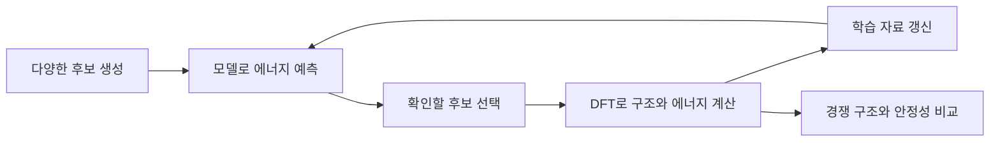

# GNoME: 재료 후보를 예측하고 다시 계산하며 배우기

| 원문 정보 | 내용 |
| --- | --- |
| 제목 | Scaling deep learning for materials discovery |
| 저자 | Amil Merchant, Simon Batzner, Samuel S. Schoenholz, Muratahan Aykol, Gowoon Cheon, Ekin Dogus Cubuk |
| 연구 기관 | Google DeepMind, Google Research |
| 발표 | Nature 624, 80–85쪽, 2023년 11월 29일 온라인 공개 |
| 원문 | [논문과 추가 자료](https://www.nature.com/articles/s41586-023-06735-9), [공개 데이터·코드](https://github.com/google-deepmind/materials_discovery) |
| 읽을 위치 | 본문 생성·선별, active learning, 안정 구조·검증, 원자 간 포텐셜·전도체 선별, 결론과 Methods의 데이터 분할·DFT·검증 정의 |

## 1. 새 재료는 원소 이름을 조합하는 것만으로 정해지지 않습니다

같은 원소 비율이라도 원자의 배열이 다르면 다른 결정 구조가 됩니다. 가능한 배열을 모두 비싼 계산이나 실제 실험으로 확인하기 어렵다는 문제가 있습니다. GNoME는 그래프 신경망으로 후보의 에너지를 예측하고, 골라낸 후보를 밀도범함수이론인 DFT로 다시 계산합니다. 그 결과를 다음 학습에 넣는 순환을 구성합니다.

그래프는 원자 같은 대상을 점으로, 주변 원자의 관계를 선으로 표현하는 방식입니다. DFT는 전자 밀도를 바탕으로 물질의 에너지 등을 근사 계산하는 이론입니다. 신경망 점수와 실험실 합성 결과 사이에는 이 물리 계산과 실제 제작·분석이라는 서로 다른 단계가 있습니다.

## 2. 원문 순서에 따라 방법을 구분합니다

| 원문의 부분 | 방법의 의미 |
| --- | --- |
| Generation and filtration | 기존 구조를 바꾸는 경로와 조성에서 출발하는 경로로 후보를 만듭니다. |
| GNoME·Active learning | 이웃 정보를 모으는 그래프 모델로 에너지를 예측하고 DFT 결과를 다시 학습합니다. |
| Stable crystals·Validation | 경쟁 구조와 비교하고 다른 계산 근사·실험 데이터와의 일치를 확인합니다. |
| Interatomic potentials | 축적한 에너지와 힘을 이용해 원자 움직임을 계산하는 모델도 학습합니다. |
| Methods | 후보 생성, 데이터 분할, 구조 완화, 일치 판정의 구체적 기준을 확인합니다. |

원문은 기존 비교 집합에 대해 안정한 후보 약 220만 구조와, 경쟁 후보를 함께 넣은 뒤 새 convex hull에 남는 약 38만 1천 구조를 구분합니다. 이는 모두 실제로 합성한 새 물질의 개수라는 뜻이 아닙니다. 실험 데이터와의 일치도 별도 절과 정의로 설명합니다.

이 글에서는 데이터와 소프트웨어를 직접 내려받아 GNoME를 훈련하지 않았습니다. 아래는 원리를 이해하기 위해 구성한 작은 예제입니다.

## 3. Convex hull을 낮은 에너지의 경계로 이해합니다

Convex hull은 보통 볼록 껍질이라고 번역합니다. 재료의 상 안정성 문맥에서는 주어진 조성에서 경쟁 물질을 섞어 얻을 수 있는 낮은 에너지의 경계를 생각하시면 됩니다. 단순히 원자 수가 많거나 원자들이 그림에서 볼록하게 생겼다는 뜻이 아닙니다.

원소 A와 B의 기준 에너지를 원자당 0 eV로 정하겠습니다. AB 결정의 총 형성 에너지가 두 원자당 −0.8 eV라면 원자당 값은 −0.4 eV입니다. A와 B를 따로 두는 혼합의 기준 0보다 낮습니다.

| 자체 후보 | B 원자 비율 | 원자당 에너지 |
| --- | ---: | ---: |
| A | 0 | 0 eV |
| B | 1 | 0 eV |
| 기존 AB 구조 | 0.5 | −0.30 eV |
| 새 AB 구조 | 0.5 | −0.40 eV |

새 구조를 넣기 전에는 기존 AB가 비교 집합에서 유리할 수 있습니다. 새 AB가 들어오면 기존 AB는 같은 조성의 더 낮은 에너지 구조보다 원자당 0.10 eV 높습니다. ‘안정’이라는 판단에 비교 집합이 들어간다는 뜻입니다. 새로운 후보가 더해지면 앞선 판단이 달라질 수 있습니다.

여기서 비교한 것은 특정 근사와 조건에서의 에너지입니다. 실제 온도에서의 진동·엔트로피, 반응 속도와 합성 경로는 이 네 줄 표에 들어 있지 않습니다. 에너지가 낮다는 계산만으로 당장 원하는 조건에서 합성할 수 있다고 판정하지 않습니다.

## 4. 모델의 선별 성능을 어떻게 세나요?

자체 예에서 후보 40개 가운데 모델이 8개를 골랐고, 추가 계산에서 6개가 정한 안정성 조건을 만족했다고 하겠습니다. 선택한 후보의 적중률은 `6/8=75%`입니다. 전체 후보 중 75%가 안정하다는 뜻은 아닙니다.

나머지 32개를 계산하지 않았다면 그 안에 놓친 안정 구조가 몇 개인지 알 수 없습니다. 따라서 이 정보만으로 재현율을 계산할 수 없습니다. 모델을 이용한 선별에서는 많이 찾는 목표와 적은 계산으로 찾는 목표를 나누어야 합니다.

Active learning은 자료를 수동적으로 계속 받기만 하는 대신, 다음에 확인할 대상을 선택하면서 배우는 방식입니다. 선택 기준 자체가 탐색 범위에 영향을 줍니다. 확실한 후보만 계속 고르면 낯선 영역을 덜 볼 수 있고, 불확실한 후보만 고르면 확인 비용이 커질 수 있습니다.

## 5. 데이터가 새롭다는 의미도 확인합니다

같은 조성의 여러 구조를 학습·시험에 무작위로 흩어 놓으면 새 조성에 대한 성능을 과대평가할 수 있습니다. 원문 Methods는 조성에 기반한 분할을 설명합니다. 자체 예로 AB의 두 배열이 각각 학습과 시험에 들어간 경우와, AB는 학습에만 두고 AC를 시험하는 경우는 다른 질문을 평가합니다.

또한 실험 데이터베이스와 구조가 일치했다는 결과는 해당 연구팀이 모두 직접 합성했다는 뜻이 아닙니다. ‘새 데이터 항목’, ‘기존 과학에 없던 재료’, ‘시험 환경에서 새 조성’, ‘제품에 쓰인 소재’를 분리해서 읽으시면 결과의 의미가 명확해집니다. [A-Lab](alab-2023.md)은 계산 후보를 실험으로 옮기는 과정과 정정 사례를 보여 줍니다.

## 자기점검

1. AB 네 원자 구조의 형성 에너지가 −1.2 eV라면 원자당 값은 얼마인가요?
2. 선택한 후보 20개 중 15개가 조건을 만족하면 적중률은 얼마인가요?
3. DFT에서 안정하다고 계산되었다는 말만으로 상온 합성·내구성·반도체 성능을 보장할 수 있나요?

답과 이유

1. −0.3 eV/원자입니다. 서로 다른 크기의 구조를 비교하려면 같은 기준으로 환산합니다.
2. 75%입니다. 선택하지 않은 후보의 정답이 없으면 전체 재현율은 알 수 없습니다.
3. 보장할 수 없습니다. 계산 조건과 합성·기능·신뢰성의 확인은 서로 다른 근거입니다.

[반도체와 소재 논문 목록](README.md)
