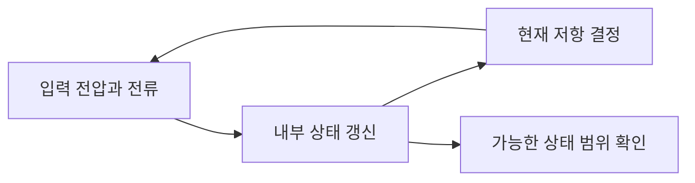

# 멤리스터: 지나간 입력이 현재 저항에 남는 모델

| 원문 정보 | 내용 |
| --- | --- |
| 제목 | The missing memristor found |
| 저자·기관 | Dmitri B. Strukov, Gregory S. Snider, Duncan R. Stewart, R. Stanley Williams / HP Labs |
| 발표 | Nature 453, 80–83쪽, 2008년 5월 1일 |
| 원문 | [발표 기록](https://www.nature.com/articles/nature06932), [저자가 공개한 PDF](https://www.ece.ucsb.edu/~strukov/papers/2008/Nature2008.pdf) |
| 정정 | [2009년 정정문 DOI](https://doi.org/10.1038/nature08166), [대학 보관 정정문](https://people.eecs.berkeley.edu/~prabal/teaching/eecs598-w10/readings/SSSW08.pdf) |
| 읽을 위치 | 80쪽 식 (1)–(4), 81쪽 두 영역 모델·식 (5)–(7), 82쪽 경계와 그림 3, 83쪽 적용 범위 |

## 1. 같은 전압인데 전류가 다른 이유

보통의 이상적인 저항은 현재 전압과 전류의 관계를 일정한 R로 나타냅니다. 이 논문은 내부 상태가 입력의 이력에 따라 변하고, 그 상태에 따라 저항이 달라지는 소자 모델을 다룹니다. `memristor`는 memory와 resistor를 결합한 이름입니다. 사람이 경험을 기억한다는 의미까지 포함하지 않습니다.

원문은 1971년 Chua의 전하·자속 관계에서 출발해 더 넓은 memristive system과 구분합니다. 뒤이어 얇은 막의 두 영역 경계를 상태 변수로 삼습니다. 그림 2와 3의 여러 곡선은 모델 시뮬레이션이며, 그림 3d의 실험 비교와 구분해야 합니다. 이 글 역시 새로운 소자를 제작한 실험 기록은 아닙니다.

## 2. 원문 각 부분이 설명하는 것

| 원문 부분 | 핵심 질문 |
| --- | --- |
| 식 (1)–(4) | 상태가 전하 하나로 정해지는 경우와 더 일반적인 동적 소자는 어떻게 다릅니까? |
| 식 (5)–(7) | 이동하는 경계가 두 저항 영역의 길이와 전체 저항을 어떻게 바꿉니까? |
| 82쪽 경계 논의 | 경계가 막의 끝에 도달하면 단순 선형 이동식을 계속 써도 됩니까? |
| 그림 3·마무리 | 구동 조건과 경계 규칙의 차이가 전압·전류 곡선에 어떻게 나타납니까? |

상태 변수는 현재를 설명하는 데 필요한 내부 값입니다. 여기서는 도핑된 영역의 길이 w를 사용합니다. 전체 막 두께 D와 같지 않으며 `0≤w≤D`입니다. 전하 q는 전류를 시간에 따라 더한 양입니다. 저항이 q에만 의존하는 이상 모델과 온도·다른 내부 변수도 필요한 실제 소자는 구분하셔야 합니다.

## 3. 두 영역의 저항을 직접 더합니다

아래는 설명을 위해 직접 정한 값입니다. x를 `w/D`라고 놓으면 두 영역을 직렬 저항으로 보는 모델은 다음과 같습니다.

```math
R(x)=R_{ON}x+R_{OFF}(1-x),\qquad 0\le x\le1.
```

R_ON=100 Ω, R_OFF=10,000 Ω로 정합니다. x=0.2라면 `100×0.2+10,000×0.8=8,020 Ω`입니다. x=0.8이면 `80+2,000=2,080 Ω`입니다. 낮은 저항 영역이 더 큰 비중을 차지할수록 전체 저항이 낮아집니다.

| 자체 상태 x | 저항 | 1 V를 걸고 상태 변화를 잠시 무시한 전류 |
| --- | ---: | ---: |
| 0.2 | 8,020 Ω | 약 0.12469 mA |
| 0.5 | 5,050 Ω | 약 0.19802 mA |
| 0.8 | 2,080 Ω | 약 0.48077 mA |

같은 1 V에도 전류가 다릅니다. 전압을 걸어 둔 동안 상태까지 변하면 표의 한 행에 계속 머무르지 않습니다. 정적인 저항 계산과 시간에 따른 상태 갱신을 분리해서 따라가는 것이 좋습니다.

## 4. 이력을 계산할 때 필요한 경계

자체 학습 모델에서 `dx/dq=0.01 /µC`, 초기 x=0.2라고 가정합니다. +30 µC가 통과하면 x=0.5입니다. 이후 −10 µC가 통과하면 x=0.4입니다. 이 구간에서의 저항은 각각 5,050 Ω과 6,040 Ω입니다. 이 상수와 수치는 원문 장치의 추정값이 아닙니다.

처음부터 +100 µC를 단순히 대입하면 x=1.2가 되어 허용 범위를 벗어납니다. 막 안의 경계가 막 바깥으로 이동했다고 해석할 수는 없습니다. 포화와 반대 방향 입력 때의 동작을 별도로 정해야 합니다. 원문도 끝점 가까이에서 선형 이동과 다른 경계 규칙을 다룹니다.



그래프에 고리가 생기는 hysteresis는 같은 입력값에서도 과거 경로에 따라 출력이 달라질 수 있다는 뜻입니다. 고리가 보인다는 관찰 하나로 모든 내부 기작이 유일하게 결정되지는 않습니다. 측정 주파수와 누설·열·경계 조건도 확인해야 합니다.

## 5. 정정문을 먼저 반영합니다

2009년 정정문은 그림 2a의 한 저항을 `R_OFF(1−w/D)`로 고치고 창 함수의 표기를 수정합니다. 저자들은 공개된 시뮬레이션에는 올바른 식을 사용했다고 설명합니다. 따라서 원래 그림의 잘못된 비율을 그대로 복사해 계산하면 본문 식과 충돌합니다. 위 계산은 정정된 두 영역 비율을 사용합니다.

이 연구는 저항 변화와 내부 상태를 연결하는 중요한 계산 관점을 제공합니다. 그러나 실제 산화물 소자가 모든 조건에서 이상적인 전하 제어 멤리스터라는 보장은 아닙니다. 메모리나 신경망에 사용할 때에는 읽기 중 상태 변화, 유지 시간, 반복 내구성, 소자 간 차이도 평가해야 합니다. ‘신경과 닮은 기능’은 생물 신경세포의 모든 성질을 복제했다는 뜻이 아닙니다.

## 자기점검

1. 위 모델에서 x=0이면 전체 저항은 얼마인가요?
2. x=0.4에서 1 V를 걸고 상태를 고정하면 전류는 약 얼마인가요?
3. x가 1을 넘는 계산 결과가 나오면 선형식을 그대로 계속 사용해도 되나요?

<details>
<summary>답과 이유</summary>

1. R_OFF인 10,000 Ω입니다.
2. 저항은 6,040 Ω이므로 약 0.16556 mA입니다.
3. 안 됩니다. 모델의 정의역을 벗어났으므로 경계에서의 동작을 정해야 합니다.

</details>

[반도체와 소재 논문 목록](README.md)
