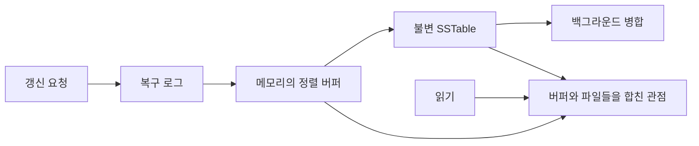

# 정렬된 행 범위로 나누는 저장소 / Bigtable’s data model and storage

Bigtable의 자료형은 단순한 표 그림보다 정확하게 적는 편이 이해에 도움이 됩니다. 행 이름·열 이름·버전으로 바이트 배열을 찾으며, 행 이름의 정렬 순서가 분산 배치와 조회 비용에 영향을 줍니다.

| 항목 | 원문 정보 |
| --- | --- |
| 논문 | Fay Chang, Jeffrey Dean, Sanjay Ghemawat, Wilson C. Hsieh, Deborah A. Wallach, Mike Burrows, Tushar Chandra, Andrew Fikes, Robert E. Gruber, Bigtable: A Distributed Storage System for Structured Data |
| 발표 | OSDI 2006, 205–218쪽 |
| 당시 소속 | Google, Inc.입니다. |
| 원문 | [Google 공개 PDF](https://research.google.com/archive/bigtable-osdi06.pdf) |
| 읽을 위치 | §2–3 모델·API, §4 의존 서비스, §5 저장·복구, §6 압축·필터·캐시, §7 평가, §8–9 사례·운영 경험입니다. |

## 빈 칸을 모두 저장하는 표가 아닙니다

원문은 행·열·시각으로 찾는 희소 정렬 맵과, 행 범위를 나누는 tablet을 설명합니다. 최근 갱신은 메모리 구조, 오래된 내용은 정렬된 불변 파일에 두며 읽을 때 병합합니다. 단일 행 원자성과 일반적인 여러 행 트랜잭션은 구분됩니다. 평가에는 당시 기계·GFS·요청 패턴이 지정됩니다. 다음 데이터와 비용은 자체 예제입니다.

맵은 키에서 값을 찾는 자료구조입니다. 희소하다는 것은 가능한 모든 행·열 조합의 빈 항목을 물리적으로 마련하지 않는다는 뜻입니다. 열 가족 column family는 열을 묶어 관리하는 단위이며, `가족:한정자`에서 한정자는 그 안의 구체적인 열 이름입니다. 값 자체는 저장소가 의미를 해석하지 않는 바이트 배열입니다.

직접 만든 장비 기록에서 한 셀을 다음처럼 나타낼 수 있습니다.

```text
행: plantA:sensor07
열: reading:temperature
버전: 100
값: 바이트 배열 "23.4"
```

`23.4`를 실수로 해석할지 문자열로 해석할지는 응용이 정한 인코딩에 달렸습니다. 버전 100·101에 서로 다른 측정값을 보관할 수도 있습니다. 정수 타임스탬프를 사용한다는 사실만으로 서로 다른 장비의 시계가 동기화되거나 전역 트랜잭션 순서가 보장되지는 않습니다.

## 행 키가 조회 계획의 일부가 됩니다

자체 키를 `공장:장비:시각`으로 만들면 같은 장비의 시계열이 연속합니다. 반대로 `시각:공장:장비`로 만들면 같은 시각대의 여러 장비가 가까워집니다. 한 키가 두 정렬을 동시에 만족시키지는 못합니다.

| 주된 조회 | 유리한 앞부분 | 남는 문제 |
| --- | --- | --- |
| 장비 한 대의 최근 기록 | 공장·장비 | 모든 장비의 특정 시각을 모으면 여러 범위를 읽을 수 있습니다. |
| 특정 시각대의 전체 장비 | 시각 | 증가하는 최신 키 끝에 쓰기가 몰릴 수 있습니다. |
| 장비를 고르게 흩어 쓰기 | 해시 접두부 | 한 장비나 시간 범위 조회가 여러 조각으로 나뉠 수 있습니다. |

정렬에 좋은 키와 부하 분산에 좋은 키는 같은 기준이 아닙니다. 예컨대 쓰기가 전부 마지막 1%의 키 범위에만 집중되면 전체 서버가 많아도 그 범위를 담당하는 서버가 먼저 바빠질 수 있습니다. 분할 가능한 단위와 요청의 쏠림을 함께 봐야 합니다.

tablet은 행 범위이고 tablet server는 이를 제공하는 실행 서버입니다. 둘을 같은 개수로 생각하면 안 됩니다. 한 서버가 여러 tablet을 담당할 수 있으며, 범위를 나누거나 옮기는 것과 서버를 새로 켜는 것은 별도 작업입니다.

## 기록 경로와 읽기 경로

갱신은 복구용 기록을 남긴 뒤 메모리의 정렬된 버퍼인 memtable에 반영합니다. 버퍼를 불변 SSTable 파일로 내보내고, 파일이 많아지면 병합합니다. SSTable은 한 번 만든 뒤 기존 내용을 제자리에서 고치지 않는 정렬 맵입니다. 불변성은 동시 읽기와 파일 공유를 단순하게 하지만, 새 버전과 삭제를 다른 곳에 기록해야 합니다.



자체 예로 오래된 파일에 `k=7`, 새 파일에 `k=9`가 있으면 최신 버전을 우선해 9를 읽습니다. 이후 삭제 표식이 버퍼에 있다면 키가 없다고 읽어야 합니다. 표식만 먼저 지우고 옛 파일 7을 남기면 삭제한 값이 다시 보입니다. 병합은 순서대로 합치는 작업뿐 아니라 어떤 버전과 삭제 정보를 더 이상 필요로 하지 않는지 판단하는 작업입니다.

복구 로그와 SSTable도 역할이 다릅니다. 로그는 아직 파일로 정리되지 않은 갱신을 복원하고, 정렬 파일은 키 조회와 범위 조회를 제공합니다. 메모리에 있는 데이터가 빠르다는 사실은 전원 손실 후에도 남는다는 뜻이 아닙니다.

## 작은 값을 읽어도 큰 블록을 가져올 수 있습니다

자체 비용 모형에서 필요한 값이 1KiB인데 저장 블록이 64KiB라면, 캐시 미스 한 번에 최대 블록 64KiB를 가져와야 할 수 있습니다. 이런 독립 읽기 1,000번은 유용한 값 약 0.977MiB에 대해 블록 약 62.5MiB를 가져옵니다. 이 계산은 압축·재사용·프로토콜 비용을 제외한 예입니다.

반면 다음 64개 값이 같은 블록에 있고 이미 가져온 블록을 재사용한다면 요청마다 블록을 다시 읽지 않습니다. 순차 읽기와 무작위 읽기의 차이는 함수 이름이 아니라 재사용되는 데이터 범위에 있습니다. 한 RPC로 여러 값을 받는 스캔도 요청당 고정비를 나눕니다.

[Bloom 필터](bloom1970.md)는 파일에 그 행·열이 확실히 없는지 거르는 데 쓰일 수 있습니다. 음성 판단으로 파일 읽기를 생략하지만, 양성이 실제 존재를 확정하지는 않습니다. 블록 캐시는 가져온 블록을 재사용하고, 필터는 가져올 필요가 없는 파일을 제외하므로 서로 다른 비용을 줄입니다.

## 분산 서비스와 데이터 모델의 경계

본문의 클라이언트는 위치를 알아낸 뒤 tablet server와 직접 통신합니다. 모든 데이터 요청이 master를 통과하는 구조로 그리면 데이터 경로와 배치 관리 경로가 섞입니다. 반면 Chubby 같은 메타데이터·잠금 서비스에 대한 의존은 남으므로 “master를 거치지 않는다”를 모든 제어 서비스와 독립적이라고 읽어서는 안 됩니다.

단일 행의 원자 갱신은 같은 행의 두 열을 함께 바꾸는 데 유용합니다. 하지만 A 계좌 행에서 10을 빼고 B 계좌 행에 10을 더하는 작업을 여러 행 쓰기 배치로 보냈다고, 원문 모델의 일반 분산 트랜잭션이 되는 것은 아닙니다. 데이터 모델의 보장을 응용의 회계 불변식과 맞추어야 합니다.

후속 [Spanner](spanner2012.md)는 여러 그룹의 트랜잭션과 시간 불확실성을 별도로 다루는 연구로 연결해 읽을 수 있습니다. 원문 Bigtable의 당시 제약을 현재 상용 제품 전체의 기능으로 단정하지 않습니다. 같은 제품 이름도 2006년 논문과 오늘의 서비스 사양은 구분해야 합니다.

## 결과를 비교하는 기준

§7의 총처리량과 서버당 처리량은 다릅니다. 서버 수가 10배이고 총처리량이 6배라면 서버당 처리량은 0.6배가 됩니다. 총량이 늘었다는 사실과 선형 확장이라는 주장은 별도입니다. 이 숫자는 자체 산술이며 원문의 측정을 옮긴 것이 아닙니다.

압축률·값 크기·캐시 적중률·부하 균형·네트워크 공유 여부가 달라지면 병목도 바뀝니다. 논문을 읽고 “분산 맵은 항상 관계형 DB보다 빠르다”는 결론을 내리기보다, 필요한 트랜잭션과 조회를 어떤 자료 배치로 만족시키는지 비교해야 합니다.

## 자기 점검

1. 행 키의 정렬 방식은 왜 조회 비용과 쓰기 쏠림에 영향을 주나요?
2. 삭제 표식을 옛 값보다 먼저 없애면 어떤 문제가 생기나요?
3. 서버 수 10배, 총처리량 6배라면 서버당 처리량은 몇 배인가요?

<details>
<summary>해설 보기</summary>

1. 행 범위가 분산 배치의 단위이고, 연속 키 조회는 가까운 범위를 읽기 때문입니다. 최신 키가 한쪽에 몰리면 쓰기 부하도 집중될 수 있습니다.
2. 옛 파일의 값이 다시 살아난 것처럼 읽힐 수 있습니다. 더 오래된 버전을 안전하게 제외할 조건과 함께 제거해야 합니다.
3. 6/10=0.6배입니다. 총 확장과 서버당 효율을 따로 봅니다.

</details>

[이 분야의 논문 목록](README.md)
