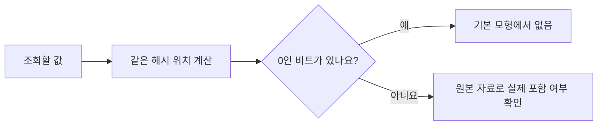

# Bloom: ‘없습니다’를 빠르게 확인하는 필터 / Fast negative membership checks

| 항목 | 내용 |
|---|---|
| 논문 | Space/Time Trade-offs in Hash Coding with Allowable Errors |
| 저자·당시 소속 | Burton H. Bloom, Computer Usage Company; 일부 연구는 Computer Corporation of America 재직 중 수행했다고 표기했습니다. |
| 발표 | Communications of the ACM 13(7), 422–426쪽, 1970년 7월 |
| 원문 | [대학 보관 원문 PDF](https://courses.cs.washington.edu/courses/csep521/21wi/readings/bloom_cacm.pdf) |
| 읽을 위치 | A Sample Application, Two Hash-Coding Methods, Computational Factors, Analysis of Method 2, Comparison, Hyphenation Application |

## 작은 오류를 허용한다는 말의 방향

논문은 집합에 속하지 않는 대상을 대부분 검사하는 상황에서 공간·거절 시간·허용 오류를 함께 분석합니다. Method 2는 여러 비트 위치를 1로 표시하고, 검사 위치 중 0이 있으면 거절합니다. 오류는 집합 밖의 대상을 안에 있다고 받아들이는 방향입니다. 방법 비교는 비트 주소 계산·접근 비용을 일정하게 둔 강한 가정에 의존하며, 마지막 응용 표는 가정한 하이픈 처리 사례의 예상값입니다. [원문 422–426쪽](https://courses.cs.washington.edu/courses/csep521/21wi/readings/bloom_cacm.pdf)

이 필터를 완전한 사전이라고 생각하면 용도를 잘못 잡습니다. ‘없습니다’라는 빠른 결과로 비싼 후속 검사를 생략하되, ‘있을 수 있습니다’라는 결과에는 실제 자료를 다시 확인하는 구성을 생각하시면 됩니다.

## 비트·해시·거짓 양성

비트는 0 또는 1을 담는 자리입니다. 해시 함수는 입력에서 제한된 범위의 번호를 계산합니다. 서로 다른 입력이 같은 번호로 갈 수 있는데 이를 충돌이라고 합니다. 필터의 해시는 암호화와 같지 않으며, 번호만으로 원래 값을 복원하도록 만든 것도 아닙니다.

`거짓 양성`은 실제로 없는 대상을 있을 수 있다고 받아들이는 경우입니다. `거짓 음성`은 실제로 있는 대상을 없다고 거절하는 경우입니다. 아래의 기본 필터는 삽입에 쓴 해시와 비트가 그대로 유지된다는 조건에서 후자를 만들지 않습니다. 자료가 손상되거나 삭제 규칙을 바꾸어도 같은 보장이 유지된다는 뜻은 아닙니다.

## 직접 따라가기: 8비트의 작은 필터

이 절의 입력과 해시는 직접 만든 예제입니다. 비트 번호는 0~7이며 처음에는 모두 0입니다. 두 해시 위치를 다음과 같이 정하겠습니다.

| 입력 | 해시 위치 | 집합에 실제로 넣었나요? |
|---|---|---|
| A | 1·4 | 예 |
| B | 2·4 | 예 |
| C | 1·2 | 아니요 |
| D | 2·6 | 아니요 |

A를 삽입하면 1·4번이 1, B까지 삽입하면 1·2·4번이 1입니다. 4번을 두 번 표시해도 값은 여전히 1입니다.

```text
번호:       0 1 2 3 4 5 6 7
초기:       0 0 0 0 0 0 0 0
A 삽입 뒤:  0 1 0 0 1 0 0 0
B 삽입 뒤:  0 1 1 0 1 0 0 0
```

C를 검사하면 1·2번이 모두 1이므로 통과합니다. 하지만 그 비트들은 A와 B가 나누어 만든 결과입니다. C라는 원소가 들어 있었다는 증거는 아닙니다. 이것이 거짓 양성입니다. D는 6번이 0이어서 거절할 수 있습니다. 삽입한 D라면 그 위치가 반드시 1이어야 했다는 조건을 사용합니다.



## 왜 단순 삭제가 위험한가요?

A를 지운다고 1·4번을 0으로 바꾸면, 아직 들어 있는 B의 4번도 사라집니다. 이후 B를 검사할 때 2번은 1이지만 4번은 0이므로 잘못 거절합니다. 같은 비트를 누가 함께 사용했는지 1비트만으로는 알 수 없기 때문입니다.

각 자리의 횟수를 저장하는 다른 구조를 생각할 수 있지만, 이는 기본 비트 필터와 다른 자료구조입니다. 횟수의 범위·감소 규칙·메모리 비용·잘못된 삭제를 따로 다루어야 합니다. 이 논문의 기본 구조에 아무 조건 없이 삭제를 덧붙였다고 표시해서는 안 됩니다.

## 직접 계산: 비트 수와 해시 수의 균형

다음 식은 독립적이고 균등한 해시를 가정하는 이상화 근사입니다. 원문의 서로 다른 위치 선택 규칙과 모든 유한 크기의 정확한 확률식을 같다고 두지 않습니다. 비트 수 m, 삽입 수 n, 원소당 해시 수 k일 때 점유율을 근사하면 다음과 같습니다.

```math
q\approx1-e^{-kn/m},\qquad
p_{FP}\approx q^k.
```

해시 수를 늘리면 통과하려면 확인해야 할 위치가 늘지만, 삽입할 때 1로 만드는 비트도 많아집니다. 두 효과가 반대 방향입니다. m=1,000, n=100, k=7이면 `q≈1−e⁻⁰·⁷≈0.5034`, 거짓 양성 확률은 약 0.00819입니다. 이 모형의 최적 해시 수 근사 `(m/n)ln2≈6.93`과 가까운 정수를 고른 예입니다.

같은 1,000비트에 원소를 200개 넣으면서 k=7을 유지하면 근사 확률은 약 0.138입니다. 원소가 두 배가 되었다고 거짓 양성도 단순히 두 배인 것은 아닙니다. 예상 적재량을 넘기는 일은 구조의 오류 확률에 직접 영향을 줍니다.

1,000비트는 125바이트입니다. 원소 100개를 각각 64비트 식별자로 저장하면 식별자만 800바이트입니다. 하지만 앞의 125바이트 구조는 원소를 나열하거나 충돌 없이 복원할 수 없습니다. 해시·메타데이터·실제 원본 자료의 저장 비용도 비교에서 빠져 있습니다. 서로 다른 기능을 가진 두 크기를 같은 기능의 압축률이라고 말하면 안 됩니다.

## 오류 확률과 통과 결과의 신뢰도는 다릅니다

가상의 10만 조회 중 실제 포함 원소가 1,000개, 미포함 조회가 99,000개라고 하겠습니다. 미포함 조회에 대한 거짓 양성률이 1%라면 약 990개가 불필요하게 통과합니다. 실제 포함 1,000개와 합쳐 원본 검사는 약 1,990번입니다. 조회마다 원본을 보는 방식보다 약 98.01%를 생략하는 계산입니다.

그런데 통과한 결과 중 실제 포함 비율은 `1,000/1,990≈50.25%`입니다. 거짓 양성률이 1%라는 사실을 ‘통과한 결과가 99% 진짜입니다’로 바꾸면 분모를 바꾼 것입니다. 이 수치들은 실행한 시스템의 관측값이 아니라 지정한 조회 구성으로 계산한 기대값입니다.

## 결과의 한계와 후속 적용

거짓 양성 뒤에 정확한 조회를 두면 최종 답을 정확하게 유지할 수 있지만, 추가 조회의 시간과 메모리 비용을 계산해야 합니다. 공격자가 입력을 고르거나 해시가 균등하지 않으면 위 근사를 그대로 적용할 수도 없습니다. 원문의 비트 단위 시간 가정 역시 현대 CPU의 캐시·벡터 연산과 같은 비용 모형은 아닙니다.

실제 후속 사용은 [Bigtable 논문](bigtable2006.md)의 Bloom filters 부분에서 확인할 수 있습니다. SSTable에 특정 행·열 자료가 있을 가능성을 먼저 검사하여 불필요한 저장 장치 조회를 줄입니다. 필터가 원본 데이터를 대신 저장하거나 모든 조회를 없애는 것은 아닙니다.

## 자기점검

1. 작은 예에서 C가 통과했는데도 실제로 없을 수 있는 이유는 무엇인가요?
2. A를 삭제하며 4번 비트를 0으로 바꾸면 어느 원소의 보장이 깨지나요?
3. 미포함 조회의 거짓 양성률 1%는 통과 결과의 정확도 99%와 같은가요?

<details>
<summary>해설 보기</summary>

1. C가 요구하는 1·2번을 다른 두 원소가 각각 1로 만들었습니다. 비트의 조합은 원소의 신원을 보존하지 않습니다.
2. B입니다. B도 4번을 사용하므로 존재하는데 없다고 거절할 수 있습니다.
3. 아닙니다. 전자는 실제로 없는 조회를 분모로 삼습니다. 후자는 실제 포함 비율과 거짓 양성을 함께 알아야 계산할 수 있습니다.

</details>

[알고리즘과 컴퓨터 시스템 목록](README.md)
