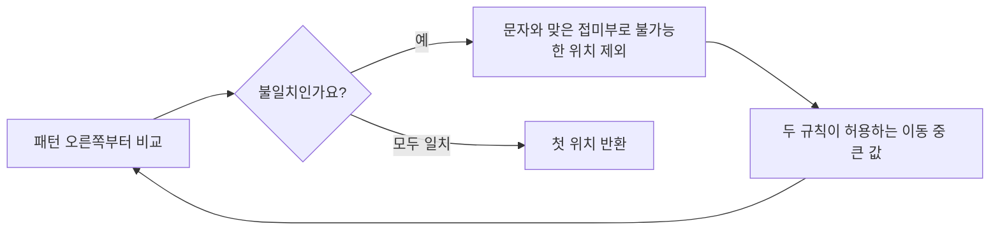

# 오른쪽에서 비교하는 문자열 검색 / Boyer–Moore string searching

문자열 검색에서 이미 확인한 문자가 다음 비교의 시작점을 바꿀 수 있습니다. 이 글은 오른쪽 끝의 불일치를 이용해 후보 여러 개를 한꺼번에 제외하는 이유를 살펴봅니다.

| 항목 | 원문 정보 |
| --- | --- |
| 논문 | Robert S. Boyer, J Strother Moore, A Fast String Searching Algorithm |
| 발표 | Communications of the ACM 20(10), 1977년 10월, 762–772쪽 |
| 당시 소속 | Boyer는 Stanford Research Institute, Moore는 연구 당시 Xerox PARC이며 게재 시 주소는 SRI International입니다. |
| 원문 | [저자 공개 PDF](https://www.cs.utexas.edu/~moore/publications/fstrpos.pdf) |
| 읽을 위치 | §2–4 검색 규칙, §5 구현, §6–7 실험과 평균 모형, §8 적용 조건, §9 규칙의 변천입니다. |

## 무엇을 건너뛰어도 되는가

원문은 한 패턴의 첫 출현을 찾습니다. 오른쪽부터 비교하고, 불일치 문자와 이미 맞은 접미부를 바탕으로 이동합니다. 실험에서는 PDP-10 구현의 문자 참조와 명령 수를 별도로 셉니다. 전처리를 제외한 주기억장치 검색이라는 조건도 중요합니다. 아래 배열과 계산은 이해를 위한 자체 예제입니다.

패턴은 찾으려는 문자열이고, 정렬 위치는 패턴의 첫 문자를 본문 어느 위치에 맞췄는지 나타냅니다. 접미부는 문자열 끝부분입니다. 문자 집합의 크기는 나올 수 있는 서로 다른 문자의 개수입니다. 길이와 문자 집합은 다른 개념입니다. `AAAA`는 길이가 4여도 사용한 문자는 하나입니다.

본문 `ZZZZABCD`에서 패턴 `ABCD`를 찾겠습니다. 모든 위치는 0부터 셉니다.

| 패턴 시작 | 오른쪽에서 확인한 내용 | 다음 행동 |
| --- | --- | --- |
| 0 | 본문 3번의 Z와 패턴 끝 D가 다릅니다. | Z가 패턴에 없으므로 시작을 4로 옮깁니다. |
| 4 | D, C, B, A가 차례로 같습니다. | 4에서 처음 발견했다고 답합니다. |

시작 1·2·3을 생략해도 되는 이유를 직접 확인해 보세요. 이 위치 중 어디에서 패턴이 시작하더라도 이미 본 Z가 패턴의 어떤 문자와 맞아야 합니다. 패턴에 Z가 없으므로 모두 불가능합니다. 짐작해서 건너뛴 것이 아니라, 관측한 문자 하나로 세 후보의 모순을 확인한 것입니다.

이 예에서는 검색 단계의 문자 비교가 1+4=5번입니다. 패턴을 읽고 표를 만드는 비용은 포함하지 않았습니다. 이 작은 계산을 실제 실행 시간이나 모든 입력의 평균 비교 횟수로 해석하면 안 됩니다.

## 불일치 문자와 맞은 접미부

불일치 문자 규칙은 그 문자가 패턴 어디에 있는지 봅니다. 패턴 `ABCD`의 마지막 위치에서 A를 만났다면, 패턴의 A가 그 위치에 오도록 3칸 이동할 수 있습니다. 문자 정보만 쓰는 구현과 접미부 정보도 쓰는 구현은 보장하는 성질이 같다고 단정할 수 없습니다.

접미부 규칙은 조금 더 풍부한 정보를 사용합니다. 패턴 `ABYAB`를 본문 조각 `XXAAB` 위에 놓았다고 하겠습니다. 오른쪽의 B와 A는 맞지만, 그 왼쪽에서 패턴 Y와 본문 A가 다릅니다.

```text
패턴: A B Y A B
본문: X X A A B
          × ✓ ✓
```

이미 본 끝부분 AB를 패턴의 앞부분 AB와 맞추면 3칸 이동합니다. 1칸 이동하면 이미 확인한 본문 A가 패턴 Y와 맞아야 하고, 2칸 이동하면 그 A가 패턴 B와 맞아야 합니다. 둘 다 불가능하므로 3칸보다 작은 후보를 제외할 수 있습니다. 이 예는 접미부가 단순한 마지막 문자보다 많은 정보를 담는다는 것을 보여 줍니다.

원문의 접미부 규칙은 재등장하는 접미부 앞의 문자까지 고려합니다. 같은 불일치를 다시 만들 위치를 후보로 남기지 않기 위해서입니다. 문자열 왼쪽 경계를 넘어가는 경우에는 접미부와 패턴 접두부의 겹침도 살핍니다. 접두부는 문자열의 시작 부분입니다.



이때 큰 이동을 택할 수 있는 것은 두 규칙이 각각 그보다 작은 후보를 제외했기 때문입니다. 근거 없는 두 추측 중 큰 값을 고르는 방식으로 일반화하면 안 됩니다.

## 이동 거리와 포인터 이동의 차이

패턴 전체가 이동한 거리와 현재 비교 문자의 포인터가 이동한 거리는 다를 수 있습니다. 오른쪽에서 왼쪽으로 두 글자를 확인한 뒤 패턴을 3칸 이동하면, 다음 비교를 새 패턴의 오른쪽 끝에서 시작하기 위해 포인터는 5칸 오른쪽으로 움직입니다. 이미 뒤로 간 2칸을 되돌리는 움직임이 포함되기 때문입니다.

따라서 원문의 delta 표를 현대 구현의 패턴 시작점 이동 표와 그대로 대응시키면 인덱스 오류가 생길 수 있습니다. 표를 외우기 전에 그 값이 패턴 시작점, 패턴 끝, 현재 비교 포인터 중 무엇의 변화를 뜻하는지 먼저 적는 편이 정확합니다.

모든 출현을 찾는 문제도 별도로 생각해야 합니다. `ABABAB`에는 `ABAB`가 시작 0과 2에 나옵니다. 완전히 맞았다는 이유로 패턴 길이 4만큼 이동하면 두 번째 출현을 놓칩니다. 첫 출현 검색의 종료 규칙을 모든 출현 검색에 그대로 적용할 수 없습니다.

## 결과를 읽을 때의 조건

원문이 설명하는 최악의 경우 선형성은 제시된 접미부 규칙과 표 접근 조건을 포함합니다. 접미부 규칙을 생략한 짧은 코드나 다른 종료 규칙에 같은 보장을 자동으로 붙이면 안 됩니다. §9에는 이전 접미부 규칙의 이차적 반례도 나옵니다.

평균적으로 건너뛰는 문자가 많다는 설명은 입력 전체를 읽지 않아도 되는 모든 작업에 관한 명제가 아닙니다. 디스크에서 파일을 가져오는 비용, 유니코드 문자를 처리하는 방식, 여러 패턴 검색, 정규식 검색은 다른 비용을 더합니다. 예를 들어 자체 모형에서 비교 비용이 문자당 3에서 1로 줄어도, 입출력 대기 비용이 각각 9라면 총비용은 12에서 10으로 줄어 1.2배가 됩니다. 비교 단계의 3배가 전체 작업의 3배로 이어지지 않습니다.

후속 문헌인 [Karp–Rabin의 1987년 논문](rabin-karp1987.md)은 이 검색법을 비교 대상으로 다룹니다. 두 방법을 함께 읽으면 문자의 불일치로 후보를 제거하는 방식과 지문값으로 후보를 거르는 방식의 차이를 볼 수 있습니다. 어느 쪽이 빠른지는 패턴 길이, 문자 분포, 검증 비용과 구현 조건을 함께 정해야 판단할 수 있습니다.

## 자기 점검

1. `ABCD`와 비교한 본문 끝 문자가 Z이면 왜 4칸 이동할 수 있나요?
2. 접미부를 비교하며 포인터가 2칸 왼쪽으로 갔고 패턴은 3칸 전진한다면 다음 끝 비교까지 포인터는 얼마나 움직이나요?
3. 검색 비교가 3배 빨라지면 파일 읽기도 포함한 전체 작업이 항상 3배 빨라지나요?

<details>
<summary>해설 보기</summary>

1. 현재 관측한 Z가 다음 세 정렬에서도 패턴 안에 들어가는데, 패턴에는 Z가 없기 때문입니다.
2. 오른쪽으로 5칸입니다. 이미 물러난 2칸과 패턴의 전진 3칸을 합칩니다.
3. 그렇지 않습니다. 파일 읽기 등 바뀌지 않은 비용이 남습니다. 각 비용을 같은 단위로 더한 뒤 비율을 계산해야 합니다.

</details>

[이 분야의 논문 목록](README.md)
