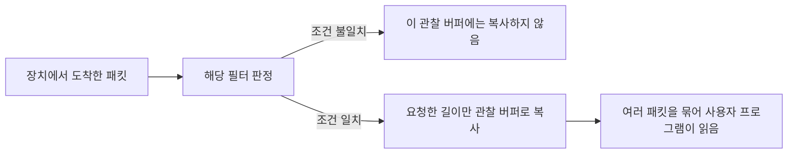

# BPF: 필요한 네트워크 패킷을 복사 전에 골라내기

Steven McCanne와 Van Jacobson의 「The BSD Packet Filter: A New Architecture for User-level Packet Capture」는 Lawrence Berkeley Laboratory에서 작성한 연구입니다. [저자 원고의 대학 보관본](https://pdos.csail.mit.edu/6.1810/2025/readings/bpf-usenix93.pdf)은 1992년 12월 19일자 초고이고, [USENIX 학회본](https://www.usenix.org/publications/library/proceedings/sd93/mccanne.pdf)은 1993년 1월 25–29일 Winter USENIX 발표 자료입니다. 아래 쪽수는 학회본 인쇄 259–269쪽을 따릅니다. 제공 PDF의 마지막 270쪽은 빈 쪽입니다.

## 배경: 읽고 버릴 데이터에도 비용이 듭니다

원문은 Network Tap과 Packet Filtering, Filter Model, BPF Model·Pseudo-Machine, 성능 측정, Applications, Conclusion 순서로 전개됩니다. 관찰 도구로 넘길 패킷을 커널 안에서 먼저 판정하고 필요한 길이만 복사하는 설계와, 레지스터 기반 필터 기계를 함께 다룹니다. 캡처에서 버린다는 것은 관찰 프로그램에 넘기지 않는다는 뜻이며, 정상 네트워크 전달을 차단한다는 뜻과 다릅니다. [원문 259–263쪽](https://www.usenix.org/publications/library/proceedings/sd93/mccanne.pdf)

패킷은 네트워크에서 주고받는 데이터 묶음입니다. 헤더에는 종류·주소·길이처럼 본문을 해석하는 정보가 들어갑니다. 사용자 영역은 일반 프로그램이 실행되는 영역이고, 커널 영역과의 경계를 넘겨 데이터를 전달할 때에는 복사와 시스템 호출 등의 비용이 발생할 수 있습니다.

필터는 데이터가 원하는 조건에 맞는지 검사하는 작은 프로그램입니다. 수신한 데이터를 모두 사용자 프로그램으로 보낸 뒤 대부분 버리면, 필요 없는 부분까지 옮긴 비용을 되돌릴 수 없습니다. 입력이 도착한 가까운 곳에서 판정하는 구조는 이 낭비를 줄일 기회를 만듭니다.

## 직접 계산하는 복사량

초당 10,000개 패킷이 도착하며 각 1,000바이트라고 가정하겠습니다. 그중 1%만 필요하고, 필요한 패킷도 앞 100바이트만 저장한다고 정합니다. 다음은 실제 BPF 실험이 아닌 자체 예제이며 헤더·정렬·장치 DMA·버퍼 관리 비용은 생략합니다.

| 설계 | 관찰용 복사량의 단순 계산 | 초당 양 |
| --- | --- | --- |
| 모두 복사한 뒤 판정 | 10,000 × 1,000 | 10,000,000바이트 |
| 판정 후 필요한 앞부분만 복사 | 10,000 × 0.01 × 100 | 10,000바이트 |

이 조건에서는 양이 1,000분의 1입니다. 그러나 전체 프로그램이 1,000배 빨라진다는 결론은 아닙니다. 모든 패킷에 대한 필터 실행, 인터럽트, 시간표시, 버퍼 관리 비용은 남습니다. 이미 다른 처리에서 필요한 복사도 있을 수 있습니다. 줄어든 데이터 양과 줄어든 전체 시간을 따로 계산해야 합니다.



직접 만든 그림은 하나의 관찰 필터를 기준으로 합니다. 여러 프로그램이 서로 다른 조건을 등록한 상황에서 한 필터의 거절을 모든 프로그램의 거절로 읽어서는 안 됩니다. 묶어서 읽는 방식도 패킷 경계를 잃어버린다는 뜻은 아닙니다. 각 기록에 길이 같은 구분 정보가 있으면 한 번에 전달받은 여러 기록을 다시 구별할 수 있습니다.

## 작은 기계가 조건을 실행합니다

원문 기계는 누산기 A, 인덱스 레지스터 X, 임시 저장소, 프로그램 카운터를 사용합니다. 패킷은 바이트 배열로 보며, 조건 분기는 참·거짓에 따라 다음 검사를 고릅니다. 반환값 0은 거절이며 양수는 보존할 길이를 뜻하고 실제 길이를 넘겨 복사하지 않습니다. [원문 264–266쪽](https://www.usenix.org/publications/library/proceedings/sd93/mccanne.pdf)

레지스터는 현재 계산에 쓰는 작은 저장 장소입니다. 누산기는 값을 읽어 비교·계산할 때 중심이 되는 저장 장소이고, 인덱스는 데이터 안의 위치를 계산할 때 보탭니다. 프로그램 카운터는 다음에 실행할 명령의 위치입니다. 가상 기계라는 표현은 별도의 물리 CPU를 장착한다는 뜻이 아니라, 약속한 명령을 소프트웨어가 해석해 실행한다는 뜻입니다.

설명용으로 패킷의 특정 분류 필드가 7 또는 9인지 검사한다고 하겠습니다. 필드를 A로 한 번 읽고 7과 비교한 뒤, 다를 때만 9와 비교하면 됩니다. A가 7이면 두 번째 비교는 필요 없습니다. 이 경우 조건의 값뿐 아니라 어떤 경로를 이미 통과했는지가 이후 계산의 근거가 됩니다.

이런 분기 구조를 제어 흐름 그래프라고 합니다. 그래프의 점은 검사나 연산이며 화살표는 다음으로 갈 수 있는 경로입니다. 트리와 그래프라는 이름만으로 속도를 단정할 수는 없습니다. 실제 명령 수, 반복해서 읽는 데이터, 해석기의 구현, 입력 분포를 보아야 합니다.

## 헤더 길이를 고정하면 왜 틀릴까요?

주소를 알아내는 오프셋은 시작점에서 얼마나 떨어졌는지를 뜻합니다. 단위가 바이트인지, 여러 바이트를 묶은 워드인지 먼저 확인해야 합니다. 다음 계산은 일반적인 비태그 Ethernet과 IPv4 형식을 가정한 자체 설명입니다. 원문의 가변 길이 헤더 예와 함께 읽으실 수 있습니다. [원문 266–267쪽](https://www.usenix.org/publications/library/proceedings/sd93/mccanne.pdf)

링크 계층 헤더가 14바이트이고 IPv4 헤더 길이 필드 IHL이 6이라면, IP 헤더는 6 × 4 = 24바이트입니다. TCP 목적지 포트는 TCP 헤더 시작에서 2바이트 뒤에 있으므로 패킷 시작에서 14 + 24 + 2 = 40바이트 위치입니다. IHL을 5로 고정해 계산하면 36바이트를 보게 되어 다른 필드를 잘못 해석합니다.

더 중요한 것은 TCP라는 전제가 맞는지 확인하는 순서입니다. 같은 위치의 두 바이트를 읽었다고 항상 포트가 되지는 않습니다. 링크 계층 종류와 IP 프로토콜을 먼저 확인하고, 첫 조각이 아닌 IP 단편에서 TCP 헤더가 없을 수 있다는 점도 처리해야 합니다. VLAN 태그나 IPv6 등을 적용하면 이 예제의 시작 위치와 해석 자체가 달라집니다.

반환값을 96으로 정했지만 실제 패킷이 60바이트라면 복사 가능한 양은 다음과 같습니다.

```math
L_{copy}=\min(L_{packet},L_{requested})=\min(60,96)=60
```

이는 36바이트의 빈 공간을 덧붙인다는 뜻이 아닙니다. 원문은 패킷 끝을 벗어나는 데이터 참조도 거절로 종료하도록 설명합니다. 길이를 제한하는 일과 조건 필드가 의미상 올바른지 확인하는 일은 서로 보완합니다.

## 실험 수치의 단위를 나누어 읽습니다

학회본의 tap 비교는 동일 Sparcstation 2·SunOS 4.1.1에서 수행하며, accept-all 조건에는 16KB 버퍼를 씁니다. 큰 패킷을 모두 거절하는 조건의 약 450µs 대 5µs는 불필요한 복사를 포함하는 해당 NIT/BPF 경로의 차이입니다. 필터 기계 비교는 별도로 패킷 추적 자료의 CPU 명령 수를 측정합니다. [원문 260–262쪽, 267–268쪽](https://www.usenix.org/publications/library/proceedings/sd93/mccanne.pdf)

450을 5로 나눈 자체 산술은 90입니다. 이것을 오늘날 모든 네트워크 장치의 처리량이 90배가 된다는 주장으로 바꾸면 실험 조건을 잃습니다. 처리 시간·명령 수·대역폭은 같은 단위가 아니며, 버퍼 경로와 필터 계산의 효과도 구분해야 합니다.

## 오늘의 eBPF와 구분하기

현재 Linux 문서는 원래 기계를 classic BPF와 구분하고, eBPF의 더 넓은 레지스터와 커널 실행 환경을 설명합니다. 이 계보는 확인되지만 오늘의 map·helper·다양한 훅을 1993년 논문에 소급해서 넣어서는 안 됩니다. [Linux의 구분 설명](https://docs.kernel.org/bpf/classic_vs_extended.html), [현재 ISA 문서](https://kernel.org/doc/html/next/bpf/standardization/instruction-set.html)

이 글의 후속 의미는 유용한 작업을 실행 지점 가까이 옮기고 제한된 명령으로 표현한다는 설계 관점에 있습니다. 일반적인 커널 확장을 안전하게 실행하는 문제까지 모두 해결했다는 뜻은 아닙니다. 안전성 검사와 권한, 허용된 기능은 각 실행 환경에서 별도로 확인해야 합니다.

## 스스로 확인하기

1. 캡처 필터가 거절하면 해당 패킷은 반드시 정상 네트워크 처리에서도 폐기되나요?
2. IHL이 6인데 IP 헤더를 20바이트로 계산하면 포트 위치가 맞나요?
3. 원문의 최대 배속을 현대 eBPF의 모든 프로그램 성능으로 써도 되나요?

<details>
<summary>답과 이유</summary>

1. 아닙니다. 이 필터가 결정하는 관찰용 복사와 정상 프로토콜 처리를 구분합니다.
2. 아닙니다. 24바이트이므로 위 예제의 목적지 포트 위치는 40바이트입니다.
3. 안 됩니다. 당시 장치·비교 경로·측정 단위가 한정되어 있고 명령 집합도 다릅니다.

</details>
