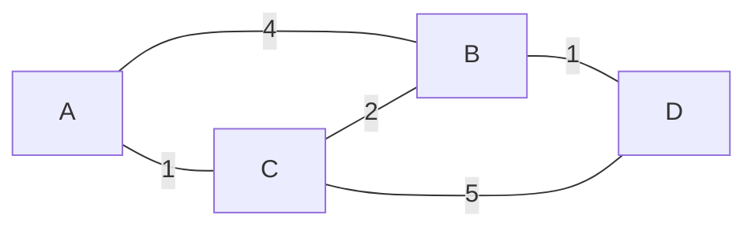

# Dijkstra: 확정한 거리와 아직 바뀔 거리 / Settled and tentative distances

| 항목 | 내용 |
|---|---|
| 논문 | A Note on Two Problems in Connexion with Graphs |
| 저자·당시 소속 | E. W. Dijkstra, Mathematisch Centrum, Amsterdam |
| 발표 | Numerische Mathematik 1, 269–271쪽, 1959년 |
| 원문 | [대학 보관 원문 PDF](https://www.cs.yale.edu/homes/lans/readings/routing/dijkstra-routing-1959.pdf) |
| 읽을 위치 | Problem 1: 269–270쪽의 최소 연결 트리, Problem 2·Remarks: 270–271쪽의 두 점 사이 최단 경로 |

## 한 논문의 서로 다른 두 문제

원문은 모든 정점을 연결하는 트리의 간선 길이 합과, 두 정점 사이 경로의 길이를 나누어 다룹니다. Problem 2에서는 출발점에서의 거리가 짧은 순서로 정점을 확정하고, 후보까지의 경로를 갱신합니다. Remark 1은 방향에 따라 길이가 달라지는 경우를 언급합니다. 논문의 끝에서는 저장할 후보 간선과 종전 방법을 비교합니다. [원문 전체 269–271쪽](https://www.cs.yale.edu/homes/lans/readings/routing/dijkstra-routing-1959.pdf)

‘가장 가까운 곳부터 갑니다’만 기억하면, 현재 정점에서 가장 가까운 이웃으로 이동하는 탐욕법과 혼동하기 쉽습니다. 여기서 비교할 값은 출발점부터 후보까지 누적한 거리입니다. 현재 정점이 바뀌어도 비교의 출발점은 바뀌지 않습니다.

## 용어와 판단의 기준

그래프는 정점과 간선으로 관계를 나타내는 구조입니다. 가중치는 간선마다 붙인 비용이고, 경로 길이는 그 비용의 합입니다. 아래 계산에서는 모든 가중치가 0 이상이며, 한 경로의 비용을 합으로 계산한다고 가정합니다.

`확정 거리`는 더 짧아지지 않는다고 판단한 값입니다. `임시 거리`는 지금까지 발견한 경로 중 최선의 값이므로 이후 줄어들 수 있습니다. `완화`는 어떤 간선을 거쳐 가는 비용을 기존 임시 거리와 비교하여 작은 쪽을 남기는 갱신입니다. 단어 자체에 시간을 늦춘다는 의미를 붙이시면 안 됩니다.

출발점 A의 거리는 0으로, 아직 경로를 모르는 정점은 무한대로 놓습니다. 이 무한대는 실제로 무한한 거리를 이동한다는 뜻이 아니라 ‘유한한 경로를 아직 찾지 못했습니다’라는 표기입니다. 프로그램에서는 정수 범위와 더하기 연산의 오버플로도 따로 고려해야 합니다.

## 직접 계산: 가까운 간선보다 누적 거리를 봅니다

다음은 원문의 그림이나 측정값이 아닌 자체 예제입니다. 무방향 간선을 `A–B:4`, `A–C:1`, `C–B:2`, `B–D:1`, `C–D:5`로 두겠습니다.

| 단계 | 새로 확정한 정점 | A | B | C | D |
|---|---|---:|---:|---:|---:|
| 초기화 | 없음 | 0 | ∞ | ∞ | ∞ |
| A의 간선 확인 | A | 0 | 4 | 1 | ∞ |
| C의 간선 확인 | C | 0 | 3 | 1 | 6 |
| B의 간선 확인 | B | 0 | 3 | 1 | 4 |
| 종료 | D | 0 | 3 | 1 | 4 |

C를 확정할 때 B는 `min(4,1+2)=3`, D는 `min(∞,1+5)=6`으로 바뀝니다. 다음 후보는 B의 3과 D의 6을 비교해 B입니다. B에서 D로 가면 `3+1=4`이므로 D가 다시 줄어듭니다. D를 처음 발견했을 때 종료했다면 6이라는 잘못된 답을 남겼을 것입니다. 목적지를 발견한 시점과 최소 후보로 확정한 시점을 구별해야 합니다.

경로 자체를 얻으려면 거리만 저장해서는 부족합니다. B를 3으로 바꿀 때 직전 정점 C를, D를 4로 바꿀 때 B를 기록합니다. D에서 거꾸로 따라가면 `D←B←C←A`이며 뒤집으면 `A→C→B→D`입니다. 같은 최단 거리가 여러 경로에서 나오면 어느 경로를 남길지와 모든 경로를 셀지는 별도 문제입니다.

## 왜 확정해도 되나요?

후보 u의 임시 거리가 아직 확정하지 않은 정점 중 가장 작다고 하겠습니다. 더 좋은 경로가 있다면, 그 경로가 확정 집합을 처음 벗어나는 간선을 생각할 수 있습니다. 그 간선의 앞부분은 이미 처리되었으므로 그때의 완화가 후보를 남겼어야 합니다. 이후 비용이 음수가 아니라면 그 후보보다 뒤의 경로가 더 작은 값으로 갑자기 내려갈 수 없습니다. 최소 후보를 택했다는 조건과 음수가 없다는 조건을 함께 사용하는 논증입니다.

이를 단순한 표어 대신 반례로 점검해 보겠습니다. 방향 간선 `A→B:2`, `A→C:5`, `C→B:−4`를 두면 B를 2에서 확정한 뒤 C를 처리하면서 1이라는 더 짧은 경로를 발견합니다. 이미 확정한 B를 다시 보지 않는 규칙과 충돌합니다. 이 반례는 음의 간선이 있는 모든 문제가 풀리지 않는다는 뜻이 아니라, 여기서 사용한 확정의 근거가 깨졌다는 뜻입니다.

## 연결 트리와 최단 경로 트리는 다릅니다

별도의 삼각형에서 `A–B=2`, `B–C=2`, `A–C=3`이라고 하겠습니다. 모든 정점을 싸게 연결하려면 앞의 두 간선을 택해 합계 4를 얻습니다. 하지만 A에서 C로 가는 거리는 4입니다. A 기준 최단 경로 트리는 A–B와 A–C를 택하여 각 목적지의 거리를 2·3으로 만들고 간선 합계는 5가 됩니다. 두 방법 모두 ‘트리’를 만들지만 줄이려는 목적함수가 다릅니다.

자료구조도 논문과 현대 구현을 나누어 봐야 합니다. 후보를 배열에서 매번 훑으면 정점 수 V에 대해 약 V번의 선택마다 V개를 볼 수 있습니다. 우선순위 큐는 가장 작은 후보를 찾는 작업을 조직하는 방법이며, 거리 갱신과 오래된 항목 제거까지 설계해야 합니다. 특정 힙을 사용한 현대 구현의 계산량을 1959년 원문의 직접 측정 결과로 표시해서는 안 됩니다.

## 결과의 범위와 후속 연결

이 논문은 절차와 저장 방식에 관한 짧은 설명이지, 오늘날 도로망 서비스의 지연시간 벤치마크가 아닙니다. 실제 경로 서비스에는 시간에 따라 변하는 비용, 통행 제한, 여러 목적, 지도 오류 같은 추가 조건이 있습니다. 각 조건이 비용의 합과 확정 규칙을 유지하는지 확인해야 합니다.

후속 적용은 [OSPF 명세 RFC 2328 §16.1](https://www.rfc-editor.org/rfc/rfc2328#section-16.1)에서 구체적으로 확인할 수 있습니다. 이 명세는 라우터를 뿌리로 두고 Dijkstra 절차로 최단 경로 트리를 계산합니다. 패킷 전달에는 다음 홉과 연결 상태 같은 규칙도 필요하므로, 위 네 정점 계산이 라우팅 프로토콜 전체를 구현한 것은 아닙니다.

## 자기점검

1. 위 예제에서 D를 처음 6으로 기록했을 때 끝내면 왜 틀리나요?
2. 삼각형 예제의 최소 연결 비용 4가 A에서 C로 가는 최단 거리라는 주장에는 어떤 문제가 있나요?
3. 음의 간선 반례에서 깨진 것은 후보의 발견인가요, 확정 이후 바뀌지 않는다는 주장인가요?

해설 보기

1. B를 거치는 비용 4가 나중에 발견됩니다. 임시 거리를 처음 기록한 사건은 확정이 아닙니다.
2. 4는 선택한 두 간선의 전체 합입니다. A–C라는 한 목적지의 비용은 직접 간선 3이 더 작습니다. 최적화 대상을 바꾸어 읽었습니다.
3. 후자입니다. 후보를 갱신할 기회는 있지만, 먼저 확정한 B의 거리가 이후 더 줄어듭니다. 비음수 조건에 의존한 정당화를 사용할 수 없습니다.

[알고리즘과 컴퓨터 시스템 목록](README.md)
