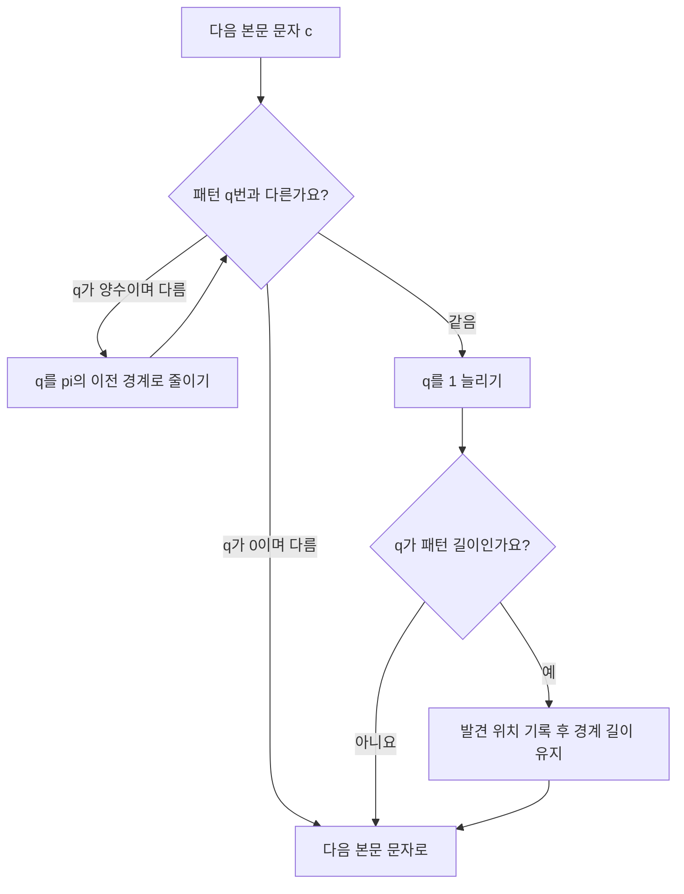

# 맞은 접두부를 재사용하는 검색 / Knuth–Morris–Pratt matching

KMP의 핵심은 불일치한 뒤 본문을 다시 읽는 대신, 이미 맞았던 패턴의 끝부분을 다음 후보의 시작으로 해석하는 것입니다. 접두부 표는 이 재해석에 필요한 길이를 저장합니다.

| 항목 | 원문 정보 |
| --- | --- |
| 논문 | Donald E. Knuth, James H. Morris, Jr., Vaughan R. Pratt, Fast Pattern Matching in Strings |
| 발표 | SIAM Journal on Computing 6(2), 1977년 6월, 323–350쪽 |
| 게재본 소속 | Stanford University, Xerox PARC, MIT입니다. Morris·Pratt의 연구비 설명에는 Berkeley에서 수행한 작업도 구분됩니다. |
| 원문 | [게재 논문 PDF](https://cs.brown.edu/courses/csci1810/fall-2023/resources/ch2_readings/kmp_strings.pdf) |
| 읽을 위치 | §1–2 검색과 표 구성, §3–4 구현·확장, §5 주기와 지연, §6 회문, §7–8 경위와 다른 검색법입니다. |

## 불일치해도 남아 있는 정보

논문은 패턴 길이 m, 본문 길이 n에 대해 전처리와 검색을 합쳐 O(m+n)인 방법을 설명합니다. 본문 포인터를 뒤로 돌리지 않으며, 문자 집합 크기에 비례하는 전이표를 요구하지 않습니다. §5는 개선된 next 표의 문자 사이 지연도 분석합니다. 아래 표는 설명하기 쉬운 현대식 접두부 길이 표이며, 원문의 인덱스와 next 값을 그대로 옮긴 것은 아닙니다.

접두부는 문자열 앞부분, 접미부는 뒷부분입니다. 경계 또는 border는 전체보다 짧으면서 접두부와 접미부가 동시에 되는 문자열입니다. `ABAB`에서는 `AB`가 경계입니다. 여기서 “짧다”는 조건이 없으면 자기 자신이 항상 답이 되어 불일치 후 전진할 수 없습니다.

패턴 `ABABAC`의 각 위치까지 읽었을 때 가장 긴 경계의 길이 pi는 다음과 같습니다.

| 위치 | 문자 | 그 위치까지의 문자열 | pi |
| --- | --- | --- | --- |
| 0 | A | A | 0 |
| 1 | B | AB | 0 |
| 2 | A | ABA | 1 |
| 3 | B | ABAB | 2 |
| 4 | A | ABABA | 3 |
| 5 | C | ABABAC | 0 |

`ABABA`의 경계 `ABA`는 길이 3입니다. 그보다 짧은 경계 `A`도 있지만 가장 긴 것부터 시도하면 됩니다. 실패하면 pi를 다시 따라가 더 짧은 후보로 내려갑니다. 경계 하나를 기억했다고 나머지를 영원히 버리는 것은 아닙니다.

## 같은 본문 문자를 다른 상태에서 보기

본문 `ABABABAC`에서 패턴을 찾겠습니다. 아래 q는 현재 본문 끝과 일치한 패턴 접두부 길이입니다. 따라서 다음에 비교할 패턴 위치도 q입니다.

| 본문 위치 | 문자 | 처리 후 q | 이유 |
| --- | --- | --- | --- |
| 0–4 | ABABA | 5 | 처음 다섯 문자가 맞습니다. |
| 5 | B | 4 | C와 다르므로 q를 pi[4]=3으로 줄인 뒤, 패턴 3번 B와 맞춥니다. |
| 6 | A | 5 | 다음 A가 맞습니다. |
| 7 | C | 6 | 패턴 전체를 찾습니다. 시작은 7−6+1=2입니다. |

본문 5번의 B를 다시 비교했지만 본문 위치를 과거로 옮기지는 않았습니다. 이미 읽은 `ABABA`의 마지막 `ABA`가 패턴의 처음 `ABA`와 같다는 사실을 재사용했습니다. “본문 문자를 한 번 가져온다”와 “그 문자를 패턴 문자와 한 번만 비교한다”는 같은 말이 아닙니다.

표를 만드는 일에도 같은 원리가 적용됩니다. 패턴 자체를 본문으로 삼아, 지금까지 아는 경계를 한 글자 늘려 보고 실패하면 더 짧은 경계로 돌아갑니다. `ABABAC` 마지막 C에서는 길이 3의 후보 뒤 B, 길이 1의 후보 뒤 B, 길이 0의 후보 뒤 A가 모두 C와 달라 pi가 0이 됩니다.

## 반복문 안에 반복문이 있어도 선형인 이유

본문을 한 글자 처리할 때 q는 최대 1 늘어납니다. q는 음수가 될 수 없고, 불일치 반복문에서는 항상 줄어듭니다. 총 증가량이 n 이하이므로 총 감소 횟수도 n을 넘을 수 없습니다. 매 글자마다 m번 감소하는 경우를 독립적으로 곱하면, 이전 감소를 다시 하려면 먼저 q를 올려야 한다는 제한을 빠뜨립니다.

이것은 분할상환 분석입니다. 개별 처리 중 비싼 순간이 있어도 여러 처리를 합친 비용을 제한하는 방식입니다. 길이 100만 본문을 처리하는 전체 비교 수가 선형이라는 설명이, 모든 문자에서 비교 횟수가 일정하다는 뜻은 아닙니다.

원문은 단순 f 표와 불필요한 재비교를 제거한 next 표를 구분합니다. 개선 표에 관한 §5의 로그 지연 보장을 기본 pi 구현에 그대로 붙이면 안 됩니다. 전체 선형 시간과 한 입력 문자 사이의 지연은 별도로 확인해야 합니다. 실시간이라는 말도 정해진 계산 모형의 지연 조건이며 실제 장치의 응답 시간 측정과는 다릅니다.

## 겹치는 답과 다른 문제의 경계

`ABABA`에서 `ABA`를 모두 찾으면 시작 0과 2가 답입니다. 첫 발견 뒤 q를 0으로 버리면 마지막 A가 다음 후보의 처음 A라는 정보를 잃습니다. q를 전체 패턴의 경계 길이 1로 두고 계속하면 겹치는 출현을 찾습니다. 첫 출현만 요구할 때는 발견 즉시 종료할 수 있습니다.

정확한 연속 부분문자열과 부분수열도 구분해야 합니다. `AXBYC`에는 부분수열 `ABC`가 있지만 연속 부분문자열 `ABC`는 없습니다. KMP의 경계 논증은 연속해서 맞았다는 사실에 기대므로, 건너뛰는 문자·편집 거리·정규식으로 과제를 바꾸면 같은 표만으로 해결되지 않습니다.

원문 §6은 짝수 길이 회문들의 이어 붙임을 인식하는 문제까지 다룹니다. 이는 모든 문맥 자유 언어를 선형 시간에 처리했다는 주장이 아닙니다. §8의 Boyer–Moore 분석 역시 별도의 비교 방향과 이동 규칙에 대한 분석입니다. 한 논문에 여러 문제가 등장해도 정리의 조건을 합쳐 하나의 만능 검색 보장으로 읽으면 안 됩니다.

## 이후 문헌과 연결해 읽기

[Boyer–Moore](boyer-moore1977.md)는 맞은 접미부와 불일치 문자를 이용합니다. [Karp–Rabin](rabin-karp1987.md)은 작은 지문값을 이용하며, 1987년 논문이 KMP를 선행 검색법으로 명시합니다. 세 방법의 공통 과제는 후보를 안전하게 줄이는 것이지만, 재사용하는 정보와 검증 방식은 다릅니다. 패턴을 한 번만 쓰는지 여러 본문에서 재사용하는지에 따라서도 전처리 비용의 비중이 달라집니다.

## 자기 점검

1. `ABABA`의 가장 긴 경계는 무엇이며 길이는 얼마인가요?
2. 본문 위치가 뒤로 가지 않아도 한 문자를 여러 번 비교할 수 있나요?
3. `ABABA`에서 `ABA`를 처음 찾은 뒤 모든 출현을 계속 찾으려면 q를 얼마로 두나요?

해설 보기

1. `ABA`, 길이 3입니다. 전체 길이 5를 경계로 사용하지 않습니다.
2. 가능합니다. 현재 문자를 더 짧은 접두부의 다음 문자와 비교합니다. 이미 지나간 본문을 다시 가져오는 것과 다릅니다.
3. 1로 둡니다. 패턴 `ABA`의 경계 `A`를 유지하면 시작 2의 겹치는 답도 찾습니다.

[이 분야의 논문 목록](README.md)
