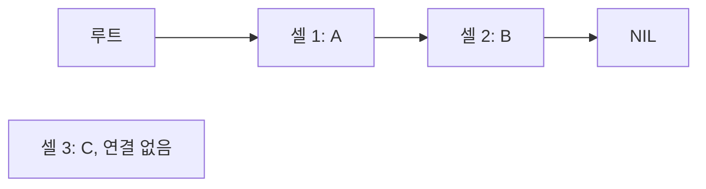

# McCarthy: 기호를 자료로 다루는 프로그램 / Programs over symbolic expressions

| 항목 | 내용 |
|---|---|
| 논문 | Recursive Functions of Symbolic Expressions and Their Computation by Machine, Part I |
| 저자·당시 소속 | John McCarthy, Massachusetts Institute of Technology |
| 발표 | Communications of the ACM 3(4), 184–195쪽, 1960년 4월 |
| 원문 | [저자가 공개한 재입력 PDF](https://www-formal.stanford.edu/jmc/recursive.pdf) · [저자의 원문 안내](https://www-formal.stanford.edu/jmc/recursive.html) |
| 읽을 위치 | PDF §2 함수·조건·재귀, §3 기호식·기본 연산·apply/eval, §4 IBM 704 구현·저장 회수, §5 선형 표현, §6 흐름도와 재귀 |
| 판본 | PDF 34쪽에는 후대 주석이 있습니다. 특히 18쪽의 eval 관련 주석은 제시된 판본이 완전히 정확하지 않다고 경고합니다. |

## 숫자 계산에서 기호 조작으로

이 논문은 식을 자료로 표현하고, 작은 기본 연산과 조건·재귀로 그 식을 처리하는 체계를 설명합니다. §3은 원자와 순서쌍으로 S-expression을 만들며, 함수의 표현을 다시 기호식으로 옮겨 apply/eval을 설명합니다. §4는 같은 아이디어를 IBM 704의 저장 구조·프로그램·자동 회수와 연결합니다. §5–6은 다른 표현과 흐름도의 재귀적 해석을 비교합니다. [원문 §2–6](https://www-formal.stanford.edu/jmc/recursive.pdf)

이 글에서는 원문의 긴 함수 정의를 그대로 옮기지 않고, 그 정의를 읽는 데 필요한 작은 자료를 직접 만들어 보겠습니다. 아래 표기는 쉼표 없는 교육용 Lisp 형태입니다. 원문의 M-expression 표기와 구별하며, 특정 현대 Lisp 구현에서 실행한 결과라고 주장하지 않습니다.

## 원자·순서쌍·리스트를 구분합니다

원자는 여기서 더 쪼개지 않는 이름입니다. `BIRD`라는 이름의 철자에 여러 글자가 있어도 자료 모형에서는 하나로 취급할 수 있습니다. 순서쌍 `(x . y)`는 첫 부분과 둘째 부분을 갖습니다. 리스트는 둘째 부분이 다음 순서쌍을 가리키고 마지막에 NIL로 끝나는 구조로 표현할 수 있습니다.

직접 만든 자료 `(A (B C) D)`를 생각하겠습니다. 바깥 리스트에는 A, 안쪽 리스트 `(B C)`, D라는 세 원소가 있습니다. B와 C가 있다고 바깥 원소 수를 네 개로 세면 중첩 구조를 무시한 것입니다.

```text
(A (B C) D)
= (A . ((B . (C . NIL)) . (D . NIL)))
```

바깥에 세 순서쌍, 안쪽에 두 순서쌍이 필요하므로 공유가 없는 이 표현에서는 총 다섯 개입니다. 문자열의 괄호 개수와 메모리의 순서쌍 개수를 같은 방식으로 세는 것이 아니라, 각 리스트 원소를 잇는 구조를 세었습니다.

| 연산 | 이 자료에서의 계산 | 확인할 점 |
|---|---|---|
| car | `A` | 첫 원소를 얻습니다. |
| cdr | `((B C) D)` | 첫 원소를 제외한 나머지 리스트입니다. |
| car 뒤에 cdr가 아닌, cdr 뒤에 car | `(B C)` | 연산을 적용하는 순서를 보존합니다. |
| 한 번 더 car | `B` | 안쪽 구조를 따라갑니다. |
| cons로 앞에 X 추가 | `(X A (B C) D)` | 기존 리스트 앞에 한 순서쌍을 만듭니다. |

원문에서 eq는 원자끼리의 동일성에 제한되어 있고, 복합 구조를 비교하는 equal은 재귀로 정의됩니다. 현대 언어의 동명 연산이 언제나 같은 의미라는 가정을 넣지 않아야 합니다. `NIL`을 원자로 취급하는 정의와 빈 리스트의 역할도 함께 읽습니다.

## 프로그램 모양의 자료와 실행을 나누기

`(RED BLUE)`라는 목록을 보았을 때 글자 RED가 앞에 있다는 사실만으로 의미가 정해지지는 않습니다. 자료로 읽으면 두 이름의 목록입니다. 평가할 식으로 읽으면 RED라는 연산 또는 함수에 BLUE를 주는 형태일 수 있습니다.

교육용 식 `(QUOTE (RED BLUE))`는 안쪽을 평가할 명령으로 넘기지 않고 자료 자체로 다루는 역할을 보여 줍니다. 반면 `(CONS (QUOTE RED) (QUOTE (BLUE)))`는 두 자료를 조합하는 계산을 표현합니다. 두 경우의 결과 모양이 같을 수 있어도 거기까지 간 과정은 다릅니다.

`평가 환경`은 이름과 그 이름이 가리키는 값을 연결하는 정보입니다. 예를 들어 환경을 `X→(A B)`, `Y→(C)`로 정하면, X라는 이름 자체와 X가 가리키는 리스트를 구분해야 합니다. ‘코드를 자료로 표현할 수 있습니다’는 문장을 ‘자료를 읽기만 하면 무조건 실행됩니다’로 바꾸지 않는 이유입니다. 안전하지 않은 입력을 평가기에 바로 넘기는 문제도 이 구별과 연결됩니다.

## 직접 따라가기: 두 리스트의 연결

왼쪽 리스트 `[A,B,C]`와 오른쪽 리스트 `[D,E]`를 연결한다고 하겠습니다. 교육용 규칙은 왼쪽이 비면 오른쪽을 돌려주고, 비지 않았으면 첫 원소를 남긴 뒤 나머지의 연결 결과를 붙이는 것입니다.

```text
append([A,B,C], [D,E])
→ cons(A, append([B,C], [D,E]))
→ cons(A, cons(B, append([C], [D,E])))
→ cons(A, cons(B, cons(C, append([], [D,E]))))
→ [A,B,C,D,E]
```

이 단계에는 멈추는 경우가 있습니다. 왼쪽 길이는 3→2→1→0으로 줄어듭니다. 반대로 같은 왼쪽 리스트를 매번 다시 넣으면 ‘재귀입니다’라는 사실만으로 종료하지 않습니다. 재귀는 자신을 다시 부르는 구조이고, 종료는 그 구조가 어떤 입력에서 멈추는지에 관한 별도 주장입니다.

부작용 없는 연결 리스트 모형에서는 A·B·C에 해당하는 순서쌍 세 개를 새로 만들고 오른쪽 꼬리를 공유할 수 있습니다. 그렇다면 연결 비용은 왼쪽 길이에 따라 늘어납니다. 배열에서 두 입력을 통째로 복사하는 구현은 다른 저장 모형이므로 같은 할당 횟수를 적용하면 안 됩니다.

## 직접 계산: 회수할 수 있는 저장 공간

다음은 논문의 메모리 규모와 무관한 자체 예입니다. 셀 1은 `(A,2)`, 셀 2는 `(B,NIL)`, 셀 3은 `(C,NIL)`이며 프로그램의 루트가 셀 1만 가리킨다고 하겠습니다. 루트는 지금 프로그램이 직접 붙잡고 있는 참조의 출발점입니다.



루트에서 따라갈 수 있는 셀은 1·2이고 3은 도달할 수 없습니다. 이 제한된 모형에서는 3을 재사용 후보로 삼을 수 있습니다. 이후 다른 참조가 없다는 조건 아래 루트를 셀 3으로 바꾸면 1·2가 회수 후보가 됩니다. ‘최근에 쓰지 않았습니다’가 아니라 ‘현재 루트에서 도달할 수 없습니다’가 판단 기준입니다.

실제 회수에는 도달 가능한 구조를 표시하고 저장 영역을 훑는 비용이 있습니다. 자동 메모리 관리를 사용한다는 사실은 메모리가 무한하다거나 회수 시간이 0이라는 뜻이 아닙니다. 공유된 부분이 있으면 모든 루트에서의 도달 가능성을 함께 보아야 합니다.

## 원문 결과와 후속 읽기

원문에는 당시 인터프리터·컴파일러의 상태와 속도에 관한 서술이 있지만, 그것을 현재 언어의 성능비로 사용하지 않습니다. 특히 저자 재입력본의 eval 주석 때문에 이 글도 그 정의를 복사한 완전한 실행기를 제공한다고 표시하지 않았습니다. 수학적 표현, 실제 디버깅된 구현, 후대 언어의 규칙은 구별해야 합니다.

후속 역사는 저자의 [History of Lisp](https://www-formal.stanford.edu/jmc/history/lisp/lisp.html)에서 구현 과정과 Lisp 1.5 이후의 전개로 이어 읽을 수 있습니다. 이 논문의 영향을 이해할 때에는 괄호 모양 하나보다, 함수·기호 자료·평가기·저장 관리가 어떻게 연결되었는지 살펴보시는 편이 유용합니다.

## 자기점검

1. `(A (B C) D)`의 바깥 원소는 몇 개이며, 공유 없는 순서쌍 표현에는 몇 셀이 필요한가요?
2. 위 append 모형에서 왼쪽 길이를 5, 오른쪽 길이를 100으로 바꾸면 새 순서쌍은 몇 개인가요?
3. 어떤 셀을 오래 쓰지 않았다는 이유만으로 회수해도 되나요?

<details>
<summary>해설 보기</summary>

1. 바깥 원소는 3개, 순서쌍은 바깥 3개와 안쪽 2개를 합쳐 5개입니다.
2. 오른쪽을 공유하는 이 모형에서는 5개입니다. 배열 복사나 다른 부작용 조건을 넣으면 다시 분석해야 합니다.
3. 안 됩니다. 다른 루트에서 여전히 도달할 수 있는지 확인해야 합니다. 시간의 경과와 참조의 부재는 다른 정보입니다.

</details>

[알고리즘과 컴퓨터 시스템 목록](README.md)
