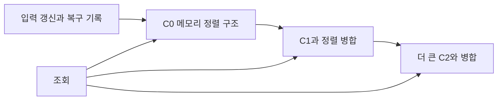

# 갱신을 모아서 병합하는 색인 / The log-structured merge-tree

LSM-tree는 쓰기를 없애는 자료구조가 아닙니다. 갱신을 작은 메모리 구조에 모은 뒤 큰 정렬 구조에 순서대로 합쳐, 갱신마다 흩어진 디스크 위치를 방문하는 비용을 나누는 설계입니다. 대신 병합과 여러 구성 요소 조회라는 비용이 남습니다.

| 항목 | 원문 정보 |
| --- | --- |
| 논문 | Patrick O’Neil, Edward Cheng, Dieter Gawlick, Elizabeth O’Neil, The Log-Structured Merge-Tree (LSM-Tree) |
| 발표 | Acta Informatica 33, 1996년, 351–385쪽 |
| 원고 소속 | O’Neil 두 저자는 UMass Boston, Cheng은 Digital Equipment Corporation, Gawlick은 Oracle입니다. |
| 원문 | [저자 논문의 대학 공개 원고 PDF](https://db.cs.berkeley.edu/cs286/papers/lsm-acta1996.pdf) |
| 읽을 위치 | 읽은 원고는 32쪽이며 §2 두 구성 요소, §3 비용과 다중 구성, §4 동시성·복구, §5 대안 비교, §6 한계와 확장을 다룹니다. 게재본 쪽수와 구분합니다. |

## 제자리 갱신을 미루는 이유

원문은 삽입량이 많은 이력 색인의 비용을 출발점으로 삼습니다. 메모리 C₀와 디스크 구성 요소 사이에서 rolling merge로 갱신을 옮기며, 당시 디스크 탐색·회전 지연과 메모리 가격을 포함한 비용 모형을 분석합니다. 실제 구현 전체의 벤치마크나 오늘의 SSD 성능으로 읽지 않습니다. 아래 데이터와 수치는 자체 예제입니다.

색인은 키에서 실제 기록의 위치나 값을 빠르게 찾는 구조입니다. 구성 요소 component는 전체 색인의 일부를 보관하는 정렬 구조입니다. 병합은 이미 정렬된 두 열의 앞부분을 비교하며 전체 순서를 만드는 작업입니다. 로그 구조 파일 시스템과 이름이 연결되지만, 파일 블록을 관리하는 계층과 키 색인을 관리하는 계층은 다릅니다.

원문 C₀는 메모리에 상주하도록 크기를 제한합니다. 운영체제가 우연히 일부 페이지를 캐시해 준다는 기대와 다릅니다. 디스크를 방문하지 않고 삽입할 작은 공간을 확보한 뒤, 그 공간이 넘치지 않도록 큰 구조로 내보낼 속도를 유지해야 합니다.

## 작은 정렬 열을 합쳐 보기

직접 만든 예에서 오래된 디스크 구성에 `(2,A),(5,B),(9,C)`가 있고, 메모리에 `(1,D),(5,E),(7,F)`가 있습니다. 각 키가 하나의 최신 값만 갖도록 정한 설명용 모델입니다.

| 다음 비교 | 출력 | 이유 |
| --- | --- | --- |
| 메모리 1, 디스크 2 | (1,D) | 작은 키를 먼저 냅니다. |
| 메모리 5, 디스크 2 | (2,A) | 디스크 쪽이 작습니다. |
| 메모리 5, 디스크 5 | (5,E) | 같은 키라 새 값을 선택합니다. |
| 메모리 7, 디스크 9 | (7,F) | 작은 키를 냅니다. |
| 메모리 소진, 디스크 9 | (9,C) | 남은 값을 냅니다. |

결과는 키가 정렬된 다섯 항목입니다. 같은 키 처리에서 어느 버전이 최신인지 판단하려면 생성 순서나 버전 규칙이 있어야 합니다. 정렬 순서만으로 최신성이 저절로 생기지는 않습니다. 원문의 이력 색인은 키와 기록 위치를 다루므로, 위 최신 값 모델은 원문의 모든 삭제·이력 의미를 그대로 재현한 코드가 아닙니다.

삭제는 더 신중합니다. 오래된 구성에 키 5가 남아 있다면 앞 구성에 삭제 표식을 두어 조회에서 숨길 수 있습니다. 표식과 오래된 항목이 만날 때 제거할 수 있지만, 뒤에 또 더 오래된 값이 남아 있다면 표식만 버리지 않아야 합니다. 스냅샷을 지원하는 구현에서는 과거 조회가 필요로 하는 버전도 고려해야 합니다.

## 묶음 처리의 이득을 계산합니다

자체 단순 모형에서 임의 페이지 한 번 읽고 쓰는 데 각각 10ms가 든다고 하겠습니다. 서로 다른 32개 페이지의 갱신을 매번 즉시 처리하면 32×20=640ms입니다. 이 페이지들을 연속 구간으로 묶어 처리할 수 있고, 읽기·쓰기 각각의 시작 비용이 10ms, 각 페이지 전송이 0.1ms라고 가정하면 20+64×0.1=26.4ms입니다.

두 계산은 임의 접근과 연속 접근의 비용 차이를 보여 줍니다. 실제로 모든 갱신이 같은 연속 32페이지에 놓인다는 보장은 없고, 로그 영속화·CPU·인덱스 갱신도 제외했습니다. 따라서 이 비율은 SSD 측정이나 일반적인 LSM 속도 배수가 아닙니다. 원문의 비용 모형을 읽을 때에도 이런 전제의 역할을 찾아야 합니다.

메모리 버퍼를 키우면 한 페이지를 읽었을 때 함께 반영할 갱신을 더 모을 수 있습니다. 하지만 메모리는 비용이 들며, 전체 디스크 구조가 너무 크면 작은 버퍼 한 번을 비우기 위해 너무 많은 옛 데이터를 훑을 수 있습니다. 여러 중간 구성 요소를 두는 이유가 여기서 나옵니다.

원문의 같은 인접 크기 비율 결과도 조건이 있습니다. 가장 작은 메모리 구성, 가장 큰 구성, 삽입률 등을 고정한 모형의 최적화입니다. 전체 합계 크기를 고정하는 변형은 다른 관계를 갖습니다. 이를 “어떤 장치와 작업에서도 모든 레벨은 10배가 최적”이라는 규칙으로 바꾸지 않습니다.

## 쓰기·읽기·공간의 비용은 사라지지 않습니다

쓰기 증폭은 사용자 입력보다 더 많은 바이트를 저장 장치에 쓰는 비율입니다. 자체 예에서 입력이 100MB/s이고 병합 등을 포함한 쓰기 증폭을 8로 놓으면 장치가 처리할 쓰기는 800MB/s입니다. 지속 쓰기 능력이 600MB/s라면 단순 정상상태 상한은 600/8=75MB/s입니다. 처음 메모리에 빨리 받아도 이보다 계속 많이 받으면 뒤에 일이 쌓입니다.

이것이 병합 부채와 쓰기 정지의 직관입니다. 평균 처리량뿐 아니라 어느 순간 병합이 몰리는지, 읽기가 같은 장치를 공유하는지, 여유 공간이 있는지도 중요합니다. 소프트웨어의 버퍼 크기를 늘리는 것만으로 지속 가능한 장치 대역폭을 늘릴 수는 없습니다.

읽기는 최신 값이 어느 구성에 있는지 확인해야 합니다. 없는 키에 대해 디스크 파일 넷을 모두 확인해야 하는 단순 모형에서, 각 파일의 Bloom 필터 거짓 양성 확률이 1%라면 실제 파일 방문 수의 기댓값은 4×0.01=0.04입니다. 이것은 기댓값의 선형성에 따른 자체 계산이며, 네 필터가 반드시 독립이라는 가정은 필요하지 않습니다. 양성 결과를 실제 존재로 확정해서는 안 됩니다.

공간도 병합 중에는 옛 파일과 새 결과가 함께 존재할 수 있습니다. 새 파일이 완성되고 참조가 바뀌기 전에 옛 파일을 지우면 중단 후 복구에 실패할 수 있습니다. 평상시의 논리 데이터 크기와 병합·스냅샷·복구를 포함한 최대 물리 공간을 따로 계산해야 합니다.

## 원문의 복구와 이후 사용

원문 §4는 체크포인트와 이후 로그를 이용해 메모리 구성과 병합 상태를 복구하는 설계를 설명합니다. 물리적 노드 잠금과 트랜잭션의 키 범위 격리는 같은 보장이 아니며, 본문도 더 추상적인 격리 문제와 일부 상세 증명을 별도로 남깁니다. 모든 동시성·복구 문제가 완성된 구현으로 검증되었다고 요약하지 않습니다.

후속 [Bigtable](bigtable2006.md)의 §10은 memtable과 SSTable을 이용한 저장 방식이 LSM-tree와 유사하다고 명시합니다. 이 연결은 실제 논문에 근거하지만, 두 시스템의 파일 구성과 병합 정책이 완전히 같다는 뜻은 아닙니다. 원문의 “실제로 세 구성 정도”라는 전망 역시 그 시기의 비용 분석이며 현재의 모든 엔진에 적용하는 한계가 아닙니다.

LSM을 고를 때는 쓰기가 많다는 한 조건 외에 점 조회·범위 조회·최신성·삭제·장치 대역폭을 함께 봐야 합니다. 반대로 B-tree도 캐시와 순차 삽입에서 유리할 수 있으므로, 제자리 갱신이 언제나 입력마다 비싼 임의 I/O를 만든다고 단정하지 않습니다.

## 자기 점검

1. 메모리에 삽입을 끝냈다는 사실이 지속 가능한 쓰기 처리량을 증명하나요?
2. 입력 100MB/s·쓰기 증폭 8·장치 600MB/s인 단순 모형의 지속 입력 상한은 얼마인가요?
3. 삭제 표식만 먼저 지우면 어떤 문제가 생길 수 있나요?

해설 보기

1. 아닙니다. 뒤의 병합과 영속 기록을 같은 속도로 처리할 수 있어야 합니다.
2. 75MB/s입니다. 다른 비용을 제외한 대역폭 상한이며 실제 성능 보장은 아닙니다.
3. 뒤 구성의 옛 값이 다시 조회될 수 있습니다. 오래된 버전과 과거 조회의 필요를 고려해 제거해야 합니다.

[이 분야의 논문 목록](README.md)
