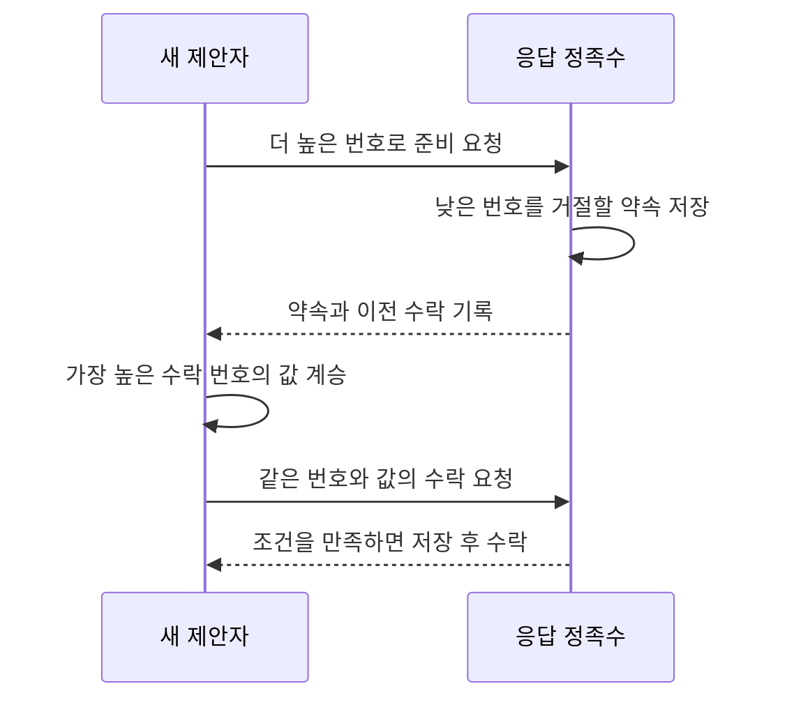

# 과반수의 기록을 잇는 합의 / Paxos and the part-time parliament

서버 하나가 답하지 않는 동안 다른 서버들은 작업을 계속하고 싶습니다. 하지만 예전 서버가 나중에 돌아와 다른 결정을 전하면 어떻게 될까요? Paxos는 서버가 기억하는 약속과 과거 표를 이용해 같은 결정 위치의 값이 달라지지 않도록 합니다.

| 항목 | 원문 정보 |
| --- | --- |
| 논문 | Leslie Lamport, The Part-Time Parliament |
| 발표 | ACM Transactions on Computer Systems 16(2), 1998년 5월, 133–169쪽 |
| 당시 소속 | Digital Equipment Corporation Systems Research Center입니다. |
| 원문 | [저자 공개 PDF](https://lamport.azurewebsites.net/pubs/lamport-paxos.pdf). 표지에는 2000년의 작은 수정이 명시됩니다. |
| 읽을 위치 | §1 요구·가정, §2 단일 결정, §3 결정의 열·읽기·구성 변경, §4 상태 기계, 부록의 상태 변수와 불변식입니다. |

## 우화와 알고리즘을 구분합니다

원문은 가상의 의회를 통해 중단·재시작과 메시지 지연에도 기록을 일치시키는 절차를 설명합니다. 과반수가 겹치는 성질, 더 높은 투표 번호에 대한 약속, 기존 투표를 계승하는 규칙이 함께 사용됩니다. 일관성은 무조건적인 진행 보장과 다르며, 악의적으로 거짓말하는 서버까지 기본 절차가 견딘다는 주장은 아닙니다. 아래 서버와 메시지는 직접 만든 예입니다.

값을 고르는 제안자, 표를 수락하는 수락자, 결정 사실을 배우는 학습자는 역할 이름입니다. 반드시 별도 컴퓨터여야 하는 것은 아닙니다. 정족수는 결정을 위해 응답을 모아야 하는 집합이며, 여기서는 단순하게 전체 수락자의 과반수를 씁니다. 투표 번호는 시도들을 정렬하는 고유한 번호로, 명령의 로그 위치와 다른 값입니다.

서버 다섯 대 A·B·C·D·E에서 과반수는 세 대입니다. 서로 다른 세 대 집합 두 개는 반드시 적어도 한 대에서 겹칩니다. 둘의 크기를 더하면 6인데 전체는 5이기 때문입니다. 그러나 겹친 서버가 아무 규칙 없이 반대 값에 또 투표할 수 있다면 이 계산만으로는 안전성이 생기지 않습니다.

## 먼저 묻고, 기록을 이어서 제안합니다

다음은 한 로그 위치의 값을 선택하는 자체 흐름입니다. 번호 10의 제안자가 A·B·C에 문의하고, 세 서버가 더 낮은 번호의 새 요청을 수락하지 않겠다고 약속했다고 하겠습니다. 이전 수락이 없다면 제안자는 값 X를 보내고, A·B·C가 이를 수락하여 X가 선택됩니다.

그 직후 제안자가 중단되어 다른 서버에 선택 사실을 알리지 못했습니다. 번호 20의 새 제안자는 C·D·E에서 문의 응답을 모읍니다.

| 응답 서버 | 보고한 마지막 수락 | 새 제안자가 얻는 정보 |
| --- | --- | --- |
| C | 번호 10, 값 X | 이전 시도가 X를 수락했다는 흔적입니다. |
| D | 없음 | 이 서버가 모른다는 뜻입니다. 전체에 결정이 없다는 뜻은 아닙니다. |
| E | 없음 | 같은 이유로 새 값을 마음대로 고를 근거가 되지 않습니다. |

새 제안자는 받은 응답 중 가장 높은 번호의 수락 값을 이어받아 X를 제안해야 합니다. X가 이미 선택되었는지 확실히 모르더라도 이 규칙을 지킵니다. 결정되었는지 알아맞히는 대신, 결정되었을 가능성과 충돌하지 않는 행동을 하는 것입니다.

## 수락·선택·인지가 다른 이유

한 서버가 X를 수락한 사실과 X가 정족수에 의해 선택된 사실은 다릅니다. 선택되었지만 이를 아는 학습자가 없을 수도 있습니다. 응답 메시지가 사라졌다고 이미 저장된 표가 취소되지는 않습니다. 반대로 한 서버에서 수락 응답을 받았다고 고객에게 결정을 확정해 주면 필요한 교집합 논증이 성립하지 않을 수 있습니다.

다른 자체 상황에서는 번호 10의 X가 A 한 대에서만 수락된 뒤 멈췄다고 하겠습니다. 번호 20이 B·C·D에서 준비 응답을 모았고 아무 수락 기록도 없었다면 Y를 제안할 수 있습니다. X는 선택된 값이 아니었습니다. 새 약속들 때문에 낮은 번호 10이 뒤늦게 정족수를 완성하는 길도 차단됩니다.

이 차이가 중요한 이유는 Paxos가 “누군가 한 번 제안한 값은 영원히 바꿀 수 없다”는 알고리즘이 아니기 때문입니다. 안전성은 선택된 값과 미래 선택의 일치입니다. 모든 미완료 시도의 값까지 영구 고정하면 진행을 불필요하게 막습니다.

## 기억을 잃으면 약속도 무너집니다

서버가 재시작 뒤 약속과 수락 이력을 모두 잃고 새 서버처럼 행동하면, 옛날에 한 표가 앞으로의 행동을 제한하지 못합니다. 따라서 원문에서 지워지지 않는 장부에 대응하는 정보는 중단 후에도 보존되어야 합니다. 저장 장치의 원자적 갱신과 오류 처리까지 합의의 추상 증명에서 자동으로 해결되지는 않습니다.

재전송에도 같은 응답을 반복할 수 있어야 합니다. 메시지가 중복되었다는 이유로 고객 명령을 두 번 적용하는 문제는 별도입니다. 예를 들어 `잔액에 10 더하기`를 같은 요청 식별자로 두 번 받았다면, 합의로 순서가 정해져도 식별자에 따른 중복 제거가 없으면 20을 더할 수 있습니다. 합의와 정확히 한 번의 서비스 효과를 같은 보장으로 읽지 않습니다.

## 진행과 로그의 여러 위치

제안자 둘이 번호를 계속 올려 서로의 시도를 방해하면 서로 다른 값이 선택되지는 않아도 결정이 계속 늦어질 수 있습니다. 안정적인 지도자와 응답 가능한 과반수가 충분히 오래 유지되는 등의 조건이 진행에 필요합니다. [FLP](flp1985.md)의 무조건적인 종료 불가능성과 충돌하지 않습니다.

여러 명령을 실행하려면 위치별 합의를 이어 로그를 만듭니다. 지도자를 안정적으로 유지하면 준비 단계의 일부를 여러 위치에 걸쳐 재사용할 수 있지만, 새 지도자는 이전 위치들의 수락 기록을 회복해야 합니다. 위치 8의 결정을 배웠다고 위치 7의 빈칸을 무시하고 상태 기계에 적용하면 명령 순서가 달라질 수 있습니다.

아무 복제본에서 즉시 읽으면 최신 결정을 모르는 응답을 받을 수도 있습니다. 안전한 쓰기 합의가 모든 읽기의 최신성을 자동으로 보장하지 않습니다. 원문 §3.3.4가 읽기를 따로 다루는 이유이며, 읽기 장벽·지도자 확인 등 서비스의 규칙을 추가로 정해야 합니다.

후속 [Spanner](spanner2012.md)의 원문은 복제에 Paxos를 사용한다고 명시하고, [Raft](raft2014.md)는 다른 구조의 복제 로그 절차를 제시하며 Paxos와 비교합니다. 이런 실제 연결을 확인할 수 있지만, 특정 서비스가 Paxos라는 이름을 썼다고 저장·읽기·구성 변경의 모든 세부가 이 글의 단일 위치 예와 같다고 결론 내릴 수는 없습니다.

## 자기 점검

1. 다섯 서버 중 세 서버 정족수 둘이 겹친다는 사실만으로 충분한가요?
2. 새 제안자가 한 응답에서 옛 수락 X를 발견했지만 선택 여부는 모른다면 어떻게 해야 하나요?
3. 같은 슬롯의 선택 값이 바뀌지 않으면 반드시 금방 결정이 나나요?

해설 보기

1. 아닙니다. 교집합의 서버가 이전 기록과 약속을 보존하고 새 절차가 그 기록을 계승해야 합니다.
2. 모은 응답에서 가장 높은 번호의 수락 값에 따라 제안합니다. 선택 여부를 확정하지 못했다는 이유로 임의의 새 값을 고르지 않습니다.
3. 아닙니다. 안전성과 진행은 별도 성질입니다. 경쟁하는 시도와 지연으로 진행이 막힐 수 있습니다.

[이 분야의 논문 목록](README.md)
