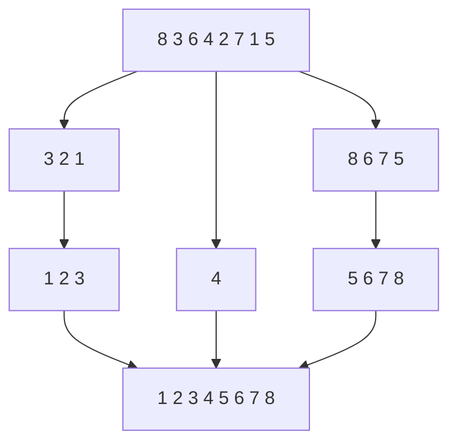

# Hoare: 나누어 정렬하고 종료를 보장하기 / Partitioning and progress in Quicksort

| 항목 | 내용 |
|---|---|
| 논문 | Quicksort |
| 저자·발표 | C. A. R. Hoare, The Computer Journal 5(1), 1962년 |
| 기관 표기 | 스캔 제목부에는 소속이 없으며 끝의 Acknowledgment는 Elliott Brothers (London) Ltd.의 게재 허가를 밝힙니다. |
| 원문 | [Oxford 보관 스캔 PDF](https://www.cs.ox.ac.uk/files/6226/H2006%20-%20Historic%20Quicksort.pdf) |
| 읽을 위치 | Part One: Theory의 Partition·Quicksort·Estimate of Time Taken, Part Two: Implementation, Conclusion |
| 쪽 번호 | 이 PDF는 인쇄 10–15쪽입니다. 마지막 쪽에서 이어지는 Zero-Address Computers는 다른 글입니다. |

## 작은 두 문제로 나누는 것만으로 충분할까요?

Hoare는 기준값을 중심으로 항목을 나누고 작은 구간에 같은 절차를 적용하는 정렬을 설명합니다. 원문은 극단값·동일값 때문에 분할이 진전되지 않는 경우, 보류 구간을 저장하는 방식, 무작위성 가정 아래의 시간 추정, 컴퓨터의 교환·저장 특성에 따른 구현을 함께 다룹니다. [원문 Part One·Part Two](https://www.cs.ox.ac.uk/files/6226/H2006%20-%20Historic%20Quicksort.pdf)

정렬은 값이 작은 순서 등 정한 관계에 맞게 항목을 배치하는 일입니다. `분할`은 각 부분이 완전히 정렬되지 않았어도, 앞쪽 값이 뒤쪽 값보다 크지 않도록 구역을 가르는 과정입니다. `기준값` 또는 pivot은 그 구역을 나눌 때 비교하는 값입니다. 분할을 마친 상태와 전체 정렬을 마친 상태를 혼동하지 않아야 합니다.

## 직접 따라가기: 분할의 결과를 확인합니다

다음은 원문의 기계어 구현을 복제한 코드가 아닌 자체 수작업 예입니다. 배열 `[8,3,6,4,2,7,1,5]`에서 4를 기준으로 나머지 값을 비교하겠습니다.

| 구역 | 들어간 값 |
|---|---|
| 4보다 작은 구역 | `[3,2,1]` |
| 기준값 구역 | `[4]` |
| 4보다 큰 구역 | `[8,6,7,5]` |

아직 왼쪽도 오른쪽도 정렬되지 않았습니다. 하지만 왼쪽의 어떤 값도 오른쪽의 어떤 값보다 크지 않으므로, 이제 두 부분의 내부 정렬만 하면 됩니다. 작은 구역을 2로 나누면 `[1]·[2]·[3]`이고, 큰 구역을 6으로 나누면 `[5]·[6]·[8,7]`입니다. 마지막 `[8,7]`을 정리하면 전체는 `[1,2,3,4,5,6,7,8]`입니다.



이 그림은 새 배열을 만들어 논리를 설명합니다. 원문의 중요한 장점인 제자리 처리를 이 그림이 구현한 것은 아닙니다. `제자리`는 입력의 저장 공간을 재사용한다는 뜻이며, 재귀 호출이나 보류 구간에 필요한 부가 공간까지 무조건 0이라는 뜻은 아닙니다.

## 두 가지 증명을 따로 세웁니다

첫째는 정렬 결과에 대한 증명입니다. 분할 후 왼쪽은 기준값 이하, 오른쪽은 기준값 이상이라는 관계를 유지하고, 각 부분을 정렬했다면 합친 배열도 정렬됩니다. 중복값의 처리 규칙에 따라 등호가 어느 구역에 놓이는지는 달라질 수 있습니다.

둘째는 종료에 대한 증명입니다. 다음 호출이 같은 구간을 그대로 받아서는 안 됩니다. 예를 들어 `[5,5,5]`를 5로 나눈 뒤 다시 세 값 전부를 같은 하위 문제로 보내면 아무 진전이 없습니다. 구간의 크기가 줄어드는지, 같은 값의 구역을 별도로 제외하는지, 포인터가 실제로 움직이는지 중 어떤 장치가 이를 막는지 확인해야 합니다.

‘재귀 함수입니다’는 종료 이유가 아닙니다. 재귀는 함수가 자기 자신을 다시 부르는 구조입니다. 종료 조건과 함께, 그 조건에 가까워지는 양이 무엇인지 제시해야 합니다. 여기서는 아직 정렬할 구간의 길이를 자연수 척도로 삼을 수 있습니다.

## 직접 계산: 평균과 최악은 다른 질문입니다

서로 다른 n개 값에 대해, 기준값과 나머지를 한 번씩 비교하는 단순 모델을 별도로 정하겠습니다. 양쪽 크기가 a와 `n−1−a`이면 비교 횟수는 다음과 같습니다.

```math
C(n)=n-1+C(a)+C(n-1-a),\quad C(0)=C(1)=0.
```

n=7을 계속 고르게 나누면 `C(7)=6+2C(3)=6+2×2=10`입니다. 매번 최소값을 기준으로 택하면 `6+5+4+3+2+1=21`입니다. n=7의 두 수는 이 단순 모델의 계산이며 원문의 구현에서 세어 얻은 비교 횟수가 아닙니다.

모든 순위의 기준값을 같은 확률로 뽑는다고 추가하면 조건별 비용을 평균할 수 있습니다. 평균은 고르게 나눈 경우 하나의 비용이 아니라, 불균형한 경우도 각 확률만큼 포함한 값입니다. 이 모델의 기대 비교 횟수 `2(n+1)Hₙ−4n`에서 `Hₙ=1+1/2+…+1/n`이므로 n=7에서는 약 13.4857입니다. 한 번의 실행에서 소수 횟수의 비교를 한다는 뜻이 아닙니다.

항상 첫 값을 택하는 구현에 이미 정렬된 입력을 주면 최악에 가까운 분할이 반복될 수 있습니다. 무작위 기준값 선택은 입력의 순서와 기준값 순위를 분리하기 위한 장치입니다. 그러나 무작위화했다고 최악의 실행이 불가능해지지는 않습니다. 기대값의 보장과 모든 실행에 대한 보장을 구분해야 합니다.

## 저장 공간과 실측 표를 읽는 방법

보류 구간을 쌓는 자료구조는 스택입니다. 마지막에 넣은 구간을 먼저 꺼냅니다. 큰 쪽을 보류하고 작은 쪽부터 처리하면, 새로 중첩해 처리하는 구간 크기가 빠르게 줄어 최대 스택 깊이를 제한할 수 있습니다. 이것은 실행 순서를 정하는 방법이지 비교 결과를 바꾸는 방법은 아닙니다.

원문 Table 1은 당시 기계와 프로그램을 조건으로 한 비교이며 일부 값에는 계산식으로 추정했다는 각주가 있습니다. 따라서 표의 모든 수를 직접 측정한 시간으로 인용하거나, 그 비율을 현재 Python 정렬에 적용하면 안 됩니다. 구현에 관한 논의도 교환 명령, 다중 워드 키, 저장 장치 특성과 함께 읽어야 합니다.

후속 정렬 공학은 [Bentley·McIlroy의 Engineering a Sort Function, 1993](https://onlinelibrary.wiley.com/toc/1097024x/1993/23/11)처럼 실제 라이브러리 함수의 입력·분할·검사 조건을 다루는 연구로 이어집니다. 여기서 직접 계산한 10·21회라는 수는 그런 구현 전체의 실행시간 평가를 대신하지 않습니다.

## 자기점검

1. 분할 뒤 `[3,2,1]·[4]·[8,6,7,5]`가 되었다면 정렬은 끝났나요?
2. 기대 비교 횟수가 약 13.49라는 말은 매번 14회 이하라는 뜻인가요?
3. 모든 값이 같은 배열에서 하위 호출이 원래 구간을 그대로 받으면 어떤 문제가 있나요?

<details>
<summary>해설 보기</summary>

1. 아닙니다. 구역 사이의 관계만 정해졌습니다. 각 구역 내부의 순서를 더 정리해야 합니다.
2. 아닙니다. 확률에 따른 평균입니다. 더 적거나 많은 실행이 함께 있을 수 있으며 최악의 경우와 별개입니다.
3. 구간 길이가 줄지 않아 종료의 근거가 사라집니다. 동일값 처리나 경계 갱신 규칙으로 실제 진전을 보장해야 합니다.

</details>

[알고리즘과 컴퓨터 시스템 목록](README.md)
