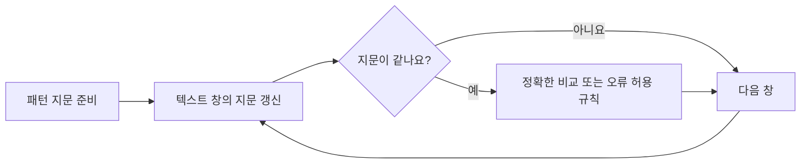

# Karp·Rabin: 짧은 지문으로 긴 문자열 거르기 / Fingerprints for string matching

| 항목 | 내용 |
|---|---|
| 논문 | Efficient Randomized Pattern-Matching Algorithms |
| 저자·당시 소속 | Richard M. Karp, UC Berkeley; Michael O. Rabin, Harvard University·Hebrew University |
| 발표 | IBM Journal of Research and Development 31(2), 249–260쪽, 1987년 3월 |
| 원문 | [대학 보관 원문 PDF](https://didawiki.cli.di.unipi.it/lib/exe/fetch.php/bio/kr87.pdf) · [발행처 서지](https://ieeexplore.ieee.org/document/5390135/) |
| 읽을 위치 | §1–3 예제·세 알고리즘·모듈러 지문, §4 갱신과 다차원 확장, §5 재초기화, §6 행렬 지문, §7 비정형 모양, §8 병렬 검색 |

## 긴 자료를 매번 처음부터 비교하지 않기

원문은 길이가 긴 문자열을 짧은 fingerprint로 나타내어 후보를 거릅니다. 지문 함수의 무작위 선택, 빠른 갱신, 거짓 일치의 확률이 핵심입니다. 실제 문자를 재검사하는 버전과 작은 오류 확률을 허용하는 버전의 보장도 구별합니다. 다차원·비정형 모양·병렬 처리로 확장하며, 연산 비용과 저장 모형의 가정을 함께 둡니다. [원문 §0–8](https://didawiki.cli.di.unipi.it/lib/exe/fetch.php/bio/kr87.pdf)

여기서 지문은 내용을 짧게 요약한 자연어 문장이 아닙니다. 입력에서 계산한 작은 수나 행렬이며, 다른 입력이 같은 지문을 가질 수 있습니다. 이 충돌 가능성을 어떤 방식으로 다룰지가 알고리즘의 정확성과 시간을 바꿉니다.

## 먼저 검색 문제를 고정합니다

패턴은 찾을 문자열이고 텍스트는 그 패턴을 찾는 대상입니다. 텍스트에서 패턴 길이만큼 연속한 창을 한 자리씩 옮기며 비교한다고 생각하시면 됩니다. 이 글의 예는 숫자 문자 하나를 한 단위로 봅니다. UTF-8 바이트, 유니코드 코드 포인트, 화면에 보이는 글자 묶음을 같은 단위로 취급한 구현은 아닙니다.

문자열을 자릿수 있는 수로 해석한 뒤 p로 나눈 나머지를 저장할 수 있습니다. `mod p`는 이 나머지를 구하는 연산입니다. 저장 값은 작아지지만 원래 문자열을 완전히 복원할 수는 없습니다. 이를 암호화나 충돌 없는 신분증으로 생각하면 안 됩니다.

## 직접 계산: 세 자리 창을 옮기기

다음은 원문의 이진 입력을 복제하지 않고, 밑 10과 나머지 기준 p=13으로 만든 교육용 예제입니다. 텍스트는 `314159`, 패턴은 `159`, 창 길이는 3입니다.

| 시작 위치 | 창 | 수로 읽은 값 | 13으로 나눈 나머지 |
|---:|---|---:|---:|
| 0 | 314 | 314 | 2 |
| 1 | 141 | 141 | 11 |
| 2 | 415 | 415 | 12 |
| 3 | 159 | 159 | 3 |

패턴 지문은 3입니다. 앞의 세 창은 지문이 다르므로 문자 전체 비교 없이 거절할 수 있습니다. 마지막 창은 지문이 같아 실제 세 문자를 확인하면 일치합니다. 처음부터 모든 창의 수를 다시 만드는 대신, 빠지는 자리와 들어오는 자리만 처리하겠습니다.

```math
H_{next}=((H_{now}-d_{out}B^{m-1})B+d_{in})\bmod p.
```

이 예에서는 B=10, m=3이고 `10² mod13=9`를 미리 계산합니다. 첫 이동은 `((2−3×9)×10+1) mod13=11`입니다. 다음은 `((11−1×9)×10+5) mod13=12`, 마지막은 `((12−4×9)×10+9) mod13=3`입니다. 중간 수가 음수여도 수학적 나머지는 0~12로 정규화합니다. 언어별 나머지 연산의 음수 처리 규칙은 구현에서 확인해야 합니다.

이런 갱신을 rolling hash라고 부릅니다. 문자들이 실제로 회전한다는 뜻이 아니라, 창이 움직일 때 지문을 이전 값에서 갱신한다는 뜻입니다. 원문의 상수 시간 분석 역시 정해진 범위의 지문 연산을 일정 비용으로 다루는 계산 모형에 의존합니다.

## 지문이 같으면 문자열도 같나요?

별도의 문자열 `172`도 13으로 나눈 나머지가 3입니다. 따라서 `159`와 `172`는 같은 지문을 가지지만 다른 문자열입니다. 재검사를 생략한 구현은 여기서 틀린 일치를 보고할 수 있습니다. 재검사를 하면 정답은 유지되지만 비교 비용이 추가됩니다.

| 방식 | 충돌 때의 행동 | 구분할 보장 |
|---|---|---|
| 지문만 비교 | 실제 문자를 보지 않고 통과합니다. | 시간과 오류 확률을 함께 분석합니다. |
| 지문 뒤 문자 재검사 | 다른 문자열이면 계속 찾습니다. | 답의 정확성과 추가 비교 시간을 나눕니다. |
| 재검사 후 함수 재선택 | 충돌하면 새 무작위 함수를 택합니다. | 반복적인 불리한 충돌에 대한 분석이 필요합니다. |

이 표는 원문의 세 접근을 읽기 위한 구분입니다. 이 해설의 작은 고정 p=13 예가 원문의 확률 정리를 만족하는 무작위 알고리즘이라는 뜻은 아닙니다.

## 무작위성은 입력이 아니라 선택한 함수에 있습니다

같은 두 수 159와 172의 차이는 13입니다. 지문에 사용할 나머지 기준을 `{5,7,11,13}` 중 균등하게 하나 고른다고 별도로 가정하면, 이 두 수가 충돌하는 경우는 13을 골랐을 때뿐입니다. 이 장난감 실험의 충돌 확률은 1/4입니다. 실제 자료의 문자가 무작위로 나왔다는 가정이 아니라, 고정한 입력에 대해 알고리즘이 무엇을 무작위로 골랐는지의 계산입니다.

13과 17 두 지문을 쓰면 159·172를 구별할 수 있습니다. 하지만 159와 380의 차이는 `13×17=221`이므로 두 나머지가 모두 같습니다. 여러 고정 지문을 쓴다는 사실만으로 충돌이 수학적으로 불가능해지지는 않습니다. 독립성·선택 분포·입력 범위를 밝히지 않고 오류 확률을 무조건 곱해서도 안 됩니다.



## 결과를 읽을 때 빠뜨리기 쉬운 조건

원문의 real time은 입력의 각 단위를 처리하는 단계 수가 일정하게 제한된다는 뜻입니다. 인터넷 서비스의 지연시간 목표를 측정했다는 말과 다릅니다. 무작위 전처리와 매개변수의 상한을 언제 알았는지도 봐야 합니다.

재검사를 하는 단순 구현에서 충돌이 많이 나면 창마다 패턴 길이에 비례하는 비용이 들 수 있습니다. 원문의 기대 시간은 선택한 함수군과 매개변수에 관한 분석입니다. 임의의 작은 상수 나머지를 정한 프로그램에 그 결과를 그대로 붙일 수 없습니다. 기대 시간과 개별 실행의 최악 시간도 구별해야 합니다.

차원이 늘어나면 갱신 순서와 저장 요구량이 달라집니다. 1차원 창 한 개의 예제가 임의 모양의 이미지 검색까지 구현한 것은 아닙니다. 원문의 행렬 지문은 비가환적인 곱의 순서와 역행렬을 사용하므로, 단순 덧셈 체크섬과 바꾸어 읽지 않아야 합니다.

후속 적용으로 [LBFS 논문](https://pdos.csail.mit.edu/~benjie/papers/lbfs%3Asosp01.pdf)은 움직이는 창의 Rabin 지문으로 파일의 경계 후보를 정합니다. 문자열의 첫 일치 검색과 파일 분할은 다른 과제이며, 지문을 빠르게 갱신하는 아이디어가 어떻게 다른 용도로 쓰이는지 비교하기 좋습니다. 이 문서에서는 파일 시스템의 전송 절감 수치를 재현하지 않았습니다.

## 자기점검

1. `314`의 지문 2에서 다음 창 `141`의 지문 11을 어떻게 얻나요?
2. 159·172가 충돌한다면 재검사 버전도 틀린 답을 내나요?
3. 고정한 두 나머지를 쓰면 어떤 문자열끼리도 충돌하지 않나요?

<details>
<summary>해설 보기</summary>

1. 가장 높은 자리의 3을 빼고 10을 곱한 뒤 새 숫자 1을 더해 나머지를 취합니다. 축약 계산은 `((2−3×9)×10+1) mod13=11`입니다.
2. 실제 문자를 비교해 다름을 확인하므로 그 충돌만으로 답이 틀리지는 않습니다. 다만 비교 시간이 추가됩니다.
3. 아닙니다. 예를 들어 159·380은 13과 17에서 모두 같은 나머지를 갖습니다. 확률 보장이나 재검사 조건이 별도로 필요합니다.

</details>

[알고리즘과 컴퓨터 시스템 목록](README.md)
