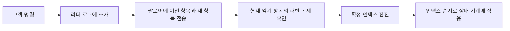

# 지도자와 로그로 나누어 이해하는 합의 / Raft replicated logs

Raft를 “과반수에 복사하면 끝”으로 기억하면 지도자가 바뀌는 순간의 중요한 규칙을 놓칩니다. 누가 지도자가 될 수 있는지, 무엇을 확정할 수 있는지, 이미 확정한 명령을 어떤 순서로 실행하는지가 함께 맞아야 합니다.

| 항목 | 원문 정보 |
| --- | --- |
| 논문 | Diego Ongaro, John Ousterhout, In Search of an Understandable Consensus Algorithm |
| 발표 | USENIX ATC 2014. 여기서는 2014년 5월 20일의 Extended Version 18쪽을 읽습니다. |
| 당시 소속 | Stanford University입니다. |
| 원문 | [저자 확장판 PDF](https://raft.github.io/raft.pdf) |
| 읽을 위치 | §5 선거·복제·안전성, §6 공동 구성, §7 스냅샷, §8 고객과 읽기, §9 이해도·정확성·성능 평가입니다. |

## 상태와 임기를 분리합니다

원문은 합의를 지도자 선거, 로그 복제, 안전성으로 나눕니다. 서버는 더 높은 임기를 보면 물러나고, 투표에는 로그의 최신성 조건이 붙습니다. 이전 임기 항목은 단순한 복제 수만 세어 확정하지 않습니다. 이해도 실험과 선거 시간 실험도 제시하지만, 모든 학습자·장치에서의 우월성을 증명한 것은 아닙니다. 다음 번호와 명령은 자체 예제입니다.

팔로어는 지도자의 복제 요청에 응답하는 서버, 후보자는 선거 중인 서버, 리더는 명령 복제를 이끄는 서버입니다. 임기 term은 논리적인 선거 세대이며 초 단위 시간 간격이 아닙니다. 로그 인덱스는 명령이 놓이는 순서이고, 각 항목의 임기는 그 항목을 만든 지도자의 임기입니다.

다섯 대에서 지도자는 과반수인 세 대의 표를 받아야 합니다. 서버가 임기마다 한 후보에만 투표하고 그 사실을 중단 후에도 기억하면, 같은 임기에 후보 둘이 각각 세 표를 얻을 수 없습니다. 투표 집합이 겹치는 서버가 이중 투표를 해야 하기 때문입니다. 서로 다른 임기의 오래된 지도자와 새 지도자가 잠시 함께 자신을 지도자라고 생각할 가능성까지 없다는 뜻은 아닙니다.

## 가장 긴 로그가 항상 최신은 아닙니다

후보를 고를 때 마지막 항목의 임기를 먼저 비교하고, 같을 때 마지막 인덱스를 비교합니다. 자체 예에서 다음 두 로그를 보겠습니다.

| 후보 | 마지막 항목 임기 | 마지막 인덱스 | 비교 결과 |
| --- | --- | --- | --- |
| A | 3 | 12 | 항목은 더 많지만 마지막 임기가 이전입니다. |
| B | 4 | 9 | 이 기준에서는 B가 더 최신입니다. |

이 규칙을 인덱스 우선 비교로 바꾸면 증명에서 기대한 선거 제한이 달라집니다. “최신”이라는 일상어 대신 `(마지막 임기, 마지막 인덱스)`의 사전식 비교라고 적으면 판단을 정확히 할 수 있습니다.

새 항목을 붙일 때에는 그 바로 앞 항목의 인덱스와 임기가 일치하는지도 확인합니다. 지도자의 7번 앞부분은 임기 2로 끝나는데 팔로어의 같은 위치가 임기 1이면, 단순히 8번 뒤에 새 항목을 붙이지 않습니다. 먼저 공통되는 지점을 찾아 충돌 부분을 정리해야 합니다. 길이만 같다고 내용도 같다고 판단하지 않습니다.

## 복제와 확정과 실행

현재 임기 6의 지도자 A가 10번 위치에 명령 `잔액에 5 더하기`를 만듭니다. A·B·C에 저장되고 A가 이를 확인하면 현재 임기의 과반 복제 조건으로 확정할 수 있습니다. D·E가 아직 못 받았어도 나머지 복제는 계속합니다. 정상 서버들이 명령을 실제 적용하는 순간은 서로 다를 수 있습니다.

확정되었다는 것은 안전하게 적용할 수 있다는 뜻이며, 디스크에 한 번 적혔다는 사실과 다릅니다. 이전 임기 항목을 새 지도자가 복제하는 경우에도 같은 문구를 그대로 쓰면 안 됩니다. Raft는 현재 임기 항목을 과반수에 복제하여 확정할 때 그 앞의 항목들도 간접적으로 확정하는 규칙을 씁니다.

예를 들어 현재 임기 6의 로그에 옛 임기 4의 9번 항목이 있다고 하겠습니다. 9번이 세 대에 보인다는 계산만으로 확정 인덱스를 올리는 대신, 임기 6의 10번 항목을 확정한 뒤 그 앞 9번도 포함시킵니다. 원문 그림 8은 이전 임기 항목이 과반 복제되어도 새 지도자가 덮어쓸 수 있는 상황을 분석합니다. 단순한 숫자 규칙에서 현재 임기 조건을 빼면 그 반례를 허용합니다.

## 고객이 다시 보냈을 때

지도자가 명령을 확정하고 적용했지만 응답 전에 중단될 수 있습니다. 고객은 실패로 생각하고 같은 요청을 다시 보냅니다. 합의가 명령 순서를 일치시켜도 이 재시도를 새 명령으로 기록하면 효과가 두 번 생깁니다.

자체 예에서 `(고객 C, 번호 42, +5)`를 이미 적용했다면, 상태 기계는 마지막 처리 번호와 응답을 기억해 같은 번호에 이전 결과를 돌려줄 수 있습니다. 고객 번호·요청 번호의 수명과 보존 방법도 서비스 설계에 들어갑니다. 같은 숫자를 서로 다른 고객에게 붙여 요청을 잘못 합치는 일도 막아야 합니다.

읽기는 로그를 바꾸지 않으므로 아무 지도자가 곧바로 답해도 될 것처럼 보입니다. 하지만 고립된 옛 지도자는 새 임기의 존재를 모를 수 있습니다. 원문 §8은 현재 임기의 항목을 확정해 기존 확정 범위를 알고, 읽기에 앞서 과반수와 통신해 자신의 권한도 확인하는 절차를 설명합니다. 단순히 “리더에서 읽기”라는 말만으로 최신 읽기 보장을 설명할 수 없습니다.

## 구성 변경과 오래된 로그

기존 구성 {A,B,C}에서 새 구성 {C,D,E}로 한꺼번에 전환한다고 해 보겠습니다. 일부는 예전 구성, 일부는 새 구성을 사용하면 옛 과반 {A,B}와 새 과반 {D,E}가 겹치지 않습니다. 각 집합이 독립적으로 결정하게 두면 위험합니다.

확장판 §6의 공동 구성에서는 옛 구성의 과반과 새 구성의 과반을 각각 요구하는 중간 단계를 둡니다. 전체 합집합의 과반 하나만 요구하는 규칙과 다릅니다. 또한 새 서버가 빈 로그로 투표권을 얻어 진행을 막지 않도록 따라잡는 단계도 고려합니다. 실제 구현의 구성 변경 방식은 버전과 설계를 확인해야 하며 모든 Raft 제품이 같은 확장판 규칙을 쓰는 것은 아닙니다.

스냅샷은 확정된 명령을 적용한 상태를 저장하고 오래된 로그 일부를 대신합니다. 마지막 포함 인덱스와 임기를 남기는 이유는 뒤의 로그와 이어지는 경계를 검증하기 위해서입니다. 현재 변수만 저장하고 그 위치 정보를 버리면 복제 로그의 연속성을 확인하기 어렵습니다.

## 평가와 후속 사용의 범위

원문 §9의 학생 실험은 특정 강의·문항·참가자 집단에서 이해도를 비교합니다. 실제 구현의 모든 버그가 줄었다는 직접 측정으로 바꾸지 않습니다. 선거 시간 실험 역시 서버 수·통신 시간·무작위 타임아웃 설정을 가진 결과이므로 일반적인 장애 복구 시간으로 복사하지 않습니다.

후속 사용의 한 예는 [etcd 공식 문서](https://etcd.io/docs/v3.5/learning/why/)의 단일 복제 그룹 설명입니다. 이 문서는 갱신이 Raft를 거쳐 확정된다고 명시합니다. 다만 Raft의 합의 절차, 데이터 저장 구조, 외부 자원에 대한 잠금의 효과는 서로 다른 층입니다. [Paxos](paxos1998.md)·[FLP](flp1985.md)와 함께 읽으면 추상 안전성, 조건부 진행, 서비스 API를 구분할 수 있습니다.

## 자기 점검

1. 마지막 임기 3·인덱스 12와 마지막 임기 4·인덱스 9 중 어느 로그가 최신인가요?
2. 과거 임기 항목이 과반수에 저장되었다면 언제나 복제 수만으로 확정하나요?
3. 명령이 합의되었다면 고객 재시도의 중복 실행 문제도 없어지나요?

해설 보기

1. 마지막 임기가 4인 로그입니다. 임기를 먼저 비교합니다.
2. 아닙니다. 현재 임기 항목을 복제 수로 확정하며 앞 항목은 간접적으로 확정합니다.
3. 아닙니다. 같은 고객 요청을 식별하고 처리 결과를 재사용하는 서비스 규칙이 필요합니다.

[이 분야의 논문 목록](README.md)
