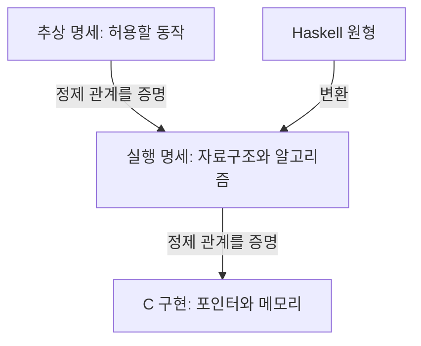

# seL4: 운영체제 커널의 구현이 명세를 따른다는 증명

Gerwin Klein, Kevin Elphinstone, Gernot Heiser, June Andronick, David Cock, Philip Derrin, Dhammika Elkaduwe, Kai Engelhardt, Rafal Kolanski, Michael Norrish, Thomas Sewell, Harvey Tuch, Simon Winwood의 「seL4: Formal Verification of an OS Kernel」는 SOSP 2009 논문입니다. 표지 소속은 NICTA, UNSW, Open Kernel Labs, ANU입니다. 여기서는 [공식 프로젝트의 원문 PDF](https://sel4.org/Research/pdfs/sel4-formal-verification-os-kernel.pdf) 1–14쪽을 기준으로 읽습니다.

## 논문의 질문과 읽을 위치

1–2절은 배경과 설계·증명 과정, 3절은 검증을 고려한 커널 구조, 4절은 명세·C 구현·기계 모델·증명, 5절은 성능과 개발 경험입니다. 6–7절은 관련 연구와 결론이며 뒤에는 참고문헌이 이어집니다. 핵심은 ARMv6 단일 프로세서용 커널 C 구현의 기능적 정확성입니다. x86 이식본이나 다중 코어 전체의 증명을 이 결과로 대신할 수 없습니다. [원문 2.1절, 3.3절, 4절](https://sel4.org/Research/pdfs/sel4-formal-verification-os-kernel.pdf)

기능적 정확성은 구현이 명세에 허용된 행동을 한다는 뜻입니다. 명세는 무엇을 해야 하는지 적은 규칙이며, 구현은 실제 자료구조와 명령으로 그 규칙을 수행합니다. 시험으로 몇 가지 입력을 확인하는 일과 가능한 상태 전이에 관한 논증을 구성하는 일은 근거의 형태가 다릅니다. 다만 증명의 범위도 명세와 전제에 의존합니다.

## 명세와 구현을 연결하는 방법

정제는 추상적인 설명에 구체적인 구현 방법을 넣으면서 허용된 행동을 벗어나지 않는 관계입니다. 예를 들어 추상 명세가 실행 가능한 작업 A 또는 B를 선택해도 좋다고 한다면, 구현이 우선순위에 따라 A를 선택하는 것은 그 선택지 안에 있습니다. 반대로 실행 불가능한 C를 고르면 관계가 깨집니다.



그림은 관계를 설명하기 위해 직접 만든 것입니다. Haskell 원형 자체가 그대로 최종 커널이 되는 흐름으로 읽으시면 안 됩니다. 원문의 Isabelle/HOL은 사람이 작성한 증명 단계를 기계가 검사하도록 돕는 도구입니다. 테스트 입력을 자동으로 많이 생성한다는 의미의 검증 도구와도 구분합니다. [원문 2.2–2.3절, PDF 2–3쪽](https://sel4.org/Research/pdfs/sel4-formal-verification-os-kernel.pdf)

수학적으로는 구체 상태와 추상 상태가 서로 어떻게 대응하는지 정합니다. 아래 수식은 관계를 설명하는 자체 표기입니다. R은 두 상태가 같은 의미를 나타낸다는 관계이며 화살표는 한 단계의 변화를 뜻합니다.

```math
R(s,\sigma)\ \land\ s\rightarrow s'
\quad\Rightarrow\quad
\exists\sigma':\ \sigma\rightarrow\sigma'\ \land\ R(s',\sigma')
```

왼쪽 상태를 그대로 복사해야 한다는 조건이 아닙니다. 배열로 만든 대기열과 수학적인 작업 목록은 비트 모양이 달라도 같은 순서를 나타낼 수 있습니다. 구현 단계가 허용한 추상 단계와 대응하는지가 핵심입니다.

## 직접 만든 대기열의 불변식

불변식은 특정 지점에서 항상 유지되어야 하는 조건입니다. 다음은 논문 코드나 실제 seL4 스케줄러의 재현이 아닌 작은 설명용 상태입니다.

| 단계 | 실행 가능한 작업 집합 | 대기열 | 검사 |
| --- | --- | --- | --- |
| 시작 | A, B | A → B | 원소가 일치합니다. |
| A 선택 | B | B | 제거 후에도 일치합니다. |
| B가 대기 상태로 전환 | 없음 | 비어 있음 | 실행 불가능한 원소가 없습니다. |
| 잘못된 갱신 | 없음 | B | 집합과 대기열이 어긋납니다. |

대기열에 B가 남는 오류는 자료구조 안의 연결이 멀쩡하더라도 발생할 수 있습니다. 따라서 연결 리스트의 앞뒤 포인터가 맞는다는 조건과, 그 리스트가 실행 가능한 작업을 나타낸다는 조건을 함께 확인해야 합니다. 한 함수가 조건을 지켜도 다른 함수가 이를 깨뜨리면 전체 주장은 성립하지 않습니다.

양방향 연결 리스트에서 중간 노드를 삭제할 때에는 앞 노드의 다음 포인터와 뒤 노드의 이전 포인터를 바꿉니다. 두 갱신 사이의 순간에는 양방향 관계가 잠시 맞지 않을 수 있습니다. 이 중간 상태에서 다른 처리가 끼어들 수 있는지가 증명과 실행 설계 양쪽에서 중요합니다. 단순히 잠금 하나를 넣었다는 설명만으로는 어떤 상태가 보호되는지 드러나지 않습니다.

## 권한과 메모리를 함께 생각하기

권한을 나타내는 capability는 특정 객체에 허용된 연산을 행사할 수 있게 하는 참조입니다. 일반 숫자 주소를 안다는 사실과 그 객체를 조작할 권한이 있다는 사실은 다릅니다. 마이크로커널은 핵심 기구를 작게 두고 여러 서비스를 사용자 영역에 배치하는 설계입니다. 작은 커널이라고 해서 그 위의 모든 프로그램이 자동으로 올바른 것은 아닙니다.

설명용으로 메모리 64칸 중 0–15번에 객체 A, 16–31번에 객체 B를 놓았다고 가정하겠습니다. 각 객체는 16칸이며 두 구간은 겹치지 않습니다. A가 삭제되었다는 표시만 바꾸고 A를 참조하는 권한이나 내부 참조를 남기면, 같은 구간을 새 객체 C로 재사용할 때 옛 참조가 다른 대상을 가리키게 됩니다. 확인할 조건은 빈 공간의 크기뿐 아니라 접근 가능한 참조의 수명입니다.

이 예제에서 64칸을 16칸씩 나누면 최대 네 구간이라는 산술은 간단합니다. 실제 할당 가능성은 정렬, 객체 종류, 권한 파생 관계 등의 추가 조건에 달려 있습니다. 네 구간이라는 계산을 실제 seL4 객체 배치 결과라고 주장하지 않습니다.

## 무엇을 믿어야 증명이 성립하나요?

원문 4.4–4.5절은 컴파일러·하드웨어·어셈블리의 정확성을 전제로 두며 부팅·초기화 코드는 당시 증명에서 제외합니다. 캐시와 TLB 처리의 일부는 전통적인 시험과 비형식적 근거에 의존합니다. 접근 제어의 별도 고수준 증명도 이 구현 증명과 아직 연결되지 않았다고 설명합니다. [원문 PDF 7–9쪽](https://sel4.org/Research/pdfs/sel4-formal-verification-os-kernel.pdf)

TLB는 가상 주소를 물리 주소로 바꾸는 결과를 기억하는 작은 저장 공간입니다. 주소표를 고쳐도 오래된 변환이 남아 있으면 실제 하드웨어 접근과 소프트웨어가 가정한 접근이 달라질 수 있습니다. 명세가 주소를 맞게 계산한다는 것과 기계가 갱신된 주소 변환을 실제로 사용한다는 것은 연결해서 확인해야 할 서로 다른 조건입니다.

같은 이유로 기능적 정확성을 모든 정보 유출의 부재나 응용 프로그램의 무오류로 확대하면 안 됩니다. 허용된 동작 자체가 사용자의 의도에 맞는지, 시간과 전력 같은 관찰 경로까지 무엇을 모델링했는지 따로 물어야 합니다. 계약을 정확히 지켰다는 사실만으로 계약 내용이 최선이었다고 결론 내릴 수는 없습니다.

## 성능과 후속 연구를 읽는 범위

5.1절은 hot-cache 조건의 단방향 IPC를 보고하지만, 224사이클 최적화 C 경로가 당시 증명본에는 아직 들어 있지 않다고 명시합니다. 이를 그대로 증명된 경로의 측정값이라고 부르면 틀립니다. [원문 PDF 10쪽](https://sel4.org/Research/pdfs/sel4-formal-verification-os-kernel.pdf)

자체 환산으로 532MHz에서 224사이클은 약 0.421µs입니다. 1사이클의 시간에 횟수를 곱한 값이며 전체 응용 지연이나 캐시가 찬 경우의 지연을 뜻하지 않습니다. 이후 프로젝트의 전개는 [공식 역사](https://sel4.systems/About/history.html)에서 따로 확인할 수 있습니다. 2009년 논문의 범위와 후속 버전의 보장을 합쳐 하나의 당시 결과로 쓰지 않습니다.

## 스스로 확인하기

1. 추상 명세가 A와 B 중 하나를 허용하는데 구현이 A만 고르면 항상 잘못인가요?
2. C 소스의 증명만으로 컴파일러와 TLB 동작까지 모두 증명되나요?
3. 224사이클이라는 수치를 당시 증명본 경로의 성능으로 바로 인용해도 되나요?

<details>
<summary>답과 이유</summary>

1. 아닙니다. 다른 조건도 만족한다면 허용된 선택을 구체화할 수 있습니다.
2. 아닙니다. 소스에서 기계 실행까지 연결하는 전제와 별도 검증 범위가 남습니다.
3. 안 됩니다. 원문은 그 최적화 경로가 당시 증명본에 아직 포함되지 않았다고 밝힙니다.

</details>
