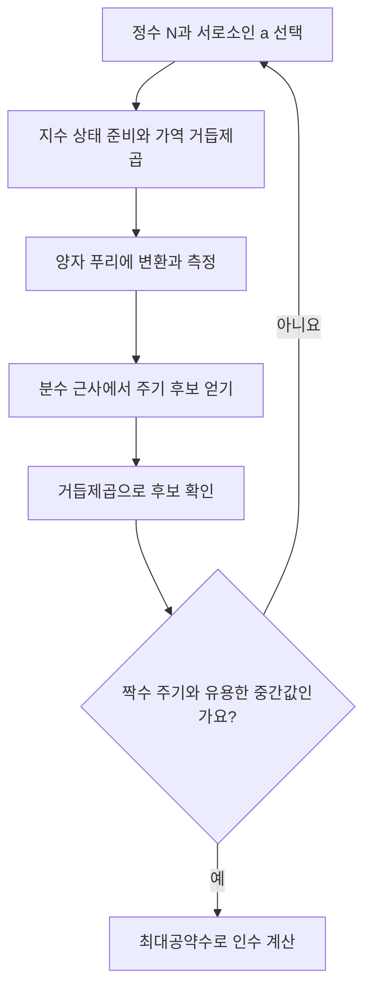

# 주기에서 소인수를 얻기 / Shor’s quantum factoring algorithm

Shor의 소인수분해는 양자 컴퓨터가 약수를 하나씩 더 빠르게 나누어 보는 방법이 아닙니다. 거듭제곱 나머지의 주기를 찾고, 그 주기를 고전적인 최대공약수 계산으로 약수에 연결하는 방법입니다.

| 항목 | 원문 정보 |
| --- | --- |
| 논문 | Peter W. Shor, Polynomial-Time Algorithms for Prime Factorization and Discrete Logarithms on a Quantum Computer |
| 발표 | SIAM Journal on Computing 26(5), 1997년, 1484–1509쪽. 선행 FOCS 발표는 1994년입니다. |
| 당시 소속 | 읽은 확장 원고의 표제는 AT&T Research입니다. |
| 원문 | [저자 arXiv v2, 1996년 1월 수정](https://arxiv.org/abs/quant-ph/9508027v2), [SIAM 게재 정보](https://epubs.siam.org/doi/10.1137/S0097539795293172) |
| 읽을 위치 | 확장 원고 PDF §2 양자 모형, §3 가역 산술, §4 푸리에 변환, §5 소인수분해, §6 이산로그, §7 오차와 미해결 문제입니다. |

## 입력의 크기를 먼저 정합니다

논문은 가정한 양자 회로 모형에서 소인수분해와 이산로그의 다항 시간 알고리즘을 설명합니다. 복잡도의 입력 크기는 정수 자체가 아니라 표현에 필요한 비트 수입니다. 원고는 가역 거듭제곱과 양자 푸리에 변환을 구성하며, 오차와 결맞음 유지가 실제 구현의 과제임을 논합니다. 다음 수와 확률 계산은 자체 예제입니다.

정수 N이 커져도 이를 이진수로 적는 길이는 대략 log₂N입니다. N번 나누어 보는 알고리즘은 N에 선형이어도 비트 길이에 대해서는 지수적일 수 있습니다. “다항 시간”을 말할 때 어느 크기를 변수로 삼았는지 빠뜨리면 고전·양자 알고리즘의 차이를 잘못 읽게 됩니다.

위수 r은 a를 몇 번 곱했을 때 처음으로 나머지가 1이 되는지를 뜻합니다. a와 N이 서로소일 때 정의되는 곱셈의 반복 주기입니다. 물리적 시간 주기와 이름이 같아도 여기서는 정수 지수의 반복 간격입니다.

## 15를 나누는 자체 계산

N=15, a=2를 택하면 나머지는 다음과 같습니다.

| 지수 x | 0 | 1 | 2 | 3 | 4 | 5 |
| --- | --- | --- | --- | --- | --- | --- |
| 2ˣ mod 15 | 1 | 2 | 4 | 8 | 1 | 2 |

r=4이며 r/2=2입니다. 그러면 2²=4이고, 4²−1=(4−1)(4+1)=15입니다. 따라서 다음 계산으로 두 인수를 얻습니다.

```math
\gcd(2^{4/2}-1,15)=\gcd(3,15)=3
```

```math
\gcd(2^{4/2}+1,15)=\gcd(5,15)=5
```

최대공약수는 두 수를 모두 나누는 가장 큰 양의 정수입니다. 이 단계는 양자 계산일 필요가 없습니다. 어려운 부분을 주기 찾기로 넘긴 뒤, 확인과 후처리는 익숙한 정수 알고리즘으로 수행합니다.

어떤 a나 성공하는 것은 아닙니다. 같은 N에서 a=14이면 위수는 2지만 14의 r/2제곱은 −1 mod 15입니다. 최대공약수는 1과 15만 주어 새로운 약수를 얻지 못합니다. r이 홀수인 경우에도 이 분해를 그대로 쓸 수 없습니다. 실패한 시도는 다른 a로 반복하는 절차의 일부입니다. 처음 a와 N의 최대공약수가 이미 비자명한 약수라면 주기 찾기 이전에 답을 얻을 수도 있습니다.

## 양자 부분이 하는 일

서로 다른 지수 x의 상태를 준비한 뒤, x와 함께 aˣ mod N을 가역적으로 계산합니다. 가역적이라는 것은 출력에서 입력을 구별할 수 있게 정보를 보존한다는 뜻입니다. 임시 작업 비트를 무작정 지우면 간섭에 필요한 관계를 훼손할 수 있어, 원문 §3은 작업 정보를 되돌려 없애는 계산을 다룹니다.

양자 푸리에 변환은 지수들의 주기성이 특정 측정값의 높은 확률로 나타나게 하는 연산입니다. 모든 aˣ를 화면에 나열해 읽는 연산이 아닙니다. 측정으로 얻은 제한된 정보에서 주기를 복원해야 하므로 후처리와 재시도가 필요합니다.



## 측정한 분수가 항상 주기 자체는 아닙니다

이해를 위해 첫 레지스터의 범위를 Q=256으로 잡고, 위수가 4인 경우를 보겠습니다. 이 예는 N²≤Q인 설정에도 맞습니다. 주기 구조 때문에 나타나는 이상적인 주요 위치는 0,64,128,192이며, 각각 Q로 나누면 0,1/4,1/2,3/4입니다.

64를 얻어 1/4을 복원하면 분모 4를 주기 후보로 삼을 수 있습니다. 하지만 128에서 얻은 1/2의 분모 2는 실제 주기의 약수입니다. 2² mod 15=4여서 1이 아니므로 주기 2라는 후보는 기각됩니다. 분수가 약분되면서 원래 분모의 일부가 사라질 수 있기 때문입니다.

일반적인 Q와 r에서는 주요 위치가 완벽한 정수 배수로 맞아떨어지지 않습니다. 원문은 측정값을 연분수로 근사하는 정확도와 성공 확률을 분석합니다. 연분수는 실수를 정수 부분과 역수의 반복으로 나타내어 좋은 유리수 근사를 구하는 방법입니다. 여기서는 정확한 주기를 한 번의 관측에서 언제나 읽는 장치로 생각하지 않는 것이 중요합니다.

## 논문이 보인 것과 보이지 않은 것

이산로그는 gʳ=x라는 관계에서 지수 r을 찾는 문제이며 소인수분해와 별도 입력·후처리가 필요합니다. 두 문제를 다항 시간에 풀 수 있다는 결과가 모든 NP 문제를 다항 시간에 푼다는 뜻은 아닙니다. 소인수분해의 어려움에 대한 고전 알고리즘의 미해결 상태를 NP 완전성 증명으로 바꾸어서도 안 됩니다.

논문의 단계 수와 실제 장치의 실행 초는 다른 수치입니다. 오류 정정에 필요한 물리적 자원, 논리 연산의 구현, 반복 횟수, 통신과 제어 비용을 정하지 않고 암호키를 푸는 현실 시간을 계산할 수 없습니다. 작은 정수의 주기를 손으로 확인한 것은 대규모 양자 하드웨어 실험이 아닙니다.

후속 영향은 암호 전환 자료에서도 확인할 수 있습니다. [NIST의 2024년 확정 표준 발표](https://www.nist.gov/news-events/news/2024/08/announcing-approval-three-federal-information-processing-standards-fips)는 FIPS 203·204·205의 승인을 알립니다. 이런 전환은 양자 공격에 대한 준비를 보여 주지만, 이 논문만으로 특정 시점에 모든 RSA 키가 이미 해독 가능하다는 결론은 나오지 않습니다. [Grover 검색](grover1996.md)의 제곱근 가속과도 서로 다른 구조적 결과입니다.

## 자기 점검

1. 위수 4에서 왜 2²−1과 2²+1의 최대공약수를 계산하나요?
2. 측정값 128/256의 분모 2를 그대로 주기라고 해도 되나요?
3. 정수 N에 다항인 시간과 N의 비트 수에 다항인 시간은 같은가요?

<details>
<summary>해설 보기</summary>

1. 2⁴−1이 15의 배수이며 두 인수 (2²−1)(2²+1)로 나뉘기 때문입니다. 최대공약수가 각각 3과 5를 줍니다.
2. 안 됩니다. 분수 약분 때문에 실제 주기의 약수가 나올 수 있습니다. 2² mod 15를 확인하면 후보 2는 실패합니다.
3. 다릅니다. 비트 수는 대략 log₂N이므로 N번 반복도 그 길이에 대해서는 지수적일 수 있습니다.

</details>

[이 분야의 논문 목록](README.md)
