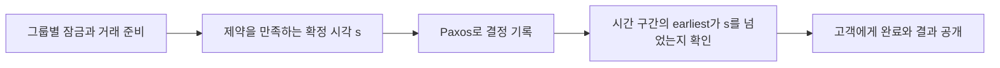

# 시계의 오차 범위를 드러내는 데이터베이스 / Spanner and TrueTime

여러 지역에서 동시에 처리한 거래를 하나의 일관된 순서로 보이게 하려면, 복제본의 합의뿐 아니라 거래의 경계와 관측 순서도 다루어야 합니다. Spanner의 TrueTime은 시계가 완벽하다고 가정하는 대신, 현재 시간의 불확실성을 구간으로 제공합니다.

| 항목 | 원문 정보 |
| --- | --- |
| 논문 | Spanner: Google’s Globally-Distributed Database |
| 저자 | James C. Corbett, Jeffrey Dean, Michael Epstein, Andrew Fikes, Christopher Frost, JJ Furman, Sanjay Ghemawat, Andrey Gubarev, Christopher Heiser, Peter Hochschild, Wilson Hsieh, Sebastian Kanthak, Eugene Kogan, Hongyi Li, Alexander Lloyd, Sergey Melnik, David Mwaura, David Nagle, Sean Quinlan, Rajesh Rao, Lindsay Rolig, Yasushi Saito, Michal Szymaniak, Christopher Taylor, Ruth Wang, Dale Woodford |
| 발표·소속 | OSDI 2012, 251–264쪽, Google, Inc.입니다. |
| 원문 | [Google 공개 PDF](https://research.google.com/pubs/archive/39966.pdf) |
| 읽을 위치 | §2 배치·복제·자료 모델, §3 TrueTime, §4 거래·읽기·시간, §5 평가, §6–8 관련 연구·미래 과제, 부록 A 지도자 임대입니다. |

## 복제 합의와 거래 확정의 층

원문은 Paxos 복제 그룹 위에 잠금과 여러 그룹의 거래 확정을 구성합니다. TrueTime의 오차 구간과 commit wait로 실제 선후 관계를 반영하는 확정 시각을 부여합니다. 읽기에는 복제본이 안전하게 제공할 수 있는 시각도 확인합니다. 초기 구현의 사례와 성능 측정은 현재 상용 서비스 전체의 사양과 구분합니다. 아래 계좌·시각·비용은 자체 예제입니다.

복제는 같은 데이터를 여러 곳에 유지하는 일입니다. 샤딩은 서로 다른 데이터를 여러 그룹으로 나누는 일입니다. 복제 그룹 하나의 합의와, 서로 다른 그룹에 걸친 거래의 전부 적용·전부 취소는 다른 문제입니다.

자체 송금에서 A 계좌는 그룹 P, B 계좌는 그룹 Q에 있다고 하겠습니다. P가 `A에서 10 차감`을 복제했다고 Q의 `B에 10 가산`까지 확정된 것은 아닙니다. 각 그룹의 지속성 외에 거래 전체가 같은 결론을 따를 절차가 필요합니다. 원문은 이 층에서 2단계 확정과 복제된 거래 상태를 설명합니다. TrueTime이 이 모든 메시지와 잠금을 대신하지는 않습니다.

## 외부 일관성이 뜻하는 순서

거래 T1의 완료 응답을 받은 뒤 고객이 T2를 시작했다면 T2가 T1보다 앞선 것으로 보이면 안 됩니다. 서로 겹치지 않는 실제 시간 관계를 직렬 순서에 반영하는 요구입니다. 동시에 진행되어 겹친 거래들은 가능한 직렬 순서 중 하나로 배치할 수 있으며, 시작 시각만으로 언제나 전역 순서가 결정되는 것은 아닙니다.

직렬화 가능성은 거래들이 어떤 순서로 하나씩 실행된 것처럼 보이는 성질입니다. 외부 일관성은 여기에 실제 완료·시작의 선후 관계까지 반영합니다. 모든 서버가 같은 물리적 순간에 값을 바꾸거나 고객이 네트워크 지연 없이 결과를 받는다는 뜻은 아닙니다.

## 숫자 하나 대신 구간을 반환합니다

TrueTime의 `now()`는 `[earliest, latest]`를 돌려줍니다. 호출이 일어난 실제 시간이 그 구간 안에 있다는 보장이 핵심입니다. 오차 한계 epsilon은 구간 폭의 절반이며, 지연 시간의 표준편차나 “대부분 맞는 평균 오차”와 다릅니다.

자체 예에서 단위를 ms로 두고 최초 구간이 [100,108]이라고 하겠습니다. epsilon은 4입니다. 단순한 설명을 위해 다른 시간 제약은 없고 확정 시각 s=108을 선택합니다. 이 시각이 확실히 과거가 되기 전에는 거래 완료를 외부에 드러내지 않습니다.

| 나중의 구간 | s=108이 확실히 과거인가요? | 판단 근거 |
| --- | --- | --- |
| [105,113] | 아닙니다. | 실제 시간이 106일 가능성도 남습니다. |
| [108,116] | 엄격한 after 조건은 아직 아닙니다. | 경계 108과 같을 수 있습니다. |
| [109,117] | 그렇습니다. | 가능한 가장 이른 시간도 108보다 큽니다. |

```math
\operatorname{after}(s):\quad TT.now().earliest>s
```

처음의 latest보다 현재의 earliest가 커질 때까지 기다리는 이유를 볼 수 있습니다. 구간의 중앙값이 108을 지났다는 사실만으로는 충분하지 않습니다. 원문 프로토콜은 이 밖에 준비 시각·기존 할당 시각 등의 제약도 함께 만족시키므로, s가 언제나 단순히 latest와 같다고 외우면 안 됩니다.



## 기다림은 다른 작업과 겹칠 수 있습니다

자체 시간 모형에서 시간 불확실성을 기다리는 데 8ms, 동시에 시작한 복제 통신이 40ms 걸린다면 둘을 끝낼 때까지의 시간은 겹치는 구간을 고려해 적어도 40ms입니다. 무조건 48ms를 더하는 것은 아닙니다. 반대로 서로 앞뒤로 의존하는 단계라면 더해야 합니다. 전체 지연은 잠금 획득·참가자 준비·복제·대기·응답의 의존 관계로 계산해야 합니다.

시계 구간이 넓어지면 보장을 지키기 위한 대기가 길어질 수 있습니다. 이 설계는 시계 오차가 사라졌다는 것이 아니라, 오차의 상한을 정확성 논증에 사용할 수 있게 표현한 것입니다. 실제 시간이 광고한 구간 밖으로 나가면 전제 자체가 깨지므로 감시와 이상 장치 처리도 중요합니다.

GPS와 원자 시계처럼 다른 기준을 사용하는 이유도 평균 오차만 줄이려는 것은 아닙니다. 같은 원인으로 함께 틀리는 고장 가능성을 줄여야 합니다. 시계가 많다는 사실과 고장 원인이 독립적이라는 사실을 같은 것으로 생각하지 않습니다.

## 과거를 읽어도 아직 기다려야 할 수 있습니다

다중 버전은 예전 시각의 값을 보존해 그 시점의 스냅샷을 읽게 합니다. 하지만 복제본이 그 시각까지의 내용을 충분히 적용했는지 확인해야 합니다. 아직 준비 중인 거래가 나중에 그 시각 이하로 확정될 가능성도 다룹니다.

자체 예에서 복제 적용으로부터 얻은 안전 시각은 120, 준비 중 거래로부터의 한계는 114라면 사용 가능한 안전 시각은 둘의 최솟값 114입니다. 시각 115의 읽기는 단순히 가장 최근 적용 항목이 120이라는 이유만으로 제공할 수 없습니다. “나중 항목 하나를 봤다”와 “그 시각 이하의 미결정 가능성이 없다”는 다른 조건입니다.

잠금 없는 읽기도 기다림 없는 읽기와 다릅니다. 쓰기 잠금을 잡지 않아도 안전 시각, 복제 지연과 요청 범위 때문에 대기할 수 있습니다. 필요한 과거 버전이 이미 수거되었다면 그 스냅샷을 무한히 보관한 것처럼 읽을 수도 없습니다.

## 배치와 평가에서 남는 제약

서로 자주 함께 접근하는 데이터를 가까이 두면 그룹 간 거래를 줄일 수 있습니다. 하지만 다른 지역 사용자와 장애 격리를 위해 복제본을 멀리 놓으면 통신 비용이 늘어납니다. 지역 수만 늘렸다는 정보로 쓰기 지연이나 재해 복구 능력을 결정할 수 없습니다. 과반수의 실제 배치와 고장 공유 범위를 함께 봐야 합니다.

§5의 마이크로벤치마크는 가까운 데이터센터, 준비된 캐시와 특정 크기의 읽기·쓰기 등을 포함합니다. 실제 F1 응용의 운영 지연도 다른 표로 제시됩니다. 가까운 복제 실험의 평균을 전 세계 모든 거래의 지연으로 바꾸거나, 원문의 미래 설계 목표를 이미 배포된 최대 규모로 옮기지 않습니다.

후속 사용을 살펴볼 자료로 [Google Cloud의 TrueTime과 외부 일관성 설명](https://cloud.google.com/spanner/docs/true-time-external-consistency)이 있습니다. 2012년 구현과 현재 제품 기능을 비교할 때에도 시간 API, 복제, 거래 계층을 나누어 읽어야 합니다. [Bigtable](bigtable2006.md)·[Paxos](paxos1998.md)와의 연결은 선행 기술의 단순한 합계보다, 각 층의 보장 사이에 추가된 조건을 보여 줍니다.

## 자기 점검

1. 현재 TrueTime 구간이 [105,113]이면 시각 108이 확실히 지났나요?
2. 복제 안전 시각 120과 준비 거래 한계 114가 있다면 시각 115의 읽기를 즉시 제공해도 되나요?
3. 잠금 없는 읽기는 항상 대기하지 않는 읽기인가요?

<details>
<summary>해설 보기</summary>

1. 아닙니다. 실제 시간이 108보다 이른 가능성이 구간 안에 남습니다.
2. 안 됩니다. 두 한계의 최솟값은 114이며, 준비 거래가 남긴 미결정 상태를 고려해야 합니다.
3. 아닙니다. 잠금 외에도 복제본의 안전 시각과 필요한 버전의 보존 여부를 확인합니다.

</details>

[이 분야의 논문 목록](README.md)
