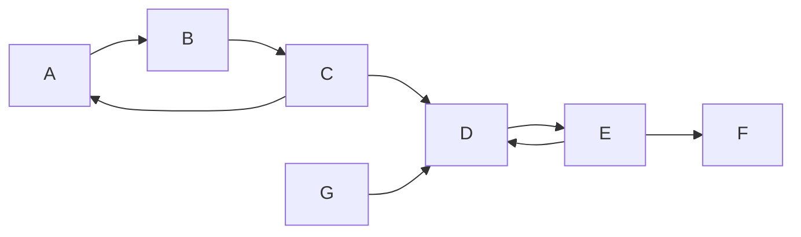

# Tarjan: DFS의 순서로 연결 구조 찾기 / Finding connectivity with DFS order

| 항목 | 내용 |
|---|---|
| 논문 | Depth-First Search and Linear Graph Algorithms |
| 저자·당시 소속 | Robert Tarjan, Cornell University 컴퓨터과학과 |
| 발표 | SIAM Journal on Computing 1(2), 146–160쪽, 1972년 6월 |
| 원문 | [학회 서지·초록](https://epubs.siam.org/doi/abs/10.1137/0201010) · [원저 논문 스캔 보관본](https://github.com/tpn/pdfs/blob/master/Depth-First%20Search%20and%20Linear%20Graph%20Algorithms%20-%20Tarjan%20%281972%29.pdf) |
| 읽을 위치 | §2 DFS·인접 목록·palm tree, §3 이중 연결성·LOWPT, §4 강한 연결성·LOWLINK, §5 후속 응용 |
| 판본 | 학회 PDF 직접 접근 대신 저널 제목·권호·쪽·본문이 표시된 15쪽 스캔을 읽었습니다. |

## 방문 순서를 정보로 사용합니다

논문은 DFS가 만드는 구조를 이용해 무방향 그래프의 이중 연결 성분과 방향 그래프의 강한 연결 성분을 찾습니다. §2는 인접 목록과 탐색 구조를, §3–4는 서로 다른 최솟값·스택·분리 기준을 설명하고 정확성과 선형 비용을 증명합니다. 결과의 계산 모형은 정점 수 V와 간선 수 E를 기준으로 합니다. [원문 146–160쪽](https://github.com/tpn/pdfs/blob/master/Depth-First%20Search%20and%20Linear%20Graph%20Algorithms%20-%20Tarjan%20%281972%29.pdf)

DFS는 한 갈래를 깊이 따라가다가 더 갈 곳이 없으면 되돌아오는 탐색입니다. 중요한 것은 단순한 방문 목록만이 아니라, 새 정점을 발견한 간선과 이미 만난 정점으로 가는 간선의 역할이 다르다는 점입니다.

## 먼저 두 종류의 연결을 나눕니다

방향 그래프에서 두 정점이 같은 강한 연결 성분, 즉 SCC에 속하려면 서로에게 도달할 수 있어야 합니다. A에서 B로 갈 수 있다는 한 방향의 정보만으로 둘을 묶을 수는 없습니다. SCC는 이 상호 도달 관계를 최대한 묶은 성분입니다.

무방향 그래프의 단절점은 그 정점을 제거했을 때 연결 구조가 갈라지는 지점입니다. 이중 연결 성분은 이 단절 구조와 관계되며, 방향 그래프의 SCC와 같은 개념이 아닙니다. 예를 들어 삼각형 ABC와 삼각형 CDE가 C를 공유하면 C는 단절점입니다. 모든 간선을 양방향으로 바꾸면 전체는 하나의 SCC이지만 C의 단절점 성질이 없어지는 것은 아닙니다.

원문의 LOWPT와 LOWLINK를 둘 다 ‘어디든 도달하는 가장 작은 번호’라고 외우면 이 구별이 사라집니다. 다음 예는 §4의 SCC를 이해하기 위한 별도 입력이며, 원문 그래프의 재현이 아닙니다.

## 직접 따라가기: 세 묶음과 한 단독 정점

간선은 `A→B`, `B→C`, `C→A`, `C→D`, `D→E`, `E→D`, `E→F`, `G→D`로 두겠습니다. F에서 나가는 간선은 없습니다. 시작 순서는 A부터, 아직 방문하지 않은 G는 나중이라고 정합니다.

발견 번호는 A=1, B=2, C=3, D=4, E=5, F=6, G=7입니다. 번호는 정점 이름에 원래 붙어 있는 값이 아니라 이 탐색에서 처음 발견된 순서입니다. 이 순서가 달라져도 최종 SCC의 정점 집합은 같아야 합니다.

교육용으로 `index[v]`는 발견 번호, `low[v]`는 아직 성분으로 닫히지 않은 연결을 요약하는 값, `on_stack[v]`는 성분 후보 스택에 남아 있는지를 나타내겠습니다. 새 정점은 자기 번호로 시작합니다. 탐색 자식이 돌아오면 그 자식의 low를 고려하고, 이미 만난 정점으로 가는 간선은 대상이 후보 스택에 남아 있을 때 그 발견 번호를 고려합니다.

| 정점 | 발견 번호 | 이 입력에서 마지막 low |
|---|---:|---:|
| A | 1 | 1 |
| B | 2 | 1 |
| C | 3 | 1 |
| D | 4 | 4 |
| E | 5 | 4 |
| F | 6 | 6 |
| G | 7 | 7 |

F는 돌아갈 후보가 없으므로 자기 번호와 low가 같습니다. F까지 스택을 꺼내면 성분 `{F}`가 닫힙니다. E는 D로 돌아갈 수 있어 low가 4이고, D에서 `{D,E}`가 닫힙니다. C는 A로 돌아가 low가 1이고 B도 그 정보를 이어받습니다. A에서 `{A,B,C}`가 닫힙니다. 마지막 G는 별도 성분 `{G}`입니다.

## ‘스택에 남아 있습니다’가 중요한 이유

G에서 D로 가는 길은 있습니다. 하지만 D가 속한 성분은 이미 닫혔으며 D에서 G로 돌아갈 경로는 없습니다. 방문 번호가 작은 D를 무조건 사용해 `low[G]=4`로 바꾸면 G를 올바른 단독 성분으로 닫지 못할 수 있습니다. ‘방문한 적 있습니다’와 ‘아직 후보 스택에 있습니다’를 분리해야 합니다.

재귀 호출 스택과 성분 후보 스택도 역할이 다릅니다. 재귀 호출은 해당 함수의 실행이 돌아오면 사라집니다. 성분 후보는 함수가 돌아와도 더 위의 정점과 함께 SCC로 묶일 수 있어 남아 있을 수 있습니다. 둘 다 마지막에 넣은 것을 먼저 꺼내지만 수명이 같은 것은 아닙니다.

원문의 낮은 번호 전파는 이 구조를 근거로 합니다. 단순히 작은 번호를 계속 저장하는 장치가 아닙니다. 어떤 간선이 갱신에 참여하는지와 언제 후보를 꺼내는지를 함께 확인해야 의미가 생깁니다. 코드를 옮길 때에는 구현마다 다른 불변식을 섞지 않아야 합니다.

## 자체 계산: 선형이라는 비용의 단위

주어진 방향 그래프에는 V=7, E=8입니다. 인접 목록을 사용하면 각 정점의 목록을 따라 총 8개의 간선 항목을 확인합니다. 각 정점은 한 번 발견되고 성분 스택에 한 번 들어가 한 번 나옵니다. 이런 작업들을 상수 시간으로 처리한다는 모형에서 전체 비용을 V+E에 비례하도록 묶을 수 있습니다. ‘정확히 15개 CPU 명령입니다’라는 뜻은 아닙니다.

정점이 스택에 있는지 매번 목록을 끝까지 검색하면 한 번의 확인이 V에 비례할 수 있습니다. Boolean 배열을 함께 유지하면 그 확인을 일정한 시간으로 처리할 수 있습니다. 알고리즘 이름이 같아도 자료구조를 잘못 바꾸면 원문의 비용 증명을 이어받을 수 없는 이유입니다.

인접 행렬에서는 없는 간선도 확인하며 정점마다 V개 자리를 훑는 구현이 자연스럽습니다. E가 작은 희소 그래프라도 V²개의 자리를 검사할 수 있습니다. 반면 무방향 그래프의 인접 목록은 한 간선을 양쪽 목록에 한 번씩 적으므로 총 2E개입니다. 이 2배는 여전히 선형이지만, 방향·무방향 표현을 섞어 실제 검사 횟수를 세면 안 됩니다.

## 한계와 후속 연구

이 논문은 주어진 그래프를 대상으로 한 정적 알고리즘입니다. 간선이 계속 바뀌는 서비스에서 이전 결과를 어떻게 갱신할지, 재귀 깊이가 큰 입력에서 어떤 스택을 사용할지는 추가 설계입니다. 메모리 부족·호출 스택 한도와 이론적인 종료성도 구분해야 합니다.

또 SCC 하나로 그래프를 압축한 결과는 원래 그래프와 같은 경로 길이를 보존하는 그래프가 아닙니다. 성분 간 의존 관계를 나타내는 용도와 가중 최단 경로 계산은 서로 다릅니다.

저자가 참여한 후속 검토 [Finding Strong Components Using Depth-First Search, 2022 공개](https://arxiv.org/abs/2201.07197)는 여러 DFS 기반 SCC 방법을 비교합니다. 같은 선형 시간이라는 분류 안에서도 유지하는 값과 정확성 설명이 다를 수 있다는 점을 이어 공부하실 수 있습니다. 원문의 결과를 하나의 암기용 low 식으로만 줄이기보다, 각 스택과 갱신이 보존하는 사실을 비교하시는 편이 좋습니다.

## 자기점검

1. G에서 D로 도달할 수 있는데도 `{G}`가 별도 SCC인 이유는 무엇인가요?
2. 후보 스택에 있는지 선형 검색하면 어떤 비용 보장을 잃을 수 있나요?
3. 무방향 그래프의 단절점과 방향 그래프의 SCC는 같은 분류인가요?

해설 보기

1. 상호 도달이 필요합니다. 이 입력에는 D에서 G로 돌아가는 경로가 없고 D의 성분도 이미 닫혔습니다.
2. 간선마다 최대 V개 항목을 살필 수 있어 V+E에 비례한 원문의 분석을 그대로 적용할 수 없습니다.
3. 아닙니다. 단절점은 정점 제거와 연결의 분리, SCC는 방향 경로의 상호 도달을 기준으로 합니다.

[알고리즘과 컴퓨터 시스템 목록](README.md)
