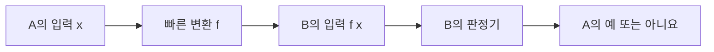

# Karp: 문제 사이의 변환과 어려움의 방향 / Reductions and the direction of hardness

| 항목 | 내용 |
|---|---|
| 논문 | Reducibility Among Combinatorial Problems |
| 저자·당시 소속 | Richard M. Karp, University of California at Berkeley |
| 발표 | Complexity of Computer Computations의 수록 장, 1972년 |
| 원문 | [대학 보관 원문 스캔 PDF](https://www2.seas.gwu.edu/~simhaweb/champalg/tsp/papers/KarpOriginal.pdf) |
| 읽을 위치 | §2 P·환원, §3 비결정성과 Cook 정리, §4 완전 문제·환원 구성, Appendix I 문제 표기 |
| 쪽 번호 | 이 보관본은 인쇄 85–103쪽의 19쪽 PDF입니다. 96쪽 환원 관계 그림은 회전되어 있습니다. |

## 서로 다른 문제가 같은 어려움을 나눕니다

논문은 입력을 다항시간 함수로 옮기고 예·아니요를 보존하는 환원을 정의합니다. 이어 Cook의 결과를 발판으로 21개 문제의 완전성과 연결 관계를 제시합니다. §3은 자신의 환원 정의와 Cook의 정의가 다름을 구분하며, §4는 그래프·집합·정수 문제 사이의 구체적인 변환을 보입니다. 빠른 알고리즘이 영원히 불가능하다는 증명과는 구별합니다. [원문 §2–4](https://www2.seas.gwu.edu/~simhaweb/champalg/tsp/papers/KarpOriginal.pdf)

환원이라는 말은 어려운 입력을 실제로 쉽게 만들어 준다는 뜻이 아닙니다. 어려움을 다른 문제의 표현으로 옮겨 묶어 볼 수 있다는 뜻에 가깝습니다. 문제의 모양이 달라도 해결 능력이 어떻게 전달되는지를 따지는 도구입니다.

## 방향을 화살표로 고정합니다

`A≤ₚB`를 ‘A를 B로 다항시간에 옮길 수 있습니다’라고 읽겠습니다. A의 입력 x를 B의 입력 f(x)로 바꾸며, x의 답이 예일 때에만 f(x)의 답도 예여야 합니다. x에 대해 예인 경우만 맞고 아니요인 경우를 보존하지 못하면 올바른 환원이 아닙니다.



B를 빨리 풀 수 있다면 이 흐름 전체로 A도 빨리 풀 수 있습니다. 따라서 이미 어려운 A를 B로 옮기면 B의 어려움에 관한 근거를 얻습니다. 반대로 B를 A로 옮겼다는 이유만으로 B가 A보다 어렵다고 결론내리면 화살표를 뒤집은 것입니다.

여기서 `결정 문제`는 최적값을 출력하기보다 ‘조건을 만족하는 답이 존재합니까?’에 예·아니요로 답합니다. 예를 들어 최대 클리크 크기를 구하는 최적화와, 크기 k 이상의 클리크가 있는지 묻는 결정판은 관련되지만 출력이 같지 않습니다.

## 직접 구성: 논리식에서 클리크로

클리크는 고른 정점 두 개가 모두 간선으로 연결된 정점 집합입니다. 다음 자체 논리식의 각 절에서 리터럴이 등장한 자리를 정점으로 만들겠습니다.

```math
\Phi=(a\lor b)\land(\neg a\lor c)\land(\neg b\lor\neg c).
```

첫 절의 a와 둘째 절의 ¬a는 서로 다른 정점입니다. 같은 절의 정점끼리는 연결하지 않고, 다른 절끼리도 서로 부정인 두 리터럴은 연결하지 않습니다. 나머지 서로 다른 절의 쌍은 연결합니다.

| 고를 정점 | 원래 절 | 서로 모순되나요? |
|---|---:|---|
| 첫 절의 a | 1 | a=참으로 둘 수 있습니다. |
| 둘째 절의 c | 2 | a와 동시에 참일 수 있습니다. |
| 셋째 절의 ¬b | 3 | a·c와 동시에 참일 수 있습니다. |

이 셋은 서로 연결되어 크기 3의 클리크입니다. `a=참, b=거짓, c=참`이라는 같은 배정으로 원래 세 절도 만족시킬 수 있습니다. 반대로 세 정점의 클리크는 같은 절에서 둘을 고를 수 없으므로 각 절에서 하나씩을 고르고, 부정 쌍이 없으므로 모순 없는 배정을 만들 수 있습니다. 양방향을 확인해야 ‘우연히 한 예제가 맞았습니다’에서 환원의 논리로 넘어갈 수 있습니다.

아니요 입력도 점검하겠습니다. `(a)∧(¬a)`에는 정점 둘이 생기지만 둘 사이를 연결할 수 없습니다. 크기 2의 클리크가 없고 원래 식도 만족되지 않습니다. 이 작은 반대 사례는 부정 쌍을 금지한 이유를 보여 줍니다. 실제 증명은 모든 입력에 대해 이 관계를 보여야 합니다.

## 직접 구성: 클리크에서 정점 덮개로

정점 덮개는 모든 간선의 끝점 중 적어도 하나를 포함하는 정점 집합입니다. 그래프 G에 A·B·C의 삼각형과 고립 정점 D가 있다고 하겠습니다. G의 보완 그래프에서는 원래 없던 서로 다른 정점의 간선을 넣고, 원래 있던 간선은 뺍니다. 자기 자신으로 가는 간선은 만들지 않습니다.

보완 그래프의 간선은 A–D, B–D, C–D입니다. D 하나를 고르면 세 간선을 모두 덮습니다. 정점 수 n=4, 원래 클리크 크기 k=3이므로 덮개의 허용 크기는 `n−k=1`입니다.

원래 그래프의 클리크 C 안에는 보완 그래프의 간선이 없습니다. 그러므로 보완 그래프의 모든 간선은 C 밖에 적어도 한 끝점을 가지며, 그 바깥 정점들을 택하면 덮개가 됩니다. 반대로 보완 그래프의 덮개 밖에는 간선이 없으므로 원래 그래프에서는 그 정점들이 서로 연결됩니다. 이름이 비슷해서가 아니라 간선의 부재와 존재를 뒤집어 연결한 것입니다.

## 크기와 표현도 증명의 일부입니다

변환이 올바른 답을 주더라도 출력이 지수적으로 커지면 여기의 환원이 아닙니다. 예를 들어 첫 변환의 출력 길이가 n² 이하이고, 둘째 변환이 입력 길이 m에 대해 m³ 시간이면 합친 계산은 n²을 만드는 비용과 대략 n⁶의 처리로 제한할 수 있습니다. 고정된 수의 다항시간 변환을 합친 결과가 여전히 다항시간이라는 구조입니다.

정수 입력에서는 값과 자리 수를 혼동하기 쉽습니다. 자체 예로 값 1,024까지 모두 훑는 반복은 1,024번이지만 이진 표현 길이는 11입니다. 배낭·합 문제의 어떤 알고리즘이 목표값 W에 비례한다고 해서, W를 이진수로 적은 입력 길이에 다항식이라고 바로 말할 수는 없습니다. 이를 의사다항시간이라는 말로 구분합니다. 이 글에서 특정 배낭 알고리즘을 실행하거나 성능을 측정한 것은 아닙니다.

원문에서 KNAPSACK이라고 부르는 문제도 목표 합과 같은지 묻는 정수 선택 형태입니다. 제목만 보고 분할 가능한 물건을 비율로 고르는 문제나, 가치 합계를 출력하는 다른 판본의 알고리즘을 가져오면 조건이 달라집니다. 입력·성질 칸을 함께 읽는 습관이 필요합니다.

## 결과와 한계, 후속 연결

NP-완전성을 설명하려면 NP에 속한다는 부분과, 이미 알려진 어려운 문제에서 이 문제로 옮기는 부분이 모두 필요합니다. 환원만으로 증거의 길이·검사 비용까지 자동으로 해결되지는 않습니다. 또 최악의 경우를 연결한 결과가 모든 작은 입력이 어렵다는 말은 아닙니다.

직접적인 선행·후속 관계는 [Cook의 글](계산과정을논리식으로표현_cook1971.md)과 함께 확인할 수 있습니다. Karp는 서론에서 Cook의 연구가 출발점이었다고 밝히고, 논리식 중심의 결과를 여러 조합 문제의 망으로 옮깁니다. 이후의 알고리즘을 읽을 때에도 정확해와 근사해, 제한된 입력과 일반 입력, 결정판과 최적화판 중 무엇을 해결했는지 먼저 보시면 됩니다. 이 분류만으로 실제 업무의 실행시간이나 모든 현실 인스턴스의 난도를 예측할 수는 없습니다.

## 자기점검

1. A≤ₚB이고 B에 빠른 판정기가 있으면 어느 문제를 빠르게 풀 수 있나요?
2. 삼각형과 고립 정점의 예에서 보완 그래프의 크기 1 덮개는 무엇인가요?
3. NP-완전 문제라는 결과가 ‘어떤 입력도 빨리 풀 수 없습니다’라는 뜻인가요?

<details>
<summary>해설 보기</summary>

1. 변환 뒤 B를 풀어 A를 판정할 수 있습니다. 이 사실만으로 반대 방향의 환원도 있다고 할 수는 없습니다.
2. D입니다. 보완 그래프의 세 간선이 모두 D에 닿습니다. 그 여집합 A·B·C가 원래 그래프의 클리크입니다.
3. 아닙니다. 문제군의 최악 경우와 환원 관계를 다룹니다. 특정 입력의 쉬움, 특수 구조, 근사·경험적 방법은 별도 질문입니다.

</details>

[알고리즘과 컴퓨터 시스템 목록](README.md)
