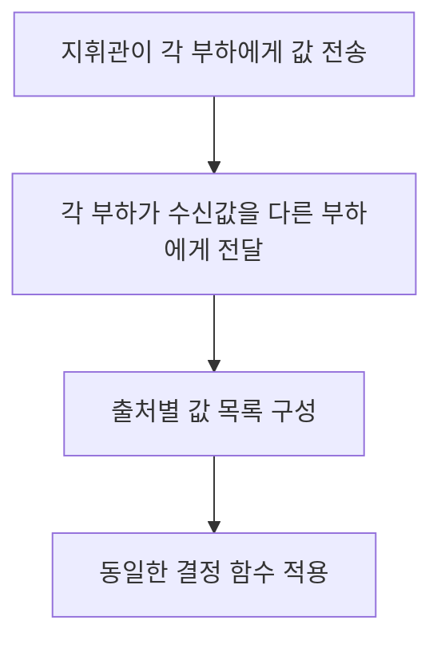

# 서로 다른 말을 하는 서버의 합의 / The Byzantine Generals Problem

서버가 멈추는 장애와, 사람마다 다른 값을 보내는 장애는 다릅니다. 이 논문은 상대방이 일관되게 행동한다는 가정을 버렸을 때, 메시지의 출처와 전달·서명 조건이 합의 가능성에 어떤 영향을 주는지 다룹니다.

| 항목 | 원문 정보 |
| --- | --- |
| 논문 | Leslie Lamport, Robert Shostak, Marshall Pease, The Byzantine Generals Problem |
| 발표 | ACM Transactions on Programming Languages and Systems 4(3), 1982년 7월, 382–401쪽 |
| 당시 소속 | 세 저자 모두 SRI International입니다. |
| 원문 | [저자 공개 게재 PDF](https://lamport.azurewebsites.net/pubs/byz.pdf) |
| 읽을 위치 | §1 문제 조건, §2 불가능성, §3 구두 메시지, §4 서명 메시지, §5 연결 경로, §6 실제 시스템의 가정, §7 비용입니다. |

## 같은 답과 올바른 입력을 구분합니다

원문은 정상 부하들이 같은 명령을 따르는 조건과, 정상 지휘관이 보낸 명령을 따르는 조건을 구분합니다. 구두 메시지와 서명 메시지에서는 필요한 가정과 허용 장애가 달라집니다. 구두 메시지의 3f+1 조건은 전달·발신자 확인·부재 감지가 가능한 모형의 결과입니다. 아래 승인·보류 예와 메시지 수는 직접 구성했습니다.

비잔틴 장애는 중단뿐 아니라 서로 모순된 응답이나 임의 행동까지 허용하는 장애 모형입니다. 악의적인 사람만 원인은 아닙니다. 소프트웨어 오류, 불안정한 신호와 장치 고장도 관측자마다 다른 정보를 줄 수 있습니다.

유효성은 정상 지휘관의 명령을 정상 부하가 따르는 성질입니다. 일치성은 정상 부하끼리 같은 결과를 얻는 성질입니다. 지휘관이 잘못된 경우에는 “그가 정말 원한 한 가지 명령”이 존재하지 않을 수 있으므로, 일치성만으로 현실의 올바른 선택까지 보장하지 않습니다.

## 셋 중 하나가 다르게 말하면

지휘관 A와 부하 B·C가 있다고 하겠습니다. B가 A에게서 승인을 받고, C에게서 “나는 보류를 받았다”는 보고를 받았습니다. B에게는 다음 두 설명이 모두 가능해 보입니다.

| 가능한 상황 | A의 행동 | C의 행동 |
| --- | --- | --- |
| A가 정상 | B·C 모두에게 승인을 보냅니다. | C가 보류를 받았다고 거짓말합니다. |
| A가 장애 | B에게 승인, C에게 보류를 보냅니다. | C가 자기 수신 내용을 사실대로 전합니다. |

B는 앞 상황에서는 정상 A의 승인을 따라야 합니다. C의 대칭적인 관점에서는 정상 A가 보류를 보냈을 가능성이 있습니다. 출처를 위조하지 못하더라도, 수신한 내용에 관해 서로 다른 말을 하는 능력이 문제를 만듭니다. 이 구별 불가능성이 작은 사례의 어려움입니다. 원문은 이 직관과 일반적인 불가능성 증명의 역할도 구분합니다.

“과반수니까 정상일 것”이라는 판단은 관측자들이 같은 표 목록을 갖고 있을 때에야 출발점이 됩니다. 장애 서버가 B에게 승인, C에게 보류라고 말하면 두 관측자가 세는 목록 자체가 다릅니다.

## 네 서버에서 정보를 한 번 더 전달하기

지휘관 A와 부하 B·C·D 중 최대 하나가 장애라고 하겠습니다. A가 정상이며 승인이라면 세 부하는 우선 승인을 받습니다. 이어 각 부하가 자신이 받은 값을 다른 부하들에게 전합니다. D가 거짓말해도 B가 보는 세 값은 자기 수신 승인, C의 보고 승인, D의 임의 값입니다. C 역시 정상 둘의 승인으로 같은 결과를 얻습니다.

반대로 A가 장애이며 B·C·D에게 각각 승인·보류·승인을 보냈다면, 세 부하는 모두 정상입니다. 부하끼리 받은 값을 전달하면 셋 모두 같은 목록을 구성할 수 있습니다. 합의한 다수결 또는 동률 처리 함수를 적용하여 같은 결과를 얻습니다. 여기서는 지휘관의 어느 발언이 “진짜”였는지를 복원할 필요가 없습니다.

이것은 장애 하나인 OM(1)의 이해를 위한 설명입니다. f가 커지면 수신 보고에 관한 보고를 재귀적으로 전달하고, 메시지의 전달 경로도 구별합니다. 단순히 두 번 통신하면 어떤 f도 해결된다고 일반화할 수 없습니다.

자체 메시지 계산에서 네 대의 OM(1)은 첫 전송 3개와 부하 간 전달 3×2=6개로 9개입니다. 재전송·헤더·시간 초과 통보는 제외했습니다. 9라는 숫자는 실측 지연이나 실제 네트워크 패킷 수가 아닙니다. 여러 논리 메시지를 패킷 하나에 담을 수도 있고, 패킷 손실은 전송을 늘릴 수도 있습니다.

## 3f+1이 가리키는 범위

f는 허용하는 장애 수이며 정상 서버 수가 아닙니다. 구두 메시지 모형에서 f=1이면 최소 4, f=2이면 최소 7이 필요합니다. 이를 “정상 서버가 과반이면 된다”로 줄이면 조건이 약해집니다. 5대 중 3대가 정상인 경우는 과반이지만 f=2에 대한 7대 조건을 만족하지 않습니다.

원문의 구두 메시지는 발신자를 모르는 익명 메시지가 아닙니다. 수신자는 누가 보냈는지 알고, 정상 전달이 이루어지며, 보내지 않은 메시지의 부재를 감지할 수 있습니다. 발신자 확인이 있어도 그 발신자가 다른 곳에 무엇을 보냈는지까지 증명되지는 않는다는 점이 핵심입니다.

부재 감지는 지연 상한과 시간 조건을 필요로 합니다. 응답이 없음을 유한 시간에 확정할 능력을 가정한 결과를 [FLP](비동기합의의불가능조건_flp1985.md)의 완전 비동기 모형과 그대로 합치면 모순처럼 보일 수 있습니다. 서로 다른 정리의 가정을 먼저 비교해야 합니다.

## 서명이 바꾸는 것과 남기는 것

위조 불가능한 서명이 있으면 B는 A가 서명한 원래 값을 C에게 전달할 수 있습니다. A가 승인과 보류 둘 다 서명했다면 정상 부하들이 두 증거를 공유해 같은 값 집합으로 결정할 수 있습니다. C가 “A가 보류라고 했다”고 말만 하는 경우와, A가 실제 서명한 보류를 전달하는 경우가 달라집니다.

서명은 발언의 출처와 변조 여부를 다룹니다. 서명한 값이 현실적으로 옳다는 증명은 아닙니다. 장애 지휘관은 서로 다른 값에 정당하게 자기 서명을 붙일 수 있습니다. 또한 네트워크가 영원히 끊겨 정상 서버끼리 전달할 길이 없으면 서명이 메시지를 순간 이동시키지 않습니다. 원문 §5는 정상 노드들이 연결된 경로의 조건을 따로 다룹니다.

반복 실행에서는 오래된 서명을 재사용하는 일도 고려해야 합니다. 예를 들어 지난 회차의 `승인` 증거와 이번 회차의 `승인`을 구분하려면 서명 대상에 회차와 문맥이 들어가야 합니다. [RSA](나머지거듭제곱의공개키암호_rsa1978.md)의 수학 연산이 있다는 사실만으로 분산 프로토콜의 회차 구분까지 해결되지는 않습니다.

## 후속 연구와 실제 한계

[Castro·Liskov의 PBFT, OSDI 1999](https://www.usenix.org/conference/osdi-99/practical-byzantine-fault-tolerance)는 비잔틴 장애를 허용하는 복제 서비스의 구현과 평가로 이어지는 사례입니다. 이를 1982년 재귀 전달 알고리즘과 동일한 코드로 생각하지 않습니다. 모형·정족수·단계·타임아웃과 서비스 평가 조건을 다시 읽어야 합니다.

논문의 알고리즘은 정보가 모순될 수 있는 상황을 명시한다는 점에서 중요합니다. 하지만 모든 복제본이 같은 소프트웨어 오류를 동시에 실행하거나 입력 센서들이 같은 원인으로 틀린 값을 제공하는 경우, 독립적인 정상 다수가 있다는 가정부터 의심해야 합니다. 서버 대수를 늘리는 것과 실제로 다른 실패 원인을 확보하는 것은 별개 설계 문제입니다.

## 자기 점검

1. 발신자를 확인할 수 있으면 그 서버가 다른 수신자에게 거짓말할 가능성도 없어지나요?
2. 구두 메시지 모형에서 장애 두 대를 허용할 때 5대면 충분한가요?
3. 올바른 서명은 그 명령의 현실적 타당성도 증명하나요?

해설 보기

1. 아닙니다. 누가 말했는지와 모든 상대에게 같은 말을 했는지는 다른 사실입니다.
2. 아닙니다. 해당 모형의 3f+1 조건에서는 7대가 필요합니다.
3. 아닙니다. 서명은 출처와 변조를 검증합니다. 장애 지휘관이 서명한 모순된 지시도 존재할 수 있습니다.

[이 분야의 논문 목록](README.md)
