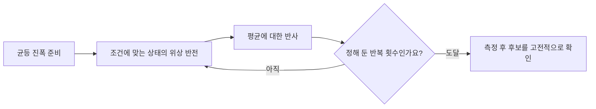

# 진폭을 모으는 양자 검색 / Grover’s unstructured search

후보를 모두 동시에 확인한 뒤 답을 전부 읽는다는 설명만으로는 Grover 검색을 이해하기 어렵습니다. 중요한 것은 정답의 위상을 바꾸고 간섭을 이용하여, 측정에서 정답이 나올 확률을 키우는 반복입니다.

| 항목 | 원문 정보 |
| --- | --- |
| 논문 | Lov K. Grover, A Fast Quantum Mechanical Algorithm for Database Search |
| 발표 | STOC 1996, 212–219쪽. 여기서는 1996년 11월 수정 arXiv v3의 8쪽을 읽습니다. |
| 당시 소속 | Bell Labs, Murray Hill입니다. |
| 원문 | [저자 공개 원고와 수정 이력](https://arxiv.org/abs/quant-ph/9605043v3) |
| 읽을 위치 | §2–3 문제와 알고리즘, §4–5 평균에 대한 반사와 증명, §6 질의 하한, §7–8 구현·여러 정답에 관한 논의입니다. |

## 후보 수와 입력 비트 수

원고는 N개 후보 중 정답 하나를 판정할 수 있는 오라클을 가정하고 O(√N)번 규모의 검색을 설명합니다. 오라클은 후보가 조건에 맞는지 판정하는 연산입니다. 그 구현 비용을 공짜로 없앤 실제 데이터베이스 성능 보고가 아닙니다. 아래 진폭과 횟수는 손으로 계산한 자체 예제입니다.

고전적인 무구조 검색에서는 이전 후보가 실패했다는 사실 외에 다른 후보를 제외할 정보가 없습니다. 정렬·색인·주기 같은 구조가 있으면 다른 알고리즘을 쓸 수 있으므로, 이 결과를 모든 검색의 최선 속도라고 읽지 않습니다. 양자 질의 하한도 같은 블랙박스 과제와 성공 기준에서의 이야기입니다.

큐비트 n개는 2ⁿ개 기저 상태를 갖습니다. 진폭은 각 상태에 붙는 복소수이며 그 절댓값의 제곱이 측정 확률입니다. 진폭의 부호나 위상은 확률만으로는 구분되지 않지만, 나중에 다른 진폭과 더해질 때 보강·상쇄를 일으킵니다. 확률 1/4과 진폭 1/2를 섞어 계산하면 합이 틀어집니다.

## 네 후보에서 한 번의 반복

후보 A·B·C·D 중 D만 정답이라고 하겠습니다. 균등 상태의 진폭은 각각 1/2이므로 확률은 각각 1/4입니다. 오라클은 정답 D의 진폭에 −1을 곱합니다. 이 순간 확률은 여전히 모두 1/4입니다.

| 단계 | A | B | C | D |
| --- | --- | --- | --- | --- |
| 초기 진폭 | 1/2 | 1/2 | 1/2 | 1/2 |
| 정답 위상 뒤집기 | 1/2 | 1/2 | 1/2 | −1/2 |
| 평균에 대한 반사 | 0 | 0 | 0 | 1 |

위상을 뒤집은 뒤 진폭 평균은 (1/2+1/2+1/2−1/2)/4=1/4입니다. 평균에 대한 반사는 각 진폭 a를 2×평균−a로 바꿉니다. 오답에는 1/2−1/2=0, 정답에는 1/2−(−1/2)=1이 됩니다. 따라서 이상적인 연산과 정답 하나라는 조건 아래 이 작은 예는 한 번의 반복 뒤 정답을 확실히 측정합니다.

```math
a_i'=2\bar a-a_i,\qquad \bar a=\frac1N\sum_{i=1}^{N}a_i
```

이 반사는 단순히 확률이 낮은 칸을 높은 칸으로 바꾸는 임의 조작이 아닙니다. 상태의 길이와 총확률을 보존하는 유니터리 연산으로 구현해야 합니다. 유니터리는 복소수 공간에서 길이와 내적을 보존하는 변환입니다.

## 16개일 때에는 반복이 필요합니다

정답 하나와 오답 15개의 초기 진폭을 모두 1/4로 놓겠습니다. 정답 부호를 뒤집은 뒤 평균은 7/32입니다. 반사 후 정답 진폭은 11/16, 각 오답은 3/16입니다.

총확률을 확인하면 (11/16)²+15×(3/16)²=(121+135)/256=1입니다. 정답 확률은 약 47.27%로 처음 6.25%보다 커졌지만 아직 확실하지 않습니다.

두 번째 반복에서는 정답 진폭이 61/64, 오답은 각각 5/64가 됩니다. 정답 확률은 약 90.84%입니다. 세 번째 반복에서는 정답이 251/256, 오답은 각각 −13/256이 되어 정답 확률이 약 96.13%입니다. 오답의 음수 진폭은 음의 확률이 아닙니다. 확률은 제곱하므로 양수이며, 부호는 다음 간섭에 영향을 줍니다.



## 오래 돌린다고 계속 좋아지지 않습니다

위의 16개 예에서 네 번째 반복의 정답 진폭은 781/1024로 내려가며 성공 확률은 약 58.17%입니다. 진폭은 한 방향으로 무한히 커질 수 없고, 반복은 정답과 오답 방향 사이의 회전으로 해석할 수 있기 때문입니다. 적절한 시점에 멈추는 것도 알고리즘의 일부입니다.

정답 수가 바뀌면 회전량과 적절한 반복 횟수도 달라집니다. 정답 하나에 맞춘 반복을 정답이 절반인 문제에 그대로 적용하면 같은 분석이 성립하지 않습니다. 정답이 없는 경우에는 측정한 후보를 조건으로 재검사해 실패를 알아야 합니다. 측정은 정답 인증서를 자동으로 붙여 주지 않습니다.

중간에 매번 정답인지 측정해 관측하려는 시도도 주의해야 합니다. 이 알고리즘은 위상과 간섭을 유지하는 연산을 반복합니다. 일반적인 고전 반복문처럼 상태의 후보 번호를 매번 읽어 기록하면 계산 상태를 바꿉니다. 원문이 오라클 구현에서 경로 흔적을 남기지 않는 조건을 논하는 이유입니다.

## 가속의 범위를 계산해 보기

자체 질의 모형에서 후보가 2⁴⁰개라면 제곱근은 2²⁰개 규모입니다. 감소 폭은 크지만 n개의 불리언 변수에 대해 후보 2ⁿ개를 검색하면 여전히 2ⁿᐟ² 규모입니다. 따라서 일반 SAT를 다항 시간에 해결했다는 결론은 나오지 않습니다. 후보 하나의 조건 검사에 필요한 회로, 메모리 접근과 오류 정정 비용도 총시간에 더해야 합니다.

후속 [Boyer·Brassard·Høyer·Tapp의 Tight Bounds on Quantum Searching](https://arxiv.org/abs/quant-ph/9605034)은 반복 횟수와 정답 수를 더욱 구체적으로 분석합니다. 이름이 비슷한 [Boyer–Moore 문자열 검색](오른쪽에서비교하는문자열검색_boyer-moore1977.md)과는 별개입니다. [Shor의 알고리즘](주기를찾는양자소인수분해_shor1997.md)은 정수 거듭제곱의 구조를 사용하므로 이 무구조 제곱근 가속과 같은 정리를 적용한 것으로 설명할 수 없습니다.

## 자기 점검

1. 진폭 −1/2의 측정 확률은 얼마인가요?
2. 네 후보 예에서 위상만 뒤집은 직후 정답 확률은 커지나요?
3. 후보가 2ⁿ개인 과제에서 O(√N) 질의는 n에 다항인가요?

<details>
<summary>해설 보기</summary>

1. 1/4입니다. 부호는 확률이 아닌 간섭의 정보입니다.
2. 아직 1/4입니다. 그 뒤 반사와의 조합이 진폭을 재분배합니다.
3. 아닙니다. √(2ⁿ)=2ⁿᐟ²로, 여전히 n에 지수적인 규모입니다. 오라클 구현 비용도 따로 있습니다.

</details>

[이 분야의 논문 목록](README.md)
