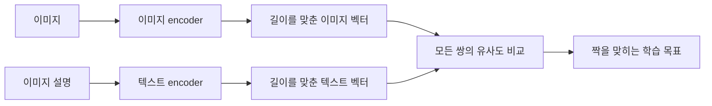

# CLIP: 이미지와 설명을 같은 공간에 놓기 | Learning Transferable Visual Models

| 항목 | 내용 |
| --- | --- |
| 원제 | Learning Transferable Visual Models From Natural Language Supervision |
| 저자 | Alec Radford 외 |
| 공개·발표 | arXiv 2021년, ICML 2021, PMLR 139 |
| 원문 | [학회 페이지](https://proceedings.mlr.press/v139/radford21a.html) · [논문 PDF](https://proceedings.mlr.press/v139/radford21a/radford21a.pdf) |
| 읽을 위치 | §2.2의 학습 목표와 Figure 3, §3.1의 zero-shot 분류, §5의 영향·편향, §6의 한계 |

## 정해진 분류 이름을 넘어서는 질문

이미지 분류기가 정해진 종류만 출력한다면 다른 종류를 추가할 때 학습 구성을 바꾸어야 합니다. CLIP은 이미지와 그 설명을 함께 학습한 뒤, 분류 후보를 자연어로 표현하여 비교하는 방식을 연구했습니다. 이미지·텍스트 encoder가 만든 벡터의 대응 관계를 학습하는 것이 핵심이며, 이미지 설명을 문장으로 생성하는 모델과는 출력 구조가 다릅니다. 근거는 원문 §2.2와 §3.1입니다.

Supervision은 이 문맥에서 모델에 학습 방향을 알려 주는 신호입니다. 사람이 옆에서 매 순간 감독한다는 뜻은 아닙니다. ‘이 이미지에는 이 설명이 연결되어 있습니다’라는 대응이 신호가 됩니다. 웹의 이미지·설명 쌍에도 수집과 선택 과정이 있으므로 아무 정보 없이 학습한다는 뜻으로 읽지 않습니다.

## 서로 다른 자료를 비교할 수 있게 만들기

이미지는 픽셀이고 문장은 토큰이므로 그대로 내적할 수 없습니다. 각각 encoder를 통과시킨 후 같은 차원의 embedding으로 대응시킵니다. Embedding은 자료를 벡터 공간의 한 점에 놓는 표현입니다. ‘같은 공간’이라는 말은 같은 크기의 벡터로 비교하도록 학습한다는 뜻입니다.

Contrastive에는 ‘대조하여 구별함’이라는 느낌이 있습니다. 맞는 쌍의 점수를 상대적으로 높이고 다른 쌍과 구별하도록 학습합니다. 그림의 두 encoder가 같은 가중치를 쓴다는 뜻은 아닙니다. 논문의 Figure 3에서 실제 계산 정의를 확인하실 수 있습니다.

## 두 이미지와 두 설명으로 만든 계산

아래는 학습된 CLIP의 출력이 아닌 직접 만든 벡터입니다. 첫 이미지·첫 설명의 벡터는 `(1,0)`, 두 번째 쌍은 `(0,1)`이라고 정합니다. 이미 길이가 1이므로 내적이 cosine similarity입니다. Cosine은 두 벡터 방향이 얼마나 비슷한지 나타내며, 같은 방향이면 1, 직각이면 0입니다.

| 이미지·설명 | 설명 A `(1,0)` | 설명 B `(0,1)` |
| --- | --- | --- |
| 이미지 A `(1,0)` | 1 | 0 |
| 이미지 B `(0,1)` | 0 | 1 |

설명을 위해 유사도에 2를 곱한 점수 `[[2,0],[0,2]]`를 사용합니다. 첫 행에 softmax를 적용하면 정답 설명 A의 비율은 `e²/(e²+1) ≈ 0.880797`입니다. 첫 열에서도 같은 비율로 이미지 A를 고릅니다. 정답 비율의 음의 자연로그는 약 0.126928입니다.

한 행은 ‘이 이미지에 맞는 설명’을, 한 열은 ‘이 설명에 맞는 이미지’를 비교합니다. 이처럼 양쪽 방향을 보아야 단순히 이미지에서 설명으로만 분류하는 계산과 구별할 수 있습니다. 실제 학습에서 벡터는 매번 직접 지정되지 않고 encoder의 가중치에 따라 달라집니다.

## Zero-shot을 읽을 때의 조건

새 분류 과제에서 후보를 ‘고양이의 사진’, ‘자동차의 사진’처럼 문장으로 만들고 이미지 벡터와 비교할 수 있습니다. 여기서 zero-shot은 그 대상 평가 데이터의 정답으로 추가 학습하지 않는 설정을 뜻합니다. 사전학습을 전혀 하지 않았거나, 고양이라는 개념을 한 번도 보지 않았다는 뜻은 아닙니다.

후보가 둘일 때의 softmax 비율은 그 두 후보 사이의 상대적 값입니다. ‘고양이 88%’라는 숫자를 세상의 모든 가능성 중 고양이일 객관적 확률로 해석하지 않습니다. 후보에 다른 문장을 추가하거나 표현을 바꾸면 분모와 점수가 달라질 수 있습니다.

## 논문 결과와 한계

원문은 여러 영상 과제에서 자연어로 지정한 분류의 전이 가능성을 평가합니다. 이 결과는 대규모 이미지·텍스트 학습의 활용 경로를 보여 주지만, 입력 설명의 편향이나 평가 구성의 영향을 없애지는 않습니다. 편향은 원문 §5, 적용 한계는 §6(PDF 8~9쪽)에서 함께 확인하실 수 있습니다.

후속 모델을 읽을 때에는 CLIP과 같은 encoder로 이미지를 비교하는지, 언어 모델이 답 문장을 생성하는지 먼저 구분하시면 좋습니다. [DDPM](../딥러닝_deep-learning/ddpm.md)은 잡음에서 샘플을 생성하는 방법을 다룹니다. 생성과 검색·분류는 연결될 수 있지만 같은 연산은 아닙니다.

## 자기 점검

1. cosine similarity 계산 전에 `(3,4)`를 단위 길이로 바꾸면 무엇이 됩니까?
2. 이 글의 0.880797을 실제 CLIP 정확도로 적어도 됩니까?
3. 설명 후보가 바뀌었는데 분류 비율도 바뀌었다면 반드시 구현 오류입니까?

답과 해설

1. 길이가 5이므로 `(0.6,0.8)`입니다.
2. 안 됩니다. 두 쌍의 벡터를 직접 정한 수치 계산이며 실제 데이터의 정확도를 측정하지 않았습니다.
3. 아닙니다. 후보 표현과 후보 집합은 비교 점수와 softmax 분모에 영향을 줍니다.

[논문 해설](../README.md) · [용어 설명](../논문을읽는용어_PAPER_TERMS.md)
