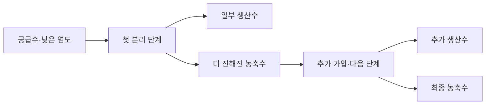

# 담수화에서 좋은 막만으로 전력을 계속 줄일 수 없는 이유 / Energy limits of desalination

Menachem Elimelech와 William A. Phillip의 「The Future of Seawater Desalination: Energy, Technology, and the Environment」를 읽습니다. Science 333(6043), 712–717, 2011년 8월 5일 발표된 검토 논문입니다. 원문 소속은 예일대학교 화학·환경공학과이며, Phillip의 당시 현 소속으로 노터데임대학교도 표시되어 있습니다.

[DOI](https://doi.org/10.1126/science.1200488) · [저자 연구실의 논문 목록](https://elimelechlab.rice.edu/publications/) · [출판본 외부 보관 사본](https://albertsk.org/wp-content/uploads/2012/08/science-2011-elimelech-712-71.pdf)

## 바닷물에서 물만 꺼내는 일

소금을 물에 풀면 저절로 섞이지만, 다시 맑은 물과 진한 소금물로 나누려면 일을 해야 합니다. 분자의 무질서가 커지는 방향과 반대로 분리하기 때문입니다. 담수화는 소금을 없애는 마술이 아니라 물과 염을 다른 흐름으로 나누는 공정입니다. 따라서 생산수뿐 아니라 남은 농축수의 행방도 계산해야 합니다.

역삼투는 물은 잘 통과시키고 염은 대부분 막는 막의 바닷물 쪽에 높은 압력을 가하는 방법입니다. 삼투압은 물이 자발적으로 묽은 쪽에서 진한 쪽으로 이동하려는 경향을 압력으로 표현한 양입니다. 압력이 삼투압 차이를 이겨야 반대 방향으로 물을 보낼 수 있습니다. 막이 얇아져 이동 저항이 줄어도 이 기본 부담이 사라지지는 않습니다.

논문의 중심 질문은 더 잘 통하는 막을 만들면 담수화 전력을 얼마나 더 줄일 수 있는가입니다. 저자들은 막의 재료, 압력을 가하는 방식, 앞뒤 처리, 환경 영향을 함께 보아야 한다고 설명합니다. 이 글은 당시 검토를 읽으며 만든 공학 해설이며, 논문의 2011년 산업 수치를 2026년 전 세계 설비의 현황으로 취급하지 않습니다.

## 회수율을 올리면 남는 물도 변합니다

회수율은 들어온 물 중 생산수로 꺼낸 부피 비율입니다. 가상 설비에 35 g/L 해수 100 m³가 들어오고 염이 생산수로 전혀 빠져나가지 않는다고 합시다. 회수율 50%라면 생산수와 농축수는 각각 50 m³입니다. 처음 염 질량은 3,500 kg이므로 농축수는 70 kg/m³, 즉 70 g/L가 됩니다.

회수율을 75%로 올리면 농축수는 25 m³이고 염 농도는 140 g/L입니다. 더 많은 물을 얻는 대신 뒤쪽 막이 훨씬 진한 물을 상대해야 합니다. 이 계산은 체적 변화와 침전을 무시한 물질수지이며, 그 조건의 설비가 실제로 문제없이 운전한다는 보장이 아닙니다. 높은 농도에서는 삼투압뿐 아니라 스케일과 점도도 다시 검토해야 합니다.

```math
R=\frac{V_p}{V_f},\qquad
C_b\simeq\frac{C_f}{1-R}
```

여기서 f는 공급수, p는 생산수, b는 농축수를 가리킵니다. 같은 막을 쓰더라도 공급 염도와 회수율을 맞추지 않으면 kWh/m³를 공정 능력의 공정한 비교로 사용할 수 없습니다. 수온과 최종 수질도 같이 적어야 합니다.

## 이론 최소와 한 단계 설비의 최소는 다릅니다

원문 713~716쪽은 35 g/L, 회수율 50%에서 가역 분리의 최소 에너지 약 1.06 kWh/m³와 이상적인 단일 압력 단계의 약 1.56 kWh/m³를 구분합니다. 가역 과정은 거의 균형을 유지하면서 아주 조금씩 분리하는 극한입니다. 실제로 빠른 물 생산과 유한한 장비를 요구하면 다른 제약이 생깁니다.

긴 막 모듈의 앞에서는 해수가 덜 진하고 뒤에서는 더 진합니다. 처음부터 끝까지 같은 높은 압력을 걸면 앞쪽에서는 필요한 것보다 높은 압력을 쓰게 됩니다. 반대로 앞쪽에 맞춘 낮은 압력만 쓰면 뒤쪽의 분리가 진행되지 않습니다. 따라서 저항이 거의 없는 막을 상상해도 단일 압력 운전의 에너지와 가역 최소 사이에 간격이 남습니다.



이는 자체 원리 그림입니다. 압력을 단계적으로 맞추면 불필요하게 높은 압력에 노출되는 부피를 줄일 수 있습니다. 그러나 추가 펌프와 제어·배관·유지보수가 필요합니다. 전력만 최소화하는 설계와 물의 총비용을 최소화하는 설계가 같지는 않습니다. 원문은 이 차이를 장치 구성과 자본비 사이의 선택으로 설명합니다.

## 펌프와 에너지 회수기의 숫자 예

가상 공급수 2 m³를 60 bar까지 올려 생산수 1 m³와 농축수 1 m³를 얻는다고 합시다. 60 bar는 6,000,000 Pa이며 압력과 부피의 곱은 일의 단위 J가 됩니다. 이상적 가압 일은 12 MJ=3.333 kWh입니다. 펌프 효율 80%면 공급 전력량은 약 4.167 kWh입니다.

농축수 1 m³가 여전히 60 bar에 있다면 남은 압력 일은 6 MJ=1.667 kWh입니다. 회수율 90%의 가상 에너지 회수기가 이를 1.5 kWh만큼 유효하게 되돌리면 순부담은 약 2.667 kWh입니다. 여기서는 회수된 일을 같은 전기적 가치로 공제하는 단순 모델을 사용했습니다. 실제 압력 교환기의 흐름과 보조 펌프를 정확히 맞춘 모형은 아닙니다.

핵심은 농축수를 그냥 흘려보내면 고압 펌프가 이미 넣은 일도 버린다는 점입니다. 따라서 새 막의 투수도만 읽는 것보다 농축수의 압력을 어떻게 회수했는지 확인하는 편이 설비 성능을 이해하는 데 중요할 수 있습니다. 투수도가 두 배라는 문장을 전체 전력이 절반이라는 문장으로 바꿀 수 없는 이유이기도 합니다.

## 막의 선택성과 오염 저항

투수도는 주어진 구동력에 물이 얼마나 잘 지나가는지를 나타냅니다. 선택성은 물과 염 등 서로 다른 성분을 얼마나 잘 구분하는지를 나타냅니다. 물을 잘 통과시키면서 염도 함께 많이 통과시키면 생산수 품질을 얻기 위해 재처리가 필요합니다. 단일 지표가 커졌다는 사실만으로 공정에 유리하다고 판정할 수 없습니다.

오염은 유기물·미생물·입자 등이 표면에 쌓여 운전을 방해하는 현상입니다. 스케일은 용해되어 있던 성분이 고체로 침전하는 문제입니다. 둘은 겹칠 수 있지만 같은 원인은 아닙니다. 미생물을 없애기 위한 약품이 막의 화학 구조를 손상한다면 세척과 재료 안정성이 연결됩니다. 그래서 막 수명과 전처리의 약품·전력까지 함께 계산해야 합니다.

학습용으로 막 단계가 2.0, 앞뒤 처리가 1.2 kWh/m³인 설비를 생각해 보겠습니다. 막 단계만 10% 줄이면 전체는 3.2에서 3.0으로, 6.25% 감소합니다. 막 단계 절감률을 전체 설비에 그대로 붙이면 감소 효과를 과장하게 됩니다. 반대로 앞뒤 처리의 부담을 줄이는 연구는 막 투수도가 바뀌지 않아도 전체 성능을 바꿀 수 있습니다.

## 막 표면의 농도는 탱크의 농도와 같지 않습니다

물이 막을 통과하고 염이 남으면 막 바로 앞쪽에 염이 더 많이 쌓일 수 있습니다. 이를 농도 분극이라고 합니다. 탱크에서 잰 평균 염도만으로 막 표면의 삼투압을 계산하면 필요한 압력을 낮게 예측할 수 있습니다. 통로의 혼합과 유속을 바꾸면 이 차이를 줄일 수 있지만 펌프의 마찰 손실이 늘 수 있습니다. 재료와 유동 설계가 연결되는 지점입니다.

가상 유효 구동 압력을 `가압 차−삼투압 차`로 단순화해 보겠습니다. 가압 차 60 bar, 삼투압 차 40 bar라면 20 bar가 남습니다. 표면 농도 증가로 삼투압 차가 50 bar가 되면 10 bar만 남습니다. 막의 투수도가 같아도 물 흐름이 줄어들 수 있습니다. 실제 막 모듈의 압력·농도 분포를 맞춘 계산이 아니라 표면 농도를 무시하면 생기는 오류를 보여 주는 예제입니다.

같은 생산량을 유지하려고 압력을 계속 높이면 오염이 원인인지 농도 분극인지 막 손상인지 가려지지 않을 수 있습니다. 원수·농축수·생산수의 유량과 염도, 막 전후 압력과 시간 변화를 같이 재야 원인을 좁힐 수 있습니다. 높은 투수도 한 번의 측정과 장기간 안정된 물 생산은 별도의 검증입니다.

## 물 공급의 사회적 경계

담수화의 비용은 해안에서 생산한 물을 도시로 보내는 데서 끝나지 않습니다. 고지대까지 보내면 위치 에너지가 필요하고, 관로와 저장조의 비용이 생깁니다. 재이용·누수 감소·수요 관리와 비교할 때도 같은 최종 수질과 공급 장소, 가뭄 때의 신뢰도를 맞추어야 합니다. 빗물이 많은 해안과 지하수가 고갈된 건조 지역에 같은 결론을 적용하기 어렵습니다.

염의 총량이 보존된다고 해도 방류의 생태 영향이 같다는 뜻은 아닙니다. 같은 질량을 좁은 곳에 빠르게 배출할 때와 넓게 섞어 배출할 때 주변 생물이 겪는 농도·시간이 다릅니다. 해류, 해저 지형, 취수 위치, 전처리 약품을 함께 봐야 합니다. 물이 깨끗해졌다는 생산수 분석만으로 해양 영향 평가를 대신할 수 없습니다.

이 검토 논문은 한 가지 새 막을 시험한 원저가 아니라 당시 에너지·재료·환경 연구를 묶어 한계를 분석한 논문입니다. 후속 설비를 평가할 때 쓸 경계 설정과 비교 논리를 제공한다는 데 가치가 있습니다. 현행 설비 사례는 [담수화 기술 리뷰](../../제품리뷰_reviews/에너지와물_energy-water/desalination.md)에서 별도로 다룹니다.

열람 범위는 원문 인쇄 712~717쪽 전체의 본문·그림 설명·참고문헌입니다. 별도 Supporting Online Material은 읽지 않았으며 그 유도 과정을 직접 확인했다고 쓰지 않았습니다. 출판사 사본은 위 외부 보관 링크로 읽었고, 저자 연구실 목록과 DOI로 서지를 대조했습니다.

## 확인 문제

1. 같은 막이라도 회수율을 높이면 왜 더 높은 압력이 필요할 수 있나요?
2. 투수도가 매우 커져도 단일 압력 단계가 가역 최소에 자동으로 도달하지 않는 이유는 무엇인가요?
3. 막 단계 전력을 10% 줄이면 전체 설비 전력도 10% 줄어드나요?

<details><summary>해설 보기</summary>

1. 남는 물의 염 농도와 삼투압이 높아집니다.
2. 길이에 따라 필요한 압력이 다른데 한 압력으로 운전하기 때문입니다. 유한한 유량·장치의 제약도 있습니다.
3. 아닙니다. 막 단계가 전체에서 차지하는 몫에 절감률을 곱해야 합니다. 예제에서는 6.25%입니다.

</details>

[논문 목록](README.md)
