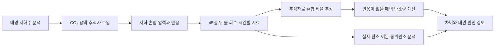

# 지하에 넣은 탄소가 광물로 변했는지 확인하는 방법 / Tracing carbon mineralisation

Juerg M. Matter, Joanna Speer, Christopher Day, Peter B. Kelemen, Amal Ibrahim, Sulaiman Al Mani, Ehab Tasfai, Moeez Ilyas, Karan Khimji, Talal Hasan의 「Rapid mineralisation of carbon dioxide in peridotites」를 읽습니다. Communications Earth & Environment 6, 590, 2025년 7월 26일 발표 논문입니다. 소속은 사우샘프턴대학교, 옥스퍼드대학교, 컬럼비아대학교와 오만의 Carbon Management Services SPC입니다.

[출판사 원문](https://www.nature.com/articles/s43247-025-02509-5) · [원문 PDF](https://www.nature.com/articles/s43247-025-02509-5.pdf) · DOI: 10.1038/s43247-025-02509-5

## 저장은 위치와 화학 상태를 함께 뜻합니다

탄소를 지하에 넣는 방식에도 차이가 있습니다. 기체·초임계 유체로 공간에 가두거나, 물에 녹이거나, 암석과 반응하여 탄산염 광물로 만드는 방법이 있습니다. 광물화는 탄소를 고체 화합물의 구성 성분으로 바꾸는 과정입니다. 위치를 옮긴 것과 화학적으로 고정된 것을 구분해야 저장의 위험과 관측 방법을 이해할 수 있습니다.

감람암은 감람석 등 마그네슘이 풍부한 광물을 포함하는 암석입니다. 이산화탄소를 녹인 물이 암석과 반응하면 금속 이온이 나오고 탄산염이 생길 수 있습니다. 다만 암석이 존재한다는 사실만으로 원하는 속도로 물을 넣고 뺄 수 있는 것은 아닙니다. 화학적 반응성, 물이 통하는 길, 그 길이 시간에 따라 어떻게 변하는지가 별개의 조건입니다.

이 연구는 오만의 한 관정에서 CO₂를 녹인 물을 주입하고 다시 회수한 시험을 다룹니다. 보고된 약 88%는 주입한 탄소를 모두 꺼내어 고체 무게로 직접 잰 비율이 아닙니다. 물의 화학 조성·동위원소·추적자를 함께 사용한 물질수지 추정입니다. 이 차이가 이 논문을 읽을 때 가장 중요합니다.

## 물을 넣었다가 다시 꺼내는 시험

원문 Methods의 시험은 100~400 m 구간을 분리한 관정에 CO₂ 44.0 kg과 물 8,220 L를 넣고 45일 후 회수하는 구조입니다. 주입 전에 배경 지하수를 분석합니다. 그다음 반응성이 낮은 추적자를 함께 넣어 나중에 나오는 물 중 주입수의 몫을 추정합니다.



이 자체 그림의 마지막 단계가 중요합니다. 탄소 농도가 줄었다는 사실만으로 광물화를 결론 내리면 단순 희석과 구별되지 않습니다. 반응하지 않는다고 둔 추적자가 어떻게 줄었는지와 비교해야 합니다. 또 추적자 자체가 실제로 비반응적으로 거동하는지, 배경 물이 대표성을 가지는지도 분석의 가정입니다.

## 희석만으로도 농도는 낮아집니다

자체 예제로 배경수의 추적자 농도를 0, 주입수 농도를 4 mmol/L로 두겠습니다. 회수수에서 1 mmol/L가 측정되면 두 물만 섞였다는 모델에서 주입수 비율은 1/4입니다. 주입수 탄소 농도를 100, 배경수를 1 mmol/L로 임의 설정하면 반응이 없을 때 예상 탄소 농도는 다음과 같습니다.

```math
X=\frac{B_{sample}-B_{background}}{B_{injected}-B_{background}}
\qquad
C_{predicted}=XC_{injected}+(1-X)C_{background}
```

숫자를 넣으면 0.25×100+0.75×1=25.75 mmol/L입니다. 실제 농도가 5 mmol/L라면 예상보다 20.75 mmol/L 낮습니다. 단순히 100에서 5로 줄었으니 95% 반응했다고 하는 계산은 배경수 혼합을 놓칩니다. 위 수는 원문을 재현한 자료가 아니라 혼합 보정의 역할을 설명하는 가상 예제입니다.

농도 차이만으로 전체 질량을 얻을 수도 없습니다. 시간마다 나오는 물의 양이 다르므로 농도에 유량과 시간 간격을 곱해 합쳐야 합니다. 초반 시료 하나와 마지막 시료 하나만 비교하면 많이 흘러나온 구간의 영향이 지워집니다. 시간에 걸친 적분이 실험과 물질수지를 연결합니다.

## 약 88%는 어떤 근거로 나왔나요?

원문 3~4쪽은 추적자 회수율 약 37.6%로 분산을 보정한 뒤, 주입 탄소 1,011 mol 중 회수 탄소를 120 mol로 계산합니다. 차이 891 mol은 약 88.13%입니다. 연구진은 용존 무기 탄소와 칼슘·마그네슘 등, 광물의 포화 상태, 탄소 동위원소를 함께 검토하여 탄산염 침전을 가장 그럴듯한 원인으로 해석합니다.

용존 무기 탄소는 물에 녹은 CO₂와 중탄산·탄산 이온 등을 합쳐 센 탄소입니다. 탄소가 이 형태 사이에서 바뀌는 것과 고체가 되어 물 밖으로 나가는 것은 다릅니다. pH만 측정해서 전체 탄소가 사라졌다고 말할 수 없는 이유입니다. 산성도가 줄어드는 현상도 배경수와의 혼합 및 암석 반응을 함께 반영합니다.

동위원소는 양성자 수는 같지만 중성자 수가 다른 원자입니다. 탄소의 동위원소 비율은 서로 다른 탄소원의 혼합이나 반응을 추적하는 데 쓰입니다. 다만 비율 하나가 광물화된 탄소의 질량계 역할을 혼자 수행하는 것은 아닙니다. 추적자와 원소 농도, 가능한 반응을 함께 맞출 때 해석력이 생깁니다.

## 단위가 맞지 않으면 먼저 질량으로 돌아갑니다

원문 표 1과 본문의 일부 DIC 농도 표기에는 μmol·mmol·mol 사이의 단위 불일치가 있습니다. 이 글은 그 농도 숫자를 그대로 재사용하거나 저자 대신 정정값을 확정하지 않습니다. 대신 보고된 총 CO₂ 질량과 물 부피로 크기를 독립 점검합니다.

44.0 kg을 44 g/mol로 나누면 약 1,000 mol입니다. 이를 8,220 L로 나누면 약 0.1217 mol/L입니다. 논문이 제시한 탄소 총몰수와 대략 맞는 크기입니다. 같은 조성에서 수백 mol/L라는 값을 얻었다면 단위·소수점·분모를 다시 살펴야 합니다. 원문에도 오자가 있을 수 있으므로 출처가 권위 있다는 사실이 차원 검사를 대신하지 않습니다.

물 사용량의 시험 비는 8.22 m³/0.044 t≈186.8 m³/t-CO₂입니다. 이것을 모든 상업 광물화 공장의 물 소비량으로 쓰면 안 됩니다. 일부 물은 회수·순환할 수 있고, 원수의 종류·기체 용해 조건과 시험 목적이 다릅니다. 이 예제는 소규모 시험의 비율을 계산한 것이며 장래 공정의 물 수요 예측이 아닙니다.

## 빨리 반응해도 크게 운영할 수 있나요?

암석이 반응하면서 고체 부피가 늘면 물길이 막힐 수 있습니다. 반대로 응력으로 새 균열이 생겨 흐름이 좋아질 가능성도 있습니다. 두 효과 중 무엇이 지배하는지에 따라 같은 반응이 운전을 돕거나 방해할 수 있습니다. 반응 속도가 빠르다는 결과만으로 주입 능력도 유지된다고 결론 내릴 수 없습니다.

투수성은 암석이 유체를 통과시키는 성질입니다. 주입성은 실제 관정에서 압력 변화에 대해 얼마나 주입되는지를 나타내는 운전상의 특성입니다. 암석 작은 조각과 균열망을 포함한 저장층은 규모가 다릅니다. 주변 관정 사이에서도 배경수와 흐름이 달라질 수 있으므로 하나의 위치에서 얻은 값을 넓은 지역의 대표값으로 놓기 어렵습니다.

논문도 작은 주입량과 주입성·화학·역학 결합의 불확실성을 한계로 제시합니다. 후속 시험에서 더 큰 주입량, 긴 기간의 압력·유량 변화, 주변 지하수 영향과 추적자의 거동을 볼 필요가 있습니다. 여기서 성공한 탄소 고정 메커니즘과 상업적 규모의 비용·수자원·인허가는 서로 연결되지만 같은 검증 항목은 아닙니다.

## 회수율 보정에도 오차가 있습니다

회수한 추적자 비율로 탄소의 회수를 보정하는 과정은 관측하지 못한 영역의 거동에 대한 가정을 포함합니다. 추적자와 탄소가 물리적으로 같은 물 흐름을 따르고 탄소의 차이는 반응에서 온다는 설명이 성립해야 합니다. 초기 농도·유량계·분석 기기의 오차도 마지막 비율에 영향을 줍니다. 소수점이 긴 결과가 나왔다고 현장 반응량을 그 자릿수까지 정확히 아는 것은 아닙니다.

가상 시험에서 주입 탄소 1,000 mol, 보정 회수 탄소 120 mol이면 반응 손실 비율은 88%입니다. 회수 탄소가 ±20 mol 범위라고 두면 같은 계산의 비율은 86~90%가 됩니다. 이 범위는 원논문의 신뢰구간이 아니라 오차의 방향을 확인하는 민감도 예제입니다. 실제 불확실성 평가는 추적자 회수율과 유량·농도의 상관, 모형 가정까지 전파해야 합니다.

서로 다른 증거를 함께 읽는다고 오차가 모두 없어지지는 않습니다. 하지만 한 대안 설명이 농도는 맞추어도 동위원소나 압력 조건을 설명하지 못한다면 그 설명의 설득력은 낮아집니다. 연구 결과를 읽을 때는 최종 비율만 외우기보다 어떤 관측이 어떤 대안을 제한했는지를 따라가시면 다른 현장 시험도 이해할 수 있습니다.

## 포집 공장과 연결할 때

공기 포집과 광물화를 연결하면 앞 공정은 탄소를 모으고 뒤 공정은 저장합니다. 그러나 원문 시험의 탄소는 암모니아 공장에서 포집한 CO₂입니다. 이 시험 자체가 대기 직접 포집을 실증했다고 부르면 안 됩니다. 제거와 배출 감축의 구분은 탄소의 출발점과 전체 배출 경계에 달려 있습니다.

저장 방식은 운송 거리, 물 확보, 압력 관리와 장기 감시에 의해 선택됩니다. 반응성이 큰 암석이 멀리 있고 가까운 곳에 검증된 퇴적층 저장소가 있다면 화학 반응 속도만으로 우열을 정할 수 없습니다. 잠재 저장량이라는 지질학적 숫자와 실제 허가·주입 가능한 연간 처리량도 구별해야 합니다.

열람 범위는 출판본 8쪽의 본문·Methods·그림 설명·서지·이해관계 공개 전체입니다. 별도 보충표와 공개 원자료는 재분석하지 않았습니다. 일부 저자는 관련 광물화 특허 이해관계를 공개하며, 표본과 규모의 한계를 함께 읽어야 합니다. 지도·사진을 전재하지 않았고, 위 혼합 계산과 흐름도는 자체 제작했습니다.

## 확인 문제

1. 탄소 농도가 낮아졌다는 사실만으로 광물화를 확정할 수 없는 이유는 무엇인가요?
2. 추적자 농도로 혼합 비율을 추정하려면 어떤 가정이 필요한가요?
3. 반응 속도가 빠른 암석에서 주입성이 오히려 나빠질 수 있는 이유는 무엇인가요?

<details><summary>해설 보기</summary>

1. 배경 지하수와 섞여 희석되거나 다른 경로로 이동했을 수 있습니다. 물질수지와 대안 원인을 검토해야 합니다.
2. 추적자가 반응·흡착 등으로 별도로 줄지 않고 주입수와 함께 이동하며 두 물의 초기 조성이 알려져 있어야 합니다.
3. 침전물이 유효 물길을 막을 수 있기 때문입니다. 균열 생성과 막힘의 경쟁은 추가 현장 시험이 필요합니다.

</details>

[직접 공기 포집 논문](direct-air-capture2018.md) · [논문 목록](README.md)
