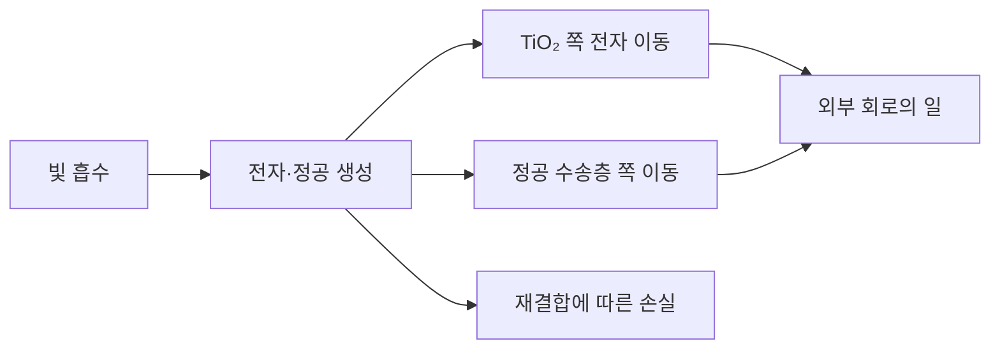

# 페로브스카이트 태양전지에서 액체 전해질을 없앤 이유 / Solid-state perovskite solar cells

Hui-Seon Kim, Chang-Ryul Lee, Jeong-Hyeok Im, Ki-Beom Lee, Thomas Moehl, Arianna Marchioro, Soo-Jin Moon, Robin Humphry-Baker, Jun-Ho Yum, Jacques E. Moser, Michael Grätzel, Nam-Gyu Park의 「Lead Iodide Perovskite Sensitized All-Solid-State Submicron Thin Film Mesoscopic Solar Cell with Efficiency Exceeding 9%」를 읽습니다. 성균관대학교 화학공학·에너지과학 연구진과 EPFL 광자·계면 연구진의 연구이며, Scientific Reports 2, 591에 2012년 8월 21일 발표되었습니다.

[출판사 원문](https://www.nature.com/articles/srep00591) · [원문 PDF](https://www.nature.com/articles/srep00591.pdf) · DOI: 10.1038/srep00591

## 액체를 바꾸면 무엇이 달라지나요?

태양전지는 빛을 흡수하는 것만으로 전기를 계속 만들지 못합니다. 빛으로 생긴 음전하와 양전하를 서로 다른 길로 꺼내 외부 회로에 보내야 합니다. 이때 전자는 음전하를 띤 입자이며, 정공은 전자가 비어 있는 자리를 양전하 운반자처럼 다루는 표현입니다. 전자와 정공이 다시 만나 빛이나 열로 에너지를 돌려주면 재결합이라고 합니다.

페로브스카이트는 원래 특정 결정 구조를 가리킵니다. 이 글에서는 논문에 쓰인 납과 아이오딘을 포함한 유기·무기 할라이드 흡수체를 뜻합니다. 이름 자체가 납을 포함하지 않는다는 뜻도, 모든 페로브스카이트가 같은 반도체라는 뜻도 아닙니다. 소재 이름과 실제 조성을 함께 확인해야 합니다.

초기 감응형 전지에서는 액체 전해질이 전하를 전달했습니다. 그런데 흡수체가 액체와 접촉하며 유지되지 않는다면 처음의 높은 전류는 오래가지 못합니다. 이 논문은 액체 대신 고체 정공 수송 물질을 사용한 소자로 이 문제를 다룹니다. 여기서 고체라는 말은 전하 전달 경로를 설명하며, 소자가 전부 무기물이라는 뜻은 아닙니다. 전고체 전지라는 이차전지 분류와도 다른 이야기입니다.

## 층의 순서보다 전하가 가는 길을 보세요

논문의 주요 재료에는 빛을 받는 흡수체, 전자가 이동할 TiO₂, 정공이 이동할 spiro-MeOTAD가 있습니다. TiO₂의 다공성 골격은 작은 입자들이 연결되어 있고 그 사이로 다른 물질이 들어가는 구조입니다. 도로망에 건물이 들어선 모습을 떠올리면 골격 두께와 건물 벽 두께가 다른 양이라는 점을 이해하기 쉽습니다.



직접 그린 이 그림은 기능을 나눈 것이며, 논문에서 관측한 초고속 전하 이동의 시간 순서를 그대로 재현한 그림은 아닙니다. 실제 경로를 판별하려면 빛을 켠 뒤 흡수 신호가 언제 나타나고 사라지는지 측정해야 합니다. 논문은 시간 분해 분광법과 전기적 측정을 함께 사용하며, 일부 종을 명확히 식별하려면 다른 파장 영역의 측정이 필요하다는 한계도 적습니다.

분광 신호가 빨리 줄었다고 해서 전하가 모두 유용하게 수집되었다고 단정할 수는 없습니다. 원하는 층으로 이동해도 원래의 신호가 줄고, 재결합해도 줄 수 있기 때문입니다. 성분을 뺀 대조 소자와 실제 전류 측정을 함께 보는 이유가 여기에 있습니다. 하나의 측정이 아니라 서로 다른 관측이 같은 설명을 지지하는지 살펴보는 연습입니다.

## 효율의 세 항을 직접 계산합니다

대표 소자의 보고값은 단락 전류 밀도 17.6 mA/cm², 개방 전압 0.888 V, 충전율 0.62이며, 표준 모사 태양광 100 mW/cm²에서 효율 9.7%입니다. 해당 구조의 TiO₂ 골격 두께는 약 0.6 μm입니다. 이 수치를 균일한 페로브스카이트 막의 두께로 바꾸어 쓰면 안 됩니다. 원문 PDF 2~4쪽의 구조와 광전류 측정을 함께 읽으시면 됩니다.

단락 전류는 출력 단자를 거의 연결했을 때의 전류입니다. 개방 전압은 전류를 꺼내지 않을 때의 전압입니다. 실제 동작점에서는 두 극단을 동시에 얻지 못하므로 최대 출력과 두 극단의 곱 사이에 충전율이라는 비율을 둡니다.

```math
\eta=\frac{J_{sc}V_{oc}FF}{P_{in}}
\qquad
17.6\times0.888\times0.62=9.689856
```

오른쪽 값의 단위는 mW/cm²입니다. 100 mW/cm²로 나누면 0.0969, 즉 약 9.69%가 됩니다. 이것은 보고된 반올림 값을 대입한 재계산입니다. 새 소자를 제작한 실험값이 아닙니다.

흡수층을 늘려 전류가 커지면 효율도 항상 커질까요? 가상의 두 번째 소자가 18.5 mA/cm², 0.80 V, 충전율 0.55라면 출력은 8.14 mW/cm²입니다. 전류는 첫 소자보다 커도 전체 효율은 낮습니다. 전하가 이동할 길이와 재결합이 전압·충전율에 미치는 영향을 함께 보아야 합니다. 한 열만 고르면 잘못된 설계 방향을 택할 수 있습니다.

## 흡수, 양자 효율, 전력 효율은 서로 다릅니다

흡수율은 들어온 빛 중 흡수된 몫입니다. 외부 양자 효율은 입사 광자 수에 대해 외부 회로로 수집한 전자 수를 비교합니다. 전력 변환 효율은 들어온 광에너지와 꺼낸 전기에너지를 비교합니다. 광자 한 개의 에너지가 파장에 따라 달라지므로 이 세 비율은 같은 숫자가 될 필요가 없습니다.

균일한 가상 막에서 흡수 계수 α를 20,000 cm⁻¹로 두고 반사·산란을 무시하면 흡수율은 1−exp(−αd)입니다. 두께 0.5 μm는 0.00005 cm이므로 αd=1, 흡수율은 약 63.2%입니다. 두께를 두 배로 늘리면 약 86.5%입니다. 두께가 두 배여도 흡수율은 두 배가 되지 않습니다. 이미 흡수한 빛을 다시 흡수할 수 없기 때문입니다.

이 계산은 논문의 다공성 구조를 맞춘 광학 모델이 아닙니다. 실제 소자는 반사, 산란, 각 층의 굴절률과 불균일한 충전 상태를 고려해야 합니다. 가상 계산을 쓰는 목적은 두께 증가에 수확 체감이 생긴다는 사실을 이해하는 데 있습니다. 전류가 더는 크게 늘지 않는데 전하 이동 손실이 계속 늘면 최적 두께가 나타날 수 있습니다.

## 안정성 결과를 읽는 시간 기준

논문 PDF 6쪽의 안정성 검사는 실온 공기에 보관한 비봉지 소자를 꺼내 측정한 결과입니다. 500시간 이상이라는 기간을 연속 태양광 조사 500시간으로 읽거나, 옥외 모듈의 수년 수명을 입증한 것으로 읽으면 안 됩니다. 보관 온도, 빛의 유무, 전기적 부하, 습도, 측정 사이의 간격이 다르면 시험이 달라집니다.

가령 효율 8%인 시료가 처음보다 상대적으로 14% 높아졌다면 8×1.14=9.12%입니다. 22%가 되는 것이 아닙니다. 개선 폭은 1.12%포인트입니다. 보관 중 특성이 변했다고 해서 모든 사용 조건에서 유리한 열화 경로를 가졌다는 뜻도 아닙니다. 조성이 안정되는 초기 변화와 장기 손상을 구분할 추가 시험이 필요합니다.

## 한 소자의 곡선과 여러 소자의 분포

효율 계산은 각 값의 측정 경계가 같다는 조건도 필요합니다. 전류를 조사 면적으로 나누었는데 전압·충전율을 다른 조건에서 측정한 값으로 가져오면 같은 소자의 전력 곡선이 아닙니다. 조사 면적을 정하는 마스크, 기준 광원의 보정과 주사 방향도 비교의 일부입니다. 작은 대표 소자의 최고값과 여러 번 만든 소자의 분포를 따로 보고해야 공정의 일관성을 판단할 수 있습니다.

모듈 연결도 새 질문을 만듭니다. 가상의 셀 두 개가 각각 1 A·0.8 V 동작점에서 일한다면 두 셀의 출력 합은 1.6 W입니다. 직렬 연결에서 하나가 부분 음영 때문에 0.5 A만 낼 수 있다고 단순화하면, 둘의 전압이 여전히 각각 0.8 V라는 추가 가정 아래 전력은 0.8 W입니다. 실제로는 전압 곡선과 우회 경로까지 달라집니다. 독립 셀 효율의 평균만으로 모듈의 출력 손실을 알 수 없는 이유입니다.

또 처음 측정한 좋은 성능이 장기 운전에서 유지되는지 알려면 동일한 조건으로 주기적으로 다시 측정해야 합니다. 서로 다른 광도나 온도의 결과를 시간 변화처럼 연결하면 기후 변화와 열화를 섞게 됩니다. 실제 현장 비교에서는 기준화한 소자 시험과 사용 환경의 누적 발전량을 함께 보아야 합니다. 이 초기 논문을 후속 제품과 비교할 때도 면적·봉지·운전 조건을 먼저 맞추시면 됩니다.

측정 조건과 소자 분포를 남기면 다음 연구가 같은 성과를 재현했는지, 특정 조건만 바꾸어 얻은 차이인지 구별할 수 있습니다. 최고 효율 외에 비교의 재료가 되는 정보입니다.

## 이 논문의 기여와 남는 질문

이 연구는 고체 전하 수송 경로를 갖춘 초기 페로브스카이트 소자의 가능성을 보여 줍니다. 제목의 높은 효율만 외우기보다 흡수체, 전자 수송층, 정공 수송층을 나누어 설계하는 발상을 읽는 편이 후속 연구를 이해하는 데 도움이 됩니다. 작은 면적의 대표 소자와 대면적 제조 수율 사이에는 별도의 공학 문제가 있습니다.

예를 들어 100개의 가상 소자 중 최고 효율이 12%라도 80개가 6%라면 최고값 하나만으로 생산성을 설명할 수 없습니다. 면적 확대 시 균일성, 불량 분포, 봉지 재료, 납 회수와 폐기 관리가 추가됩니다. 이 글은 후속 상용 모듈의 현행 성능을 판정하지 않습니다. 원문이 다룬 질문과 아직 다루지 않은 질문을 구분하는 데 초점을 둡니다.

열람 범위는 원문 PDF 7쪽의 본문·그림 설명·Methods·참고문헌·이해관계 공개 전체입니다. 별도 보충자료는 읽지 않았습니다. 논문의 그림이나 표를 전재하지 않았으며, 위 도표와 가상 계산은 학습용으로 만들었습니다.

## 확인 문제

1. 전류 밀도가 증가해도 효율이 낮아질 수 있는 이유는 무엇인가요?
2. TiO₂ 골격의 두께를 흡수체의 균일한 막 두께로 취급하면 어떤 문제가 생기나요?
3. 공기 중 보관 시험을 연속 운전 수명으로 바꿔 말할 수 없는 이유는 무엇인가요?

<details><summary>해설 보기</summary>

1. 효율은 전류·전압·충전율의 곱에 달려 있습니다. 전류 이득보다 나머지 두 항의 손실이 클 수 있습니다.
2. 골격의 빈 공간, 충전율, 산란과 계면을 지워 버리므로 흡수량과 이동 거리를 잘못 계산합니다.
3. 빛·온도·습도·부하와 시간 이력이 달라 서로 다른 손상 원인을 시험하기 때문입니다.

</details>

[태양전지의 이론 한계](shockley-queisser1961.md) · [논문 목록](README.md)
