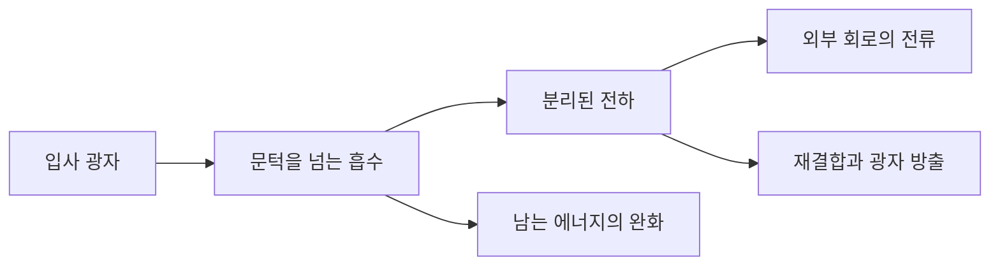

# 태양전지의 효율 한계는 어떤 가정에서 나올까요

William Shockley·Hans J. Queisser의 「Detailed Balance Limit of Efficiency of p-n Junction Solar Cells」는 Journal of Applied Physics 32(3), 510–519쪽에 1961년 3월 실렸습니다. 두 저자의 당시 소속은 미국 Palo Alto의 Shockley Transistor, Unit of Clevite Transistor입니다. [원논문 DOI](https://doi.org/10.1063/1.1736034)와 [출판판 공개 사본](https://banavathvalyaiitmadras.wordpress.com/wp-content/uploads/2015/12/limit-of-efficiency_shockley_queisser.pdf)을 대조했습니다. 사본은 저자 기관이 아닌 외부 사이트가 보관한 자료입니다. 표지 다음 PDF 2–11쪽의 본문·식·그림 설명·부록을 읽었습니다. 원문 그림과 문장을 전재하지 않으며, 아래 숫자 예제는 별도로 만들었습니다.

## 실리콘의 성적표에서 물리적 상한으로

제품의 최고 성능과 물리적으로 가능한 최고 성능은 다릅니다. 어떤 자전거가 시속 30km로 달렸다는 기록만으로 바퀴를 바꾸어도 31km를 넘을 수 없다고 결론 내릴 수는 없습니다. 태양전지도 당시 소자의 불순물이나 저항을 포함한 경험식에서 얻은 값과, 이상적인 소자를 가정한 상한을 구분해야 합니다. 이 구분이 있어야 무엇을 줄일 수 있는 손실로 볼지 알 수 있습니다.

원문은 태양 6000K·전지 300K의 흑체 조건과 단일 접합 등을 가정하여 약 1.1eV에서 약 30%의 한계를 제시합니다. §2의 광자 에너지 손실만 센 상한, §§3–5의 복사·전압·최대 출력 계산, §6과 부록의 당시 소자 비교를 구분해서 읽어야 합니다. 이 숫자를 모든 태양광 방식·모든 조명 조건의 고정된 30%라고 쓰면 적용 범위를 벗어납니다. [원문 511–519쪽](https://doi.org/10.1063/1.1736034)

## 밴드갭은 빛이 전하를 움직이게 하는 문턱입니다

광자는 빛의 에너지 묶음입니다. eV는 전자 하나의 전하가 1V의 전위차를 지날 때에 해당하는 에너지 단위입니다. 전력 단위 W와 다릅니다. 밴드갭은 반도체에서 전자를 전류에 기여할 수 있는 상태로 올리는 데 필요한 에너지 간격입니다. 계단의 높이를 생각하시면 문턱 아래 빛과 문턱 위 빛의 차이를 이해하기 쉽습니다.

이상적인 단일 문턱 모형에서는 문턱보다 작은 광자는 전하쌍을 만들지 못합니다. 문턱보다 큰 광자도 한 개가 한 전자·정공 쌍을 만든다고 정합니다. 정공은 전자가 비어 있는 자리를 양전하 운반자처럼 다루는 표현입니다. 남는 에너지를 모두 전기 출력으로 얻는다고 가정하지 않습니다. 높은 에너지 운반자가 주변과 에너지를 주고받아 낮은 상태로 내려오는 과정을 에너지 완화라고 부르겠습니다. 제품이 장기간 낡는다는 뜻의 열화와 구분하시면 됩니다.

가상의 빛에 0.8eV 광자 100개와 2.4eV 광자 100개가 들어 있다고 하겠습니다. 들어온 에너지는 320eV입니다. 밴드갭을 1.2eV로 두면 낮은 광자 100개는 문턱을 넘지 못합니다. 높은 광자에서는 쌍 100개가 생겨, 한 쌍당 1.2eV를 모두 회수한다는 추가적인 이상화에서도 120eV만 얻습니다. 이 단계의 비율은 37.5%입니다. 이는 실제 태양 스펙트럼이나 원논문의 수치 적분을 재현한 값이 아닙니다.

```math
E_{in}=100(0.8)+100(2.4)=320\ \mathrm{eV}
\qquad \eta_{문턱예제}=100(1.2)/320=0.375
```

문턱을 0.7eV로 낮추면 200개 모두 반응하지만 회수량은 최대 140eV, 43.75%입니다. 문턱을 1.3eV로 두면 높은 광자 100개에서 130eV, 40.625%입니다. 같은 ‘갭을 높인다’는 변화에도 광자의 분포와 전압·전류의 교환 관계가 중요합니다. 이 두 색만 있는 예제의 최적값을 햇빛의 최적 밴드갭으로 일반화하지 않습니다.

## 흡수하는 소자는 빛을 내보내는 경로도 가집니다

상세 평형은 열평형에서 서로 반대인 미시적 과정들의 흐름이 맞아야 한다는 조건입니다. 입구로 물을 받을 수 있는 수조에 출구가 전혀 없다고 놓고 성능을 계산하면 수지가 틀어질 수 있습니다. 전자가 빛을 받아 올라가는 과정과 전자·정공이 다시 만나 빛을 방출하는 과정도 함께 다뤄야 합니다. 재결합은 분리된 전자와 정공이 사라지는 과정입니다. 복사 재결합은 그 에너지를 광자로 내보내고, 비복사 재결합은 다른 경로로 넘깁니다.

발전 중인 전지는 열평형 자체는 아닙니다. 조명에 의해 운반자가 늘어난 상태를 계산하되, 평형에서 지켜야 할 관계를 사용하여 방출과 생성의 기준을 잡습니다. ‘상세 평형이므로 빛이 켜져도 전류가 0’이라는 뜻이 아닙니다. 정상상태에서는 만들어지는 전하쌍과 재결합·외부 추출로 없어지는 전하쌍의 수지가 맞습니다.



직접 그린 흐름도는 경로를 보여 줄 뿐 각 화살표의 폭이나 손실률을 측정한 그림은 아닙니다. ‘잘 빛나는 전지’와 ‘전기를 덜 만드는 전지’를 무조건 같은 말로 놓기 어려운 이유도 여기에 있습니다. 비복사 손실을 줄이는 일과 필수적인 복사 경로까지 없애겠다는 주장은 다릅니다.

## 개방 전압과 최대 출력 전압을 나눕니다

개방 회로는 전류를 뽑지 않는 상태이고, 단락은 두 단자를 매우 작은 저항으로 연결한 상태입니다. 앞에서는 전압이 있어도 전류가 0이며, 뒤에서는 전류가 있어도 단자 전압이 거의 0입니다. 전력은 전압과 전류의 곱이므로 두 극단 모두 실제 출력의 최대점이 아닙니다.

다음은 원문 전체를 옮긴 식이 아닌, 개념을 계산하기 위한 이상 다이오드 예제입니다. Iph는 조명이 만드는 전류, I0는 다이오드의 기준 전류, Vt는 온도와 연결되는 전압 척도로 정합니다. 직렬·병렬 저항은 생략합니다.

```math
I(V)=I_{ph}-I_0[\exp(V/V_t)-1],\qquad P(V)=VI(V)
V_{oc}=V_t\ln(1+I_{ph}/I_0)
```

Iph=1A, I0=1μA, Vt=0.02585V로 정하면 개방 전압은 약 0.357V입니다. 전압을 그 값까지 올리면 전류가 0으로 내려갑니다. 최대점은 이보다 낮은 전압에서 찾아야 합니다. 도함수 조건은 I+V(dI/dV)=0이며, 전류가 줄어드는 정도와 전압 증가의 이익이 맞는 지점을 뜻합니다. 서로 다른 동작점의 최대 전압과 최대 전류를 곱해 실제 출력이라고 보고하면 과대 평가가 됩니다.

충전율 FF는 최대 출력의 면적을 Voc×Isc 직사각형과 비교한 비율입니다. 이름 때문에 배터리 충전 상태로 생각하기 쉽지만 태양전지에서는 전류·전압 곡선의 모양을 요약합니다. 전압·전류·FF 중 하나만 좋아졌다는 보고도 나머지 값과 함께 보아야 전력 변화를 알 수 있습니다.

## 같은 광전류에서 기준 전류가 커지면

가상 다이오드의 I0를 열 배인 10μA로 바꾸고 다른 수는 고정해 보겠습니다. 개방 전압은 약 0.2976V로 내려갑니다. 원래 약 0.3571V와 비교하면 약 0.0595V의 차이입니다. 큰 Iph/I0에서 이 차이는 Vt×ln(10)으로 근사할 수 있습니다. 광전류가 그대로여도 재결합과 연결되는 전류 척도가 달라지면 전압을 잃을 수 있다는 뜻입니다.

다만 I0는 고정하고 Vt만 온도에 비례해 키워 전지가 뜨거워질수록 전압이 높아진다고 결론 내리면 안 됩니다. 실제 온도가 변하면 I0를 포함한 다른 물리량도 달라집니다. 한 변수만 바꾼 수학 예제와 모든 물리량이 함께 변하는 실험을 구분해야 합니다. 모형을 읽을 때는 입력으로 고정한 양과 식 안에서 함께 변해야 하는 양을 표시하는 습관이 유용합니다.

효율의 분모에도 경계가 있습니다. 가상 셀 100개가 각자 1W를 내더라도 배선과 면적 손실이 포함된 모듈이 100W를 보장하지는 않습니다. 입사광을 받는 전체 면적과 실제 반도체 면적도 다를 수 있습니다. 유효 면적 효율과 외곽 면적 효율을 비교하면 가장자리·간격의 차이가 재료의 차이처럼 보일 수 있습니다.

또한 순간 효율과 연간 발전량은 서로 다른 질문입니다. 높은 온도, 그림자, 광의 입사각, 변환기의 동작점 추적과 가동 중단을 포함하면 동일한 시험 효율의 모듈도 다른 전력량을 낼 수 있습니다. 이론적 한계 논문은 각 손실의 위치를 찾게 하지만 특정 지역의 발전소 수익성을 대신 계산하지 않습니다. 다음 단계에서는 시험 조건을 맞춘 셀 비교와 현장 조건을 맞춘 발전량 비교를 따로 해야 합니다.

광자 예제의 320 eV는 에너지이며 전력은 아닙니다. 같은 묶음이 매초 들어오면 eV/s로 전력에 연결할 수 있습니다. 광자의 개수만 같아도 도착 시간이 다르면 전류와 전력이 달라집니다. 따라서 한 번 받은 에너지의 변환 비율과 연속 조명 아래의 정상상태 전력 계산을 나누어 읽으시면 됩니다.

## 이 논문이 설명하는 한계와 남겨 둔 문제

밴드갭 아래 빛을 못 쓰는 손실, 초과 에너지의 완화, 재결합과 출력 동작점의 제약을 한꺼번에 ‘재료가 나빠서’라고 부르면 해결 방향이 흐려집니다. 저항을 줄이는 공정과 여러 밴드갭을 나누어 쓰는 구조는 서로 다른 문제를 바꿉니다. 반대로 조명·온도·방출 방향 같은 가정을 바꾸면 한계 계산도 다시 해야 합니다.

한계가 있다는 사실이 특정 회사의 모듈 가격이나 수명을 정해 주지는 않습니다. 셀 효율, 배선·봉지재가 포함된 모듈 효율, 발전소의 연간 발전량은 서로 다른 분모와 손실 경로를 가집니다. 같은 시험 광도에서 1cm² 소자가 얻은 결과를 대면적 모듈과 바로 비교할 수 없는 이유입니다. 후속 구조의 실제 사례는 [2012년 고체형 페로브스카이트 소자](perovskite-solid2012.md)에서 읽습니다. 그 연구의 성과를 이 단일 접합 논문의 가정을 모두 벗어난 결과라고 설명하지 않습니다.

## 스스로 확인합니다

1. 1961년의 약 30%는 모든 태양전지와 모든 스펙트럼의 절대 상한인가요?
2. 단락 전류와 개방 전압을 곱하면 실제 최대 출력인가요?
3. 두 색 광자 예제의 37.5%는 완성된 상세 평형 계산인가요?

<details>
<summary>답과 이유</summary>

1. 아닙니다. 접합 수·광자 변환·온도·스펙트럼·광학 조건을 먼저 확인해야 합니다.
2. 아닙니다. 서로 다른 동작점의 값입니다. 실제 곡선에서 VI의 최대를 찾아야 합니다.
3. 아닙니다. 문턱과 초과 에너지 손실만 보여 준 자체 예제이며 방출·전압·동작점 계산이 더 필요합니다.

</details>

[에너지·환경 논문](README.md)
