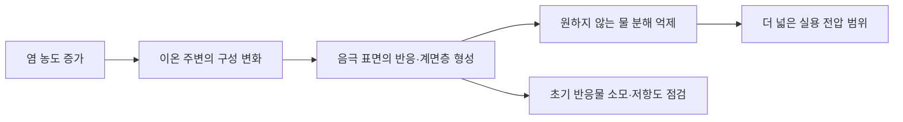

# 물보다 염이 많은 전해질은 전지를 어떻게 바꾸나요? / Water-in-salt electrolytes

Liumin Suo, Oleg Borodin, Tao Gao, Marco Olguin, Janet Ho, Xiulin Fan, Chao Luo, Chunsheng Wang, Kang Xu의 「“Water-in-salt” electrolyte enables high-voltage aqueous lithium-ion chemistries」를 읽습니다. 메릴랜드대학교 화학·생체분자공학과 미국 육군연구소 연구진의 논문이며 Science 350(6263), 938–943에 2015년 11월 20일 발표되었습니다.

[DOI](https://doi.org/10.1126/science.aab1595) · [저자 연구실의 원문 PDF](https://cswang.umd.edu/files/2021/08/3-Water-in-Salt-Electrolyte-Enables-High-Voltage-Aqueous-Li-ion-Chemistries.pdf)

## 물을 쓰면 전압은 왜 제약되나요?

전해질은 전지 안에서 이온이 이동하는 길입니다. 전자는 외부 회로로 보내고, 내부에서는 양·음 이온의 이동으로 전하 균형을 맞춥니다. 전해질이 전자를 자유롭게 전달하면 내부 단락과 같은 문제가 생길 수 있습니다. 물을 쓰는 수계 전해질은 가연성 유기 용매의 일부 위험을 줄일 수 있지만, 높은 전압에서는 물이 분해되어 원하지 않는 반응이 일어나기 쉽습니다.

물의 열역학적 분해 전압과 실제 전극에서 전류가 눈에 띄게 흐르기 시작하는 전압은 구분해야 합니다. 열역학은 반응의 에너지상 가능성을 다루고, 반응 속도는 표면 상태와 장벽에도 좌우됩니다. 문이 열릴 수 있는지와 사람들이 실제로 얼마나 빨리 통과하는지가 다른 것과 비슷합니다. 물의 기본 법칙을 바꾸지 않아도 분해 반응을 느리게 만드는 계면을 설계할 수 있습니다.

논문은 매우 진한 LiTFSI 수용액과 전극 표면의 막을 함께 다룹니다. LiTFSI는 리튬 이온과 큰 음이온으로 이루어진 염입니다. 염을 많이 넣는다는 말만으로 작동 원리를 설명할 수는 없습니다. 리튬 주변의 이웃이 달라지고, 전극에서 먼저 반응하는 종이 달라져야 합니다.

## 농도 단위를 먼저 읽습니다

논문의 21 m은 용매인 물 1 kg당 염 21 mol이라는 몰랄 농도입니다. 완성된 용액 1 L당 21 mol을 뜻하는 몰 농도 M과 다릅니다. 부피가 얼마나 변하는지 모르는 상태에서 두 단위를 그대로 바꿀 수 없습니다. mol은 입자의 개수를 묶어 세는 단위이며, 분자량을 알면 질량과 연결할 수 있습니다.

학습용으로 물 1 kg을 18.015 g/mol로 나누면 약 55.51 mol입니다. 여기에 리튬 염 21 mol이 있다면 물 분자 대 리튬의 수 비는 55.51/21≈2.64입니다. 모든 리튬을 여러 물 분자가 독립적으로 둘러싸는 묽은 용액의 그림을 그대로 적용하기 어려운 환경입니다. 다만 이 수는 평균 조성비이며, 모든 리튬에 정확히 같은 개수의 이웃이 붙어 있다는 관측값은 아닙니다.

가상의 소금 A가 물 1 kg당 1 mol 들어 있으면 수 비는 약 55.5입니다. 입자들의 총수 비가 달라지면 가까운 이웃의 구성, 이온쌍, 이동과 반응을 검토해야 합니다. “농도가 높을수록 무조건 잘 흐른다”는 결론도 성립하지 않습니다. 운반자 수가 늘어나는 효과와 점도·상호작용으로 이동이 느려지는 효과가 경쟁하기 때문입니다.

## 계면에 생기는 막의 역할

SEI는 전해질과 전극 사이에서 생성되는 고체 계면층입니다. 이온은 지나가도록 하면서 전자에 의한 추가 전해질 분해를 억제하는 것이 유리합니다. 완전히 막아야 한다는 뜻은 아닙니다. 사람은 통과하고 차량은 제한하는 출입구처럼, 어떤 이동을 허용하고 어떤 이동을 막는지가 핵심입니다.

이것은 원리의 관계를 그린 자체 그림입니다. 논문은 분광법, 분자 모의실험, 표면 분석을 결합해 LiF가 풍부한 음극 계면층의 설명을 제시합니다. 한 장의 표면 사진만으로 전지 전체의 안전성과 수명을 확정한 연구는 아닙니다. 초기 막 형성에 반응물이 쓰이므로 첫 주기의 손실과 이후의 안정화를 함께 봐야 합니다.

전압 안정 창은 정해진 전극·주사 속도·전류 판정 아래 부반응이 제한되는 구간입니다. 그 폭이 약 3 V라는 사실을 완성 전지가 3 V로 계속 방전한다는 뜻으로 바꾸면 안 됩니다. 전극 두 개의 실제 반응 전위, 내부 저항과 작동 전류가 최종 전압을 결정합니다. 다른 전극 표면에서는 분해의 시작도 달라질 수 있습니다.

## 에너지 밀도의 분모를 확인합니다

논문의 전체 전지는 LiMn₂O₄ 양극과 Mo₆S₈ 음극을 사용합니다. 보고된 약 84 Wh/kg은 양·음극 활물질 합계 질량 기준이며, 전해질과 집전체·분리막·포장까지 합친 완제품 질량 기준이 아닙니다. 원문 941~942쪽의 전지 시험과 에너지 계산을 함께 읽어야 합니다.

학습용으로 47 mAh/g은 47 Ah/kg과 같습니다. 평균 방전 전압을 임의로 1.8 V라고 두면 47×1.8=84.6 Wh/kg입니다. 실제 전압은 방전 중 변하므로 정밀 계산은 전압을 방전 전하량에 대해 적분합니다. 이 예는 크기와 단위 관계를 보여 주는 계산입니다.

가상 셀에서 활물질 3 kg이 이 기준으로 252 Wh를 저장하고, 나머지 부품을 합친 셀 질량이 6 kg이라면 셀 에너지 밀도는 42 Wh/kg입니다. 다시 냉각·외함을 추가한 팩은 분모가 더 커질 수 있습니다. 활물질 수치를 완제품 광고 수치와 나란히 놓으면 이런 차이가 사라집니다. 높은 염 농도는 계면을 바꾸는 장점과 함께 전해질 질량·비용을 검토하게 합니다.

## 1,000회와 100회의 시간은 다릅니다

원문은 높은 4.5 C 조건의 1,000회에서 용량 유지율 68%, 낮은 0.15 C 조건의 100회에서 78%를 제시합니다. 서로 다른 조건이므로 “저속에서도 1,000회 성능을 똑같이 확인했다”라고 합치면 안 됩니다. C는 정격 용량에 대한 전류 비율입니다. 1 C는 이상적으로 한 시간에 그 용량만큼 충·방전하는 전류이며, 0.5 C는 두 시간이 걸리는 전류입니다.

충전과 방전을 같은 속도로 하고 휴지를 생략한 가상 시간은 4.5 C 1,000회의 경우 2×1,000/4.5≈444시간입니다. 0.15 C 100회는 2×100/0.15≈1,333시간입니다. 횟수가 적어도 전극이 반응 가능한 상태로 머문 시간은 더 길 수 있습니다. 실제 시험에는 전압 제한과 휴지가 있으므로 위 값은 실험의 실제 경과 시간이 아닙니다.

쿨롱 효율은 돌려받은 전하량과 넣은 전하량의 비입니다. 에너지 효율은 전압까지 반영합니다. 가상의 쿨롱 효율이 0.999, 평균 방전·충전 전압이 각각 1.8 V와 2.1 V라면 에너지 효율은 약 0.999×1.8/2.1=85.6%입니다. 전하 효율이 높아도 전압 손실로 열이 생길 수 있습니다. 마찬가지로 매 주기 손실을 단순 곱한 모델을 실제 용량 감소 법칙으로 단정해서는 안 됩니다.

## 전압 곡선의 면적을 비교합니다

같은 용량 1 Ah를 방전해도 전압 곡선이 다르면 얻는 에너지가 다릅니다. 가상 전지가 처음 0.5 Ah는 2.0 V, 나머지 0.5 Ah는 1.5 V에서 방전한다면 에너지는 1.0+0.75=1.75 Wh입니다. 최고 전압 2.0 V에 전체 용량을 곱한 2 Wh와 다릅니다. 방전 중 낮은 전압까지 모두 포함한 용량을 높은 전압과 곱하면 에너지를 과대평가할 수 있습니다.

전압 제한을 낮추면 더 많은 전하를 꺼내 용량이 커질 수 있지만, 부반응이나 재충전 회복성이 달라집니다. 연구 간 비교에서는 충전·방전 종료 전압과 전류, 활물질의 양을 맞추어야 합니다. 동일 화학계라도 얇은 전극의 낮은 전류 시험과 두꺼운 전극의 높은 전류 시험은 이온의 이동 거리와 전위 분포가 다릅니다.

안정성도 한 지표가 아닙니다. 발화 가능성, 기체 발생, 압력 축적, 부식과 누출은 서로 다른 고장 경로입니다. 물을 사용해 특정 가연성 위험을 낮추는 발상은 가치가 있지만, 셀의 모든 위험을 하나의 용매 이름으로 판정할 수는 없습니다. 어떤 조건에서 무엇을 관측한 연구인지 묻는 것이 새로운 전해질을 이해하는 출발점입니다.

## 가능성을 보여 준 범위와 다음 비교

이 연구의 중요한 질문은 수계 전지의 전압 제약을 용액과 계면의 공동 설계로 얼마나 넓힐 수 있는가입니다. 이후 다른 수계 화학계를 읽을 때도 전해질의 이름보다 전극, 전압 창 측정 방법, 활물질 질량비와 시험 속도를 먼저 맞추시면 됩니다. 실험실 성능을 비교하려면 전극의 면적당 적재량과 전해질 양도 필요합니다.

물 기반이라는 이유만으로 어떤 고농도 염의 환경성·가격·대량 회수까지 유리하다고 결론 내릴 수는 없습니다. 불소를 포함하는 염의 제조·폐기와 누출, 부식, 저온에서의 유동성도 별개 평가 대상입니다. 이 글은 새 전해질의 조제 지침이나 상용 제품의 안전 인증 판정이 아니라 연구 결과를 읽는 방법을 다룹니다.

열람 범위는 연구실 제공 원문 PDF의 본문 938~943쪽과 그림·표·참고문헌 전체이며, 이 사본은 2015년 11월 24일 수정 표시가 있습니다. 별도 보충자료는 읽지 않았습니다. 연결된 정오표 DOI 10.1126/science.aad9367의 전문은 접근 제한으로 확인하지 못했으므로 추가 수정 내용을 추정하지 않았습니다.

## 확인 문제

1. 21 m을 21 mol/L로 바꿔 적으면 안 되는 이유는 무엇인가요?
2. 전압 안정 창의 폭과 전지의 방전 전압은 왜 다른가요?
3. 쿨롱 효율 99.9%가 에너지 효율 99.9%를 뜻하지 않는 이유는 무엇인가요?

해설 보기

1. 용매 질량과 완성 용액 부피라는 분모가 다르며, 밀도와 조성이 필요합니다.
2. 창은 특정 계면의 분해 억제 범위이고 실제 전압은 두 전극의 반응 전위 차이와 손실로 정해집니다.
3. 에너지는 전하량과 전압에 함께 달려 있으며 충전과 방전의 평균 전압이 다를 수 있습니다.

[논문 목록](README.md)
