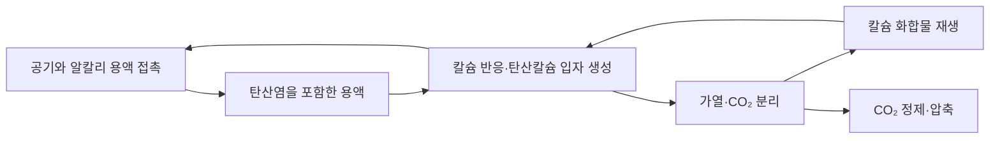

# 공기에서 탄소를 모으는 공장의 물질수지와 비용 / Engineering a direct air capture process

David W. Keith, Geoffrey Holmes, David St. Angelo, Kenton Heidel의 「A Process for Capturing CO₂ from the Atmosphere」를 읽습니다. Joule 2(8), 1573–1594에 2018년 8월 15일 수록되었으며 온라인 발표는 6월 7일입니다. 소속은 Carbon Engineering이며 Keith는 하버드대학교 공학·공공정책 소속도 표시되어 있습니다. 저자들은 회사 고용·지분과 관련 특허 이해관계를 공개합니다.

[논문 DOI](https://doi.org/10.1016/j.joule.2018.05.006) · [저자 제공 PDF](https://davidkeith.earth/wp-content/uploads/2023/10/Keith-et-al.-2018-A-Process-for-Capturing-CO2-from-the-Atmosphere.pdf) · [정오표 DOI](https://doi.org/10.1016/j.joule.2018.09.017)

## 묽은 기체를 처리한다는 뜻

직접 공기 포집, DAC는 대기의 CO₂를 모으는 공정입니다. 연소 배기가스에서 모으는 포집과 출발 농도가 다릅니다. 학습용으로 공기 중 CO₂를 400 ppm, 몰 부피를 24 L/mol, CO₂ 몰 질량을 44 g/mol로 고정해 보겠습니다. 공기 1 m³에는 약 41.67 mol의 기체가 있고 CO₂는 그중 약 0.01667 mol, 약 0.733 g입니다.

모든 CO₂를 완전히 꺼낼 수 있다는 이상적 조건에서도 1 t을 얻으려면 공기 약 136만 m³가 필요합니다. 포집 비율을 75%로 놓으면 약 182만 m³입니다. 이 수는 현행 대기 농도나 실제 공장의 유량을 측정한 결과가 아닙니다. 희박한 성분을 모으려면 많은 공기를 장치에 통과시켜야 한다는 크기 계산입니다.

그래서 흡수제의 반응 능력만큼 공기 흐름의 저항이 중요합니다. 더 촘촘한 접촉면은 포집에는 유리해도 팬이 공기를 밀어 넣는 일을 늘릴 수 있습니다. 같은 재료라도 접촉기의 모양과 공기 속도를 어떻게 선택했는지에 따라 장치 크기와 운영비가 함께 달라집니다.

## 두 순환 고리를 나누어 봅니다

논문은 수산화칼륨 용액으로 CO₂를 흡수한 뒤, 칼슘 화합물을 사용하는 회수 고리로 흡수제를 되돌리는 공정을 제시합니다. 흡수는 기체가 액체 안으로 들어가 반응하는 과정입니다. 흡착은 주로 고체 표면 등에 붙는 과정이며, 이름이 비슷해도 장치와 재생 방식이 같지 않습니다.

이 자체 그림에서는 열교환기·산소 설비·여과기·압축기의 세부 흐름을 생략했습니다. 화학식 네 개가 순환한다고 공장이 네 상자로 끝나는 것은 아닙니다. 작은 분말을 제거하고, 반응기에서 입자를 일정 크기로 키우고, 높은 온도의 열을 회수하는 부속 기능이 실제 운전을 가능하게 합니다.

흡수제는 순환하지만 손실과 보충이 전혀 없다는 뜻은 아닙니다. 먼지와 불순물이 쌓이면 일부를 배출해야 하고, 물이 증발하면 보충해야 합니다. 고체가 너무 잘게 생기면 원하는 반응기 밖으로 빠져나가 여과와 재투입이 필요합니다. “촉매처럼 재사용한다”는 한 문장으로 이런 물질수지를 지우면 비용이 낮게 보입니다.

## 파일럿, 공정 모의, 상업 규모를 구분합니다

저자들은 파일럿에서 얻은 각 장치의 자료와 공급업체 자료를 결합해 큰 공장의 에너지·물질수지를 계산합니다. 원문 PDF 11~16쪽의 파일럿은 전체 상업 공장을 그대로 축소한 장치가 아닙니다. 일부 저위험 장치는 생략되었고, 소성 장치와 접촉기의 처리량도 같지 않습니다. 큰 공장의 결과를 파일럿이 그대로 실측했다고 말할 수 없는 이유입니다.

공정 모의는 입력과 가정으로부터 각 흐름의 온도·조성·에너지를 맞추는 계산입니다. 그 계산이 수렴했다는 사실은 설비가 수년 동안 예측한 가동률로 운영된다는 실증과 다릅니다. 파일럿은 막힘과 입자 성장, 표면 오염 같은 위험을 줄이는 데 유용하지만, 확장 규모의 건설비와 장기 신뢰도에는 추가 근거가 필요합니다.

이 논문의 가치는 검토 가능한 공정과 비용 경계를 제시했다는 데 있습니다. 추정이 있다는 이유로 모두 무의미한 것도 아니고, 상세한 표가 있다는 이유로 실제 구매 가격이 확정된 것도 아닙니다. 원자료가 측정인지 공급업체 견적인지 모의 계산인지 항목마다 구분해서 읽어야 합니다.

## 포집량과 최종 CO₂ 양이 다른 이유

열과 전력을 천연가스로 공급하는 설계에서는 그 연료에서 생기는 CO₂도 처리합니다. 원문의 기준 설계는 공기에서 0.98 Mt/년을 모으고, 연료 기원까지 포함하여 약 1.46 Mt/년의 CO₂ 흐름을 내보냅니다. 두 값의 차이를 공기 포집량에 더하면 대기 제거 실적을 부풀리게 됩니다.

자체 예제로 공기에서 100 t을 모으고 연료에서 30 t이 생겼다고 합시다. 두 흐름을 합쳐 130 t을 저장하더라도 대기에서 제거한 출발량은 100 t입니다. 여기에 외부 전력·연료 생산·운송·건설·누출로 15 t의 배출이 추가되면 순제거는 단순 모델에서 85 t입니다. 실제 평가는 시스템 경계와 시간 기준을 더 정교하게 맞춥니다.

따라서 포집, 저장, 회피 배출, 순제거는 다른 지표입니다. 포집 CO₂로 연료를 만들고 다시 태우면 탄소는 대기로 돌아옵니다. 재생에너지 기반 연료가 화석 탄소 사용을 줄일 가능성과 영구 제거는 별도로 평가해야 합니다. 무엇을 판매하는 사업인지도 이 구분에 따라 달라집니다.

## 열과 전기를 섞어 더하지 않습니다

원문 표 2에는 서로 다른 투입·산출 구성을 둔 시나리오가 있습니다. 전기와 가스를 함께 쓰는 한 구성의 입력은 포집 1 t당 가스 5.25 GJ와 전기 366 kWh입니다. 이 값은 해당 모의 설계의 값이며, 모든 DAC 장치의 공통 성능이 아닙니다.

단위만 맞추면 5.25 GJ는 약 1,458 kWh입니다. 여기에 366을 더해 1,824 kWh라고 표현할 수는 있지만, 같은 품질의 전기 1,824 kWh를 쓴다는 뜻은 아닙니다. 높은 온도 열과 전력은 얻는 방식과 이용 가능성이 다르며, 경제성·배출 계산에서는 각각의 단가와 배출계수를 적용합니다.

자체 예제로 전기 배출계수를 0.300 kg/kWh로 두면 366 kWh의 배출은 109.8 kg입니다. 포집 1,000 kg에서 이것만 공제하면 890.2 kg이 남습니다. 가스의 상류 배출이나 누출 등을 아직 넣지 않은 부분 계산입니다. 원문 PDF 19쪽의 유사 예시에는 단순 곱과 맞지 않는 117 kg 표기가 있으므로 이 글에서는 주어진 입력을 직접 곱한 값을 사용했습니다.

## 비용 범위는 왜 한 숫자가 아닌가요?

균등화 비용은 설비의 수명 동안 드는 비용을 생산량에 나누어 비교하는 방식입니다. 원문은 약 94~232 달러/t이라는 범위를 제시하지만, 출력 압력·산소 공급·금융 가정·반복 건설 여부가 다릅니다. 가장 낮은 값이 압축 CO₂를 저장소까지 보내 영구 제거하는 모든 비용을 포함한다고 읽으면 안 됩니다.

자체 예제로 설비비가 연간 정격 포집능력 1 t당 700달러, 연간 자본회수계수가 10%, 가동률이 90%라면 자본 항은 700×0.10/0.90≈77.78달러/t입니다. 가동률이 60%면 116.67달러/t이 됩니다. 장치의 반응 성능이 같아도 가동 중단과 금융 조건 때문에 단가가 달라집니다.

여기서 가동률은 시간당 포집 속도와 구별해야 합니다. 정격으로 1시간 작동할 때의 에너지 효율이 좋아도 일 년 중 정비가 길면 고정 비용을 나눌 생산량이 적습니다. 탄소 제거 인증도 대기 기원 탄소, 저장 위치, 영속성과 재고 변화를 추적해야 거래 가능한 결과가 됩니다. 이는 원문 공정표만으로 확정되는 항목이 아닙니다.

## 경계가 같아야 비용도 비교할 수 있습니다

자체 예제로 공기에서 1,000 kg을 포집하고 전 과정 순제거가 850 kg인 설비를 놓겠습니다. 포집 비용이 200 화폐단위/t이라면 순제거 톤당 비용은 200/0.85≈235.29입니다. 운송·저장 비용을 추가하지 않은 상태에서도 분모만 바꾸면 단가가 달라집니다. 서로 다른 공정의 포집 단가와 순제거 단가를 같은 열에 놓지 않는 이유입니다.

압축 조건도 산출물의 일부입니다. 낮은 압력의 CO₂가 필요한 인접 공정과 멀리 떨어진 저장소에 보내야 하는 공정은 같은 서비스가 아닙니다. 산소나 열을 다른 공정에서 받는 설계는 그 자원의 비용을 어느 쪽에 배분했는지 봐야 합니다. 부산물이라고 가격을 0으로 놓는 가정과 시장에서 별도 구매하는 조건은 다르며, 공장들이 함께 운영되지 않으면 통합의 이익도 줄 수 있습니다.

## 연구를 이어 읽는 기준

규모의 경제는 큰 반응기와 열 통합에서 유리할 수 있지만 초기 투자가 커지고 한 장치의 정지가 전체 생산에 영향을 줄 수 있습니다. 고체 흡착제 방식은 다른 재생 조건과 모듈 구성을 선택합니다. 어느 쪽이 항상 싸다고 정하기보다 같은 농도·기후·출력 압력·탄소 경계로 비교해야 합니다.

열람 범위는 저자 제공 PDF 23쪽 중 표지를 제외한 본문 22쪽·그림 설명·표·참고문헌 전체입니다. 별도 보충 그림 4개는 읽지 않았습니다. 연결된 정오표는 출판사 접근 제한으로 전문을 직접 확인하지 못했으므로 표 3의 세부 비용 합계를 인용하지 않습니다. 설계의 수치와 자체 계산은 구분했고, 현재 가동 중인 상업 플랜트 실측으로 표시하지 않았습니다.

## 확인 문제

1. 저장소에 들어간 CO₂가 130 t이라도 대기 제거가 130 t이 아닐 수 있는 이유는 무엇인가요?
2. 5.25 GJ의 열과 366 kWh의 전기를 비용 계산에서 따로 다뤄야 하는 이유는 무엇인가요?
3. 같은 정격 설비의 가동률이 낮아지면 고정 비용의 톤당 부담은 어떻게 되나요?

해설 보기

1. 공정 연료 기원 CO₂가 포함될 수 있고 상류 배출·누출도 순제거에서 공제해야 합니다.
2. 에너지의 품질·공급 방법·가격과 배출계수가 다르기 때문입니다.
3. 고정 비용을 나눌 실제 포집량이 줄어 톤당 부담이 커집니다.

[광물화 논문](지하탄소의광물화검증_peridotite-mineralisation2025.md) · [논문 목록](README.md)
