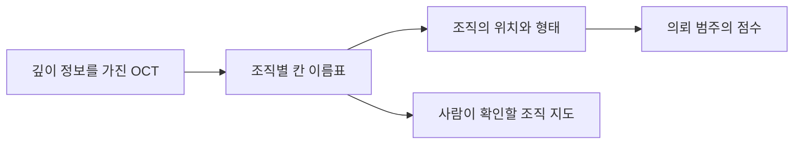

# 망막의 단층 영상을 조직 지도와 의뢰 판단으로 연결하기 / Retinal OCT segmentation and referral decisions

## 논문과 읽은 판본

Jeffrey De Fauw, Joseph R. Ledsam, Bernardino Romera-Paredes 외, 「Clinically applicable deep learning for diagnosis and referral in retinal disease」, Nature Medicine 24, 1342–1350, 2018입니다. 주요 연구팀은 DeepMind, Moorfields Eye Hospital·UCL 안과연구소와 UCL입니다. [출판 DOI](https://doi.org/10.1038/s41591-018-0107-6), [UCL 공개 저자본 안내](https://discovery.ucl.ac.uk/id/eprint/10056194/), [저자본 PDF](https://discovery.ucl.ac.uk/id/eprint/10056194/1/Diagnosis%20and%20referral%20in%20retinal%20disease%20-%20updated.pdf)를 확인했습니다.

2026년 10월 21일 기준 저자본 41쪽 중 본문·참고문헌·Online Methods·약어의 1–19쪽을 읽고, 보충표 1·3을 추가 대조했습니다. 그림 1과 표 1은 이미지로도 확인했습니다. 나머지 보충자료 전체와 동영상은 읽거나 시청하지 않았습니다. 아래 쪽수는 저자본 PDF 기준이며, 출판본 쪽수와 다릅니다. 확인한 서지에서 별도 정정 공지를 찾지 못했습니다. 제목의 ‘임상 적용 가능’과 실제 전향적 도입 효과의 입증을 구분해 읽겠습니다.

## OCT는 안저 사진과 어떤 점이 다릅니까?

망막은 눈 뒤에서 빛을 받아 신호로 바꾸는 조직입니다. 안저 사진이 안쪽 표면을 바라본 사진에 가깝다면, OCT는 조직의 깊이 방향 정보를 쌓아 단면과 입체 구조를 보여 줍니다. OCT는 optical coherence tomography의 약자이며 광간섭단층촬영이라고 부릅니다. 반사된 빛의 정보를 이용하므로, 단순히 사진의 색만 분류하는 문제와 입력 구조가 다릅니다.

이 글에서는 단층 영상 속 빈 공간과 조직의 경계가 어떻게 해석으로 이어지는지 살펴봅니다. 밝게 보이는 부분의 모양을 외우는 것만으로는 충분하지 않습니다. 장비가 달라져 밝기와 잡음이 바뀐 것인지, 실제 조직의 모양이 달라진 것인지 먼저 구분해야 합니다. 같은 내용을 다른 글꼴로 인쇄해도 문장의 뜻은 같을 수 있지만, 글꼴에만 익숙한 인식기는 뜻까지 다르게 읽는 상황과 비슷합니다.

## 첫 단계는 조직을 나누고, 둘째 단계는 그 지도를 읽습니다

원문의 Results와 그림 1은 원 OCT를 15종류의 조직·병리·인공물 지도로 나눈 뒤, 별도 분류기가 의뢰 범주를 정하는 구조를 설명합니다. 분할 학습에는 877개 스캔, 분류 학습에는 7,621명에서 얻은 14,884개 스캔이 쓰였습니다. 의뢰 평가용 997명은 학습 대상과 분리했습니다. [저자본 2–4쪽](https://discovery.ucl.ac.uk/id/eprint/10056194/1/Diagnosis%20and%20referral%20in%20retinal%20disease%20-%20updated.pdf)

분할은 영상의 각 작은 칸에 이름표를 붙이는 작업입니다. ‘이 칸은 조직 A, 옆 칸은 액체 공간’처럼 표시합니다. 분류는 그 이름표들의 배치와 부피를 보고 검사 전체의 범주를 정하는 작업입니다. 칸마다 이름을 고르는 것과 환자의 의뢰 범주를 고르는 것은 출력의 단위부터 다릅니다.

다음은 원문 그림의 복사가 아니라 원리를 나타낸 자체 흐름입니다.

이 중간 지도에는 장점과 비용이 함께 있습니다. 장비별 밝기 차이를 조직 이름으로 바꾸면 뒤의 판단기가 장비 자체를 덜 배워도 됩니다. 또 사람이 지도를 보고 ‘액체로 칠한 곳이 실제로는 그림자 아닙니까?’라고 점검할 수 있습니다. 반면 잘못된 이름표가 붙으면 다음 판단기가 그 오류를 이어받을 수 있습니다. 중간 결과가 보인다는 사실만으로 결과가 옳아지는 것은 아닙니다.

정보를 버리는 문제도 있습니다. 직접 만든 예로 서로 다른 두 영상이 같은 조직 배치로 변환된다면, 다음 분류기는 둘을 구별할 수 없습니다. 원래 밝기 무늬에만 들어 있던 유용한 차이가 지도에 남지 않았을 수 있습니다. 따라서 해석 가능한 중간 표현을 쓰는 설계는 ‘사람이 볼 수 있는 정보’와 ‘과제에 필요한 정보’를 함께 따져야 합니다.

## 장비 적응의 실험이 보여 준 것

원문 표 1에서 첫 장비의 의뢰 오류는 55/997, 다른 업체 장비에서는 분할기를 추가 학습한 뒤 4/116입니다. 두 번째 장비의 추가 분할 학습 스캔은 152개였고 뒤의 분류기는 바꾸지 않았습니다. 이 자료도 같은 병원 체계에서 수집했습니다. 장비가 달랐다는 사실과 독립 병원 외부 검증은 구분해야 합니다. 전체 연구는 후향적 자료 평가이며 자율 의뢰 도입의 무작위 임상시험은 아닙니다. [저자본 6–8·13–16쪽](https://discovery.ucl.ac.uk/id/eprint/10056194/1/Diagnosis%20and%20referral%20in%20retinal%20disease%20-%20updated.pdf)

이를 소프트웨어의 입력 변환기와 판단기로 나누어 생각할 수 있습니다. 센서 A의 단위를 공통 단위로 맞춘 뒤 계산하던 프로그램에 센서 B가 들어오면, 먼저 변환기를 다시 맞춥니다. 그렇다고 B의 출력이 무조건 정확해지는 것은 아닙니다. 새로운 센서의 범위·해상도·잡음이 공통 표현에서 제대로 보존되는지 시험해야 합니다.

추가로 라벨을 붙이는 양이 적었다는 결과도 ‘새 장비의 자료가 전혀 필요 없다’와 다릅니다. 지도 제작을 다시 배우는 데 필요한 자료와, 의뢰 정답을 다시 배우는 데 필요한 자료는 종류가 다릅니다. 무엇의 재학습 비용을 줄였는지를 쓰면 두 단계 설계의 의미가 분명해집니다.

## 정답, 전문가의 의견, 환자의 이후 상태

이 연구의 의뢰 정답은 이후의 진료 기록까지 검토해 정한 범주입니다. 비교 전문가에게 OCT만 보인 경우와 임상 정보를 함께 보인 경우도 나눕니다. 추가 병리의 일부 정답은 전문가 다수 의견을 사용하므로 의뢰 정답과 동일하지 않습니다. [저자본 4·6·14–15쪽](https://discovery.ucl.ac.uk/id/eprint/10056194/1/Diagnosis%20and%20referral%20in%20retinal%20disease%20-%20updated.pdf)

평가에서 정보를 누가 언제 사용할 수 있었는지가 중요합니다. 나중의 진료 기록으로 정답을 확인하는 일과, 모델 입력에 그 기록을 먼저 넣는 일은 다릅니다. 전자는 결과 확인에 도움이 되지만 후자는 미래 정보를 미리 본 평가가 될 수 있습니다. 검사 시점에 사용할 수 있는 입력만 모델에 제공했는지 확인해야 합니다.

또 ‘정답과 같은 의뢰 범주’는 시력 보존이나 대기 시간 감소를 직접 뜻하지 않습니다. 실제 경로에서는 의뢰를 받은 병원의 수용 능력, 진료 지연, 재검사, 치료 반응이 이어집니다. 같은 의뢰 점수가 여러 현장에서 다른 환자 결과로 연결될 수 있으므로, 그림의 분류 성능과 운영 이후의 효과를 별도로 측정해야 합니다.

## 자체 계산: 민감도가 같아도 양성 예측도는 달라집니다

민감도는 실제 양성 중 양성으로 잡은 비율이며, 특이도는 실제 음성 중 음성으로 분류한 비율입니다. 양성 예측도는 양성으로 표시한 사람 중 실제 양성인 비율입니다. ‘무엇 중 몇 명인가’를 서로 바꾸면 같은 시스템이 전혀 다른 성능으로 보입니다.

원문의 성능을 재현한 수치가 아닌 가상 이진 분류기로 계산하겠습니다. 1,000명 중 긴급 평가가 필요한 사람이 100명이며 민감도 95%, 특이도 90%라고 가정합니다.

| 분류 결과 | 인원 | 계산 |
|---|---:|---|
| 실제 양성을 잡음 | 95 | 100×0.95 |
| 실제 양성을 놓침 | 5 | 100−95 |
| 음성을 잘못 양성으로 표시 | 90 | 900×0.10 |
| 음성을 음성으로 분류 | 810 | 900×0.90 |

이때 양성 예측도는 95/(95+90)≈51.4%입니다. 민감도 95%가 ‘양성 표시의 95%는 맞다’가 아닌 이유가 여기 있습니다. 이제 동일한 민감도·특이도를 가정하되, 양성 비중이 1%인 10,000명을 검사하면 실제 양성 100명 중 95명은 잡지만 음성 9,900명 중 990명이 양성으로 표시됩니다. 양성 예측도는 95/1,085≈8.8%입니다.

두 예는 정확히 같은 분류 성능을 서로 다른 모집단에 적용했습니다. 이 계산은 해당 연구의 실제 인구집단 유병률이나 임상 운영을 추정하지 않습니다. 병원 의뢰 환자에서 얻은 점수를 일반 인구 선별검사에 그대로 옮기기 어려운 통계적 이유를 보여 줍니다. 선별 이후에 실제 확인 검사로 이어지는 흐름까지 있어야 양성 표시의 의미를 평가할 수 있습니다.

## AUC는 점수의 순서를 평가합니다

판정 문턱을 낮추면 더 많은 양성을 찾는 대신 음성도 더 자주 양성으로 표시할 수 있습니다. 여러 문턱에서 민감도와 거짓양성 비율을 그린 것이 ROC 곡선이며, AUC는 그 아래 면적입니다. 특정 문턱 하나의 정확도와 다릅니다.

자체 점수 예로 실제 양성 두 명이 0.9·0.6, 실제 음성 두 명이 0.7·0.2를 받았다고 하겠습니다. 양성과 음성을 한 명씩 고르는 네 쌍 중 양성 점수가 더 높은 쌍은 셋입니다. 동점이 없는 이 예의 AUC는 3/4=0.75입니다. 하지만 문턱을 0.8로 정하면 양성 둘 중 하나만 잡습니다. AUC 0.75가 그 문턱에서 민감도 75%라는 뜻이 아닌 이유입니다. 실제 의뢰 경로에서는 순위 성능과 함께 어떤 문턱을 사용해 누가 누락되거나 추가 호출되는지도 확인해야 합니다.

## 같은 오류 개수도 같은 피해를 뜻하지 않습니다

직접 만든 가상 비교에서 시스템 A는 긴급 대상을 1명 놓치고 불필요한 의뢰 20건을 만들며, B는 긴급 대상 4명을 놓치고 불필요한 의뢰 5건을 만든다고 하겠습니다. 오류 수만 세면 A는 21건, B는 9건이어서 B가 좋아 보입니다. 하지만 누락 하나의 비용을 20점, 불필요 의뢰 하나를 1점으로 놓는 자체 기준에서는 A=40점, B=85점입니다.

20점이라는 숫자는 실제 의료 손실의 측정값이 아닙니다. 가치 판단을 숨긴 채 오류를 모두 같은 무게로 더하지 말아야 한다는 예입니다. 누락 비용을 2점으로 바꾸면 A=22점, B=13점이 되어 순서가 바뀝니다. 어떤 대상을 얼마나 급하게 연결할 것인지에는 성능뿐 아니라 자원과 환자에게 미치는 결과에 대한 기준도 필요합니다.

여러 모델을 평균하는 앙상블도 이 판단을 대신하지 않습니다. 서로 다른 모델이 모두 같은 특이 사례를 못 배웠다면 같은 방향으로 틀릴 수 있습니다. 의견이 모였다는 사실과 새로운 장비·집단에서도 확률이 정확하다는 사실은 다릅니다. 임상 정보가 더해졌을 때 판단이 바뀌는 사례와 모델 간 불일치를 따로 보는 일이 유용합니다.

## 스스로 확인해 보세요

1. 분할기를 새 장비 자료로 학습했지만 분류기를 바꾸지 않았다면, 새 장비의 검증을 생략해도 됩니까?
2. 민감도 95%인 시스템이 양성으로 표시한 사람 중 실제 양성도 항상 95%입니까?
3. 오류가 9건인 시스템은 오류가 21건인 시스템보다 환자에게 항상 유리합니까?

정답과 해설

1. 아닙니다. 입력 장비의 변화가 공통 조직 지도에서 잘 처리되는지 실제로 평가해야 합니다. 같은 병원 체계의 다른 장비 시험도 다른 기관·국가의 외부 평가와는 구분합니다.
2. 아닙니다. 민감도의 분모는 실제 양성이고, 양성 예측도의 분모는 양성 표시입니다. 위 가상 모집단에서는 양성 비중이 바뀌자 양성 예측도가 약 51.4%에서 8.8%로 달라졌습니다.
3. 아닙니다. 어떤 오류가 발생했는지와 결과의 무게가 필요합니다. 자체 비용 예에서는 누락의 가중치에 따라 A와 B의 순서가 바뀌었습니다.

[분야 목차](README.md)
