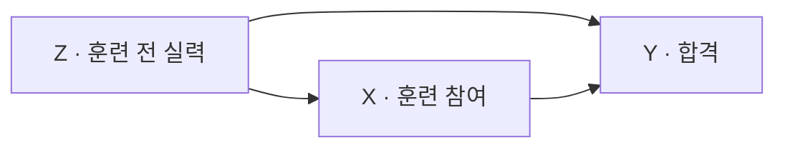
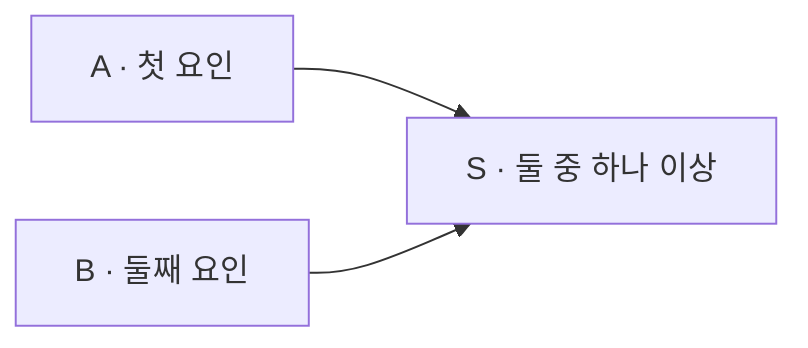

# 관측과 개입을 구별하는 인과 그림 | Causal diagrams for empirical research

## 논문과 읽은 범위

| 항목 | 내용 |
|---|---|
| 저자·소속 | Judea Pearl, University of California, Los Angeles의 Computer Science Department입니다. |
| 원제 | Causal diagrams for empirical research |
| 발표 | Biometrika 82(4), 669–688쪽, 1995년입니다. |
| 원문 | [출판사·DOI](https://doi.org/10.1093/biomet/82.4.669) · [저자 공개 PDF](https://ftp.cs.ucla.edu/pub/stat_ser/R218-B.pdf)입니다. |
| 확인 범위 | 본문·부록·참고문헌 669–688쪽과 토론 688–689·694–695쪽, 저자 답변 중 705–706쪽을 읽었습니다. |
| 판본 구별 | 공개 PDF는 토론과 답변까지 묶은 42쪽입니다. 본 논문은 그중 첫 20쪽이며, 1994년 사전 보고서와 별개의 연구로 중복 집계하지 않습니다. |

관측 자료에서 개입의 효과를 계산할 수 있는 조건을 다루는 이론 논문입니다. 새로운 임상시험이나 취업 효과를 측정한 논문은 아닙니다. 아래 인원·확률과 훈련 사례는 계산을 위해 직접 구성했습니다. 원문은 개입에 체크 표시를 쓰며, 이 글에서는 오늘날 자주 쓰는 `do(X=x)`로 표기합니다.

## 질문을 바꾸면 필요한 계산도 달라집니다

‘훈련받은 사람의 합격률은 얼마입니까?’는 이미 훈련받은 집단을 관찰하는 질문입니다. ‘같은 대상 집단에 훈련을 제공하면 합격률이 어떻게 바뀝니까?’는 개입의 질문입니다. 훈련 선택에 영향을 준 사전 실력까지 같아지는 것은 아닙니다.

| 기호 | 뜻 | 이 글의 사례 |
|---|---|---|
| 조건부 확률 `P(Y=1│X=1)` | X가 1인 사람 중 Y가 1인 비율입니다. | 훈련받은 사람의 합격률입니다. |
| 개입 확률 `P(Y=1│do(X=1))` | 대상 집단의 훈련 배정 방식을 바꿨을 때의 결과입니다. | 모두에게 같은 훈련을 제공하는 가상 개입입니다. |
| 교란 | 원인 후보와 결과에 함께 영향을 주는 다른 요인 때문에 관계가 섞이는 현상입니다. | 사전 실력이 훈련 선택과 합격에 모두 영향을 줍니다. |
| 식별 | 가정이 주어졌을 때 관측 분포만으로 목표 효과가 하나로 정해지는 성질입니다. | 표본을 무한히 늘려도 남는 원리상의 모호성이 없는지 묻습니다. |

‘개입’은 숫자 하나를 바꾸는 선언에 그치지 않습니다. 훈련의 내용·기간을 명시하고, 배정만 바꿨을 때 나머지 결과 생성 과정이 유지된다고 가정해야 합니다. 온라인 강의와 실습 수업을 한 변수에 섞으면 `X=1`이 무엇인지부터 모호해집니다. 원문 §2.2는 구조 방정식에서 X를 정하던 식만 바꾸는 방식으로 이 차이를 표현합니다.

## 화살표는 어떤 가정을 나타냅니까

아래는 훈련 전 실력 Z를 측정했다는 자체 모형입니다. 방향성 비순환 그래프, 줄여 DAG는 화살표를 따라 출발점으로 돌아오는 순환이 없는 그림입니다. 화살표는 다른 직접 원인들을 고정해도 해당 요인이 영향을 줄 수 있다는 인과 가정입니다. 상관계수가 크다는 뜻만은 아닙니다.



X를 외부에서 배정하면 Z가 X를 선택하게 하는 화살표는 끊고, Z가 Y에 영향을 주는 경로는 남깁니다. 합격에 영향을 주는 다른 훈련 전 요인이 X에도 영향을 준다면 그 요인도 모형에 표현해야 합니다. 중요한 화살표를 빠뜨린 그림으로 계산하면 정확한 산술로도 잘못된 효과를 얻을 수 있습니다.

## 집단별로 높아졌는데 전체 비율은 낮아지는 예

200명의 자체 자료에서 훈련 전 실력은 낮음·높음이 각각 100명입니다. 어려움을 느낀 사람이 훈련에 더 많이 참여했다고 가정합니다.

| 사전 실력 Z | 훈련 X=1: 합격/인원 | 비참여 X=0: 합격/인원 |
|---|---:|---:|
| 낮음 | 48/80 = 60% | 8/20 = 40% |
| 높음 | 18/20 = 90% | 64/80 = 80% |
| 단순 전체 | 66/100 = 66% | 72/100 = 72% |

단순 비교는 `66%−72%=−6%p`입니다. 그러나 낮은 실력의 비중이 참여 집단에서는 80%, 비참여 집단에서는 20%입니다. 서로 다른 구성의 집단을 그대로 비교한 결과입니다.

위 그래프가 맞고, 실력별 참여 여부와 남은 결과 요인 사이에 추가 교란이 없다고 가정하겠습니다. 두 집단 모두 훈련 참여·비참여 사례가 있어 비교가 가능하다는 조건도 필요합니다. 이때 원문 §3.1의 뒷문 기준은 `X←Z→Y` 경로를 Z로 막게 하며, 같은 대상 인구의 실력 비율로 다시 평균을 냅니다.

```math
P(Y=1\mid do(X=x))=\sum_z P(Y=1\mid X=x,Z=z)P(Z=z)
```

여기서 합 기호 Σ는 실력별 결과를 대상 인구 비율로 곱해 더한다는 뜻입니다. 참여 집단 자신의 비율 `P(Z│X=1)`을 다시 쓰면 구성을 맞추지 못합니다.

- 모두 참여하는 계산: `0.5×0.60+0.5×0.90=0.75`입니다.
- 모두 비참여하는 계산: `0.5×0.40+0.5×0.80=0.60`입니다.
- 같은 인구에서의 평균 효과: `0.75−0.60=0.15`, 즉 15%p입니다.

이는 가정 아래 식별된 자체 예제입니다. 모든 개인에게 합격 가능성이 정확히 15%p씩 증가한다는 뜻도, 실제 훈련 프로그램의 효과가 15%p라는 뜻도 아닙니다. 집단 평균의 차이와 개인별 잠재 결과는 구별합니다.

## 변수를 많이 맞춘다고 항상 좋아지지는 않습니다

위 예의 Z는 공통 원인입니다. 반대로 두 요인의 공통 결과를 고르면 관련이 없던 두 요인이 관련되어 보일 수 있습니다. 이를 충돌점, collider라고 부릅니다. 그림의 화살표 두 개가 한 점으로 들어오기 때문에 붙은 이름입니다.

직접 만든 독립적인 이진 변수 A·B가 각각 1일 확률이 1/2이고, 둘 중 하나라도 1이면 S=1이라고 하겠습니다. 네 조합 `(0,0)·(0,1)·(1,0)·(1,1)`은 각각 확률 1/4입니다.



전체에서는 A 값과 무관하게 B=1의 비율은 1/2입니다. 그러나 S=1인 자료만 남기면 A=0일 때 가능한 것은 `(0,1)`뿐이므로 B=1의 비율은 1입니다. A=1일 때는 `(1,0)·(1,1)`이 남아 그 비율이 1/2입니다. A가 B를 바꾸지 않았는데도 표본을 고르는 조건이 관련을 만들었습니다.

경로의 모양과 조건을 함께 읽는 규칙을 d-분리라고 부릅니다. 원문 §2.1의 규칙은 공통 원인·중간 경로와 충돌점을 구별하며, 충돌점의 후손을 조건으로 삼는 경우도 다룹니다. ‘가능한 모든 변수를 회귀식에 넣습니다’라는 요령만으로는 이 차이를 처리할 수 없습니다.

## 관측되지 않은 공통 원인과 식별 조건

원문 §3.2의 앞문 기준은 관측 가능한 중간 변수 M을 거쳐 효과를 구하는 다른 길입니다. 다음 조건들이 함께 필요합니다.

1. X에서 Y로 가는 모든 방향 경로가 M을 거쳐야 합니다.
2. X와 M 사이의 뒷문 경로가 없어야 합니다.
3. M과 Y 사이의 뒷문 경로가 X를 조건으로 삼으면 모두 막혀야 합니다.

조건이 맞으면 X가 M에 미치는 변화를 구하고, M과 Y의 관계에서는 X에 따른 교란을 따로 조정해 결합할 수 있습니다. ‘중간 변수를 측정했습니다’만으로 성립하는 방법은 아닙니다. 전체 효과를 구하면서 중간 변수를 일반적인 공통 원인처럼 고정해 버리면, 알아보려던 전달 경로까지 막을 수 있습니다. 원문 §5.2는 중간 변수 활용이 단순한 한 번의 조정과 다른 경우를 보여 줍니다.

## 개입식을 관측식으로 바꾸는 세 규칙

원문 §4, 정리 3은 개입을 포함한 식을 변형하는 세 규칙을 제시합니다. 오늘날 do-calculus라고 부르는 계산의 핵심입니다.

| 규칙 | 가능한 변형 | 먼저 확인할 부분 |
|---|---|---|
| 관측의 삽입·삭제 | 결과와 조건부 독립인 추가 관측 조건을 넣거나 뺍니다. | 이미 개입한 변수의 들어오는 화살표를 제거한 그림에서 독립성을 확인합니다. |
| 개입과 관측의 교환 | 특정 변수의 개입을 관측 조건으로, 또는 그 반대로 바꿉니다. | 원문이 정한 추가 화살표 제거와 d-분리 조건을 확인합니다. 단순 상관의 유무로 교환하지 않습니다. |
| 개입의 삽입·삭제 | 결과에 해당 방식으로 영향을 주지 않는 개입을 넣거나 뺍니다. | 관측 조건의 조상 관계까지 반영한 그림을 사용합니다. |

핵심은 식의 모양만 보고 `do`를 지우지 않는다는 점입니다. 다른 규칙은 서로 다른 변형 그림에서 조건을 확인합니다. 앞문 식도 이런 변형으로 관측량만 남기는 과정을 설명합니다. 이 표는 정확한 기호 조건 전체를 대체하는 절차서가 아니며, 실제 적용은 [원문의 정리 3·부록 증명](https://ftp.cs.ucla.edu/pub/stat_ser/R218-B.pdf)과 함께 읽어야 합니다. 1995년 본문은 이 규칙으로 모든 식별 가능한 경우를 찾는지의 완전성 문제를 열린 질문으로 남깁니다. 그 당시의 정리와 이후 연구의 성과를 합쳐 쓰지 않습니다.

## 무작위시험·잠재 결과 관점과 비교합니다

| 접근 | 분석 대상 | 여전히 필요한 것 |
|---|---|---|
| 무작위 배정 | 배정과 훈련 전 요인의 연결을 설계로 끊습니다. | 탈락·불이행·다른 사람에게 미치는 영향과 실제 받은 처치를 구별해야 합니다. |
| 인과 그래프 | 빠진 화살표와 교란 경로, 필요한 조정 집합을 드러냅니다. | 그림의 인과 가정은 해당 분야 지식과 연구 설계로 정당화해야 합니다. |
| 잠재 결과 | 같은 사람이 서로 다른 처치를 받았을 때의 결과를 기호로 구별합니다. | 동시에 관측할 수 없는 결과를 연결하는 배정·교환 가능성 등의 가정이 필요합니다. |

서로 무관한 세 선택지라기보다 연구 설계와 가정을 서로 다른 방식으로 표현하는 도구입니다. 같은 호의 Imbens·Rubin 토론은 불이행·단조성·집단 구조 등 화살표만으로 표현하기 어려운 조건을 지적합니다. Cox·Wermuth는 현실에서 어떤 방식으로 변수를 고정하는지 묻습니다. 저자 답변 705–706쪽도 실제 개입이 다른 메커니즘까지 바꾸면 그 변화까지 모형에 넣어야 한다고 구별합니다. 이 논쟁은 그림의 계산 능력과 가정의 현실성을 따로 평가하게 합니다.

식별과 추정도 구별합니다. 위의 식이 성립해도 실력이 높은 비참여자가 한 명뿐이면 비율의 오차가 큽니다. 어떤 실력 집단에 참여자가 전혀 없으면 그 집단의 참여 결과를 자료만으로 계산할 수도 없습니다. 원문 §6도 표본 변동을 고려한 구간 추정이 별도로 필요함을 밝힙니다. 이 글의 표는 그 문제를 없앤 실제 자료가 아니라 계산 구조를 보이는 자체 자료입니다.

## 자가 점검

1. 자체 표의 참여자 합격률이 6%p 낮다는 사실만으로 훈련이 해롭다고 결론 낼 수 있습니까?
2. 독립적인 A·B에서 S=1인 사례만 남기면 왜 A·B가 관련되어 보입니까?
3. 인과 그림에서 효과가 식별되면 표본이 작아도 정확한 수치를 얻습니까?

<details>
<summary>해설 보기</summary>

1. 그렇지 않습니다. 참여 집단의 사전 실력 구성이 다릅니다. 제시한 가정 아래 같은 인구 비중으로 계산하면 평균 효과는 15%p입니다.
2. `(0,0)`이 빠져 A=0일 때 B는 반드시 1이 됩니다. 공통 결과로 표본을 고른 것이며 A에서 B로 영향이 생긴 것은 아닙니다.
3. 아닙니다. 식별은 관측 분포와 목표 효과의 관계이고, 유한한 표본의 오차·겹침 부족·측정 오류는 추정에서 따로 다룹니다.

</details>

[인과추론 논문 안내](README.md) · [논문 전체 목록](../README.md)
