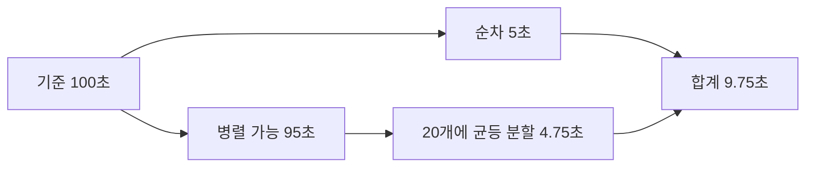

# Amdahl: 병렬화의 한계 / Limits to parallel speedup

| 항목 | 내용 |
|---|---|
| 논문 | Validity of the Single Processor Approach to Achieving Large Scale Computing Capabilities |
| 저자·발표 | Gene M. Amdahl, AFIPS Spring Joint Computer Conference 30, 483–485쪽, 1967년 |
| 원문 | [CMU에서 제공하는 원문 PDF](https://www.cs.cmu.edu/~18742/papers/Amdahl1967.pdf) · [DOI](https://doi.org/10.1145/1465482.1465560) |
| 확인 위치 | 483쪽 순차 오버헤드·실제 문제의 불규칙성, 484쪽 조직 A/B/C와 비교 가정, 485쪽 그림·마무리 |
| PDF 주의 | 대상 본문은 처음 3쪽입니다. 마지막 쪽에는 다음 글의 시작이 포함됩니다. |

## 병렬 장치의 수보다 전체 작업을 보기

Amdahl은 여러 프로세서를 연결하면 단일 프로세서의 한계를 쉽게 넘는다는 주장에 대해, 순차적인 관리 작업과 실제 문제의 불규칙성을 검토했습니다. 원문의 과거 명령수 비율과 조직별 비교는 당시의 통계·가정에 근거합니다. 그 비율을 오늘날 프로그램의 실행시간 비율로 그대로 넣어서는 안 됩니다. [원문 483–485쪽](https://www.cs.cmu.edu/~18742/papers/Amdahl1967.pdf)

아래의 익숙한 식은 논문에 실린 현대 다중 코어 측정표가 아닙니다. 논지를 이해하려고 고정된 작업량을 시간으로 나누어 만든 이상화 모델입니다.

## 직접 세운 모델의 조건

한 프로세서에서의 시간을 1로 정규화하겠습니다. 순차 시간 비율이 s이고, 나머지 `1−s`는 N개 처리 장치에 완벽히 나누어진다고 가정합니다. 장치 각각의 속도는 기준과 같고, 통신·대기·분할 비용은 없다고 두겠습니다.

```math
T_N=s+\frac{1-s}{N},\qquad
S_N=\frac{T_1}{T_N}=\frac{1}{s+(1-s)/N}.
```

`speedup`은 같은 작업의 기준 시간/새 시간이라는 비율입니다. `parallel fraction`은 이 모델에서 병렬화할 수 있는 시간 비율이지, 소스코드 줄 수나 반복문 개수의 비율이 아닙니다. `efficiency=S_N/N`은 장치 수에 비해 어느 정도의 속도 향상을 얻었는지 보여 줍니다.

## 직접 계산: 100초 작업과 20개 장치

100초 중 5초는 순차, 95초는 병렬화할 수 있다고 가정하겠습니다. 따라서 `s=0.05`입니다.

| 장치 수 N | 모델의 실행 시간 | 속도 향상 |
|---:|---:|---:|
| 1 | 100초 | 1배 |
| 2 | 52.5초 | 약 1.9048배 |
| 4 | 28.75초 | 약 3.4783배 |
| 20 | 9.75초 | 약 10.2564배 |
| 무한대로 증가 | 5초에 접근 | 20배에 접근 |

20개일 때 병렬 부분은 `95/20=4.75초`입니다. 여기에 순차 5초가 남으므로 전체는 9.75초입니다. 프로세서 20개를 사용했다는 사실만으로 20배가 되지 않습니다. 효율도 `10.2564/20≈0.5128`입니다. 이 값은 측정 결과가 아니라 가정으로부터 계산한 값입니다.



## 식에 빠져 있는 비용을 넣기

20개 장치 사이의 통신과 대기에 합계 2초가 추가된다고 하겠습니다. 새 시간은 11.75초이며 속도 향상은 `100/11.75≈8.5106배`입니다. 장치 수를 늘렸을 때 통신량도 늘어난다면 비용 항을 N의 함수로 써야 합니다.

```math
T_N=s+(1-s)/N+h(N).
```

이 식도 기준 시간을 1로 둔 식입니다. 따라서 앞의 추가 2초는 `h(20)=2/100=0.02`로 넣습니다. 초 단위로 계산하려면 식 전체에 기준 시간 100초를 곱해야 합니다.

예를 들어 여러 작업 중 가장 느린 작업이 끝나야 다음 단계로 넘어간다면 평균 작업 시간으로 병렬 구간을 계산할 수 없습니다. 4개 장치의 작업이 1·1·1·5초라면 그 단계는 2초의 평균이 아니라 적어도 5초가 걸립니다. 불균형은 순차 코드와 다른 원인이지만, 전체 시간에 남는 대기라는 점에서 모델의 단순 가정을 깨뜨립니다.

## 한계가 고정되는 조건과 후속 논의

`N→∞`일 때 `1/s`라는 상한은 s와 전체 작업을 고정한 모델에서 나옵니다. 입력을 더 크게 바꾸어 병렬 계산량을 늘렸다면 분모의 가정도 달라집니다. 서로 다른 입력을 처리한 결과를 같은 작업의 속도 향상이라고 부르면 비교가 어긋납니다.

후속 논의인 Gustafson의 [Reevaluating Amdahl's Law, 1988](https://fenix.tecnico.ulisboa.pt/downloadFile/1126518382300502/03%20-%20ReevaluatingAmdahlsLaw.pdf)은 문제 크기와 시간 기준을 달리 보는 관점을 제시합니다. 고정 작업량과 확장된 작업량이라는 비교 기준의 차이를 먼저 읽으시면, 어느 법칙이 다른 법칙을 무조건 폐기했다는 식의 해석을 피할 수 있습니다.

실제 프로그램에서는 구간별 실행시간을 먼저 측정하고, 입력·장치 수·동기화 방식을 함께 적어야 합니다. 명령수가 적어도 메모리 대기로 시간이 길 수 있으므로 ‘순차 명령 5%’와 ‘순차 실행시간 5%’를 같은 데이터로 취급하면 안 됩니다.

## 자기점검

1. s=0.20이고 N=4라면 속도 향상은 얼마인가요?
2. N=20에서 9.75초가 실제로 측정되었다고 이 표를 인용해도 되나요?
3. 입력을 열 배 늘린 실험에서 s가 작아졌다면 원래 상한과 모순인가요?

<details>
<summary>해설 보기</summary>

1. `1/(0.20+0.80/4)=2.5배`입니다. 무한 장치 상한은 5배입니다.
2. 안 됩니다. 여기서는 실행한 적이 없는 가정 계산입니다. 실제 측정이라고 쓰려면 환경과 원자료가 필요합니다.
3. 아닙니다. 고정했던 작업과 시간 비율이 바뀌었습니다. 새 조건에서 다시 모델을 세우고 비교 기준을 명시해야 합니다.

</details>

[정보와 전자공학 목록으로](README.md)
