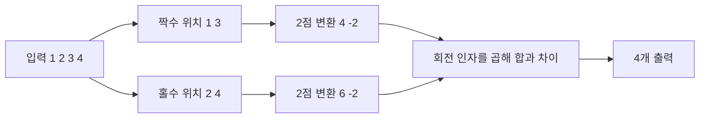

# Cooley·Tukey: FFT의 계산 분해 / Factoring the Fourier transform

| 항목 | 내용 |
|---|---|
| 논문 | An Algorithm for the Machine Calculation of Complex Fourier Series |
| 저자·발표 | James W. Cooley·John W. Tukey, Mathematics of Computation 19(90), 297–301쪽, 1965년 4월 |
| 원문 | [Stanford에서 제공하는 원문 PDF](https://web.stanford.edu/class/cme324/classics/cooley-tukey.pdf) · [AMS 원문 주소](https://www.ams.org/mcom/1965-19-090/S0025-5718-1965-0178586-1/S0025-5718-1965-0178586-1.pdf) |
| 확인 위치 | 297–299쪽 식 (1)–(14)의 인수 분해·계산량, 300–301쪽 당시 계산 시간표 |

## 변환을 바꾸지 않고 계산을 나누기

논문은 복소 푸리에 합을 입력 길이 N의 인수에 따라 작은 합들로 분해합니다. 여기서 원문의 기본 연산은 복소 곱셈 뒤 복소 덧셈을 하는 단위입니다. 원문 식 (1)은 지수의 부호가 양수이며, N을 일반적인 인수의 곱으로 다루므로 방법 전체가 2의 거듭제곱에만 한정되는 것은 아닙니다. [원문 297–299쪽](https://web.stanford.edu/class/cme324/classics/cooley-tukey.pdf)

다음은 익숙한 순방향 DFT의 음수 지수 관례로 직접 계산한 예입니다. 부호 관례가 달라도 분해 원리는 같습니다. 원문 식을 그대로 옮긴 계산은 아닙니다.

```math
X_k=\sum_{n=0}^{N-1}x_n e^{-2\pi i kn/N}.
```

`i²=-1`인 i는 허수 단위입니다. 복소 지수는 크기가 1인 회전을 나타내며, k에 따라 입력을 서로 다른 회전과 곱해 더합니다. DFT는 수학적 변환이고 FFT는 그것을 빠르게 계산하는 알고리즘 계열입니다. FFT를 사용한다고 다른 스펙트럼을 정의하는 것은 아닙니다.

## 직접 계산: 길이 4의 입력

입력을 `x=[1,2,3,4]`로 두고 짝수 위치 `[1,3]`과 홀수 위치 `[2,4]`로 나누겠습니다. 길이 2의 변환은 합과 차이만 계산하면 됩니다.

| 부분 입력 | 0번 결과 | 1번 결과 |
|---|---:|---:|
| 짝수 위치 E | 1+3=4 | 1−3=−2 |
| 홀수 위치 O | 2+4=6 | 2−4=−2 |

`W₄=e^(−2πi/4)=−i`를 사용하면 결합은 다음과 같습니다.

```math
X_k=E_k+W_4^kO_k,\qquad
X_{k+2}=E_k-W_4^kO_k\quad(k=0,1).
```

| 출력 | 직접 결합 |
|---|---|
| X₀ | 4+6=10 |
| X₁ | −2+(−i)(−2)=−2+2i |
| X₂ | 4−6=−2 |
| X₃ | −2−(−i)(−2)=−2−2i |

`X₀`은 회전을 하지 않은 합이므로 10입니다. `X₁`과 `X₃`은 켤레 관계입니다. 입력이 실수인 경우 나타나는 이 대칭은 계산 결과를 점검하는 데 유용하지만, 임의의 복소 입력에서도 같은 대칭이 있다고 가정하면 안 됩니다.



분해의 이득은 같은 부분 합을 여러 출력에서 재사용한다는 데 있습니다. k별로 처음부터 더하면 반복되는 계산을 따로 수행합니다. 재귀적으로 나누고 결합하면 한 단계에서 처리하는 양은 N에 비례하고, N이 2의 거듭제곱일 때 단계 수는 `log₂N`이 됩니다.

## 계산 횟수와 실행 시간을 구분하기

교육용 radix-2 분해에서 N=8이면 3단계, 단계당 4개의 버터플라이가 있어 총 12개입니다. 버터플라이는 두 입력을 회전 인자와 결합해 두 출력을 만드는 작은 계산 묶음입니다. 직접식의 64개 곱셈·누산 항과 12개 버터플라이는 단위가 다르므로 ‘정확히 64/12배 빠르다’고 나누면 안 됩니다. 실제 시간에는 메모리 접근, 데이터 순서, 특수한 회전 인자의 처리, 병렬화 등이 영향을 줍니다.

입력 길이를 편하게 만들려고 0을 붙일 때도 목적을 확인해야 합니다. 예를 들어 `[1,1]`과 `[1,2]`의 선형 합성곱은 `[1,3,2]`입니다. 길이 2의 순환 합성곱을 계산하면 마지막 2가 앞에 더해져 `[3,3]`이 됩니다. 선형 합성곱을 DFT로 구하려면 적어도 `2+2−1=3` 길이를 확보해야 합니다. 길이 4로 채우는 것은 그 조건을 만족하는 선택입니다.

후속 구현에서는 이 수학적 분해와 실제 하드웨어의 메모리 구조를 함께 다룹니다. [FFTW의 알고리즘 설명](https://www.fftw.org/fftw-paper-ieee.pdf)은 여러 분해와 구현 선택을 조합하는 사례입니다. 따라서 점근적 계산량이 같다는 사실과 같은 기계에서 같은 시간이 걸린다는 사실은 구분해야 합니다.

## 짝수·홀수 분해에서 재사용이 생기는 이유

앞의 길이 4 예를 외우기보다 합의 인덱스를 바꾸어 보겠습니다. N이 짝수일 때 입력 위치 n을 `2m`과 `2m+1`로 나눕니다. 음수 지수 관례에서 `W_N=e^(−2πi/N)`라고 놓으면 다음과 같습니다.

```math
X_k=\sum_{m=0}^{N/2-1}x_{2m}W_N^{2mk}
+W_N^k\sum_{m=0}^{N/2-1}x_{2m+1}W_N^{2mk}.
```

`W_N²=W_(N/2)`이므로 두 합은 각각 길이 N/2의 DFT입니다. 또한 `W_N^(k+N/2)=−W_N^k`이고 부분 변환은 주기 N/2로 반복됩니다. 그래서 이미 계산한 E_k와 O_k를 가지고 합과 차이를 만들어 X_k와 X_(k+N/2)를 함께 얻습니다. 부분 변환을 출력마다 새로 계산하지 않는 것이 핵심입니다. 원문 297–300쪽도 지수와 인덱스를 재배열해 같은 계산을 재사용하지만, 원문의 양수 지수·일반 인수 분해와 이 radix-2 설명은 표기를 구분합니다.

재귀 비용을 `T(N)=2T(N/2)+aN`이라고 쓰면, 각 단계에 남아 있는 모든 작은 문제의 크기를 합쳐도 N입니다. 문제 하나가 작아지는 만큼 개수가 늘기 때문입니다. 단계가 log₂N개여서 결합 비용의 합이 aNlog₂N에 비례합니다. 입력을 반으로 나누었다고 최종 출력 수도 절반이 되는 것은 아닙니다. [원문 식 (3)–(20)](https://web.stanford.edu/class/cme324/classics/cooley-tukey.pdf)

## 출력 번호를 실제 주파수와 진폭으로 읽습니다

아래는 원문 실행 자료가 아닌 자체 신호 예입니다. 초당 8개를 측정하고 8개를 모아 `x=[1,0,−1,0,1,0,−1,0]`을 얻었다고 하겠습니다. 이는 `cos(2π·2n/8)`의 표본으로, 주파수 2 Hz의 진폭 1인 코사인입니다. 표본화 주파수 F_s=8 Hz, N=8이므로 출력 간격은 `F_s/N=1 Hz`입니다.

k=2에서는 값이 0인 홀수 위치를 제외하면 각 항이 `1,1,1,1`이 되어 X₂=4입니다. 실수 입력의 대칭 때문에 X₆도 4이며 다른 출력은 0입니다. k=6은 6 Hz의 별도 저주파 성분을 뜻하는 것이 아니라, 이 표본화에서 −2 Hz에 해당하는 위치입니다. 이 예의 양의 주파수 진폭은 대칭 두 성분을 합쳐 `2×4/8=1`로 복원합니다. 모든 출력에서 무조건 두 배 하는 규칙은 아닙니다. 직류 k=0과 짝수 N의 나이퀴스트 위치 k=N/2는 자기 자신과 짝을 이루므로 별도로 다룹니다.

| 이 자체 예의 값 | 뜻 |
| --- | --- |
| F_s=8 Hz | 실제 측정 간격은 1/8초입니다. |
| N=8 | 자료 길이 N/F_s는 1초입니다. |
| X₂=X₆=4 | 두 방향의 복소 회전 성분이며, 원신호 진폭 4가 아닙니다. |

뒤에 0을 붙여 길이 32로 변환하면 출력 격자는 0.25 Hz 간격으로 더 촘촘해집니다. 그러나 새로 측정한 시간이 늘지는 않습니다. 같은 유한 자료의 주파수 응답을 더 촘촘하게 평가하는 것과, 가까운 두 실제 주파수를 더 잘 구별할 관측 정보를 얻는 것은 구분해야 합니다. 실제 분리 능력에는 관측 시간·창 함수·잡음도 관여합니다.

## 자기점검

1. 위 결과에서 X₀만 11로 나왔다면 무엇을 먼저 확인하시겠습니까?
2. 양수 지수 관례를 쓰면 위 입력의 허수 부분은 어떻게 달라지나요?
3. FFT는 길이가 2의 거듭제곱인 경우에만 정의되나요?

<details>
<summary>해설 보기</summary>

1. 입력의 합이 10인지, 입력 순서와 합산이 맞는지 확인하시면 됩니다. 이 경우 X₀에는 회전 인자가 모두 1입니다.
2. 실수 입력이므로 음수 지수 결과의 켤레가 됩니다. X₁은 −2−2i, X₃은 −2+2i가 됩니다.
3. 아닙니다. 이 글의 예제가 radix-2일 뿐입니다. 다른 인수 분해나 다른 길이 처리 방법도 있으며 계산 비용과 구현은 달라집니다.

</details>

[정보와 전자공학 목록으로](README.md)
