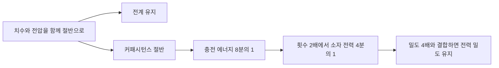

# Dennard 외: 전압과 치수의 축소 / Scaling dimensions and voltage together

| 항목 | 내용 |
|---|---|
| 논문 | Design of Ion-Implanted MOSFET's with Very Small Physical Dimensions |
| 저자 | Robert H. Dennard·Fritz H. Gaensslen·Hwa-Nien Yu·V. Leo Rideout·Ernest Bassous·Andre R. LeBlanc |
| 발표 | IEEE Journal of Solid-State Circuits SC-9(5), 256–268쪽, 1974년 10월 |
| 원문 | [Stanford에서 제공하는 원문 PDF](https://stanford.edu/class/cs114/readings/dennard.pdf) · [IBM의 논문 정보](https://research.ibm.com/publications/design-of-ion-implanted-mosfets-with-very-small-physical-dimensions) |
| 확인 위치 | Device Scaling 257–259쪽, 소자 특성 그림 259쪽, 회로 분석 264–266쪽, Table I·II 265쪽 |

## 작게 만드는 조건을 함께 바꾸기

논문은 작은 MOSFET의 치수·전압·도핑을 연결하는 축소 관계와, 이온 주입을 이용한 소자의 제작·특성을 다룹니다. 이상적인 소자 축소, 실제 제작 소자와 모델의 비교, 집적회로 성능의 예상은 서로 다른 근거입니다. Table I은 전계를 유지하는 축소 관계를, Table II는 배선처럼 다른 변화가 생기는 항목을 정리합니다. 원문은 문턱 아래 특성이 원하는 비율로 단순 축소되지 않는 문제도 설명합니다. [원문 257–259·264–266쪽](https://stanford.edu/class/cs114/readings/dennard.pdf)

`MOSFET`은 절연막을 사이에 둔 게이트의 전압으로 채널을 제어하는 전계효과 트랜지스터입니다. `도핑`은 반도체에 불순물을 넣어 전하 운반자의 성질과 농도를 조절하는 과정이며, `이온 주입`은 그 조절에 쓰이는 제조 방법입니다. 단순히 그림의 길이를 줄이는 일만으로 전기적 조건까지 정해지지는 않습니다.

## 직접 유도: 전계와 커패시턴스

이 절에서는 이상화한 관계를 직접 따라가겠습니다. 축소 인자 κ를 1보다 크게 두고 길이와 전압을 모두 `1/κ`배로 줄입니다. 그러면 대표적인 전계 `E≈V/L`의 비율은 `(1/κ)/(1/κ)=1`입니다. 이것이 전계를 일정하게 유지한다는 말의 출발점입니다.

평행판 근사 `C=εA/d`에서 면적 A는 `1/κ²`, 절연막 두께 d는 `1/κ`이므로 C는 `1/κ`배입니다. 이 근사는 재료와 기하의 조건을 고정한 설명이며 실제 소자의 모든 기생 성분을 나타내지는 않습니다.

| 항목 | 이상적 축소 비율 |
|---|---:|
| 선형 치수·전압 | 1/κ |
| 도핑 농도 | κ |
| 소자 커패시턴스·전류 | 1/κ |
| 대표 지연 CV/I | 1/κ |
| 충전 에너지 CV² | 1/κ³ |
| 주파수를 κ배 올릴 때 소자당 동적 전력 | 1/κ² |
| 면적당 소자 수 | κ² |

지연의 비율은 `CV/I`에 각 비율을 넣으면 확인할 수 있습니다. 전류도 줄지만 충전해야 할 전하 `CV`가 더 빠른 비율로 줄어들므로 지연은 짧아집니다. ‘전류가 작으니 반드시 더 느리다’는 직관만으로는 이 결과를 설명할 수 없습니다.

## 직접 계산: κ=2의 가상 회로

다음은 실제 칩의 측정값이 아닙니다. C=10fF, V=4V인 가상의 노드가 충전되는 경우를 생각하겠습니다. 전원에서 한 번 완전히 충전할 때 가져오는 에너지를 `CV²`로 계산하면 160fJ입니다. 커패시터에 저장되는 에너지 `½CV²`와는 구별합니다.

| 항목 | 축소 전 | κ=2 축소 후 |
|---|---:|---:|
| C | 10fF | 5fF |
| V | 4V | 2V |
| 충전 에너지 CV² | 160fJ | 20fJ |
| 초당 충전 횟수 | 1억 회 | 2억 회 |
| 이 충전에 따른 평균 전력 | 16µW | 4µW |

에너지는 1/8, 횟수는 2배이므로 전력은 1/4입니다. 같은 면적에 소자를 네 배 배치하고 모두 같은 활동 조건을 가진다고 가정하면 면적당 동적 전력은 유지됩니다. 소자 한 개의 전력과 칩 전체 전력, 면적당 전력을 구별해야 하는 이유입니다.



## 조건을 하나 빼면 달라지는 결과

치수와 C만 절반으로 만들고 전압을 그대로 두면 에너지는 1/2입니다. 충전 횟수를 두 배로 올렸을 때 소자 전력은 그대로이며, 밀도까지 네 배라면 전력 밀도는 네 배입니다. 따라서 ‘작아지면 전력 밀도가 자동으로 일정하다’는 문장은 전압 조건을 빠뜨린 것입니다.

배선도 따로 봐야 합니다. 같은 재료의 저항 `R=ρL/A`에서 길이는 절반, 단면적은 1/4이면 저항은 두 배입니다. 배선 커패시턴스가 절반이라는 같은 기하 근사 아래에서는 RC가 그대로입니다. 소자 지연이 절반이라는 결과를 배선 지연에도 그대로 붙일 수 없습니다.

후속 논의는 Dennard 등이 쓴 [A Perspective on Today's Scaling Challenges and Possible Future Directions](https://research.ibm.com/publications/a-perspective-on-todays-scaling-challenges-and-possible-future-directions)와 연결됩니다. 이 해설의 비례 계산에는 누설·배선·재료·열·제조 편차를 모두 정량적으로 넣지 않았습니다. 최신 공정의 실제 전압과 주파수 예측으로 쓰려면 별도의 모델과 측정이 필요합니다.

## 도핑을 늘리면 전기장이 차지하는 폭도 줄어듭니다

공핍층은 이동할 수 있는 전자나 정공이 적어지고, 이온화된 도핑 원자의 전하가 남은 영역입니다. 채널 길이만 줄이고 이 영역의 폭을 그대로 두면 드레인의 전기장이 게이트가 조절해야 할 부분까지 깊게 들어옵니다. 게이트 전압을 낮춰 꺼 두려 해도 드레인 전압이 문턱을 낮추는 이유가 여기에 있습니다. 따라서 축소에는 길이뿐 아니라 전하 분포를 함께 바꾸는 일이 필요합니다.

원문 p.258 식 (1)은 전위차와 도핑을 공핍층 폭에 연결합니다. 이를 균일한 도핑과 한 방향의 전기장으로 단순화하면 다음 관계를 얻습니다. 아래의 ψ는 공핍층에 걸리는 총전위차이며, N은 단위 부피당 도핑 원자 수입니다.

```math
W=\sqrt{\frac{2\varepsilon_{Si}\psi}{qN}},\qquad
\frac{W'}{W}=\sqrt{\frac{\psi'/\psi}{N'/N}}.
```

직접 만든 예로 εSi=1.036×10⁻¹² F/cm, q=1.602×10⁻¹⁹ C, N=10¹⁷ cm⁻³, ψ=1 V를 대입하면 W≈1.137×10⁻⁵ cm, 즉 113.7 nm입니다. 길이를 절반으로 만들면서 N을 두 배, ψ를 절반으로 맞추면 제곱근 안이 1/4이 되어 W≈56.9 nm로 줄어듭니다. 도핑만 두 배로 바꾸면 W는 1/√2배인 약 80.4 nm에 그칩니다. 선폭을 반으로 줄였다는 이유만으로 공핍층도 자동으로 반이 되지 않습니다.

여기서 ‘ψ도 절반’이라는 조건은 중요합니다. 원문은 접합의 내장전위와 반전이 시작되는 표면전위가 길이처럼 그대로 축소되지 않는다고 설명합니다. 필요한 총전위차를 맞추려면 기판 바이어스, 즉 소스에 대한 기판의 전압을 별도로 조절해야 할 수 있습니다. 위 계산은 그 조건을 충족시킨 이상화이며, 실리콘의 모든 전압이 저절로 절반이 된다는 주장이 아닙니다.

단순히 도핑을 계속 높이는 것도 해답은 아닙니다. 원문은 도핑 원자에 의한 산란으로 이동도가 조금 낮아짐을 지적하고, 표면 근처와 더 깊은 곳의 도핑을 다르게 만드는 이온 주입 구조를 분석합니다. 이동도는 같은 전기장 아래에서 운반자가 얼마나 잘 이동하는지를 나타냅니다. ‘도핑 증가 → 공핍층 축소 → 짧은 채널의 전위 조절’이라는 이점과 ‘산란 증가 → 이동도 저하’라는 비용을 함께 보아야 식 (3)의 전류 축소 가정도 이해할 수 있습니다.

## 자기점검

1. κ=2일 때 전압만 그대로라면 전계는 어떻게 되나요?
2. 20fJ의 충전이 초당 2억 회 발생하면 평균 전력은 얼마인가요?
3. 표의 4µW를 실제 1974년 칩의 실측 전력이라고 인용할 수 있나요?

<details>
<summary>해설 보기</summary>

1. 길이가 절반이므로 `V/L`은 두 배입니다. 전계 일정 조건이 성립하지 않습니다.
2. `20×10⁻¹⁵×2×10⁸=4×10⁻⁶W`, 즉 4µW입니다.
3. 안 됩니다. 이 글에서 정한 C·V·횟수로 계산한 예입니다. 원문의 소자 측정·회로 예측과도 분리해서 읽어야 합니다.

</details>

[정보와 전자공학 목록으로](README.md)
