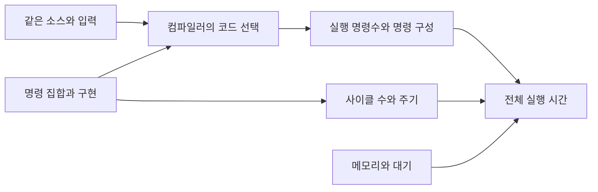

# Patterson·Ditzel: RISC 설계의 선택 / Tradeoffs in RISC design

| 항목 | 내용 |
|---|---|
| 논문 | The Case for the Reduced Instruction Set Computer |
| 저자·발표 | David A. Patterson·David R. Ditzel, ACM SIGARCH Computer Architecture News 8(6), 25–33쪽, 1980년 10월 |
| 원문 | [Berkeley에서 제공하는 원문 PDF](https://people.eecs.berkeley.edu/~kubitron/courses/cs252-F00/handouts/papers/patterson80.pdf) · [저자 소속 대학의 서지 목록](https://www2.eecs.berkeley.edu/Pubs/Faculty/patterson.html) |
| 확인 위치 | 25쪽 서론·복잡화 이유, 27쪽 CISC 사용·구현, 28–29쪽 RISC and VLSI·Speed·면적, 29–31쪽 고급언어·진행 중 연구·결론 |
| 정오표 | PDF 9쪽·인쇄 33쪽이 정오표입니다. 본문 각주를 인용할 때 함께 확인해야 합니다. |

## 명령을 많이 제공하는 일의 비용

저자들은 명령 집합의 복잡도가 늘어나는 추세를 비용과 성능의 관점에서 재검토합니다. 단순한 명령 집합은 제어 회로·설계·검증의 부담을 줄이고, 면적과 주기 시간을 다른 방식으로 사용할 여지가 있다는 논의입니다. 고급언어를 편리하게 사용하는 목표가 반드시 복잡한 하드웨어 명령을 요구하는지도 묻습니다. 1980년 글의 Berkeley 연구는 진행 중인 설계 전망이며, 완성된 RISC I 칩의 실측 보고로 읽으면 안 됩니다. [원문 25·27–31쪽](https://people.eecs.berkeley.edu/~kubitron/courses/cs252-F00/handouts/papers/patterson80.pdf)

## 줄어드는 것은 무엇인가요?

`instruction set`은 프로그램이 사용할 수 있는 기계 명령과 그 동작에 대한 약속입니다. `instruction count`는 특정 프로그램이 실제로 실행한 명령의 수입니다. 명령의 종류를 줄이면 같은 일을 여러 명령으로 나누어 해야 할 수도 있으므로 두 수는 같은 방향으로 움직이지 않습니다.

`컴파일러`는 소스 프로그램을 대상 기계에서 실행할 코드로 옮기고 변환하는 도구입니다. 어떤 복합 동작을 하드웨어 한 명령으로 지원할지, 기본 명령들의 조합으로 만들지는 컴파일러·기계 구조를 함께 볼 문제입니다. 명령 집합과, 그것을 내부 회로로 구현하는 방법도 같은 개념이 아닙니다.

## 직접 계산: 명령수가 늘어도 빨라질 수 있나요?

다음은 두 가상 구현을 비교한 예이며 실제 제품의 성능표가 아닙니다. 프로그램의 결과와 입력은 같다고 가정하겠습니다.

```math
T=IC\times CPI\times t_{cycle}
=\frac{IC\times CPI}{f}.
```

`IC`는 실행 명령수, `CPI`는 명령당 평균 사이클 수, `f`는 초당 사이클 수입니다. 평균 CPI를 사용할 때에는 그 프로그램에서 실제로 실행된 명령들의 구성을 반영해야 합니다.

| 가상 구현 | IC | 평균 CPI | 주파수 | 실행 시간 |
|---|---:|---:|---:|---:|
| A | 100 | 2 | 1GHz | 200ns |
| B | 130 | 1 | 1GHz | 130ns |

B는 명령수가 30% 많지만 사이클 총수는 적습니다. 시간은 A의 65%, 속도 향상은 `200/130≈1.5385배`입니다. ‘명령 하나가 더 많은 일을 한다’는 주장만으로 전체 성능을 비교할 수 없는 이유입니다.

이제 B가 메모리 대기 때문에 100사이클을 추가로 소비한다고 하겠습니다. CPI=1 계산에 그 대기가 포함되지 않았다는 조건에서 총 230ns가 되어 A보다 느려집니다. 반대로 처음부터 측정한 CPI에 대기가 포함되어 있었다면 다시 100사이클을 더하면 중복 계산입니다. 평균값의 정의를 확인해야 합니다.



## 코드 크기와 속도도 따로 계산하기

위 예의 모든 명령이 4바이트이고 정적 코드도 각각 100·130개라고 추가로 가정하면 코드 크기는 400·520바이트입니다. B는 이 조건에서 더 빠르면서 더 큰 코드를 가집니다. 그러나 반복문이 있다면 동적 실행 명령수와 저장된 명령수는 달라지므로, 처음 표의 IC만으로 이 바이트 수를 알아낼 수는 없습니다.

또한 고정 길이와 짧은 길이 중 어느 인코딩을 쓰는지에 따라 결과가 바뀝니다. ‘RISC이면 항상 작은 파일’이나 ‘명령이 많으면 항상 큰 파일’ 같은 결론은 명령 길이와 정적 코드 수를 생략합니다. 속도·코드 크기·설계 비용은 서로 연결되지만 하나의 숫자는 아닙니다.

## 논문의 주장과 후속 구현

이 글은 특정 명령의 유용함과 시스템 전체의 유용함을 구분하도록 권합니다. 한 기능이 일부 코드에서 빠르더라도 제어 경로와 검증 비용에 주는 영향까지 살펴야 합니다. 반대로 복잡한 명령이 언제나 나쁘다거나 모든 단순 명령이 한 사이클에 끝난다는 정리는 아닙니다.

후속 자료인 Séquin·Patterson의 [Design and Implementation of RISC I, 1982](https://www2.eecs.berkeley.edu/Pubs/TechRpts/1982/5449.html)는 실제 설계·구현을 다루므로, 1980년의 설계 주장과 나란히 읽기 좋습니다. 특정 현대 ISA의 우열을 이 초기 논문 하나로 확정할 수는 없습니다. 작업·컴파일러·구현·메모리 조건을 맞춘 비교가 필요합니다.

## 한 명령 안에서 일어나는 일을 펼쳐 봅니다

명령 집합은 프로그램에 보이는 약속이고, 그 약속을 수행하는 회로의 작업 순서는 별개의 설계입니다. 마이크로코드는 한 기계어 명령을 실행하기 위해 레지스터 전송, 덧셈, 메모리 요청 같은 내부 제어를 여러 단계로 지정하는 방식입니다. 반면 하드와이어드 제어는 그런 제어 신호를 논리회로로 생성합니다. 어느 쪽이든 메모리에서 값을 가져오는 물리적인 작업이 이름 하나로 없어지지는 않습니다.

직접 만든 가상 연산 y=a+b를 생각해 보겠습니다. a와 b가 메모리에 있고 결과도 메모리에 둔다면, 단순한 명령 집합에서는 ‘a 읽기 → b 읽기 → 레지스터끼리 더하기 → y 쓰기’의 네 명령으로 표현할 수 있습니다. 가상의 복합 명령 하나가 이 일을 모두 수행할 수도 있습니다. 그러나 후자의 명령 수가 1이라고 해서 메모리 읽기 두 번과 쓰기 한 번까지 1/4로 줄어드는 것은 아닙니다. 이 예는 실제 특정 ISA의 명령 형식이나 속도를 재현한 것이 아닙니다.

차이는 같은 값을 다시 쓸 때 더 잘 드러납니다. 이어서 z=a+c를 계산한다면, 앞에서 읽은 a를 레지스터에 유지하는 구현은 c만 추가로 읽을 수 있습니다. 두 식을 따로 처리하여 a를 매번 읽으면 메모리 읽기는 네 번이지만, 재사용하면 세 번입니다. 저장 두 번은 양쪽에 남습니다. 컴파일러가 중간값의 수명과 레지스터 배치를 조절하면, 명령을 단순하게 나누어도 데이터 이동을 줄일 기회가 생깁니다. 반대로 레지스터가 부족하여 값을 메모리에 내보내면 그 이점이 줄어듭니다.

원문 p.29의 ‘Speed’는 드물게 쓰는 기능도 제어 경로를 길게 하면 모든 작업에 비용을 줄 수 있다고 주장합니다. 이를 계산하는 별도의 가상 예로, 원래 1,000사이클에 주기 1 ns인 프로그램을 가정하겠습니다. 새 복합 명령이 프로그램의 사이클 수를 940으로 줄이지만, 제어 회로 때문에 주기가 1.1 ns가 되면 실행 시간은 1,034 ns입니다. 원래 1,000 ns보다 3.4% 느립니다. 주기가 10% 늘 때 필요한 사이클 감소는 10%가 아니라 1−1/1.1≈9.09%보다 커야 합니다. 940사이클은 6% 감소여서 부족합니다.

이 비교에서 복합 명령의 손해가 언제나 확정되지는 않습니다. 특정 연산을 별도 회로로 병렬 수행하거나 명령 전달량을 크게 줄이면 반대 결과도 가능합니다. 논문의 핵심은 명령 이름이나 개수로 결론을 내리지 말고, 실제 작업·제어 경로·메모리 이동·컴파일 결과를 합쳐 평가하자는 데 있습니다. 오늘날 모든 RISC가 한 사이클에 끝나거나 모든 CISC가 마이크로코드만 사용한다는 분류로 옮기면 원래 논증보다 강한 주장이 됩니다.

## 자기점검

1. IC가 2배, CPI가 1/2, 주파수가 같으면 실행 시간은 어떻게 되나요?
2. 실행 명령 1억 개라는 자료만으로 실행 파일 크기를 알 수 있나요?
3. 명령 종류를 줄였다는 사실만으로 전력과 속도가 모두 좋아졌다고 할 수 있나요?

<details>
<summary>해설 보기</summary>

1. 이 식의 조건 안에서는 곱이 같아 시간이 같습니다. 다른 대기·입출력 비용이 별도로 있으면 함께 반영해야 합니다.
2. 알 수 없습니다. 같은 명령을 반복 실행했을 수 있습니다. 정적 코드 수와 인코딩 길이가 필요합니다.
3. 할 수 없습니다. 실제 실행 흐름과 회로 구현에 대한 근거가 필요합니다. 이 문서의 가상 계산도 두 가상 구현의 조건을 벗어나 일반화할 수 없습니다.

</details>

[정보와 전자공학 목록으로](README.md)
