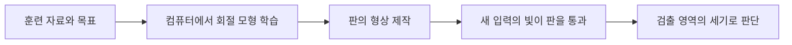

# 학습한 패턴을 광학 판에 새기는 회절 신경망

## 논문과 읽은 범위

Xing Lin·Yair Rivenson 외의 「All-optical machine learning using diffractive deep neural networks」는 Science 361, 1004–1008의 2018년 연구입니다. 여기서는 [arXiv:1804.08711v2](https://arxiv.org/abs/1804.08711v2)의 20쪽 전체와 그림 설명을 읽었습니다. 별도 보충자료 전체를 읽은 범위로 포함하지 않습니다. 게재 DOI는 [10.1126/science.aat8084](https://doi.org/10.1126/science.aat8084)이며, 아래 숫자는 공개 사전논문 판본의 조건과 분모로 표시합니다.

이 연구는 일반 컴퓨터에서 학습한 설계를 실제 광학 부품으로 만드는 사례입니다. 물체를 비춘 빛이 여러 회절판을 지나 정해진 출력 위치에 모이도록 판의 표면을 설계합니다. ‘빛이 스스로 학습한다’는 표현보다는 학습 단계와 만들어진 부품의 동작을 나누는 편이 정확합니다.

## 회절과 위상부터 이해합니다

회절은 파동이 장애물이나 작은 구조를 지나며 퍼지고 간섭하는 현상입니다. 파동이 퍼지는 것은 단순히 계산 오차가 아니라 이 장치가 입력을 서로 섞는 방법입니다. 위상은 주기적인 파동에서의 상대 위치입니다. 투명한 판의 부분마다 빛이 통과하는 두께가 다르면 진행 지연이 달라져 출력의 간섭 패턴도 바뀝니다.

뉴런이라는 이름은 여기서 생물학적 신경세포가 들어 있다는 뜻이 아닙니다. 표면의 작은 위치에 부여한 복소 투과 계수와 그 위치를 통한 파동의 변화를 가리키는 모델입니다. 계수의 크기는 통과하는 진폭의 비율, 각도는 위상 변화를 나타낼 수 있습니다. 숫자 한 개의 밝기만 다루는 것보다 표현이 복잡한 이유입니다.

출력 검출기의 세기는 진폭 절댓값의 제곱과 연결됩니다. 예를 들어 두 실수 진폭 1과 −1을 합치면 0이고, 각각의 세기 1과 1을 더하면 2입니다. 빛을 합친 뒤 검출하는 일과 먼저 검출한 숫자들을 더하는 일은 같은 연산이 아닙니다. 이 자체 예제가 간섭을 이해하는 출발점입니다.

## 설계는 컴퓨터에서, 추론은 제작된 판에서 수행합니다

훈련할 때는 파동이 판 사이를 전파하는 모형을 컴퓨터에 놓고, 원하는 정답 위치로 에너지가 모이도록 판의 계수를 조정합니다. 손실 함수는 무엇이 잘못된 출력인지를 수치로 정하는 기준이며, 역전파는 각 설계 변수의 변화가 그 손실에 어떤 영향을 주는지 계산하는 방법입니다.

그다음 판을 제작하면 그 형상이 학습된 설계를 담게 됩니다. 고정된 판의 추론은 광학적으로 진행되지만, 새 자료를 넣는 행위가 판의 형상을 자동으로 다시 학습시키지는 않습니다. 원문은 재구성 가능한 공간광변조기를 사용하는 가능성도 논의합니다. 고정된 수동 시연과 재구성 가능한 후속 설계를 같은 것으로 표시하지 않습니다. [원문 2–5·11–12쪽](https://arxiv.org/pdf/1804.08711v2)



## 91.75%와 88%의 분모가 다릅니다

공개 판본의 91.75%는 MNIST 시험 이미지 10,000개에 대한 수치 시뮬레이션입니다. 실물 시험은 그 시뮬레이션에서 성공한 이미지 중 숫자별 다섯 개, 총 50개를 골라 3D 프린트한 입력으로 수행했습니다. 이 선택된 집단에서 수치 결과와 실험 판단의 일치는 88%였습니다. 이것을 무작위 10,000개를 실물로 시험한 정확도라고 바꾸면 안 됩니다. [원문 6–7쪽과 그림 3](https://arxiv.org/pdf/1804.08711v2)

자체 산술로 10,000개의 91.75%는 9,175개이고, 50개의 88%는 44개입니다. 후자는 이미 시뮬레이션을 통과한 후보를 조건으로 선택했으므로 전체 실제 정확도와 같은 추정 대상이 아닙니다. `0.9175 × 0.88 = 0.8074`를 계산하는 것은 가능하지만, 빠진 실패 집단의 실물 결과와 대표성 조건 없이 80.74%를 실제 전체 정확도로 보고할 근거는 없습니다.

특정 연구의 성과를 낮추거나 높이는 문제에 앞서, 숫자가 답하는 질문부터 달라지는 사례입니다. 결과를 옮겨 적을 때 ‘무슨 집단에서 어떤 절차로 얻은 값인가요?’를 반드시 함께 읽어야 합니다.

## 층이 많다는 것과 비선형 함수가 많다는 것은 다릅니다

선형 광학계의 복소 파동 변환은 여러 단계를 곱한 하나의 행렬로 표현할 수 있습니다. 검출에서 세기를 읽는 비선형성이 있다고 해도, 층마다 ReLU 같은 활성화를 적용한 일반 신경망과 같은 구조가 되는 것은 아닙니다. 이에 관한 [Wei 외의 공개 비판](https://arxiv.org/abs/1809.08360)과 [Mengu 외의 응답](https://arxiv.org/abs/1810.04384)도 각각 전체 5·8쪽을 읽었습니다. 두 문서는 논쟁 자료이며 원문의 별도 실험 논문 두 편으로 세지 않습니다.

핵심 구분은 두 가지입니다. 전체 변환을 한 행렬로 적을 수 있다는 수학적 사실과, 같은 변환을 물리적인 회절판 단 한 장으로 만들 수 있다는 주장은 다릅니다. 응답은 여러 판이 설계 자유도·출력 대비·에너지 배분에 줄 수 있는 이점을 강조합니다. 따라서 ‘선형이므로 아무 기능도 없다’나 ‘층이 여러 개이므로 임의의 비선형 심층망과 같다’는 식으로 끝내지 않습니다.

자체 행렬 예제로 대각 행렬 `D` 두 개를 아무리 곱해도 대각 행렬입니다. 그 사이에 입력들을 섞는 행렬 `P`를 넣은 `D₂ P D₁`은 일반적으로 대각 행렬이 아닙니다. 전체를 하나의 행렬로 계산할 수 있지만 그것을 대각 성질만 갖는 부품 하나로 구현하지는 못한다는 뜻입니다. 다만 이 예가 광학계의 모든 구현 가능성을 증명한 정리는 아닙니다.

## 수동 부품에도 전체 시스템 비용이 있습니다

원문은 사용한 THz 재료의 각 층에서 평균 약 51%의 전력 감쇠를 설명합니다. 각 층의 투과율을 단순히 0.49로 같게 가정하면 다섯 층 통과 비율은 다음과 같습니다. 실제 광학계의 모든 반사·검출을 재현한 값이 아닌 자체 근사입니다.

```math
0.49^5\approx0.02825=2.825\%
```

분류의 빛 전파 자체가 빠르더라도 광원, 입력 형성, 정렬, 검출, 신호 대 잡음비가 남습니다. 작은 부품을 싸게 여러 개 만들 수 있다는 가능성도 재료 오차와 조립 오차를 검증해야 제품이 됩니다. 반대로 센서 앞에서 필요한 특징만 바로 분리할 수 있다면 이후 전자 계산에 전달할 자료량을 줄일 수 있습니다.

산업적으로는 범용 GPU를 통째로 대체할지보다 어떤 고정 과제와 입력 파장·형상에서 앞단 부품이 유리할지 묻는 편이 구체적입니다. 과제가 바뀔 때 재제작하는 비용과 전자·광 혼합 설계의 유연성도 비교해야 합니다. 이것은 원문이 증명한 판매 실적이 아니라 연구를 제품으로 연결할 때의 분석입니다.

## 스스로 확인합니다

1. 91.75%는 실물 입력 10,000개를 시험한 결과입니까?
2. 전체가 선형 행렬로 표현되면 물리적인 판 한 장으로 항상 같은 변환을 만들 수 있습니까?
3. 고정된 회절판에 새 이미지를 비추면 그 판의 계수가 자동으로 다시 학습됩니까?

<details>
<summary>정답과 해설</summary>

1. 아닙니다. 10,000개는 수치 시험이며 실물 시험은 성공 후보 중 선택한 50개였습니다.
2. 아닙니다. 수학적 표현과 제약된 물리 부품의 구현 가능성을 구별해야 합니다.
3. 아닙니다. 이 수동 시연은 컴퓨터에서 학습한 설계를 제작하여 추론합니다. 재구성·재학습은 별도의 설계와 절차가 필요합니다.

</details>
