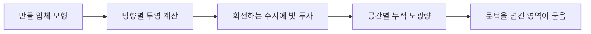

# 여러 방향의 빛을 모아 한 번에 굳히는 3D 프린팅

## 논문과 읽은 범위

Damien Loterie·Paul Delrot·Christophe Moser의 「High-resolution tomographic volumetric additive manufacturing」는 Nature Communications 11, 852에 발표된 2020년 연구입니다. [공개 원문](https://www.nature.com/articles/s41467-020-14630-4)의 PDF 1–6쪽을 읽었으며, 결과·그림 설명·Methods를 대조했습니다. 별도 보충자료와 영상은 모두 열람한 범위에 포함하지 않습니다. 연구진은 EPFL 소속이며 관련 특허 출원을 밝혔습니다.

여기서는 ‘어떻게 얇은 층을 더 빨리 쌓을까요?’에서 출발해, ‘여러 방향에서 빛을 주어 공간 안의 원하는 부분만 동시에 굳힐 수 있을까요?’로 질문을 바꿉니다. 프린터가 움직인 거리만으로 생산성을 설명하기 어려워지는 사례입니다.

## CT와 반대 방향으로 생각합니다

CT는 여러 방향에서 측정한 투영으로 내부 구조를 추정합니다. 투영은 어떤 방향으로 보았을 때 한 줄에 놓인 값들이 합쳐진 정보입니다. 이 논문에서는 만들고 싶은 입체 구조를 먼저 알고, 그 구조에 해당하는 빛의 분포를 각 방향에서 비춥니다. 회전하는 투명한 수지 안에서 누적된 빛이 충분한 곳이 굳습니다.

광중합은 빛으로 시작된 화학 반응이 작은 분자를 연결해 고분자 구조를 만드는 현상입니다. 수지는 액체 재료이고, 복셀은 입체 공간을 나눈 작은 칸입니다. 이 방식에서 복셀은 실제로 정육면체 벽이 있는 방이 아닙니다. 계산과 관찰을 위해 공간을 나누는 단위입니다.

겔화 문턱은 액체가 연결된 고분자 망을 이루기 시작하는 조건입니다. 여러 방향의 약한 빛을 더해 목표 영역만 이 문턱을 넘기려는 발상이 중요합니다. 한 장의 영상에는 목표 바깥으로 지나가는 빛도 있으므로, 각 영상이 완벽하게 모양을 그려야 하는 것은 아닙니다. 모든 방향의 누적 결과가 중요합니다.



그림은 논문 장치의 배선을 복제한 것이 아니라 작동 순서를 정리한 자체 설명입니다. 빛은 음수 세기로 비출 수 없으므로 계산상의 투영을 그대로 모두 구현하지도 못합니다. 원문 Methods는 음수 값을 0으로 자르는 근사를 설명합니다. 수학적으로 이상적인 역변환과 물리적으로 가능한 광학계 사이의 차이입니다.

## 밝기만 올려서는 해상도가 좋아지지 않습니다

에탕뒤(étendue)는 빛이 퍼진 공간 범위와 진행 방향의 퍼짐을 함께 나타내는 광학량입니다. 작은 글씨를 손전등으로 비출 때 빛이 여러 방향으로 크게 번지면 중심에서 선명하더라도 앞뒤 공간에서 흐려질 수 있습니다. 이 논문은 빛의 퍼짐을 줄이는 광학 설계와 수지의 움직임을 함께 다룹니다.

점도가 높은 수지는 잘 흐르지 않습니다. 이것은 재료 공급에는 불편할 수 있지만, 공간 안에서 굳기 시작한 물체가 가라앉거나 반응 성분이 퍼지는 현상을 줄이는 데에는 도움이 됩니다. 같은 성질이 공정에 따라 이점과 제약을 바꾸는 것입니다. 층마다 재료를 빠르게 채우는 방식의 좋은 재료 조건을 그대로 옮길 수 없습니다.

원문은 30초 미만의 센티미터 크기 출력물에서 80 µm의 채워진 구조와 500 µm의 빈 구멍을 보고합니다. 두 숫자는 서로 다른 특징의 실증입니다. 광학 영상에서 계산한 더 작은 픽셀 크기를 곧바로 ‘그 크기의 열린 유로를 만들었다’고 읽어서는 안 됩니다. 최종 부품에는 광학계, 반응, 세척과 형상의 영향이 함께 남습니다. [원문 Results와 그림 2–3](https://www.nature.com/articles/s41467-020-14630-4)

## 피드백은 다음 출력에 반영했습니다

원문의 카메라는 굳어지는 과정을 관찰합니다. 일부 영역이 늦게 나타나면 그 부분의 빛을 더 주고, 먼저 굳는 곳의 과도한 노광을 줄일 수 있습니다. 중요한 구현 조건이 있습니다. 이 연구에서 실제로 수행한 보정은 첫 출력의 관찰 결과를 다음 출력에 반영한 방식입니다. 동일 출력 중 모든 영상을 실시간으로 바꾸는 기능은 당시 장치에서 구현한 결과가 아닙니다.

자체 사례로, 목표 영역 A는 같은 세기에서 10초, B는 15초가 걸린다고 가정하겠습니다. 누적량이 세기와 시간에 비례한다는 단순 근사라면, 같은 10초에 굳히기 위해 B의 세기를 1.5배로 잡아 볼 수 있습니다. 그러나 반응이 온도와 농도에 따라 달라지면 이 비례식도 다시 확인해야 합니다. 제어란 한 번 계산한 비율을 영원히 적용하는 일이 아닙니다.

```math
D=I t,\qquad \frac{I_B^{\mathrm{new}}}{I_B^{\mathrm{old}}}=\frac{15}{10}=1.5
```

숫자는 논문에서 측정한 재료 상수가 아닌 자체 예제입니다. 여기에 부품의 실제 허용 오차를 덧붙여야 검사가 됩니다. 설계 구멍 0.60 mm가 측정에서 0.54 mm라면 직경 오차는 −10%입니다. 구멍의 단면적은 직경의 제곱에 비례하므로 원형 단면이라는 가정에서 면적은 81%가 됩니다. 직경 오차를 그대로 유량 오차로 바꾸는 것도 적절하지 않습니다. 유동 저항에는 길이와 유체 성질도 관여합니다.

## 빠른 노광과 빠른 공장은 다른 계산입니다

이 방식은 형상 자유도와 짧은 광학 노광을 보여 줍니다. 산업에서 선택하려면 수지 준비, 출력물 회수, 세척, 후경화, 검사를 포함해야 합니다. 다음은 자체 생산 예제입니다. 한 개를 굳히는 데 20초, 후처리에 180초, 검사에 40초가 순서대로 걸리면 총 240초입니다. 노광만 두 배 빨라져도 총시간은 230초가 되어 약 4.17% 줄어듭니다. 작업을 병렬로 배치한 공장은 다른 병목을 가질 수 있습니다.

재료와 광학 장치가 결합된 공정에서는 다른 수지로 바꾸는 것이 가격표의 원료만 교체하는 문제가 아닙니다. 빛의 흡수·점도·수축과 보정 조건을 다시 확인해야 합니다. 반면 검증된 재료와 형상에 대해서는 반복 작업을 표준화할 여지가 있습니다. 이것은 원문의 매출이나 양산 수율을 추정한 결과가 아니라, 논문의 공정을 생산 의사결정으로 옮길 때 필요한 분석입니다.

## 스스로 확인합니다

1. 광학 픽셀 크기가 30 µm라면 30 µm의 열린 구멍을 실증했다고 말할 수 있습니까?
2. 원문의 피드백은 같은 출력 중 실시간 보정입니까, 다음 출력의 패턴 보정입니까?
3. 노광 20초·후처리 180초·검사 40초에서 노광만 10초로 줄이면 총시간은 얼마나 줄어듭니까?

<details>
<summary>정답과 해설</summary>

1. 없습니다. 광학 해상도와 최종 재료의 채워진 특징·빈 특징을 각각 확인해야 합니다.
2. 실제 시연은 다음 출력에 관찰 결과를 반영한 방식입니다. 실시간 조절 가능성과 시연 범위를 구분합니다.
3. 240초에서 230초로 10초, 약 4.17% 줄어듭니다. 다른 공정이 대부분을 차지하기 때문입니다.

</details>
