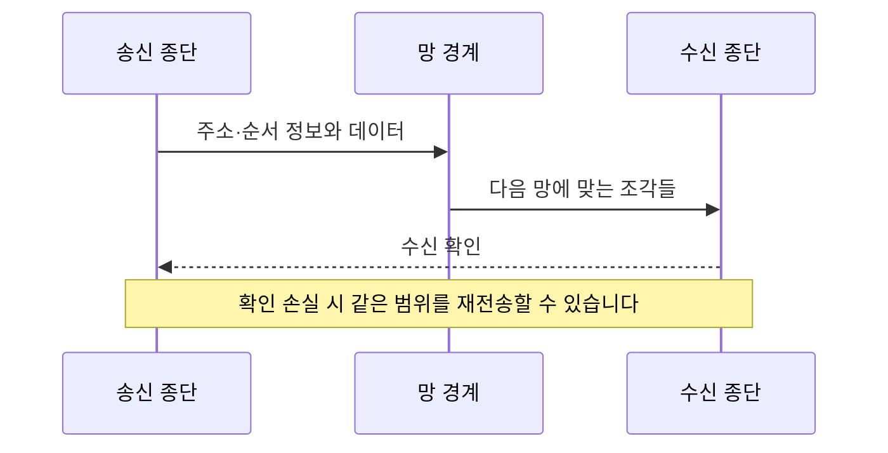

# Cerf와 Kahn: 서로 다른 망을 연결하기 | Packet-network intercommunication

Vinton G. Cerf와 Robert E. Kahn의 「A Protocol for Packet Network Intercommunication」은 IEEE Transactions on Communications 22(5), pp.637–648, 1974년 5월에 실렸습니다. [IEEE 역사 자료에 연결된 원문](https://ethw-images.s3.us-east-va.perf.cloud.ovh.us/ieee/3/36/Ref1_A_Protocol_for_Packet_Network_Intercommunication_Cerf-Kahn_1974.pdf)은 1973년 11월 5일 접수를 표시합니다. 아래 PDF 쪽은 이 13쪽 재수록본을 기준으로 합니다. 핵심 위치는 Gateway 절의 PDF 2–3쪽과 재전송·중복 검출 절의 7–8쪽입니다.

## 연결할 망이 서로 다를 때

한 학교 안의 전달 규칙이 다른 학교와 같다는 보장은 없습니다. 전송할 수 있는 묶음의 크기, 지연, 손실 처리 방식이 다른 망끼리도 통신하려면 무엇을 공통으로 약속할지 정해야 합니다.

논문은 개별 망의 차이를 경계의 gateway와 종단의 통신 절차로 다룹니다. 전송할 데이터의 식별 정보, 순서, 재전송과 중복 처리가 서로 연결됩니다. 이 글의 TCP는 1974년 설계 맥락이며 현재 TCP와 IP의 분리된 명세 전체를 그대로 나타내지는 않습니다. [원문 Introduction·The Gateway Notion](https://ethw-images.s3.us-east-va.perf.cloud.ovh.us/ieee/3/36/Ref1_A_Protocol_for_Packet_Network_Intercommunication_Cerf-Kahn_1974.pdf)

| 용어 | 쉬운 뜻 | 여기서의 역할 |
| --- | --- | --- |
| 패킷 | 주소와 제어 정보에 데이터를 붙인 전달 묶음입니다. | 큰 메시지를 나누어 보낼 수 있게 합니다. |
| gateway | 서로 다른 망 사이에서 전달을 이어 주는 경계 장치입니다. | 개별 망의 형식과 공통 전달 정보를 연결합니다. |
| 순서 번호 | 데이터가 원래 줄의 어디에 해당하는지 나타내는 번호입니다. | 도착 순서와 원래 순서를 구분합니다. |
| ACK | 상대가 무엇을 받았는지 돌려주는 확인 정보입니다. | 보낸 쪽이 재전송 여부를 판단하는 데 쓰입니다. |
| window | 확인을 기다리는 동안 보낼 수 있도록 허용한 범위입니다. | 속도와 버퍼 사용의 관계를 조절합니다. |

## 직접 만든 1,000바이트 전달 예

첫 망에서는 큰 묶음을 허용하지만 다음 망에서는 데이터 부분을 최대 300바이트씩 전달한다고 정하겠습니다. 실제 헤더·정렬·장비 규격은 생략한 교육용 조건입니다. 원문 패킷 형식을 복제하는 예는 아닙니다.

| 조각 | 원래 데이터 범위 | 데이터 크기 |
| --- | --- | ---: |
| 1 | 0–299 | 300바이트 |
| 2 | 300–599 | 300바이트 |
| 3 | 600–899 | 300바이트 |
| 4 | 900–999 | 100바이트 |

조각 3이 먼저 도착해도 그것을 메시지의 맨 앞에 놓으면 안 됩니다. 범위 정보를 보존했다면 조각을 원래 위치에 놓을 수 있습니다. 조각 1·2가 도착한 뒤 연속된 앞부분을 확보하고, 마지막 조각까지 있어야 1,000바이트 전체를 복원합니다.

이 흐름도는 역할을 보여 주기 위한 자체 그림입니다. 실제 망에서 모든 조각이 같은 경로를 지나거나 그림 순서대로 도착한다고 가정하지 않습니다.

## 확인이 사라지면 무엇을 다시 보내야 합니까

데이터가 수신자에게 도착했는데 확인만 사라질 수 있습니다. 송신자는 데이터 손실과 확인 손실을 바로 구별하지 못하므로 같은 데이터를 재전송할 수 있습니다. 수신자가 중복을 구별하지 못하면 같은 내용을 두 번 새 데이터로 전달하게 됩니다. 순서 정보는 정렬뿐 아니라 중복을 식별하는 데도 필요합니다.

반면 통신 데이터의 중복 처리가 곧 애플리케이션 작업의 ‘정확히 한 번 실행’을 보장하지는 않습니다. 프로그램이 응답을 받지 못해 새 요청을 만들면, 그 요청이 이전 요청과 같은 작업인지 다른 계층에서 판단해야 합니다. 재전송의 단위와 업무 작업의 단위를 구분하셔야 합니다.

## window를 숫자로 생각하기

자체 예로 미확인 데이터를 4,096바이트까지 허용하고 확인 왕복 시간이 0.1초라고 정하겠습니다. 다른 제약과 제어 부담을 생략하면 매 왕복마다 그만큼 전진하는 속도는 $4096/0.1=40960$바이트/초입니다. 이는 실제 회선의 측정값이 아니라 단순한 크기/시간 계산입니다.

회선의 전송 용량이 이보다 크더라도 확인을 기다리는 범위가 좁으면 충분히 활용하지 못할 수 있습니다. 반대로 범위를 무조건 넓히면 수신 버퍼나 망의 다른 제한이 사라지는 것도 아닙니다. 수신자에게 맞추는 흐름 제어와 망 전체의 혼잡을 다루는 문제도 구별해야 합니다.

## 저자의 근거와 후속 명세

논문의 중심은 서로 다른 망을 잇는 설계, 패킷 처리와 실패 상황의 분석입니다. 현재 인터넷 전체에서 이 해설의 작은 예를 실험했다는 뜻은 아닙니다. 원문이 드러내는 주소·경로·시간 제한의 선택을 현재의 완성된 규격으로 소급하지 않습니다.

확인 가능한 후속 자료는 같은 해 12월의 [RFC 675](https://www.rfc-editor.org/rfc/rfc675.html)입니다. Cerf·Dalal·Sunshine가 초기 Transmission Control Program을 더 구체적으로 기술합니다. 현재의 TCP 동작을 비교하려면 별도의 [RFC 9293](https://www.rfc-editor.org/rfc/rfc9293.html)을 읽어야 합니다. 같은 명칭이라도 원 논문, 당시 명세, 이후 규격의 범위를 구분합니다.

## 자가 점검

1. 데이터가 도착했다면 송신자도 도착을 반드시 알고 있습니까?
2. 네 조각의 도착 순서가 바뀌어도 복원하려면 무엇을 남겨야 합니까?
3. 위 계산의 허용 범위를 두 배로 늘리면 실제 처리량도 언제나 두 배입니까?

해설 보기

1. 그렇지 않습니다. 확인 정보가 사라지거나 늦을 수 있습니다.
2. 원래 데이터의 위치와 범위를 구분할 정보를 남겨야 합니다.
3. 그렇지 않습니다. 단순 계산의 제한이 완화될 뿐 다른 병목이 남을 수 있습니다.

[컴퓨팅과 시스템 논문 안내](README.md)
