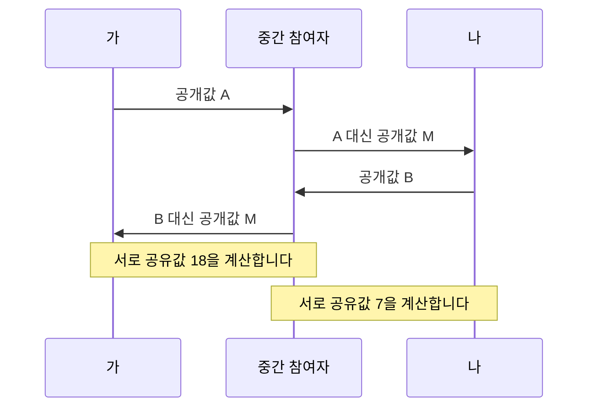

# Diffie와 Hellman: 비밀을 보내지 않고 맞추기 | Key agreement

Whitfield Diffie와 Martin E. Hellman의 「New Directions in Cryptography」는 IEEE Transactions on Information Theory 22(6), pp.644–654, 1976년 11월에 실렸습니다. [저자 측 Stanford 원문](https://www-ee.stanford.edu/~hellman/publications/24.pdf)은 1976년 6월 3일 접수를 표시합니다. 핵심 위치는 §III의 공개키·키 분배, 특히 p.649의 공유값 계산과 §IV의 인증 논의입니다.

[작은 수의 공유값 계산](#직접-만든-작은-수-계산)과 [공개값을 바꾸는 중간자 예](#공개값을-바꾸는-상대가-끼어들면)를 함께 읽으시면 키 합의와 상대 인증의 차이를 확인하실 수 있습니다. [후속 사용 절](#논문의-근거와-이후-사용)은 원문의 논의와 TLS 명세를 연결하며, 예제 숫자를 실제 보안 설정으로 사용하지 않습니다.

## 처음 만난 두 사람이 같은 비밀을 가지려면

암호 알고리즘을 알고 있어도 함께 사용할 비밀키가 없다면 안전하게 대화하기 어렵습니다. 그런데 키를 먼저 안전하게 보내야 한다면, 그 전송을 위한 안전한 수단이 다시 필요합니다. 논문은 이런 키 분배의 부담과 디지털 인증 문제를 함께 다룹니다.

여기서는 그중 두 사람이 공개 정보를 주고받아 공유 비밀을 얻는 관계를 살펴보겠습니다. 공개키 암호, 키 합의, 전자서명은 연결되지만 같은 동작은 아닙니다. 아래 계산은 메시지를 암호문으로 바꾸는 완성된 통신 프로그램이 아닙니다. [원문 §§I·III–IV](https://www-ee.stanford.edu/~hellman/publications/24.pdf)

| 용어 | 뜻과 뉘앙스 |
| --- | --- |
| 공개값 | 다른 사람이 보아도 된다고 설계한 값입니다. 비밀이 아닌 값도 변조될 수 있습니다. |
| 비밀 지수 | 각 참여자가 혼자 보관하는 계산 입력입니다. 공유 비밀 그 자체와 구별합니다. |
| mod | 나눈 나머지를 취한다는 뜻입니다. 큰 거듭제곱을 제한된 값의 범위에서 다룹니다. |
| 이산로그 | $g^a$의 나머지에서 지수 a를 찾는 문제입니다. 보통의 로그와 계산 환경이 다릅니다. |
| 인증 | 받은 공개값이 누구에게서 왔는지 확인하는 일입니다. 도청 방지와 별개의 조건입니다. |

## 직접 만든 작은 수 계산

공개한 소수 p를 23, 밑 g를 5로 정합니다. 가는 비밀 a=6, 나는 비밀 b=15를 선택합니다. 숫자를 작게 정한 이유는 손으로 결과를 확인하기 위해서이며, 보안용 설정이 아닙니다.

| 참여자 | 혼자 보관할 값 | 상대에게 보낼 값 |
| --- | --- | --- |
| 가 | a=6 | $A=5^6\bmod23=8$ |
| 나 | b=15 | $B=5^{15}\bmod23=19$ |

가는 받은 B로 $B^a\bmod p=19^6\bmod23=2$를 계산합니다. 나는 받은 A로 $A^b\bmod p=8^{15}\bmod23=2$를 계산합니다. 두 계산은 모두 $g^{ab}\bmod p$이므로 같은 값입니다. 가는 b를, 나는 a를 직접 전달받지 않았습니다.

숫자 2가 공개 통신에 그대로 실렸다는 뜻도 아닙니다. 전송한 값은 A와 B이고, 같은 공유값은 각자 내부에서 계산했습니다. 실제 통신에서는 이런 공유값으로부터 용도별 키를 만드는 절차와 검증이 추가됩니다.

## 정답이 같다는 것과 비밀이라는 것은 다릅니다

거듭제곱의 관계는 두 참여자가 같은 값을 얻는 이유를 설명합니다. 그러나 그 항등식만으로 공격자가 그 값을 찾기 어렵다는 사실까지 증명되지는 않습니다. 안전성에는 군과 매개변수 선택, 계산 문제에 대한 가정, 난수와 구현이 함께 작용합니다.

이번 작은 소수에서는 가능한 지수를 차례로 대입해 A를 만드는 값을 찾아낼 수 있습니다. 손으로 확인하기 좋은 계산이어서 오히려 보안에는 부적절합니다. 원 논문이 논의한 계산 난이도를 오늘날의 안전한 키 크기 권고로 그대로 사용하지도 않습니다.

## 공개값을 바꾸는 상대가 끼어들면

제삼자가 자신의 비밀 지수 m=13에서 공개값 $M=5^{13}\bmod23=21$을 만들었다고 하겠습니다. 가와 나에게 서로의 공개값 대신 M을 전달하면 가는 $21^6\bmod23=18$, 나는 $21^{15}\bmod23=7$을 얻습니다. 제삼자도 가와는 $8^{13}\bmod23=18$, 나와는 $19^{13}\bmod23=7$을 계산할 수 있습니다.

이는 임의로 만든 작은 수의 중간자 예입니다. 지수를 해독하지 않아도 상대의 신원을 확인하지 않은 공개값 교환을 가로챌 수 있다는 점을 보여 줍니다. ‘수동으로 보기만 하는 공격자’와 ‘메시지를 바꾸는 공격자’는 위협이 다릅니다. 키 합의만으로 상대방이 누구인지까지 확인했다고 말하면 안 됩니다.

## 논문의 근거와 이후 사용

원문은 수학적 구성과 계산 난이도에 관한 논의를 제공합니다. 이 글의 나머지 계산은 실제 암호 통신의 보안 시험이나 암호 해독 성능 측정이 아닙니다. 유출 방지, 공개값 검증, 인증과 구현의 부채널까지 검증한 것도 아닙니다.

확인 가능한 후속 사용은 [TLS 1.3의 RFC 8446 §7.4](https://www.rfc-editor.org/rfc/rfc8446.html#section-7.4)입니다. 명세는 공유 비밀 계산을 키 유도 절차에 연결하며, 인증도 별도로 다룹니다. 여기서 배울 연결은 작은 숫자를 서비스에 복사하는 방법이 아니라 ‘키 합의·키 유도·상대 인증’이 서로 다른 역할이라는 점입니다.

## 자가 점검

1. A와 B가 공개되면 a와 b도 그대로 공개된 것입니까?
2. 양쪽이 같은 수를 계산했다는 사실만으로 상대의 신원을 확인했습니까?
3. 중간자 예에서 가와 나가 각각 얻은 값은 왜 서로 다릅니까?

해설 보기

1. 그대로 공개된 것은 아닙니다. 다만 이 작은 예에서는 대입으로 찾기 쉬워 안전하지 않습니다.
2. 그렇지 않습니다. 인증되지 않은 공개값을 제삼자가 바꿀 수 있습니다.
3. 둘이 서로 합의한 것이 아니라 중간 참여자와 각각 별도의 공유값을 만들었기 때문입니다.

[컴퓨팅과 시스템 논문 안내](README.md)
