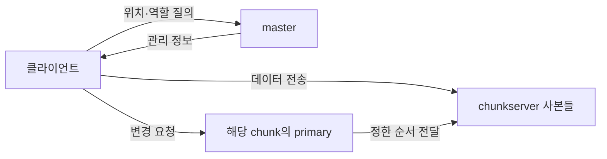

# GFS: 큰 파일의 위치와 내용을 나누어 관리하기 | The Google File System

Sanjay Ghemawat·Howard Gobioff·Shun-Tak Leung의 「The Google File System」은 2003년 SOSP에서 발표되었습니다. [Google의 논문 안내](https://research.google/pubs/the-google-file-system/)와 [공개 원문](https://storage.googleapis.com/gweb-research2023-media/pubtools/4446.pdf)을 기준으로 읽습니다. 주요 위치는 §§2.3–2.7의 구조·메타데이터·일관성, §§3.1–3.3의 변경·추가, §6의 측정입니다. 아래 PDF 쪽은 15쪽 공개본을 기준으로 합니다.

## 파일을 나누면 위치를 찾는 일도 필요합니다

여러 컴퓨터에 파일을 나누어 놓으면 저장 공간을 합칠 수 있습니다. 그러나 어느 조각이 어디 있는지, 컴퓨터 하나가 고장 났을 때 무엇을 읽을지, 두 사람이 동시에 바꿀 때 무엇을 먼저 적용할지도 정해야 합니다.

GFS는 큰 파일을 chunk로 나누고 복제하며, master가 메타데이터를 관리하고 chunkserver가 내용을 보관하도록 설계합니다. 클라이언트는 위치를 알아낸 뒤 데이터 서버와 통신합니다. master가 모든 파일 내용을 중계한다는 구조로 읽으면 안 됩니다. 이 선택은 논문이 다루는 큰 파일·연속 접근·추가 작업과 연결됩니다. [원문 §§2.1–2.4](https://storage.googleapis.com/gweb-research2023-media/pubtools/4446.pdf)

| 용어 | 쉬운 뜻 | 여기서의 주의점 |
| --- | --- | --- |
| chunk | 파일을 관리하기 위해 나눈 큰 조각입니다. | 프로그램이 한 번 읽는 크기와 항상 같지는 않습니다. |
| 메타데이터 | 이름·조각 식별자·위치처럼 내용을 찾고 관리하는 정보입니다. | 파일의 실제 본문과 구분합니다. |
| 복제 | 같은 데이터의 사본을 여러 곳에 두는 일입니다. | 사본 수만으로 모든 실패에 안전해지는 것은 아닙니다. |
| lease | 정해진 기간에 특정 역할을 맡기는 권한입니다. | 영구적인 소유권과 다릅니다. |
| primary | 한 조각의 변경 순서를 정하는 사본의 역할입니다. | 시스템의 모든 데이터를 소유한 단일 저장장치가 아닙니다. |

## 직접 만든 160 MiB 파일 계산

원문은 조각 크기를 64 MB로 표시합니다. 여기서는 단위를 명확히 하기 위해 1 MiB를 $2^{20}$바이트로 정하고, 조각 최대 64 MiB인 자체 계산 예를 만들겠습니다. 파일 크기는 160 MiB이고 각 조각을 세 곳에 복제한다고 가정합니다.

| 조각 | 논리적 위치 | 실제 내용 | 내용 사본 세 개의 합 |
| --- | --- | ---: | ---: |
| 0 | 0 MiB부터 | 64 MiB | 192 MiB |
| 1 | 64 MiB부터 | 64 MiB | 192 MiB |
| 2 | 128 MiB부터 | 32 MiB | 96 MiB |
| 합계 | 조각 3개 | 160 MiB | 480 MiB |

파일 내용을 담는 사본의 합은 480 MiB입니다. 모든 조각이 최대 크기를 이미 차지한다고 계산한 576 MiB와 다릅니다. 이 예의 마지막 조각은 32 MiB만 사용합니다. 실제 디스크 점유량에는 파일시스템 할당 단위, 메타데이터와 다른 부담도 영향을 줍니다. 이 계산을 실제 GFS의 저장량 측정으로 읽지 않습니다.

복제를 세 번 한다는 것은 용량의 대가를 치르는 선택입니다. 한 사본을 잃어도 다른 사본이 남을 수 있지만, 세 사본을 같은 실패 영역에 놓으면 그 이익이 줄어듭니다. 사본 수와 사본이 함께 실패할 조건을 따로 보셔야 합니다.

## 위치 확인과 변경 순서

이 자체 그림은 데이터 전달과 변경 순서를 나눈 역할 그림입니다. 실제 구현의 모든 왕복이나 전송 연결을 그린 것은 아닙니다. 원문 §3.1에서는 primary가 순서를 정하고 다른 사본에 적용하도록 합니다. 데이터를 먼저 보내는 경로와 적용 순서를 지시하는 경로를 분리해서 읽어야 합니다.

장애를 의심하고 사본을 다시 만드는 일도 필요합니다. 그러나 장애를 의심했다는 사실은 데이터가 실제로 사라졌다는 완전한 증거와 같지 않습니다. 지연과 중단을 구별하기 어려운 상황에서 어떤 사본을 유효하게 볼지 관리 정보와 버전이 중요해집니다.

## 추가 기록의 중복과 애플리케이션의 역할

원문 record append는 단순히 여러 클라이언트가 같은 위치를 각자 골라 덮어쓰는 동작과 다릅니다. 또 재시도 과정에서 중복이나 padding이 생길 수 있으므로, 성공한 레코드 추가를 ‘중복이 절대로 없는 정확히 한 번’으로 바꾸어 읽으면 안 됩니다. [원문 §2.7·§3.3](https://storage.googleapis.com/gweb-research2023-media/pubtools/4446.pdf)

이를 생각하기 위한 자체 예로, 로그 레코드에 식별자 `r17`을 붙였다고 하겠습니다. 같은 레코드를 다시 보았을 때 식별자를 이용해 중복을 판단하는 애플리케이션 처리가 필요할 수 있습니다. 반면 내용만 같다는 이유로 전부 중복이라고 제거하면 서로 다른 정상 레코드를 잃을 수 있습니다. 어떤 단위를 같은 작업으로 볼지 정해야 합니다.

## 저자의 근거와 적용 범위

논문 §6은 작은 구성의 실험과 당시 Google 클러스터의 관측을 구분하여 제시합니다. 이 글은 그 장비를 재구성하거나 현재 서비스의 속도를 측정하지 않았습니다. 큰 조각의 이점과 master 관리 정보의 부담을 모든 작은 파일·짧은 지연 업무의 우수성으로 일반화하지 않습니다.

확인 가능한 후속 사용은 [MapReduce 논문](MapReduce_데이터분할_MAPREDUCE.md)의 구현 설명입니다. 계산 작업이 GFS에 저장된 데이터를 사용하고 데이터 위치를 고려하는 연결을 읽으실 수 있습니다. 파일의 복제와 작업의 재실행은 서로 다른 장애 처리이므로 두 층을 구별하는 것이 중요합니다.

## 자가 점검

1. 위치를 알려 주는 master를 거치면 파일 본문도 항상 master를 통과합니까?
2. 위 파일을 세 번 복제하면 내용 사본의 합은 얼마입니까?
3. 같은 로그 내용이 두 번 보이면 언제나 하나를 버려도 됩니까?

해설 보기

1. 그렇지 않습니다. 관리 정보의 질의와 본문의 전달을 구별합니다.
2. 160×3=480 MiB입니다. 다른 저장 부담을 뺀 구성 예의 계산입니다.
3. 그렇지 않습니다. 다른 사건이 우연히 같은 내용을 가질 수 있어 작업 식별 기준이 필요합니다.

[컴퓨팅과 시스템 논문 안내](README.md)
